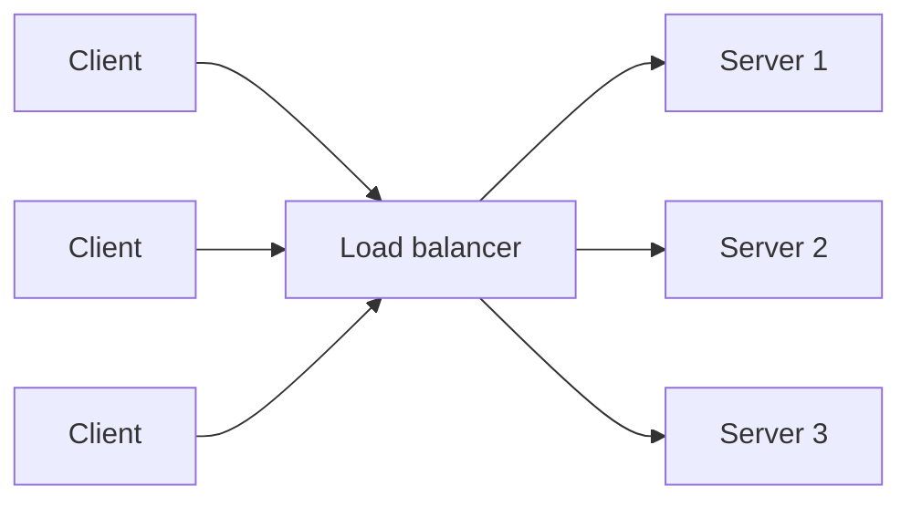
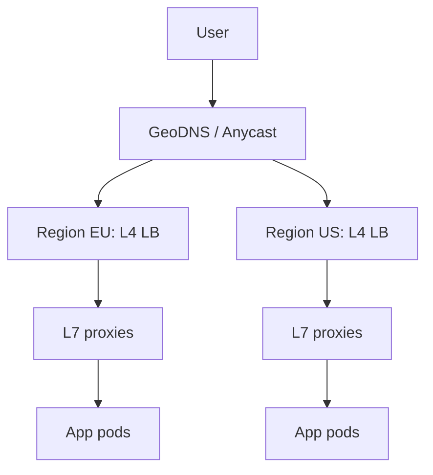

# Load balancing L4 vs L7 and algorithms

---

## 🟢 Junior Level

A **load balancer (LB)** distributes incoming requests across several servers so that no single server is overloaded, and so the service stays up when one server fails.

### Real-world analogy
A host at a busy restaurant greets guests and sends each party to a table with a free waiter, instead of letting everyone crowd one waiter. If a waiter goes home sick, the host simply stops sending guests there.



### What a load balancer does
1. **Distributes** traffic by an algorithm.
2. **Health-checks** servers and removes unhealthy ones.
3. **Hides** server topology from clients (one public address).
4. Often **terminates TLS**, compresses and caches.

### L4 vs L7

| | L4 (transport layer) | L7 (application layer) |
|---|---|---|
| Sees | IP addresses, TCP/UDP ports | HTTP method, URL, headers, cookies |
| Speed | Very fast, little CPU | Slower, parses requests |
| Routing | By IP/port only | By path, host, header, cookie |
| Extras | Pass-through TLS | TLS termination, rewrites, WAF, auth |
| Examples | AWS NLB, HAProxy (tcp mode), LVS | AWS ALB, Nginx, Envoy, HAProxy (http mode) |

### Basic algorithms
- **Round robin:** servers take turns.
- **Weighted round robin:** bigger servers get more turns.
- **Least connections:** send to the server with the fewest active connections.
- **IP hash:** the same client IP always maps to the same server.

### Minimal Java illustration

```java
import java.util.List;
import java.util.concurrent.atomic.AtomicInteger;

public class RoundRobinBalancer {

    private final List<String> servers;
    private final AtomicInteger counter = new AtomicInteger();

    public RoundRobinBalancer(List<String> servers) {
        this.servers = List.copyOf(servers);
    }

    public String next() {
        // floorMod keeps the index valid even after counter overflows to negative
        int index = Math.floorMod(counter.getAndIncrement(), servers.size());
        return servers.get(index);
    }

    public static void main(String[] args) {
        var lb = new RoundRobinBalancer(List.of("10.0.0.1", "10.0.0.2", "10.0.0.3"));
        for (int i = 0; i < 6; i++) System.out.println(lb.next());
    }
}
```

---

## 🟡 Middle Level

### Algorithms in more depth

| Algorithm | Good for | Weakness |
|---|---|---|
| Round robin | Homogeneous, short, similar requests | Ignores actual load |
| Weighted RR | Heterogeneous nodes | Static weights |
| Least connections | Long-lived or variable-cost requests | Needs connection tracking |
| Least response time | Latency-sensitive | Sensitive to measurement noise |
| IP / consistent hash | Cache affinity, sticky behavior | Skew with few clients (NAT) |
| Power of two choices | Large fleets, no global state | Slight randomness |
| Random | Simple, stateless LBs | High variance at low volume |

**Power of two choices:** pick two random servers and send to the less loaded one. It dramatically reduces max load compared with pure random, and needs no coordination. Envoy and many client-side balancers use it.

### Health checks
- **Passive:** observe failures on real traffic (outlier detection, ejection).
- **Active:** periodic probes to `/health`. Distinguish **liveness** (restart me) from **readiness** (send me traffic). In Spring Boot Actuator these are `/actuator/health/liveness` and `/actuator/health/readiness`.
- Tune intervals and thresholds: too aggressive causes flapping, too lax keeps dead nodes in rotation.

### Where load balancers sit
- **DNS-based / GSLB:** route to a region.
- **Edge / L4 LB:** spread connections across L7 proxies.
- **L7 LB / API gateway:** routing, auth, rate limits.
- **Client-side LB:** the client holds the server list (Spring Cloud LoadBalancer, gRPC), avoiding an extra hop.
- **Service mesh sidecar (Envoy):** per-call balancing between microservices.

```java
// Spring Cloud LoadBalancer: client-side balancing for service-to-service calls
@Configuration
class HttpConfig {
    @Bean
    @LoadBalanced
    RestClient.Builder loadBalancedBuilder() {
        return RestClient.builder();
    }
}

@Service
class InventoryClient {
    private final RestClient client;

    InventoryClient(@LoadBalanced RestClient.Builder builder) {
        // "inventory-service" is resolved to a list of instances and balanced per request
        this.client = builder.baseUrl("http://inventory-service").build();
    }

    Stock stock(String sku) {
        return client.get().uri("/stock/{sku}", sku).retrieve().body(Stock.class);
    }
}
```

### Nginx example

```nginx
upstream app {
    least_conn;
    server 10.0.0.1:8080 max_fails=3 fail_timeout=10s;
    server 10.0.0.2:8080 max_fails=3 fail_timeout=10s;
    server 10.0.0.3:8080 backup;
}
server {
    listen 443 ssl;
    location /api/ { proxy_pass http://app; proxy_next_upstream error timeout http_503; }
}
```

### Common mistakes
- LB itself as a single point of failure: run LBs in active-active pairs or use a managed service across zones.
- Sticky sessions hiding statefulness problems.
- Health check that only tests the process is up, not that the DB dependency works (or the opposite: deep checks that cascade failure to all nodes when a shared DB blips).
- Forgetting connection draining on deploys, which drops in-flight requests.

---

## 🔴 Senior Level

### L4 internals and scale
L4 balancers use **NAT/DSR (direct server return)** or connection proxying. In DSR the response goes directly from server to client, so the LB handles only inbound packets and scales to millions of packets per second. Techniques: ECMP routing across LB nodes, **consistent hashing (Maglev)** so that connection-to-backend mapping survives LB node changes without shared state, eBPF/XDP data planes (Katran, Cilium).

### L7 internals
L7 proxies terminate the client connection, parse HTTP/1.1, HTTP/2 or HTTP/3, and open (pooled) connections to upstreams. Key effects:
- **Connection multiplexing** reduces backend connection counts.
- **HTTP/2 gRPC** needs L7 balancing; with L4, one long-lived connection pins all calls to one backend (a classic gRPC imbalance bug).
- **Retries** at the LB must be limited to idempotent requests and capped by a **retry budget** to avoid retry storms.
- **Timeouts layered correctly**: client timeout > LB timeout > upstream timeout, else you get zombie work.

### Failure modes and edge cases
- **Thundering herd on node recovery:** a freshly started JVM is cold (JIT, caches, connection pools). Use **slow start** (ramp weight over 30-60 seconds) and readiness gates.
- **Uneven load with least connections** during deploys: new nodes with zero connections get flooded.
- **Hash skew:** a few large NAT'd clients dominate one backend; use consistent hashing with bounded loads.
- **Panic mode:** when most hosts are unhealthy, Envoy routes to all hosts rather than collapsing capacity.
- **Graceful shutdown order:** deregister from LB, wait for drain delay, then stop accepting and finish in-flight work.

```yaml
# Spring Boot graceful shutdown to pair with LB connection draining
server:
  shutdown: graceful
spring:
  lifecycle:
    timeout-per-shutdown-phase: 30s
```

### Consistent hashing with bounded loads
Plain consistent hashing (see the dedicated question) can overload one node when a hot key exists. Bounded-load variants cap each node at `(1 + ε) × average load` and spill to the next node on the ring. Used for cache-affine routing, e.g., sending the same user to the same cache-warm instance.

### Global load balancing



DNS TTLs make failover slow and uneven (resolvers ignore TTLs); Anycast with BGP converges faster, and health-aware GSLB combines both. Plan for regional failover capacity.

### Observability for load balancing
Track per-backend request rate, error rate, p99 latency, active connections, ejection counts, and LB saturation (new connections per second, conntrack table usage). Alert on imbalance: the ratio of max to mean backend load. Diagnose with a request ID propagated from the LB (`X-Request-Id`) and access logs with `upstream_response_time`.

### Algorithm selection heuristics
- Short homogeneous HTTP: round robin or P2C.
- Variable-cost (uploads, reports): least connections or least outstanding requests.
- Cache locality or per-user state: consistent hash with bounded load.
- gRPC / long connections: L7 with per-request balancing.
- Very high packet rates or non-HTTP: L4 with DSR/Maglev.

---

## 🎯 Interview Cheat Sheet

### 30-second elevator pitch
"A load balancer spreads traffic over multiple instances and removes unhealthy ones. L4 balances by IP and port and is very fast; L7 understands HTTP and can route by path or header, terminate TLS and apply policies. I choose least connections or power-of-two-choices for variable work, consistent hashing for cache affinity, and I make the LB tier itself redundant with health checks, slow start and connection draining."

### Must-know bullets
- L4 = TCP/UDP, fast, no content awareness; L7 = HTTP-aware, flexible, more CPU.
- Algorithms: round robin, weighted, least connections, IP/consistent hash, power of two choices.
- Health checks: liveness vs readiness, active vs passive.
- Avoid sticky sessions; externalize state.
- LB must not be a single point of failure.
- gRPC needs L7 (or client-side) balancing because of long-lived HTTP/2 connections.

### Common follow-up questions
- How does the LB handle a server that is slow but not dead?
- How do you do zero-downtime deployments behind an LB?
- How would you balance WebSocket connections?
- How do you load balance across regions?

### Red flags
- Saying "round robin" for everything.
- Forgetting the LB's own availability.
- Health checks that just return 200 regardless of dependencies, or that fail everything on one shared dependency.
- Unlimited retries at the LB.

### Related topics
- [Vertical vs horizontal scaling and stateless services](04.%20Vertical%20vs%20horizontal%20scaling%20and%20stateless%20services.md)
- [Consistent hashing](07.%20Consistent%20hashing.md)
- [High availability, disaster recovery and multi-region design](23.%20High%20availability%2C%20disaster%20recovery%20and%20multi-region%20design.md)
