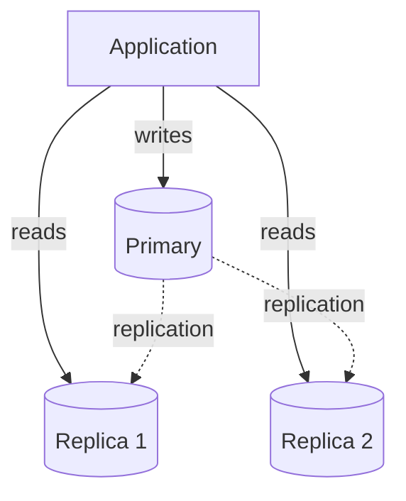
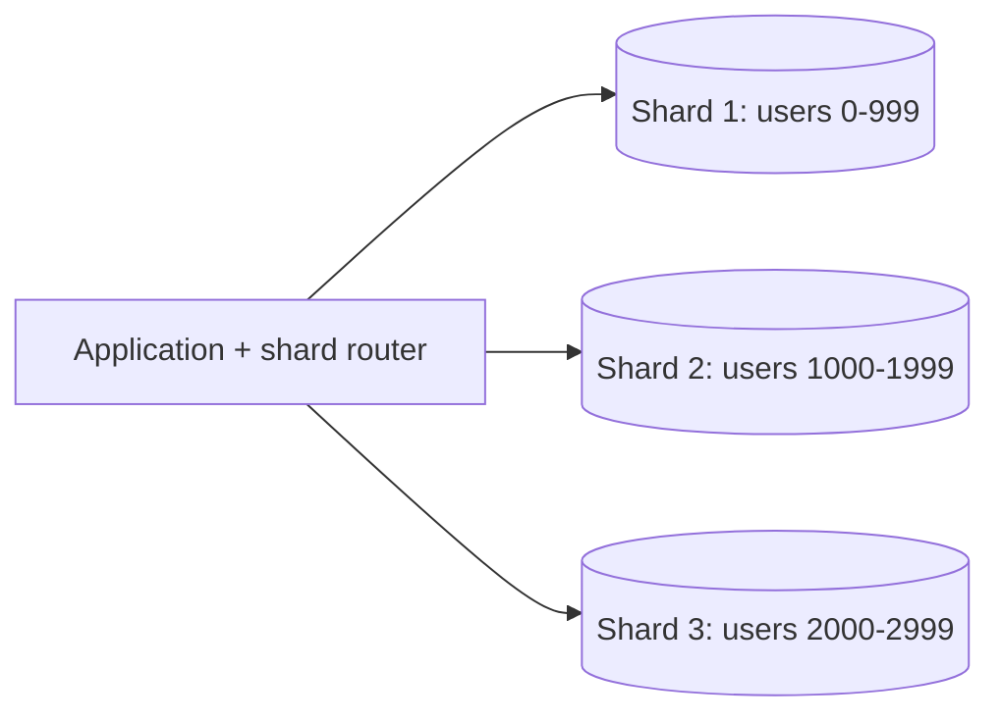
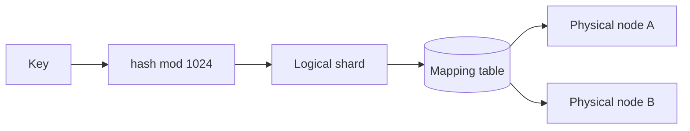

# Database scaling with replication, sharding and partitioning

---

## 🟢 Junior Level

When one database server can no longer handle the data size or traffic, we scale it. The three core techniques:

- **Replication:** keep copies of the same data on several servers. One **primary (leader)** takes writes, **replicas (followers)** copy them and serve reads.
- **Partitioning:** split a large table into smaller pieces (partitions) inside one database, e.g., by month.
- **Sharding:** split data across *multiple database servers*, each holding a subset (shard). It is partitioning across machines.

### Real-world analogy
A library is overcrowded. **Replication**: make photocopies of popular books and put them in annexes (readers go to the annex; only the main desk gets new books). **Sharding**: split the collection by author surname, A–M in building one and N–Z in building two, so each building has half the books and half the visitors.





### When to use which

| Problem | Technique |
|---|---|
| Too many reads | Read replicas, caching |
| Need failover | Replication with promotion |
| Table too large for fast maintenance | Partitioning |
| Too many writes or data > one machine | Sharding |

### Minimal Java: routing reads and writes
Spring can route to different DataSources by transaction type.

```java
public class ReadWriteRoutingDataSource extends AbstractRoutingDataSource {

    @Override
    protected Object determineCurrentLookupKey() {
        // read-only transactions go to a replica, others to the primary
        return TransactionSynchronizationManager.isCurrentTransactionReadOnly() ? "replica" : "primary";
    }
}
```

```java
@Service
class ProductService {
    @Transactional(readOnly = true)   // routed to replica
    public Product find(long id) { return repo.findById(id).orElseThrow(); }

    @Transactional                    // routed to primary
    public Product save(Product p) { return repo.save(p); }
}
```

Note: for this to work, the routing DataSource must be wrapped in a `LazyConnectionDataSourceProxy` so the connection is chosen after the transaction's read-only flag is set.

---

## 🟡 Middle Level

### Replication modes
- **Asynchronous:** the primary acknowledges the write before replicas apply it. Fast, but replicas lag and a failover may lose recent writes.
- **Synchronous:** the primary waits for at least one replica. Safer (RPO≈0), higher write latency, and availability risk if the replica is down.
- **Semi-synchronous / quorum:** wait for one or a majority of replicas (Postgres `synchronous_commit` with quorum, MySQL semi-sync).

### Replication lag and read-your-writes
A user writes a comment, refreshes, and reads from a replica that has not caught up: the comment vanishes. Remedies:
- Read from the primary for a short window after a write by that user.
- Track the replication position (LSN/GTID) in the session and read only from replicas that passed it.
- Route critical reads to the primary.

### Sharding strategies

| Strategy | How | Pros | Cons |
|---|---|---|---|
| Range | key ranges per shard | Range scans easy | Hot spots (monotonic keys) |
| Hash | `hash(key) mod N` | Even distribution | Resharding moves most data; range queries scatter |
| Consistent hash | ring (see dedicated question) | Minimal data movement | Needs virtual nodes |
| Directory/lookup | mapping table | Flexible, rebalancing | Lookup is a dependency |
| Geo | by region | Locality, compliance | Uneven load |

### Choosing a shard key
The most important sharding decision. A good key has **high cardinality**, **even distribution**, and **aligns with the main query** (so most queries hit one shard). Example: `tenant_id` or `user_id` for per-user data. A bad key: `country` (skewed), `created_at` (all writes on the latest shard).

### Costs of sharding
- **Cross-shard queries and joins** become scatter-gather or application joins.
- **Distributed transactions** need 2PC or sagas; avoid them by keeping transactions within a shard.
- **Global uniqueness** needs distributed IDs (see ID generation question).
- **Resharding** is operationally heavy.
- **Schema migrations** must run on every shard.

```java
// Application-level shard router using hash of user id
public class ShardRouter {
    private final List<DataSource> shards;

    public ShardRouter(List<DataSource> shards) { this.shards = List.copyOf(shards); }

    public DataSource forUser(long userId) {
        int idx = (int) Math.floorMod(Long.hashCode(userId) * 0x9E3779B1L, (long) shards.size());
        return shards.get(idx);
    }
}
```

### Partitioning in PostgreSQL

```sql
CREATE TABLE events (
    id bigint NOT NULL,
    created_at timestamptz NOT NULL,
    payload jsonb
) PARTITION BY RANGE (created_at);

CREATE TABLE events_2026_01 PARTITION OF events
    FOR VALUES FROM ('2026-01-01') TO ('2026-02-01');
```

Benefits: partition pruning speeds queries; dropping an old partition is instant compared to a huge `DELETE`; vacuum and index maintenance are per partition.

### Common mistakes
- Sharding too early; try indexing, caching, replicas, and vertical scaling first.
- Using `OFFSET` pagination across shards.
- Reading from replicas for flows that need fresh data.
- Choosing `hash mod N` and then needing to add shards.

---

## 🔴 Senior Level

### Failover mechanics and failure modes
Promoting a replica requires: detect failure (consensus-based, e.g., Patroni with etcd, or cloud managed failover), fence the old primary (STONITH) to prevent **split brain**, promote the most up-to-date replica, repoint clients. Danger zones:
- **Async lag loss:** acknowledged writes missing on the new primary; measure `replay_lag` and set RPO expectations.
- **Split brain:** two primaries accept writes; mitigated with fencing and quorum.
- **Failover storms:** clients reconnect simultaneously; use pool backoff and a proxy (PgBouncer, ProxySQL).

### Resharding without downtime
1. Add the new shards and set up a **mapping layer** (virtual shards: e.g., 1024 logical shards mapped to N physical servers, so rebalancing moves whole logical shards rather than rehashing keys).
2. **Dual write** or use change data capture (Debezium) to copy.
3. Verify consistency (checksums).
4. Switch reads, then writes; keep the old copy for rollback.



### Hot shards and skew
Celebrity users, large tenants and time-ordered keys cause hotspots. Techniques: dedicated shards for large tenants, key salting (`user_id#random(0..9)` with scatter-gather reads), caching hot keys, and splitting hot ranges automatically (as in Spanner, CockroachDB, TiDB, Vitess).

### Distributed SQL and middleware
Instead of hand-rolled sharding, consider Vitess (MySQL), Citus (Postgres), CockroachDB, Spanner, TiDB or DynamoDB with partition keys. These provide automatic range splitting, rebalancing and distributed transactions at the cost of latency (consensus per write, cross-region commits) and operational learning. Hand-rolled sharding is rarely justified now.

### Transactions across shards
- Avoid by design: colocate related data under the same shard key (e.g., order and order lines by `customer_id`).
- When unavoidable use **sagas** with compensations or outbox events; 2PC blocks on coordinator failure and holds locks.

### Performance and diagnostics
- Monitor replica lag, replication slot growth (WAL retention can fill disk), long-running queries on replicas that cause replication conflicts, connection counts, and per-shard QPS skew.
- Use `EXPLAIN (ANALYZE, BUFFERS)` to confirm partition pruning.
- JVM side: tune HikariCP per shard (total connections = shards × pool × app nodes) and use separate pools so one slow shard does not exhaust threads for all (bulkhead).

```java
// Bulkhead per shard: one slow shard should not consume all request threads
Bulkhead bulkhead = Bulkhead.of("shard-" + shardId,
        BulkheadConfig.custom().maxConcurrentCalls(20).maxWaitDuration(Duration.ofMillis(50)).build());

Supplier<Order> guarded = Bulkhead.decorateSupplier(bulkhead, () -> repo.find(orderId));
```

### Decision ladder
1. Optimize queries and indexes.
2. Cache and read replicas.
3. Vertical scale and partition big tables.
4. Functional split (separate databases per bounded context).
5. Sharding or distributed SQL.

---

## 🎯 Interview Cheat Sheet

### 30-second elevator pitch
"Replication copies data for read scaling and failover: one primary takes writes, replicas serve reads, with async lag trade-offs. Partitioning splits a big table within a database for maintenance and pruning. Sharding splits data across servers by a shard key to scale writes and storage, at the cost of cross-shard queries, transactions and resharding. I exhaust caching, replicas, and vertical scaling before sharding."

### Must-know bullets
- Replication scales reads and gives HA; it does not scale writes.
- Async replication = lag and possible data loss on failover; sync = latency.
- Shard key: high cardinality, even, matches the main access pattern.
- Hash mod N makes resharding painful; use virtual shards or consistent hashing.
- Avoid cross-shard transactions; use sagas.
- Read-your-writes needs special handling with replicas.

### Common follow-up questions
- How would you reshard live traffic without downtime?
- What happens to in-flight writes when the primary dies?
- How do you generate unique IDs across shards?
- How do you handle a celebrity hot key?

### Red flags
- Sharding as the first reaction to slowness.
- Choosing a monotonically increasing shard key with range sharding.
- Ignoring replica lag.
- Cross-shard joins in hot paths.

### Related topics
- [Consistent hashing](07.%20Consistent%20hashing.md)
- [CAP theorem and consistency trade-offs](08.%20CAP%20theorem%20and%20consistency%20trade-offs.md)
- [Distributed ID generation with Snowflake, UUID and ULID](18.%20Distributed%20ID%20generation%20with%20Snowflake%2C%20UUID%20and%20ULID.md)
