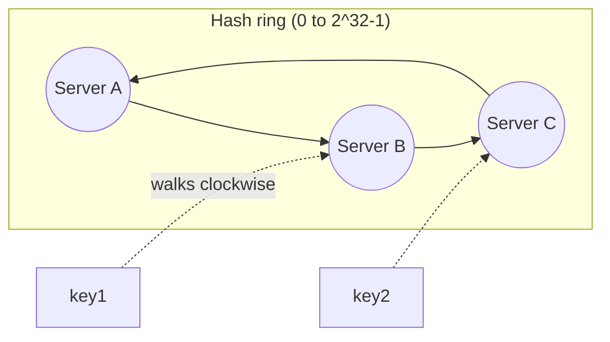
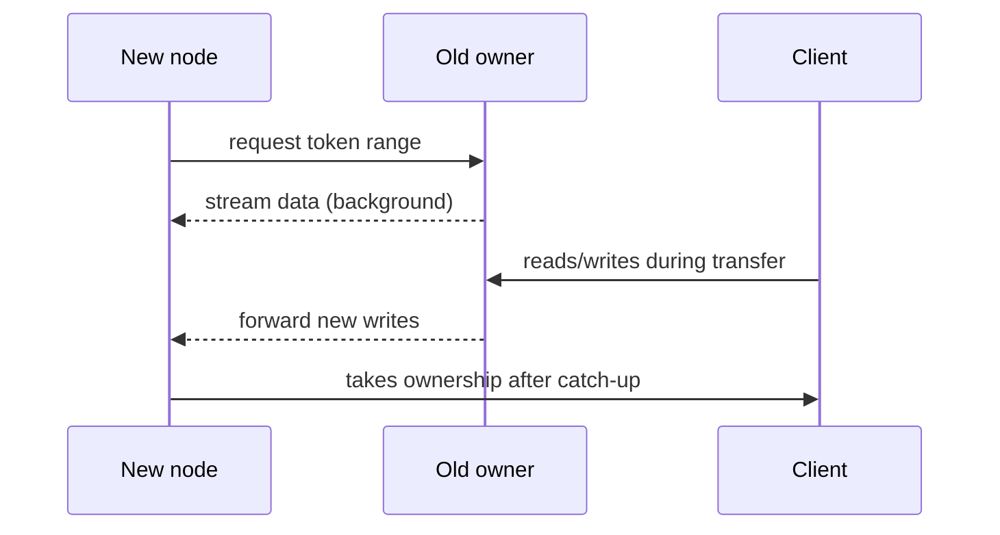

# Consistent hashing

---

## 🟢 Junior Level

**Consistent hashing** is a technique to distribute keys (users, cache entries, files) across a changing set of servers so that adding or removing a server moves only a *small fraction* of keys.

### The problem it solves
The naive approach is `server = hash(key) % N`. If N changes from 4 to 5, almost every key maps to a different server: **~80% of keys move**. For a cache, that means a sudden wave of cache misses hitting the database. For a sharded DB, it means massive data migration.

### Real-world analogy
Imagine a circular clock. Servers are placed at positions on the clock. Each key is placed on the clock too, and walks clockwise until it meets the first server; that server owns it. If a server leaves, only the keys that were walking to it now continue on to the next server. Everything else stays put.



### How it works
1. Hash each server name to a position on a ring (`0 .. 2^32-1`).
2. Hash each key to a position on the same ring.
3. The key belongs to the first server found moving clockwise.
4. Adding server X takes over only keys between its predecessor and X. Removing X hands its keys to its successor.

On average only **K/N** keys move (K keys, N servers) instead of almost all.

### Minimal Java implementation

```java
import java.nio.charset.StandardCharsets;
import java.security.MessageDigest;
import java.util.Map;
import java.util.TreeMap;

public class ConsistentHashRing {

    private final TreeMap<Long, String> ring = new TreeMap<>();

    public void addServer(String server) {
        ring.put(hash(server), server);
    }

    public void removeServer(String server) {
        ring.remove(hash(server));
    }

    public String serverFor(String key) {
        if (ring.isEmpty()) throw new IllegalStateException("no servers");
        // first server at or after the key's position, wrapping around to the start
        Map.Entry<Long, String> e = ring.ceilingEntry(hash(key));
        return (e != null ? e : ring.firstEntry()).getValue();
    }

    private static long hash(String s) {
        try {
            byte[] d = MessageDigest.getInstance("MD5").digest(s.getBytes(StandardCharsets.UTF_8));
            // use the first 4 bytes as an unsigned 32-bit value
            return ((long) (d[3] & 0xFF) << 24) | ((d[2] & 0xFF) << 16) | ((d[1] & 0xFF) << 8) | (d[0] & 0xFF);
        } catch (Exception ex) {
            throw new IllegalStateException(ex);
        }
    }
}
```

---

## 🟡 Middle Level

### The unevenness problem and virtual nodes
With only a few servers on the ring, positions are random and segments are uneven: one server may own 50% of the ring. **Virtual nodes (vnodes)** fix this: each physical server is placed at many points (e.g., 100–256) on the ring using names like `serverA#0 ... serverA#199`. Load becomes statistically even (standard deviation falls roughly with `1/sqrt(vnodes)`), and when a server leaves its load spreads across *many* other servers rather than only one successor. Vnodes also allow **weighting**: powerful servers get more vnodes.

```java
public class VirtualNodeRing {
    private final TreeMap<Long, String> ring = new TreeMap<>();
    private final int vnodes;

    public VirtualNodeRing(int vnodes) { this.vnodes = vnodes; }

    public void add(String server) {
        for (int i = 0; i < vnodes; i++) {
            ring.put(hash(server + "#" + i), server);
        }
    }

    public void remove(String server) {
        for (int i = 0; i < vnodes; i++) {
            ring.remove(hash(server + "#" + i));
        }
    }

    public String lookup(String key) {
        var e = ring.ceilingEntry(hash(key));
        return (e != null ? e : ring.firstEntry()).getValue();
    }

    private long hash(String s) {
        // Guava's murmur3 gives good distribution and speed
        return com.google.common.hash.Hashing.murmur3_128().hashString(s, java.nio.charset.StandardCharsets.UTF_8).asLong();
    }
}
```

Note that with a signed `long` hash, `TreeMap` ordering still works consistently; it simply defines the ring over the signed range.

### Replication on the ring
To tolerate failures, store each key on the next **R distinct physical servers** clockwise (a preference list), skipping vnodes belonging to a server already chosen. Dynamo, Cassandra and Riak do this. Combined with quorum reads/writes (`R + W > N`) it gives tunable consistency.

### Where it is used
- **Distributed caches** (memcached clients such as ketama, Redis client-side sharding).
- **Databases:** Cassandra, DynamoDB, Riak, Couchbase (vBuckets variant).
- **Load balancing with affinity:** route the same user or object to the same node.
- **CDNs and object stores:** locate content on edge nodes or storage nodes.

### Alternatives

| Technique | Notes |
|---|---|
| `hash mod N` | Simple; massive remapping when N changes |
| Consistent hashing with vnodes | Minimal movement; lookup O(log V) via sorted map |
| Rendezvous (HRW) hashing | For each key pick the server with highest `hash(key, server)`; no ring, even, O(N) per lookup |
| Jump consistent hash | Tiny, no memory, perfectly even, but only supports adding/removing at the end (numbered buckets) |
| Redis Cluster hash slots | Fixed 16,384 slots mapped to nodes; move slots, not keys individually |

### Common mistakes
- Using a weak or poorly distributed hash (e.g., `String.hashCode()` of similar names clusters points).
- Too few vnodes, producing hotspots.
- Not handling **replication of the removed node's data**; the cache warms slowly.
- Treating the ring as authoritative on every client without a consistent membership view: clients with different server lists route the same key differently.

---

## 🔴 Senior Level

### Quantifying behavior
- With N servers and K keys, adding one server relocates ≈ K/(N+1) keys (the theoretical minimum).
- Load imbalance for a ring without vnodes: max load can be `O(log N)` times the average. With `V = O(log N)` vnodes per server the max is `1 + ε` of average with high probability; practical systems use 100–1000.
- Memory: N × V entries; 1,000 servers × 200 vnodes = 200k entries, trivial. Lookup is O(log(NV)) via binary search; production code uses a sorted `long[]` with `Arrays.binarySearch` for cache friendliness instead of `TreeMap`.

```java
// Immutable, lock-free snapshot ring: readers use a volatile reference, updates build a new ring
public final class RingSnapshot {
    private final long[] points;
    private final String[] owners;

    RingSnapshot(long[] points, String[] owners) { this.points = points; this.owners = owners; }

    String owner(long keyHash) {
        int i = java.util.Arrays.binarySearch(points, keyHash);
        if (i < 0) i = -i - 1;           // insertion point = first point greater than key
        return owners[i == points.length ? 0 : i];
    }
}

class RingHolder {
    private volatile RingSnapshot current;
    String route(long keyHash) { return current.owner(keyHash); }
    void swap(RingSnapshot next) { this.current = next; } // atomic publication on membership change
}
```

### Hot keys and bounded loads
Consistent hashing balances *keys*, not *traffic*. One viral key still overloads its owner. Mitigations:
- **Bounded-load consistent hashing** (Google): cap each node at `ceil((1+ε)·avg)`; overflow goes to the next node.
- **Hot-key replication:** detect hot keys (count-min sketch / top-k) and replicate to several nodes or an L1 near-cache; route reads randomly among replicas.
- **Request coalescing** (single-flight) to collapse concurrent misses.

### Membership and consistency of the view
Different clients seeing different memberships will disagree on ownership. Approaches: central config (ZooKeeper/etcd) with versioned ring epochs; gossip protocols (Cassandra) with eventual convergence; and **server-side routing** (client talks to any node, which forwards) to avoid client-view issues. In caches, brief disagreement just causes extra misses; in databases it needs **epoch/fencing tokens** and handoff protocols (hinted handoff, streaming).

### Failure modes
- **Cascading failure:** when node A fails its keys shift to B, doubling B's load, potentially killing B, then C... Vnodes spread A's load across many nodes, and headroom (≥ 1/(N-1)) must exist.
- **Flapping membership:** nodes joining and leaving repeatedly cause key churn; apply failure-detector hysteresis (phi-accrual) and delay ring changes for transient failures (keep the node in the ring but mark it down; use the next replica meanwhile).
- **Cold cache on addition:** a new cache node starts empty; pre-warm or ramp traffic gradually.

### Data movement in stateful systems
Adding a node means streaming the relevant token ranges from existing nodes (Cassandra bootstrap) while still serving reads/writes: new node accepts writes for its range during streaming, reads go to old owners until complete. Anti-entropy (Merkle trees) repairs divergence.



### Choosing in practice
- Redis/memcached cluster: use built-in hash slots or ketama via a mature client.
- Stateless LB with cache affinity: Maglev or bounded-load consistent hashing in Envoy (`ring_hash`, `maglev`).
- Custom partitioning: rendezvous hashing is the simplest correct implementation for small N.

---

## 🎯 Interview Cheat Sheet

### 30-second elevator pitch
"Consistent hashing maps both servers and keys onto a ring and assigns each key to the next server clockwise, so adding or removing a node only moves about K/N keys instead of nearly all keys as with hash mod N. Virtual nodes even out load and enable weighting, and replicating to the next R distinct nodes gives fault tolerance. It is used in caches, Cassandra, and DynamoDB-style stores."

### Must-know bullets
- `hash % N` remaps ~everything when N changes; consistent hashing remaps ~1/N.
- Virtual nodes: even load, weights, spread failure load.
- Lookup via sorted structure: O(log n).
- Replicas = next R distinct physical nodes on the ring.
- Doesn't solve hot keys; use caching, replication, bounded loads.
- Alternatives: rendezvous, jump hash, Redis hash slots.

### Common follow-up questions
- Implement a consistent hash ring.
- How many virtual nodes would you use and why?
- What happens when a node fails temporarily?
- How do clients agree on the ring state?

### Red flags
- Describing the ring without virtual nodes and ignoring skew.
- Using `hashCode()` directly with poor distribution.
- Claiming it provides load balancing for hot keys.
- Forgetting data migration in stateful systems.

### Related topics
- [Database scaling with replication, sharding and partitioning](06.%20Database%20scaling%20with%20replication%2C%20sharding%20and%20partitioning.md)
- [Caching layers and CDN](09.%20Caching%20layers%20and%20CDN.md)
- [Load balancing L4 vs L7 and algorithms](05.%20Load%20balancing%20L4%20vs%20L7%20and%20algorithms.md)
