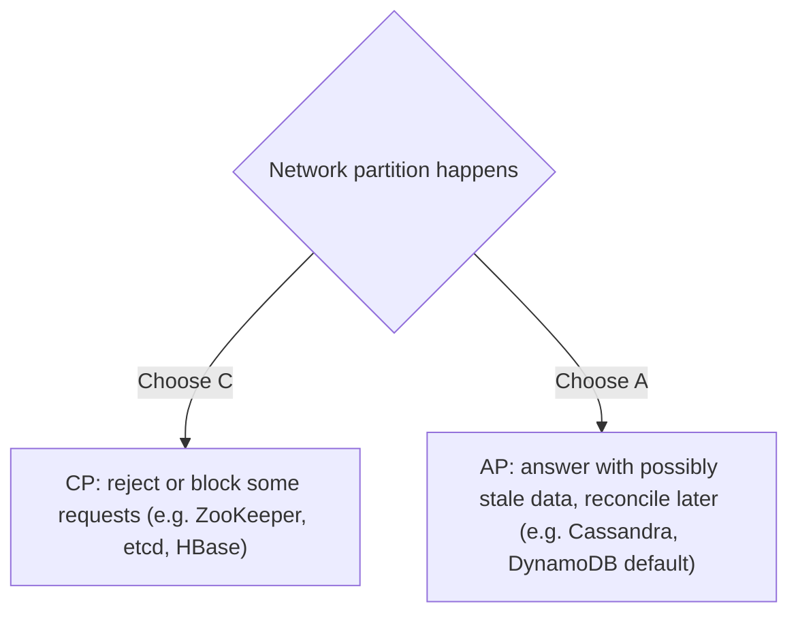
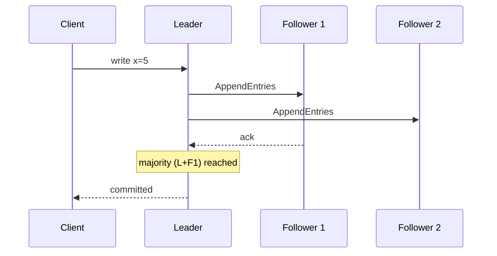

# CAP theorem and consistency trade-offs

---

## 🟢 Junior Level

The **CAP theorem** (Brewer, proven by Gilbert and Lynch) says that a distributed data store cannot simultaneously guarantee all three of:

- **C – Consistency (linearizability):** every read sees the most recent write, as if there were one copy of the data.
- **A – Availability:** every request to a non-failing node gets a (non-error) response.
- **P – Partition tolerance:** the system keeps working even when the network drops messages between nodes.

Network partitions *will* happen in any distributed system, so in practice the real choice is: **during a partition, do you choose Consistency (refuse some requests) or Availability (answer, possibly with stale data)?**

### Real-world analogy
Two bank branches share one ledger but the phone line between them goes down. A customer asks branch B for their balance. Branch B can (CP) say "sorry, I can't confirm right now" or (AP) give the last known balance, possibly out of date. It cannot do both perfectly.



### Examples

| System type | Typical choice | Why |
|---|---|---|
| Bank transfer, inventory count | CP | Wrong data is worse than a refused request |
| Social media likes, feed | AP | Stale counts are harmless |
| Shopping cart | AP (Dynamo paper) | Never refuse "add to cart" |
| Leader election, config store | CP | Must agree on one truth |

### Minimal Java illustration
The same read can behave differently depending on the consistency level requested (Cassandra driver example):

```java
// Strong-ish: need a majority of replicas to agree (CP-leaning, fails if quorum unreachable)
SimpleStatement strong = SimpleStatement.builder("SELECT * FROM accounts WHERE id = ?")
        .addPositionalValue(42)
        .setConsistencyLevel(DefaultConsistencyLevel.QUORUM)
        .build();

// Available: any single replica answers (AP-leaning, may be stale)
SimpleStatement fast = SimpleStatement.builder("SELECT * FROM accounts WHERE id = ?")
        .addPositionalValue(42)
        .setConsistencyLevel(DefaultConsistencyLevel.ONE)
        .build();
```

---

## 🟡 Middle Level

### Precise definitions matter
- CAP's "C" means **linearizability**, not the "C" of ACID (which means constraint validity).
- CAP's "A" means every non-failed node responds; not "99.99% uptime".
- A system with a single node is trivially CA but not distributed.
- CAP only applies **during** a partition. Most of the time you have all three, and the tradeoff becomes latency vs consistency.

### PACELC
Daniel Abadi's extension: **if Partition, choose Availability or Consistency; Else, choose Latency or Consistency.** It captures the everyday trade-off: synchronous replication costs latency.

| System | During partition | Else |
|---|---|---|
| DynamoDB / Cassandra (default) | PA | EL |
| MongoDB (majority concern) | PC | EC |
| Spanner, CockroachDB | PC | EC (pays latency, uses TrueTime or HLC) |
| PNUTS | PC | EL |

### Consistency spectrum

| Model | Guarantee |
|---|---|
| Linearizable | Real-time ordering, single-copy illusion |
| Sequential | All see operations in same order, not necessarily real time |
| Causal | Cause precedes effect everywhere |
| Read-your-writes | You always see your own writes |
| Monotonic reads | You never see time go backward |
| Eventual | Replicas converge if writes stop |

### Quorums
With N replicas, write quorum W, and read quorum R: if **R + W > N**, reads overlap with the latest write (strong-ish consistency, ignoring sloppy quorums and clock issues). N=3, W=2, R=2 tolerates one failure. W=1, R=1 is fast and weak. W=N gives durability but sacrifices write availability.

### Eventual consistency in practice with Spring
You rarely choose CAP at the app layer; you choose patterns that tolerate staleness:

```java
// Read-your-writes with replicas: pin the user to the primary shortly after they write
@Service
class ProfileService {
    private final Cache<Long, Instant> lastWrite = Caffeine.newBuilder()
            .expireAfterWrite(Duration.ofSeconds(5)).build();

    @Transactional
    public void update(long userId, ProfileUpdate u) {
        repository.update(userId, u);
        lastWrite.put(userId, Instant.now());
    }

    public Profile read(long userId) {
        // within 5 seconds of a write, read from the primary; otherwise a replica is fine
        return lastWrite.getIfPresent(userId) != null
                ? primaryReader.find(userId)
                : replicaReader.find(userId);
    }
}
```

### Conflict resolution for AP systems
- **Last write wins (LWW):** simple but loses updates, dependent on clocks.
- **Vector clocks / version vectors:** detect concurrent writes; the application merges.
- **CRDTs:** data types designed to merge automatically (counters, sets, registers).
- **Application-level merge:** shopping cart union.

### Common mistakes
- Saying "we pick CA" for a distributed system.
- Labeling a whole database "AP" or "CP" without noting configuration (consistency levels differ per operation).
- Ignoring the latency cost of strong consistency.
- Assuming eventual consistency means "soon"; define the bounded staleness you need.

---

## 🔴 Senior Level

### Linearizability vs serializability
**Serializability** is about transactions (isolation); **linearizability** is about single-object recency. **Strict serializability** is both, which Spanner provides using TrueTime (GPS and atomic clocks, commit wait of ~7 ms). Many "consistent" databases offer weaker guarantees (snapshot isolation, read committed); write skew can still occur under snapshot isolation, so know your DB's actual isolation level.

### How consensus provides CP
Raft/Paxos replicate a log via a leader and a majority quorum. During a partition the minority side cannot elect a leader or commit, so it becomes unavailable for writes (CP). Majority side continues. Leader leases and fencing tokens prevent stale leaders from acting.



### Design for partial failure rather than label the system
Practical designs mix models per feature:
- Payments ledger: CP with serializable transactions in one region.
- Product catalog reads: AP with cache and replicas, TTL bounded staleness.
- Counters (likes): AP with CRDT or async aggregation.
- Inventory reservation: strongly consistent decrement, or reserve-then-confirm with expiration.

### Failure modes
- **Split brain** with async-replicated primaries: both sides accept writes, then conflicts or lost writes on reconciliation. Prevent with quorum-based failover and fencing.
- **Stale reads after failover** if a replica was behind (async lag); acknowledged writes lost.
- **Clock skew** breaks LWW: a node with a fast clock silently wins every conflict. Use hybrid logical clocks, or avoid LWW for important data.
- **Read repair/hinted handoff delays** in Dynamo-style stores extend the inconsistency window.
- **Sloppy quorums** keep writes available but break the R+W>N guarantee until hinted handoff completes.

### Measuring consistency
Use Jepsen-style testing for databases, and for your own systems monitor **replication lag**, "stale read" ratio via canary writes and reads, and convergence time. Define SLOs for staleness ("99% of reads reflect writes within 1 s").

### Business-driven decisions
Ask: what is the cost of a stale read vs the cost of an unavailable request? Airlines overbook (accept inconsistency and compensate). E-commerce allows temporary oversell with apologies. Compensating actions (sagas) convert strict consistency into business-level eventual consistency.

```java
// Saga-style compensation: accept availability now, fix inconsistency later
@Transactional
public void placeOrder(Order o) {
    orders.save(o.pending());
    outbox.publish(new OrderPlaced(o.id()));      // payment and inventory react asynchronously
}

@KafkaListener(topics = "payment-failed")
void onPaymentFailed(PaymentFailed e) {
    orders.cancel(e.orderId());                     // compensate
    inventory.release(e.orderId());
}
```

### Interview insights
Good answers reject binary thinking: "CAP is only relevant during partitions; in normal operation it's latency vs consistency (PACELC); consistency is chosen per operation; and the business tolerance for staleness decides."

---

## 🎯 Interview Cheat Sheet

### 30-second elevator pitch
"CAP says that during a network partition a distributed store must choose between consistency (linearizable reads, rejecting requests on the minority side) and availability (always answering, maybe stale). Partitions are unavoidable, so the choice is CP vs AP. Outside partitions, PACELC says you trade latency for consistency. I pick per feature: strong consistency for money and inventory, eventual for feeds and counters, with quorums, idempotency and compensation to manage anomalies."

### Must-know bullets
- P is not optional; choose C or A during partitions.
- CAP's C = linearizability, not ACID consistency.
- PACELC adds the latency vs consistency trade-off in normal operation.
- Quorum rule: R + W > N.
- Eventual consistency needs conflict resolution: LWW, vector clocks, CRDTs.
- Consistency is tunable per operation, not only per database.

### Common follow-up questions
- Is MongoDB CP or AP?
- How does Raft behave during a partition?
- What is read-your-writes and how do you implement it with replicas?
- How would you design a shopping cart vs a bank ledger?

### Red flags
- "Pick any two of three" without mentioning partitions.
- Calling a single-node or master-slave RDBMS "CA".
- Ignoring clock issues with LWW.
- Not tying the choice to business impact.

### Related topics
- [Database scaling with replication, sharding and partitioning](06.%20Database%20scaling%20with%20replication%2C%20sharding%20and%20partitioning.md)
- [Distributed locks and leader election](19.%20Distributed%20locks%20and%20leader%20election.md)
- [Event sourcing](12.%20Event%20sourcing.md)
