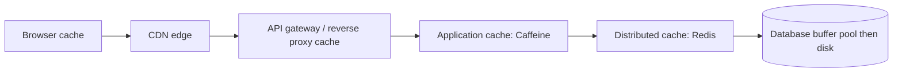
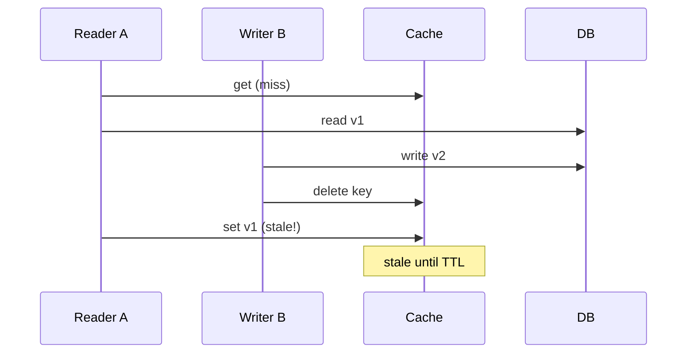

# Caching layers and CDN

---

## 🟢 Junior Level

A **cache** stores copies of frequently used data in a faster location so future requests are served quickly without redoing expensive work (database query, computation, remote call). A **CDN (Content Delivery Network)** is a geographically distributed cache of static (and sometimes dynamic) content placed close to users.

### Real-world analogy
You keep your most-used spices on the kitchen counter (cache) rather than walking to the warehouse (database) every time you cook. A CDN is a chain of local corner shops stocking popular items so you don't need to order from the central factory overseas.

### Cache layers on the request path



| Layer | Typical content | Latency |
|---|---|---|
| Browser | Static assets, API responses with `Cache-Control` | 0 ms |
| CDN | Images, JS/CSS, video, cacheable API responses | 10–50 ms |
| In-process (Caffeine) | Hot config, reference data | ~100 ns |
| Distributed (Redis, Memcached) | Sessions, query results, computed objects | ~0.5–2 ms |
| Database buffer pool | Hot pages | ~µs |

### Basic caching with Spring

```java
@Service
public class ProductService {

    private final ProductRepository repository;

    public ProductService(ProductRepository repository) {
        this.repository = repository;
    }

    @Cacheable(cacheNames = "products", key = "#id")
    public Product getProduct(long id) {
        return repository.findById(id).orElseThrow();   // runs only on cache miss
    }

    @CacheEvict(cacheNames = "products", key = "#product.id")
    public Product update(Product product) {
        return repository.save(product);
    }
}
```

```java
@Configuration
@EnableCaching
class CacheConfig { }
```

### Key terms
- **Hit / miss:** found or not found in cache. **Hit ratio** = hits / (hits + misses).
- **TTL:** time to live before an entry expires.
- **Eviction:** removing entries when full (LRU, LFU).
- **Invalidation:** removing/updating entries when the source changes; famously one of the hardest problems.

---

## 🟡 Middle Level

### Caching strategies

| Strategy | Flow | Pros | Cons |
|---|---|---|---|
| **Cache-aside (lazy)** | App checks cache; on miss loads from DB and populates | Simple; only hot data cached; resilient to cache failure | First request slow; stale data possible |
| **Read-through** | Cache itself loads from DB | Cleaner app code | Needs cache provider support |
| **Write-through** | Write to cache and DB synchronously | Cache always fresh | Write latency; caches unread data |
| **Write-behind** | Write to cache, flush to DB asynchronously | Fast writes, batching | Data loss risk, complexity |
| **Refresh-ahead** | Proactively refresh before expiry | Avoids latency spikes | Wasted refreshes |

### Cache-aside in explicit form

```java
public Product find(long id) {
    String key = "product:" + id;
    String cached = redis.opsForValue().get(key);
    if (cached != null) {
        return json.read(cached, Product.class);
    }
    Product p = repository.findById(id).orElseThrow();
    // jitter on TTL prevents many keys from expiring at the same instant
    long ttl = 300 + ThreadLocalRandom.current().nextLong(60);
    redis.opsForValue().set(key, json.write(p), Duration.ofSeconds(ttl));
    return p;
}
```

### Eviction policies
- **LRU:** evicts least recently used; good general default.
- **LFU:** evicts least frequently used; better for stable popularity (Caffeine's TinyLFU admission policy gives near-optimal hit ratio).
- **FIFO / random / TTL-based:** niche cases.
Redis: `maxmemory-policy allkeys-lru` or `allkeys-lfu` for pure caches; `volatile-*` policies only evict keys with TTL.

### The classic problems

| Problem | Description | Mitigation |
|---|---|---|
| **Cache stampede (thundering herd)** | Hot key expires, thousands of requests hit DB simultaneously | Single-flight/lock per key, jittered TTL, refresh-ahead, stale-while-revalidate |
| **Cache penetration** | Requests for non-existent keys always miss | Cache negative results with short TTL, Bloom filter |
| **Cache avalanche** | Many keys expire together or cache goes down | TTL jitter, replicas, circuit breaker, warm-up |
| **Hot key** | One key overloads a cache shard | Local L1 cache, key replication |
| **Stale data** | Source changed, cache didn't | TTL, event-based invalidation, versioned keys |

### CDN fundamentals
- **Pull CDN:** edge fetches from origin on first miss and caches (CloudFront, Cloudflare, Akamai). **Push CDN:** you upload content to the CDN in advance.
- Control caching with HTTP headers: `Cache-Control: public, max-age=31536000, immutable` for fingerprinted assets (`app.3f9a1c.js`), `ETag`/`Last-Modified` for revalidation, `Vary` for content negotiation.
- **Purge/invalidation** is slow and costly; prefer **versioned URLs**.
- CDNs also provide TLS termination, DDoS protection, compression, image resizing, and edge compute.

```java
// Cache-Control headers from a Spring controller
@GetMapping("/api/catalog/{id}")
public ResponseEntity<Product> product(@PathVariable long id) {
    Product p = service.getProduct(id);
    return ResponseEntity.ok()
            .cacheControl(CacheControl.maxAge(Duration.ofMinutes(5)).cachePublic())
            .eTag(String.valueOf(p.getVersion()))
            .body(p);
}
```

### Common mistakes
- Caching without a clear invalidation plan.
- Caching personalized responses at a shared CDN (missing `Vary` or `private`), leaking user data.
- Unbounded in-process caches causing OOM.
- Treating cache as a source of truth.
- Ignoring serialization costs and large values (Redis is single-threaded per shard for commands; 1 MB values block).

---

## 🔴 Senior Level

### Consistency between cache and database
Cache-aside has a classic race: Thread A reads DB (old value), Thread B updates DB and deletes cache, Thread A then writes the *old* value into cache: stale until TTL. Mitigations: short TTLs as a backstop, **delete after write** (not update), delayed double-delete, versioned values with compare-and-set, or CDC-driven invalidation (Debezium to a stream that evicts keys), which removes dual-write hazards.



### Stampede control with single-flight
Caffeine's `LoadingCache`/`AsyncLoadingCache` already coalesces concurrent loads for the same key within one JVM. Across nodes, use a short Redis lock or probabilistic early expiration (XFetch).

```java
LoadingCache<Long, Product> cache = Caffeine.newBuilder()
        .maximumSize(50_000)
        .expireAfterWrite(Duration.ofMinutes(5))
        .refreshAfterWrite(Duration.ofMinutes(1))   // async refresh, serves old value meanwhile
        .recordStats()
        .build(id -> repository.findById(id).orElseThrow());

// Diagnostics: hit rate and eviction count feed dashboards
CacheStats stats = cache.stats();
double hitRate = stats.hitRate();
```

### Redis internals relevant to design
- Single-threaded command execution (I/O threads in 6+): avoid O(N) commands (`KEYS`, big `SMEMBERS`, large `LRANGE`) in production, use `SCAN`.
- Persistence (RDB/AOF) is irrelevant for pure caches and costs latency; replicas and clusters give availability. Redis Cluster uses 16,384 hash slots; multi-key operations require hash tags `{user:42}`.
- Memory fragmentation and eviction under pressure; monitor `evicted_keys`, `used_memory`, `keyspace_hits/misses`, and p99 latency.
- Big keys and hot keys: detect with `--bigkeys`, `--hotkeys` (LFU policy), or client-side metrics.

### Capacity and hit-ratio economics
Latency = hit × t_cache + (1 − hit) × t_db. With cache at 1 ms, DB at 20 ms, a 95% hit rate gives 1.95 ms; at 80% it's 4.8 ms. Database load drops by `1 − hit`: going from 90% to 99% hit cuts DB traffic 10x. Size caches via working-set analysis, not total data size; use Zipf-like distribution assumptions and measure real hit curves.

### Multi-level caching and invalidation
L1 (Caffeine) + L2 (Redis) cut Redis traffic but add inconsistency windows between nodes. Broadcast invalidations through Redis pub/sub or Kafka; accept a bounded-stale L1 with short TTLs (5–30 s) for non-critical data.

### CDN at scale
- **Origin shield / tiered caching** reduces origin load by funneling edge misses through a regional cache.
- **Cache key design:** normalize query strings, ignore tracking parameters, vary only on needed headers (otherwise hit rate collapses).
- **stale-while-revalidate / stale-if-error** keeps serving during origin trouble, a big resilience win.
- **Dynamic acceleration and edge compute** (Workers, Lambda@Edge) for personalization at the edge.
- **Security:** signed URLs/cookies for private content, WAF, never cache `Set-Cookie` responses accidentally.
- Video: segmenting (HLS/DASH) so each chunk is cacheable; consider cost per GB egress and multi-CDN failover.

### Failure modes
- **Cache outage = DB outage:** if the DB cannot handle 100% of traffic, the cache is a hard dependency. Protect with rate limits, load shedding, circuit breakers, request coalescing, and a stale fallback.
- **Cold start / deploy:** warm caches before shifting traffic.
- **Poisoned cache:** a bad value cached for hours; keep purge tooling and versioned keys.
- **Clock/TTL drift** and serialization version mismatch during rolling deploys: include a schema version in the key.

---

## 🎯 Interview Cheat Sheet

### 30-second elevator pitch
"I cache at several layers: browser, CDN for static and cacheable content, in-process Caffeine for hot small data, and Redis for shared data, usually with cache-aside and TTLs plus explicit eviction on writes. I protect against stampedes with single-flight and TTL jitter, against penetration with negative caching or Bloom filters, and I design so the database survives a cold cache. CDNs use versioned URLs and Cache-Control headers."

### Must-know bullets
- Strategies: cache-aside, read-through, write-through, write-behind.
- Problems: stampede, penetration, avalanche, hot key, staleness.
- Evict by LRU/LFU (TinyLFU); always set TTLs.
- Invalidate by deleting after write; CDC for robust invalidation.
- CDN: pull vs push, Cache-Control, versioned filenames, origin shield.
- Hit ratio drives latency and DB load; monitor it.

### Common follow-up questions
- How do you keep cache and DB consistent?
- What happens if Redis goes down?
- How would you cache personalized data?
- How do you invalidate a CDN quickly?

### Red flags
- "Just add Redis" with no invalidation story.
- No TTL, no eviction, unbounded memory.
- Caching user-specific data on a public CDN.
- Treating cache as durable storage.

### Related topics
- [Consistent hashing](07.%20Consistent%20hashing.md)
- [Designing a rate limiter](13.%20Designing%20a%20rate%20limiter.md)
- [Designing a URL shortener](14.%20Designing%20a%20URL%20shortener.md)
