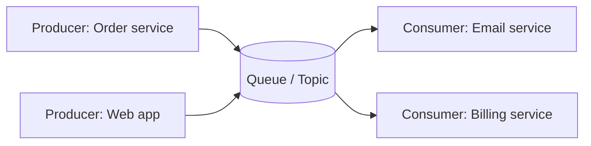
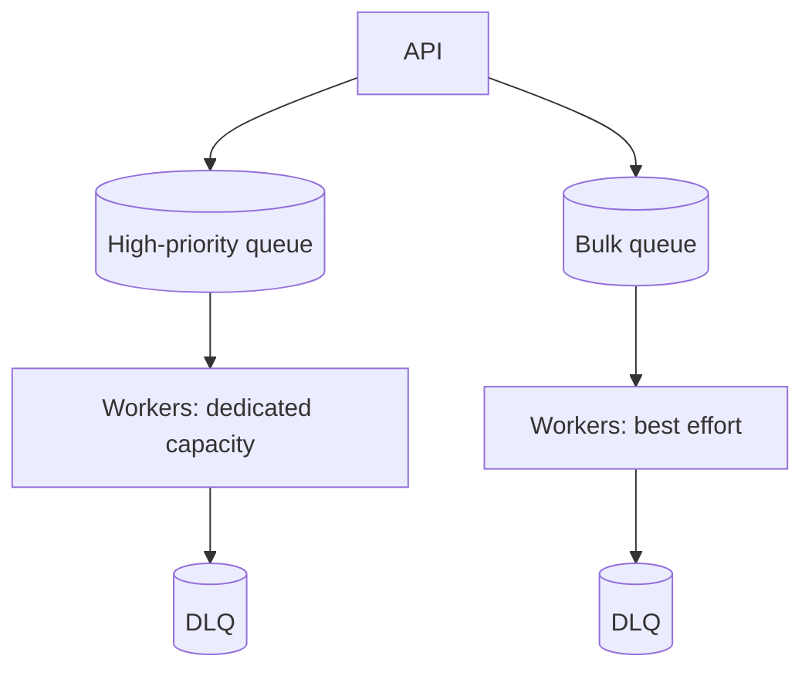

# Message queues for decoupling

---

## 🟢 Junior Level

A **message queue** (or broker) lets one component (the **producer**) send a message that another component (the **consumer**) processes later. The two never talk directly; the broker stores the message in between.

### Real-world analogy
A restaurant kitchen uses an order rail. Waiters (producers) clip order tickets onto the rail and move on; cooks (consumers) take tickets when they are free. The waiter does not wait for the dish, and if the kitchen is slow, tickets pile up on the rail instead of waiters being blocked.



### Why use a queue
1. **Decoupling:** services do not need to know each other or be up at the same time.
2. **Asynchronous processing:** respond to the user quickly, do heavy work later (send email, resize image).
3. **Load leveling:** absorb traffic bursts; consumers process at their own pace.
4. **Reliability:** messages persist and are retried on failure.
5. **Scalability:** add more consumers to process faster.

### Queue vs topic (pub/sub)
- **Queue (point-to-point):** each message is processed by *one* consumer among a group (work distribution).
- **Topic (publish/subscribe):** each message is delivered to *every* subscriber group (event broadcasting).

### Minimal Java example with Spring and RabbitMQ

```java
@Service
class OrderService {
    private final RabbitTemplate rabbit;

    OrderService(RabbitTemplate rabbit) { this.rabbit = rabbit; }

    public void placeOrder(Order order) {
        orderRepository.save(order);
        // returns immediately; email is sent asynchronously
        rabbit.convertAndSend("orders", "order.placed", new OrderPlaced(order.getId()));
    }
}

@Component
class EmailListener {
    @RabbitListener(queues = "email-queue")
    void onOrderPlaced(OrderPlaced event) {
        emailSender.sendConfirmation(event.orderId());
    }
}
```

### Popular technologies
RabbitMQ (smart broker, routing), Apache Kafka (distributed log, high throughput), AWS SQS/SNS, Google Pub/Sub, ActiveMQ Artemis, Redis Streams, Apache Pulsar.

---

## 🟡 Middle Level

### Delivery semantics
- **At-most-once:** may lose messages, never duplicates (acknowledge before processing).
- **At-least-once:** never loses, may duplicate (acknowledge after processing). The practical default; **consumers must be idempotent**.
- **Exactly-once:** achievable only in a limited sense, such as Kafka transactions within Kafka, or idempotent consumers plus deduplication (see the idempotency question).

### Queue vs log: RabbitMQ vs Kafka

| Aspect | RabbitMQ / SQS (queue) | Kafka (log) |
|---|---|---|
| Model | Broker pushes; message deleted after ack | Append-only log; consumers track offsets |
| Replay | Not by default | Yes, by resetting offsets, retention-based |
| Ordering | Per queue (with caveats under concurrency) | Per partition |
| Throughput | 10k–100k msg/s | 100k–millions msg/s |
| Routing | Rich (exchanges, bindings) | Topic and partition key |
| Best for | Task queues, RPC, complex routing | Event streaming, replay, analytics, event sourcing |

### Kafka essentials
A topic is split into **partitions**; messages with the same key go to the same partition (ordering per key). A **consumer group** assigns partitions to consumers; max parallelism = number of partitions. Producers choose `acks` (`all` plus `min.insync.replicas=2` for durability) and `enable.idempotence=true`.

```java
@Bean
ProducerFactory<String, OrderPlaced> producerFactory() {
    Map<String, Object> cfg = new HashMap<>();
    cfg.put(ProducerConfig.BOOTSTRAP_SERVERS_CONFIG, "kafka:9092");
    cfg.put(ProducerConfig.ACKS_CONFIG, "all");
    cfg.put(ProducerConfig.ENABLE_IDEMPOTENCE_CONFIG, true);
    cfg.put(ProducerConfig.KEY_SERIALIZER_CLASS_CONFIG, StringSerializer.class);
    cfg.put(ProducerConfig.VALUE_SERIALIZER_CLASS_CONFIG, JsonSerializer.class);
    return new DefaultKafkaProducerFactory<>(cfg);
}

@KafkaListener(topics = "orders", groupId = "billing")
void handle(OrderPlaced e, Acknowledgment ack) {
    billing.charge(e);   // must be idempotent
    ack.acknowledge();   // manual ack after success
}
```

### Error handling
- **Retries with backoff** for transient failures.
- **Dead letter queue (DLQ)** for poison messages that fail repeatedly; alert and provide replay tooling.
- **Retry topics** with increasing delay (Spring Kafka `@RetryableTopic`).

```java
@RetryableTopic(attempts = "4", backoff = @Backoff(delay = 1000, multiplier = 2.0),
                dltTopicSuffix = "-dlt")
@KafkaListener(topics = "payments")
void pay(PaymentRequested e) { paymentService.process(e); }
```

### The dual-write problem and the Outbox pattern
Saving to the DB and publishing to a broker are two systems; a crash between them loses or duplicates the event. **Transactional outbox:** write the event into an `outbox` table in the same DB transaction, then a relay (poller or Debezium CDC) publishes it.

```java
@Transactional
public void placeOrder(Order order) {
    orderRepository.save(order);
    outboxRepository.save(new OutboxEvent("order.placed", order.getId(), toJson(order)));
    // a separate relay publishes rows from the outbox to Kafka
}
```

### Common mistakes
- Assuming ordering across partitions.
- Non-idempotent consumers with at-least-once delivery.
- Unbounded queue growth hiding slow consumers (monitor lag).
- Large messages in the broker; store payload in object storage and send a reference.
- Using queues for request/response where a plain synchronous call is simpler.

---

## 🔴 Senior Level

### Backpressure and overload
A queue converts overload into latency and memory/disk growth. Without limits, "lag" can reach hours and the backlog becomes the incident. Design:
- Monitor **consumer lag** and **age of oldest message**; alert on both.
- Bound queues; apply producer-side throttling or load shedding when lag exceeds thresholds.
- Prioritize: separate queues for critical vs bulk work so a bulk import doesn't delay password reset emails.
- Scale consumers by lag (KEDA) but remember partition count caps parallelism and downstream systems may not scale.



### Kafka internals that matter in design
- **Replication and ISR:** a write is committed when all in-sync replicas have it; `acks=all` with `min.insync.replicas=2` and RF=3 tolerates one broker loss without data loss; unclean leader election trades durability for availability.
- **Ordering:** guaranteed per partition; with retries and `max.in.flight.requests.per.connection > 1` ordering can break unless idempotence is enabled (it caps this safely at ≤5).
- **Rebalances:** consumer group rebalances pause consumption; use cooperative-sticky assignor and static membership to reduce disruption; keep `max.poll.interval.ms` above worst-case processing time or consumers get kicked and reprocess (duplicates).
- **Partition count:** hard to reduce, expensive to increase when ordering by key matters (keys remap). Over-provision modestly.
- **Retention and compaction:** time/size retention for streams; log compaction keeps the latest value per key (changelog/state tables).

### Exactly-once effects
Kafka transactions (`transactional.id`, read-process-write with `isolation.level=read_committed`) give atomic consume-transform-produce within Kafka. When the effect is outside Kafka (DB, email), use an **idempotent consumer**: store processed message IDs (or use natural idempotency like upsert with version) in the same transaction as the business change.

```java
@Transactional
public void handle(PaymentRequested e) {
    // unique constraint on message_id makes the duplicate insert fail fast
    if (!processedRepo.insertIfAbsent(e.messageId())) {
        return; // already processed
    }
    ledger.debit(e.accountId(), e.amount());
}
```

### Failure modes and diagnostics
- **Poison message** blocks a partition when retried in place; route to DLQ after N attempts; avoid infinite blocking retries on ordered streams, or accept head-of-line blocking deliberately.
- **Consumer rebalance storms** from long GC pauses or slow processing; diagnose with consumer logs and `kafka-consumer-groups --describe` (LAG column).
- **Broker disk full / ISR shrink**: monitor under-replicated partitions.
- **Duplicate processing after rebalance** before offset commit; again idempotency.
- **Schema evolution:** use a schema registry (Avro/Protobuf), backward/forward compatibility rules, never break consumers silently.

### Choosing the messaging style
- Commands (do X) → queue with a single owner; events (X happened) → topic with many subscribers.
- Prefer **choreography** for simple flows, **orchestration** (workflow engines like Temporal) for long, complex business processes with compensation.
- Don't make everything async: synchronous calls are simpler, easier to debug, and give immediate errors; use queues where decoupling or load leveling has value.

---

## 🎯 Interview Cheat Sheet

### 30-second elevator pitch
"A message queue decouples producers and consumers in time and load: producers enqueue work and move on, consumers process at their own pace, with retries and dead-letter queues for failures. I assume at-least-once delivery and make consumers idempotent, use the outbox pattern to avoid dual-write bugs, pick Kafka when I need replay and high throughput and RabbitMQ or SQS for task queues, and watch consumer lag as the key health metric."

### Must-know bullets
- Benefits: decoupling, async, load leveling, resilience, scalability.
- Queue (one consumer per message) vs topic (fan-out).
- At-most-once vs at-least-once vs exactly-once (really idempotent effects).
- Kafka: partitions, consumer groups, offsets, ordering per partition.
- DLQ and retry with backoff; monitor lag.
- Outbox pattern solves DB-plus-broker atomicity.

### Common follow-up questions
- How do you guarantee ordering?
- What happens if a consumer crashes mid-processing?
- How do you handle a poison message?
- Kafka or RabbitMQ for this use case?

### Red flags
- "Exactly-once, no problem" without explaining idempotency.
- Publishing to the broker inside the DB transaction without outbox.
- Ignoring consumer lag and backpressure.
- Using a queue where a synchronous call is simpler.

### Related topics
- [CQRS](11.%20CQRS.md)
- [Event sourcing](12.%20Event%20sourcing.md)
- [Idempotency and exactly-once effects](20.%20Idempotency%20and%20exactly-once%20effects.md)
