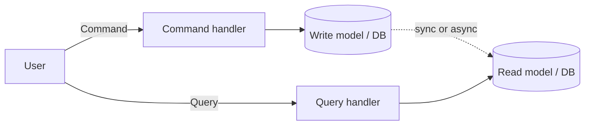
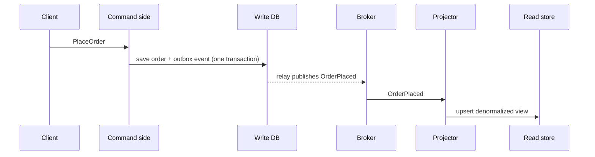

# CQRS

---

## 🟢 Junior Level

**CQRS (Command Query Responsibility Segregation)** separates the operations that **change** data (commands) from the operations that **read** data (queries), using different models for each.

- **Command:** an intention to change state ("PlaceOrder", "CancelOrder"). Returns success/failure, not data.
- **Query:** a request for data ("GetOrderSummary"). Changes nothing.

### Real-world analogy
A restaurant has a kitchen (write side) that prepares food following strict procedures, and a menu board plus display case (read side) optimized for customers to look at quickly. Customers don't read the kitchen's internal ingredient tickets; the kitchen doesn't care about the menu layout.



### Why bother?
Reads and writes often have very different needs. Writes need validation, business rules, and transactions. Reads need speed, denormalized shapes, and wide scalability. A single model forced to do both gets compromised.

### The simplest form (same database)
You do not need two databases or events to apply CQRS. Even separate classes for commands and queries are CQRS in its basic form.

```java
// Commands: change state, enforce rules
public record PlaceOrderCommand(long customerId, List<OrderLine> lines) {}

@Service
class OrderCommandService {
    private final OrderRepository orders;

    OrderCommandService(OrderRepository orders) { this.orders = orders; }

    @Transactional
    public long handle(PlaceOrderCommand cmd) {
        Order order = Order.create(cmd.customerId(), cmd.lines()); // domain validation inside
        return orders.save(order).getId();
    }
}

// Queries: read-optimized projection, no domain logic
public record OrderSummary(long id, String customerName, BigDecimal total, String status) {}

@Service
class OrderQueryService {
    private final JdbcTemplate jdbc;

    OrderQueryService(JdbcTemplate jdbc) { this.jdbc = jdbc; }

    public List<OrderSummary> recentOrders(long customerId) {
        return jdbc.query("""
            SELECT o.id, c.name, o.total, o.status
            FROM orders o JOIN customers c ON c.id = o.customer_id
            WHERE o.customer_id = ? ORDER BY o.created_at DESC LIMIT 20
            """, (rs, i) -> new OrderSummary(rs.getLong(1), rs.getString(2),
                                              rs.getBigDecimal(3), rs.getString(4)), customerId);
    }
}
```

---

## 🟡 Middle Level

### Levels of CQRS

| Level | Description | Complexity |
|---|---|---|
| 1. Separate code paths | Command/query services, same DB and model | Low |
| 2. Separate read models | Query side uses DTO projections/views/materialized views | Medium |
| 3. Separate stores | Write DB (relational) + read store (Elasticsearch, Redis, MongoDB), synchronized via events | High; eventual consistency |
| 4. CQRS + Event Sourcing | Write side stores events; read models projected from them | Highest |

### Synchronizing the read model
Typical flow with async projection:



Use the **outbox pattern** so the event and state change are atomic, and make projectors **idempotent** (upsert by id and version).

```java
@Component
class OrderProjector {
    private final OrderViewRepository views;

    OrderProjector(OrderViewRepository views) { this.views = views; }

    @KafkaListener(topics = "order-events", groupId = "order-view")
    @Transactional
    public void on(OrderEvent e) {
        OrderView v = views.findById(e.orderId()).orElseGet(() -> new OrderView(e.orderId()));
        if (e.version() <= v.getVersion()) return;   // ignore duplicates and old events
        v.apply(e);
        views.save(v);
    }
}
```

### Benefits
- Independent scaling and optimization of reads and writes (most systems are 10–1000x read-heavy).
- Query side can use the best technology: search index, cache, graph, columnar store.
- Simpler domain model (no query concerns), simpler queries (no entity graph loading).
- Different teams or security rules for read and write.

### Costs and when NOT to use
- **Eventual consistency:** user saves, redirects, and sees old data. Solutions: return the new state from the command, optimistic UI update, read-your-writes via version token, or short polling.
- More moving parts: projections, rebuild tooling, monitoring lag.
- Overkill for simple CRUD. Use CQRS where reads/writes diverge sharply or domain is complex.

### Common mistakes
- Applying CQRS to the entire system rather than selected bounded contexts.
- Commands returning rich data (blurs the separation, though returning an ID or version is fine).
- No way to rebuild projections after a bug.
- Treating CQRS as requiring Kafka, microservices, or event sourcing; none are required.

---

## 🔴 Senior Level

### Consistency strategies and UX
- **Read-your-writes token:** command returns `version=42`; the query supplies `minVersion=42` and the read API waits briefly or falls back to the write DB until the projection catches up.
- **Synchronous projection** within the same transaction (for critical small views) trades write latency for immediacy.
- **Optimistic client updates** with reconciliation.

```java
@GetMapping("/orders/{id}")
public ResponseEntity<OrderView> get(@PathVariable long id,
                                     @RequestHeader(value = "X-Min-Version", required = false) Long minVersion)
        throws InterruptedException {
    long deadline = System.nanoTime() + Duration.ofMillis(300).toNanos();
    OrderView v = views.find(id);
    while (minVersion != null && (v == null || v.version() < minVersion) && System.nanoTime() < deadline) {
        Thread.sleep(25);              // bounded wait for the projector to catch up
        v = views.find(id);
    }
    if (minVersion != null && (v == null || v.version() < minVersion)) {
        v = writeSide.load(id);        // fall back to the authoritative store
    }
    return ResponseEntity.ok(v);
}
```

### Projection engineering
- **Rebuildability:** projections are disposable derived data; keep the event log or source tables so you can drop and rebuild; support blue/green projections (build v2 in the background, switch the alias) for schema changes.
- **Ordering and idempotency:** partition by aggregate id so events for one aggregate are ordered; store the last applied version per aggregate; ignore gaps carefully (detect and trigger resync).
- **Lag monitoring:** metric = now − timestamp of last applied event; alert and expose to dashboards; define a staleness SLO.
- **Poison events** must not block all projections; park and alert.
- **Backfills** should be throttled and run off-peak.

### Failure modes
- **Dual-write inconsistency** if you update the read store directly from the command handler instead of through events: partial failure leaves stores diverged. Use outbox/CDC.
- **Out-of-order events** across partitions corrupt projections; use versions.
- **Schema evolution:** event versioning and upcasters; projections must tolerate older and newer events during rolling deploys.
- **Cascading rebuilds:** rebuilding a heavy projection can overload the broker or DB; rate limit and isolate resources.

### Performance considerations
Read stores can be denormalized to avoid joins: e.g., an Elasticsearch document with the order, customer name and product titles, answering a dashboard query in a single ~5 ms lookup instead of a 6-table join. Pre-aggregate counters (materialized views, Redis hash). On the write side keep aggregates small to reduce lock contention (optimistic locking with `@Version`).

```java
@Entity
class Account {
    @Id Long id;
    @Version Long version;      // optimistic locking: concurrent commands detect conflict
    BigDecimal balance;

    void withdraw(BigDecimal amount) {
        if (balance.compareTo(amount) < 0) throw new InsufficientFunds();
        balance = balance.subtract(amount);
    }
}
```

### Frameworks and ecosystem
Axon Framework (CQRS + ES in Java), Spring Data `@Query` projections, Spring Modulith events, jMolecules, EventStoreDB, Debezium for CDC, MediatR-like patterns via Spring `ApplicationEventPublisher` for in-process separation. Often a pragmatic approach is **modular monolith with CQRS-style read models** before splitting services.

### Architectural fit
Pairs naturally with DDD (aggregates on the write side), event-driven architecture, and multi-region read scaling (read models replicated near users while writes go to a home region). Avoid when strong cross-model consistency is a hard requirement without compensation.

---

## 🎯 Interview Cheat Sheet

### 30-second elevator pitch
"CQRS splits the write model, which enforces business rules and transactions, from the read model, which is denormalized and optimized for queries. It can be as simple as separate services over one database or as advanced as separate stores kept in sync by events. It lets reads and writes scale and evolve independently, at the price of eventual consistency and extra operational complexity, so I apply it selectively."

### Must-know bullets
- Command = change, query = read; different models.
- Levels: separate code, separate read models, separate stores, plus event sourcing.
- Sync read model via events with the outbox pattern; projectors idempotent.
- Eventual consistency UX: read-your-writes, version tokens, optimistic UI.
- Projections must be rebuildable; monitor lag.
- Not for simple CRUD; no need for Kafka or ES by default.

### Common follow-up questions
- How do you handle a read right after a write?
- How do you rebuild a projection?
- Do you need event sourcing for CQRS?
- How do you ensure the read store doesn't diverge?

### Red flags
- Applying CQRS everywhere by default.
- Updating both stores from application code without outbox.
- Believing CQRS implies microservices or Kafka.
- No plan for lag or rebuilds.

### Related topics
- [Event sourcing](12.%20Event%20sourcing.md)
- [Message queues for decoupling](10.%20Message%20queues%20for%20decoupling.md)
- [CAP theorem and consistency trade-offs](08.%20CAP%20theorem%20and%20consistency%20trade-offs.md)
