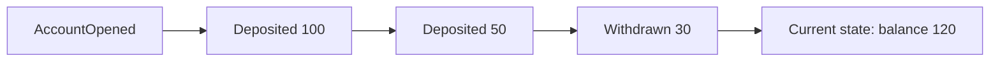
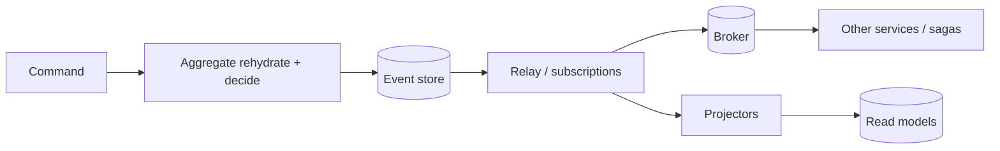

# Event sourcing

---

## 🟢 Junior Level

**Event sourcing** stores the *sequence of changes* (events) that happened to an entity instead of storing only its latest state. The current state is obtained by replaying the events from the start.

### Real-world analogy
A bank statement. The bank does not just keep "balance = 120"; it keeps every transaction: deposit 100, deposit 50, withdraw 30. The balance is the sum of those entries, and you can always explain *how* you reached it or compute the balance on any past date.



### State storage vs event sourcing

| Aspect | Traditional (state) | Event sourcing |
|---|---|---|
| Stores | Latest row | Append-only event log |
| Update | Overwrites previous value | Appends a new event |
| History | Lost (unless audit table) | Complete, built in |
| Debugging | "How did it get here?" is hard | Replay events |

### Key concepts
- **Event:** an immutable fact in the past tense (`OrderPlaced`, `ItemAdded`).
- **Aggregate:** the consistency boundary (e.g., an Order) whose events form a stream.
- **Event store:** append-only database of events, per aggregate stream.
- **Replay / rehydration:** fold events into current state.
- **Snapshot:** a periodic saved state to avoid replaying everything.

### Minimal Java example

```java
import java.math.BigDecimal;
import java.util.ArrayList;
import java.util.List;

sealed interface AccountEvent {
    record Opened(String id) implements AccountEvent {}
    record Deposited(BigDecimal amount) implements AccountEvent {}
    record Withdrawn(BigDecimal amount) implements AccountEvent {}
}

class Account {
    private String id;
    private BigDecimal balance = BigDecimal.ZERO;
    private final List<AccountEvent> uncommitted = new ArrayList<>();

    // Rebuild state by replaying history
    static Account rehydrate(List<AccountEvent> history) {
        Account a = new Account();
        history.forEach(a::apply);
        return a;
    }

    // Command: validate, then record an event
    void withdraw(BigDecimal amount) {
        if (balance.compareTo(amount) < 0) throw new IllegalStateException("Insufficient funds");
        raise(new AccountEvent.Withdrawn(amount));
    }

    private void raise(AccountEvent e) { apply(e); uncommitted.add(e); }

    // Apply never validates; events are facts that already happened
    private void apply(AccountEvent e) {
        switch (e) {
            case AccountEvent.Opened o -> id = o.id();
            case AccountEvent.Deposited d -> balance = balance.add(d.amount());
            case AccountEvent.Withdrawn w -> balance = balance.subtract(w.amount());
        }
    }

    List<AccountEvent> uncommittedEvents() { return uncommitted; }
    BigDecimal balance() { return balance; }
}
```

---

## 🟡 Middle Level

### Event store design
A relational table works well to start:

```sql
CREATE TABLE events (
    global_seq   BIGSERIAL PRIMARY KEY,         -- total order for subscribers
    stream_id    UUID        NOT NULL,           -- aggregate id
    version      INT         NOT NULL,           -- per-stream sequence
    type         TEXT        NOT NULL,
    payload      JSONB       NOT NULL,
    metadata     JSONB,                          -- correlation id, user, causation id
    occurred_at  TIMESTAMPTZ NOT NULL DEFAULT now(),
    UNIQUE (stream_id, version)                  -- optimistic concurrency control
);
```

The `UNIQUE (stream_id, version)` constraint implements **optimistic concurrency**: two concurrent commands appending version 7 to the same stream cannot both succeed.

```java
@Transactional
public void append(UUID streamId, int expectedVersion, List<DomainEvent> events) {
    int v = expectedVersion;
    for (DomainEvent e : events) {
        try {
            jdbc.update("INSERT INTO events(stream_id, version, type, payload) VALUES (?,?,?,?::jsonb)",
                    streamId, ++v, e.getClass().getSimpleName(), json.write(e));
        } catch (DuplicateKeyException ex) {
            throw new ConcurrencyException("Stream " + streamId + " changed concurrently");
        }
    }
}
```

### Snapshots
For long-lived aggregates (thousands of events), store a snapshot every N events (e.g., 100). Load = latest snapshot + events after its version. Snapshots are an optimization only; they must be discardable.

### Projections and read models
Because the log is not query-friendly, you build **projections** (read models) by subscribing to events. This is why event sourcing is usually paired with CQRS. Projections are rebuildable: delete and replay.

### Benefits
- Perfect **audit trail** (finance, healthcare, compliance).
- **Temporal queries:** state at any past time ("what did the order look like on Tuesday?").
- **Debugging and replay:** reproduce production bugs by replaying events.
- New read models later without a migration of the source of truth.
- Natural integration events for other services.

### Costs
- Steep learning curve and mindset shift.
- Querying requires projections; eventual consistency.
- **Event schema evolution** is hard because events are immutable and live forever.
- Operational concerns: storage growth, replay time, snapshots.
- Deleting personal data (GDPR "right to be forgotten") conflicts with immutability.

### Common mistakes
- Events named like commands or CRUD (`UpdateOrder`) instead of business facts (`ShippingAddressChanged`).
- Putting validation or side effects in `apply`, which runs on every replay (re-sending emails during rehydration!).
- Using event sourcing as a general integration log between services without a contract.
- Treating a Kafka topic with short retention as an event store.
- Using it for ordinary CRUD where it adds nothing.

---

## 🔴 Senior Level

### Schema evolution
Events live forever, so plan versioning from day one:
- **Upcasters:** transform old event versions into the current shape when loading (Axon supports this).
- Prefer **additive, backward-compatible** changes; add optional fields; never reuse a type name with different semantics.
- For breaking changes: introduce `OrderPlacedV2` and keep handlers for both, or perform a **stream migration** (copy-transform to a new store) in rare cases.
- Store type + version in metadata; use Avro/Protobuf with a registry for compatibility checks.

```java
// Upcaster: convert V1 events (single "name") to V2 (first/last name) on read
EventUpcaster<CustomerRegisteredV1, CustomerRegistered> upcaster = v1 -> {
    String[] parts = v1.name().split(" ", 2);
    return new CustomerRegistered(v1.id(), parts[0], parts.length > 1 ? parts[1] : "");
};
```

### Concurrency, ordering and subscriptions
- Per-stream order is by `version`. A global order (`global_seq`) for subscribers has a subtle race in Postgres: sequence values are allocated before commit, so a subscriber reading `global_seq > last` can **skip** an event that commits later with a lower number. Solutions: use `pg_current_snapshot`/xmin-based visibility, a gap-tolerant reader that waits for gaps, or a dedicated store (EventStoreDB, Axon Server) with ordered subscription.
- Subscriptions should be **at-least-once** with checkpointing and idempotent projectors.
- Competing consumers per projection need partitioning by stream id.

### Performance
- Appends are cheap (sequential inserts); reads by stream are index lookups.
- Rehydration cost is O(events); control with small aggregates (short streams), snapshots, and caching aggregate instances in memory for hot aggregates.
- Projection rebuilds of billions of events need batching, parallel streams by partition and a rebuild-to-new-table-then-swap strategy.

### Event sourcing + sagas and the outbox
Events in the store are the source of truth; publishing them to a broker is done by a relay that tails the store (CDC or polling with checkpoints). Because append and publish read the same durable log, you avoid the dual-write problem entirely, one of event sourcing's architectural strengths.



### Privacy and deletion
Immutable logs and GDPR collide. Techniques: **crypto-shredding** (encrypt personal data per subject with a key stored separately and delete the key to render events unreadable), keeping PII out of events (reference by id), or tombstone/redaction events and compaction for specific streams.

### Failure modes
- **Replay side effects:** projections or handlers triggering emails/payments during rebuilds. Separate pure projections from side-effecting reactors, and keep reactors on live subscriptions with checkpointing.
- **Poison event** that breaks a projection forever; allow skipping with alert and manual repair.
- **Clock-based logic** inside `apply` makes replay nondeterministic; store time in the event.
- **Bad events already stored:** you cannot edit history; append **compensating events** (`PaymentReversed`), or rarely migrate.
- **Unbounded growth:** archive cold streams, use snapshots plus event pruning only where legally and operationally safe.

### When to choose event sourcing
Choose it when history/audit is a first-class requirement, the domain is naturally event-oriented (ledgers, orders, workflows, IoT), or temporal analysis is valuable. Avoid it for CRUD-ish admin apps, small teams lacking experience, or data requiring frequent in-place correction/deletion. A middle path: **audit-log tables or temporal tables (history via CDC)** gives much of the audit value without the full paradigm.

### Tooling
Axon Framework + Axon Server, EventStoreDB (KurrentDB), Marten (.NET), Postgres custom store, Kafka as transport (rarely as store of record), Debezium for CDC.

---

## 🎯 Interview Cheat Sheet

### 30-second elevator pitch
"Event sourcing persists every state change as an immutable event in an append-only log, and the current state is derived by replaying the events, optionally accelerated with snapshots. It gives a full audit trail, temporal queries and rebuildable read models, usually combined with CQRS. The costs are eventual consistency, event schema evolution and privacy challenges like GDPR deletion, so I use it only where history matters."

### Must-know bullets
- Events are immutable past-tense facts; state = fold(events).
- Optimistic concurrency via stream version.
- Snapshots are a performance optimization only.
- Projections rebuild read models; pair with CQRS.
- Schema evolution: upcasters, additive changes, versioned types.
- GDPR: crypto-shredding or keeping PII outside events.
- No side effects when replaying.

### Common follow-up questions
- How do you evolve an event schema?
- How do you query the current state efficiently?
- How do you handle GDPR deletion?
- Is Kafka an event store?

### Red flags
- Events as CRUD diffs without business meaning.
- Side effects in the apply/replay path.
- Using event sourcing everywhere.
- No plan for snapshots, versioning, or projection rebuilds.

### Related topics
- [CQRS](11.%20CQRS.md)
- [Message queues for decoupling](10.%20Message%20queues%20for%20decoupling.md)
- [Idempotency and exactly-once effects](20.%20Idempotency%20and%20exactly-once%20effects.md)
