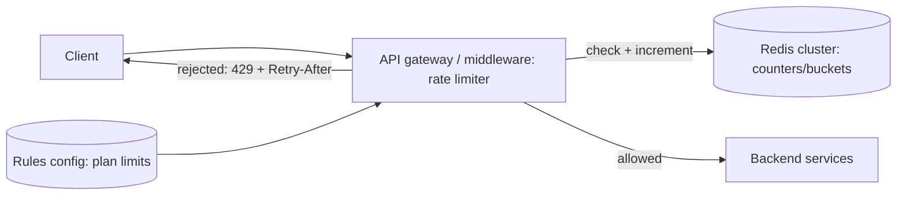

# Designing a rate limiter

---

## 🟢 Junior Level

**Goal:** limit how many requests a client can make in a time window — e.g. 100 requests per minute per API key — to protect services from overload and abuse and to enforce pricing plans. Excess requests receive **HTTP 429 Too Many Requests**.

### Clarifying questions (interview step 1)
* Limit by what: user, API key, IP, tenant, endpoint?
* What limits: per second/minute/day? Burst allowance?
* Single region or global? How accurate must it be (hard or soft limit)?
* Traffic scale: how many clients, how many requests per second?
* What happens when the limiter itself fails — allow or block?

### High-level design



Put the limiter **at the edge** (API gateway, sidecar, or a servlet filter) so rejected requests cost almost nothing.

---

## 🟡 Middle Level

### Algorithm choice

| Algorithm | Memory per client | Accuracy | Bursts | Notes |
| --- | --- | --- | --- | --- |
| Fixed window counter | 1 counter | Boundary spikes (up to 2× limit) | Uncontrolled at edges | Simplest |
| Sliding window log | 1 entry per request | Exact | Exact | Expensive at high limits |
| Sliding window counter | 2 counters | ~Exact (weighted) | Smooth | `count = cur + prev × overlap%` |
| **Token bucket** | 2 values (tokens, timestamp) | Exact rate + burst capacity | Controlled | Most common (AWS, Stripe, Spring Cloud Gateway) |
| Leaky bucket | Queue | Smooth output | Queued | Adds latency; traffic shaping |

**Token bucket**: capacity *b* tokens, refilled at *r* tokens/s; each request consumes one; allowed if a token is available. It permits short bursts up to *b* while enforcing an average rate *r*.

### Implementation with Redis (atomic Lua)

```lua
-- KEYS[1] = bucket key; ARGV: capacity, refill_per_sec, now_ms, cost
local cap, rate, now, cost = tonumber(ARGV[1]), tonumber(ARGV[2]), tonumber(ARGV[3]), tonumber(ARGV[4])
local state = redis.call('HMGET', KEYS[1], 't', 'ts')
local tokens = tonumber(state[1]) or cap
local ts = tonumber(state[2]) or now
tokens = math.min(cap, tokens + (now - ts) * rate / 1000)
local allowed = 0
if tokens >= cost then tokens = tokens - cost; allowed = 1 end
redis.call('HSET', KEYS[1], 't', tokens, 'ts', now)
redis.call('PEXPIRE', KEYS[1], math.ceil(cap / rate * 1000))
return { allowed, math.floor(tokens) }
```

### Response contract

```http
HTTP/1.1 429 Too Many Requests
Retry-After: 12
RateLimit-Policy: 100;w=60
RateLimit: limit=100, remaining=0, reset=12
Content-Type: application/problem+json

{"type":"https://api.shop.com/errors/rate-limited","title":"Too Many Requests","status":429}
```

---

## 🔴 Senior Level

### Scaling the design
* **Throughput**: 500k req/s through one Redis is too much for a single shard. Shard counters by client key across a Redis Cluster (each script touches one key/slot). Each check is ~1 network round trip (sub-ms in-region).
* **Two-tier limiting**: a local in-memory token bucket per gateway instance absorbs most checks; instances periodically sync usage to Redis (every 100 ms–1 s). Accuracy drops slightly (overshoot ≈ instances × sync interval × rate) in exchange for far less Redis load and latency.
* **Hot clients**: one massive tenant becomes a hot key — give it its own shard or a locally enforced share of its limit.
* **Multi-region**: global exact limits require cross-region coordination (expensive). Usually allocate per-region quotas (e.g. split by traffic share) and accept soft global limits, or replicate counters asynchronously (CRDT counters).

### Failure modes
* **Redis down**: fail open with a conservative local fallback limit for general APIs; fail closed for security-sensitive limits (login, OTP, password reset).
* **Clock skew**: use Redis server time (`redis.call('TIME')`) in scripts so all gateways agree.
* **Retry storms**: clients must honor `Retry-After`; publish SDKs with jittered backoff.

### Beyond request counts
* **Concurrency limits** (in-flight requests) protect expensive endpoints better than rate limits.
* **Cost-based limits** — weight requests (search = 10, GET = 1) or GraphQL query cost.
* **Adaptive limits** — lower limits automatically when backend latency or error rate rises (load shedding).
* **Layering**: CDN/WAF IP limits (DDoS, credential stuffing) → gateway per-key quotas → service-level bulkheads → database connection limits.

### Observability
Metrics per rule and client tier: allowed vs rejected, latency of the limiter itself, Redis errors and fallbacks. Dashboards for "top limited clients" help sales/support and detect abuse; alerts on rejection spikes catch broken client releases.

---

## 🎯 Interview Cheat Sheet

**30-second pitch:** I'd enforce limits at the gateway with a token bucket per client key stored in Redis via an atomic Lua script — capacity for bursts, refill rate for the average — returning 429 with Retry-After and RateLimit headers. To scale, I shard keys across Redis Cluster and add local in-memory buckets that sync periodically; I decide fail-open vs fail-closed per limit, use Redis time, and layer IP limits, quotas and concurrency limits.

**Must know:**
* Fixed vs sliding window vs token bucket vs leaky bucket trade-offs.
* Atomic Redis Lua script; one key per slot.
* 429, Retry-After, RateLimit headers.
* Two-tier local + global limiting; multi-region quotas.
* Fail-open vs fail-closed; concurrency and cost-based limits.

**Common follow-ups:**
* How accurate is your limiter with 50 gateway instances?
* How do you change limits without redeploying?
* How do you handle bursts at window boundaries?

**Red flags:** in-process counters presented as global limits; non-atomic read-modify-write; no strategy for limiter failure.

**Related:**
* [Rate limiting with Redis](../26.%20Caching%20and%20Redis/16.%20Rate%20limiting%20with%20Redis.md)
* [API keys and rate limiting](../23.%20Spring%20Security%20and%20Authentication/20.%20API%20keys%20and%20rate%20limiting.md)
* [Rate limiter](../25.%20Spring%20Cloud%20and%20Resilience/11.%20Rate%20limiter.md)
* [How to approach a system design interview](01.%20How%20to%20approach%20a%20system%20design%20interview.md)
