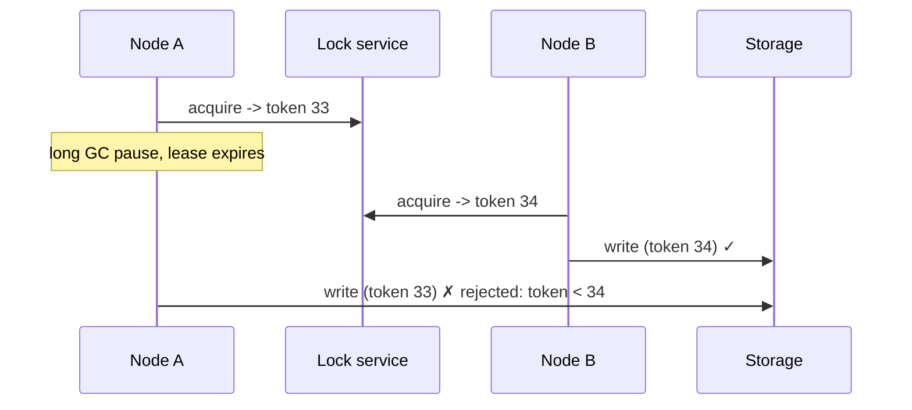

# Distributed locks and leader election

---

## 🟢 Junior Level

* A **distributed lock** gives one process at a time exclusive access to a resource across machines (process this file, run this job, update this external account).
* **Leader election** chooses one instance among many to perform a role continuously (run the scheduler, own a partition, coordinate writes); others stand by and take over if the leader fails.

Both are built on the same idea: a **lease** — exclusive ownership that **expires** unless renewed — stored in a coordination service.

| Tool | Mechanism | Typical use |
| --- | --- | --- |
| Database row lock / advisory lock | `SELECT ... FOR UPDATE`, `pg_try_advisory_lock` | Jobs in a service that already has a DB |
| Redis `SET NX PX` | Key with TTL | Efficiency locks, cache rebuilds |
| ZooKeeper | Ephemeral sequential znodes | Leader election, locks (Curator recipes) |
| etcd | Leases + revisions, election API | Kubernetes controllers, config |
| Kubernetes `Lease` objects | Coordination API | Leader election for pods (`client-go`, Spring Cloud Kubernetes) |

### Simple PostgreSQL advisory lock

```java
@Transactional
public void runNightlyJob() {
    Boolean acquired = jdbc.queryForObject("select pg_try_advisory_xact_lock(42)", Boolean.class);
    if (!Boolean.TRUE.equals(acquired)) return;     // another instance holds it
    doWork();                                       // lock released automatically at transaction end
}
```

---

## 🟡 Middle Level

### Leader election with ZooKeeper (Curator)

```java
LeaderLatch latch = new LeaderLatch(curator, "/shop/billing/leader", instanceId);
latch.addListener(new LeaderLatchListener() {
    @Override public void isLeader()  { scheduler.start(); }
    @Override public void notLeader() { scheduler.stop(); }    // must stop promptly!
});
latch.start();
```

Under the hood each candidate creates an **ephemeral sequential** znode; the lowest sequence number is leader; others watch their predecessor. If the leader's session expires (crash, network partition), its znode disappears and the next candidate takes over.

### Spring Integration leader initiator

```java
@Bean
LockRegistryLeaderInitiator leader(JdbcLockRegistry registry) {   // or RedisLockRegistry, ZooKeeper
    return new LockRegistryLeaderInitiator(registry);
}

@EventListener
void onGranted(OnGrantedEvent e) { log.info("became leader"); }
```

Spring Cloud Kubernetes offers leader election based on ConfigMaps/Leases for pods.

### Design choices
* **Lease duration** — short (seconds) for fast failover, long enough to tolerate GC pauses and network hiccups.
* **Renewal** — renew at ~⅓ of lease duration; if renewal fails, **step down** before the lease expires.
* **Work granularity** — do work in small, idempotent chunks and check leadership between chunks.

---

## 🔴 Senior Level

### The fundamental problem: you can't know you still hold the lock
A process can pause (GC, VM stall, swapped out) after checking the lock and before acting. Meanwhile the lease expires, another node becomes leader, and now **two** nodes act. No lock service can prevent this alone; you need **fencing**:



The resource must reject operations carrying an older token. ZooKeeper's `zxid`/znode version, etcd's revision numbers and Kubernetes `resourceVersion`/lease transitions can serve as monotonic tokens; in databases, store the highest token seen and update conditionally (`... where fencing_token < :token`).

### Consistency requirements of the coordination service
Use a **linearizable** store built on consensus (ZooKeeper/ZAB, etcd/Raft, Consul/Raft). Redis with async replication can grant the same lock twice after a failover — fine for efficiency locks, not for correctness. Redlock adds majority acquisition across independent Redis nodes but still relies on timing assumptions.

### Alternatives to locks
* **Partitioned ownership** — assign work by key (Kafka consumer group partitions, consistent hashing), so each item has exactly one owner by design; the broker handles failover via rebalancing.
* **Database-level concurrency** — `SELECT ... FOR UPDATE SKIP LOCKED` job queues let many workers pull distinct rows safely without a separate lock service.
* **Idempotency + unique constraints** — let duplicates happen but make them harmless.
* **Single-writer designs** — one service owns a dataset; others send commands.

### Operational notes
* Monitor leadership changes; frequent flapping indicates lease durations too short or unhealthy nodes.
* Kubernetes leader election libraries default to ~15 s lease duration and ~10 s renew deadline; failover therefore takes seconds — design consumers of the leader's output to tolerate that gap.
* Make "lost leadership" handling robust: stop timers, cancel in-flight tasks, and don't commit results produced after losing the lease.

---

## 🎯 Interview Cheat Sheet

**30-second pitch:** Distributed locks and leader election both rely on expiring leases in a coordination service — a database lock, Redis key, ZooKeeper ephemeral node, etcd lease or Kubernetes Lease. Because a paused process can't know its lease expired, correctness requires fencing tokens checked by the resource, and the coordination store must be linearizable. Often partitioned ownership, `SKIP LOCKED` queues or idempotency remove the need for a lock.

**Must know:**
* Lease, renewal, step-down.
* ZooKeeper ephemeral sequential znodes; etcd leases; Kubernetes Lease.
* Fencing tokens and why timeouts alone fail.
* Redis vs consensus-based stores for correctness.
* Alternatives: partition ownership, `SKIP LOCKED`, idempotency.

**Common follow-ups:**
* How do you elect a leader among pods in Kubernetes?
* What happens during a network partition?
* Why isn't Redlock enough for correctness?

**Red flags:** locks without expiry; trusting a lock after long operations without fencing; using leader election for work that could be partitioned.

**Related:**
* [Distributed locks with Redis, SETNX and Redlock](../26.%20Caching%20and%20Redis/15.%20Distributed%20locks%20with%20Redis,%20SETNX%20and%20Redlock.md)
* [CAP theorem and consistency trade-offs](08.%20CAP%20theorem%20and%20consistency%20trade-offs.md)
* [Idempotency and exactly-once effects](17.%20Idempotency%20and%20exactly-once%20effects.md)
* [Replication strategies](../27.%20NoSQL%20and%20Data%20Stores/22.%20Replication%20strategies.md)
