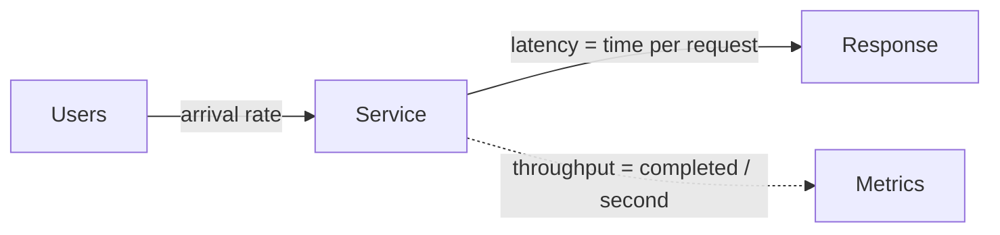

# What is the difference between performance scalability latency and throughput

---

## 🟢 Junior Level

### 1. Four words that are often confused

| Term | Plain definition | Unit | Typical question it answers |
| :--- | :--- | :--- | :--- |
| **Latency** | How long ONE request takes from start to finish | ms, µs | "How long does the user wait?" |
| **Throughput** | How many requests the system completes per unit of time | req/s, tx/s, MB/s | "How much work gets done?" |
| **Performance** | General "how fast / how efficiently" - usually expressed through latency and throughput at a given resource cost | mixed | "Is it fast enough for the cost?" |
| **Scalability** | How well performance holds up when load or resources grow | ratio | "If I double the servers or the users, what happens?" |

### 2. Real-world analogy: a highway

- **Latency** = the time one car needs to drive from city A to city B.
- **Throughput** = how many cars per hour pass a checkpoint.
- **Scalability** = what happens if you add lanes (more servers) or more cars (more users).
- **Congestion** = when more cars arrive than the road handles, every car slows down - latency explodes even though throughput stays flat at the maximum.

A highway can have low latency (empty road) and low throughput (one lane), or high latency (traffic jam) with high throughput (many lanes, all full). They are **independent axes**.

### 3. Minimal Java example: measure both

```java
import java.util.concurrent.*;
import java.util.concurrent.atomic.LongAdder;

public class LatencyVsThroughput {

    static void handleRequest() throws InterruptedException {
        Thread.sleep(20); // simulates 20 ms of I/O work
    }

    public static void main(String[] args) throws Exception {
        int requests = 200;
        LongAdder totalLatencyNanos = new LongAdder();
        ExecutorService pool = Executors.newFixedThreadPool(10);
        CountDownLatch done = new CountDownLatch(requests);

        long start = System.nanoTime();
        for (int i = 0; i < requests; i++) {
            pool.submit(() -> {
                long t0 = System.nanoTime();
                try {
                    handleRequest();
                } catch (InterruptedException e) {
                    Thread.currentThread().interrupt();
                } finally {
                    totalLatencyNanos.add(System.nanoTime() - t0);
                    done.countDown();
                }
            });
        }
        done.await();
        long elapsed = System.nanoTime() - start;
        pool.shutdown();

        double throughput = requests / (elapsed / 1_000_000_000.0);
        double avgLatencyMs = totalLatencyNanos.sum() / (double) requests / 1_000_000.0;
        System.out.printf("Throughput: %.1f req/s%n", throughput);
        System.out.printf("Average service latency: %.1f ms%n", avgLatencyMs);
    }
}
```

With 10 threads and 20 ms per call, the ideal throughput is `10 / 0.020 = 500 req/s`. Latency per call stays about 20 ms. Add more threads and throughput grows until another resource (CPU, DB) saturates.



> [!IMPORTANT]
> **Rule of thumb:** latency is about ONE request; throughput is about ALL requests; scalability is about the CHANGE of both when you change load or capacity.

---

## 🟡 Middle Level

### 1. Little's Law links everything

For any stable system:

```
L = λ × W
```

- `L` - average number of requests in the system (concurrency, in-flight requests)
- `λ` - throughput (arrival = completion rate in steady state)
- `W` - average latency (time in the system)

Examples:
- 500 req/s and 40 ms average latency → `L = 500 × 0.040 = 20` concurrent requests. That tells you roughly how many threads or connections you need.
- Your DB pool has 10 connections and each query takes 5 ms → max throughput `10 / 0.005 = 2000 queries/s`. Above that, requests queue and latency grows.

### 2. Latency = service time + queueing time

`latency = service time (doing the work) + wait time (queueing)`. As utilization approaches 100%, queueing time grows non-linearly (for an M/M/1 queue, wait ≈ `service × ρ / (1 - ρ)`). At 50% utilization the wait equals one service time; at 90% it is 9×; at 99% it is 99×. This is why systems "fall off a cliff" instead of degrading gracefully, and why capacity planning targets 60-70% peak utilization.

### 3. Scalability types

| Type | What you do | Java full-stack example | Limits |
| :--- | :--- | :--- | :--- |
| **Vertical (scale up)** | Bigger machine | More cores/RAM, bigger heap | Hardware ceiling, single point of failure, GC pauses on huge heaps |
| **Horizontal (scale out)** | More instances | More Spring Boot pods behind a load balancer | Needs stateless services, shared-state bottlenecks (DB) |
| **Functional** | Split by capability | Microservices, read replicas, CQRS | Operational complexity |

### 4. Amdahl's Law and the Universal Scalability Law

Amdahl: if a fraction `s` of the work is serial, max speedup with `N` workers is `1 / (s + (1 - s) / N)`. With 5% serial work (`s = 0.05`) you can never exceed 20× speedup, regardless of cores.

Gunther's Universal Scalability Law adds **coherence cost** (workers talking to each other: locks, cache-line bouncing, distributed coordination): throughput can actually **decrease** after a point. This matches real experience: adding threads to a contended `synchronized` section makes things slower.

### 5. Common mistakes

| Mistake | Why it hurts | Fix |
| :--- | :--- | :--- |
| "Performance" meaning only "make it faster" | Optimizing code that is not the bottleneck | Define a goal: "p99 < 300 ms at 1,000 req/s" |
| Optimizing throughput while users feel latency | A batch job increases throughput but each request waits | Track both, set SLOs on latency |
| Assuming more threads = more throughput | Contention, context switches, pool exhaustion downstream | Measure, apply Little's Law |
| Scaling out a stateful app | Session affinity, cache inconsistency | Externalize state (Redis, DB) |
| Ignoring the shared resource | 50 pods all hit one DB | Scale the bottleneck, not the stateless tier |

### 6. Throughput vs latency trade-off: batching

```java
// Higher throughput, higher latency per item: batch inserts
jdbcTemplate.batchUpdate(
    "insert into audit_event(id, payload) values (?, ?)",
    events,
    500, // batch size
    (ps, e) -> { ps.setLong(1, e.id()); ps.setString(2, e.payload()); });
```

Batching 500 rows reduces round trips (throughput ↑ 10×+), but each event waits for the batch to fill (latency ↑). Kafka's `linger.ms` and `batch.size` are the same trade-off.

---

## 🔴 Senior Level

### 1. Open vs closed workload models

A **closed** model has a fixed number of users who wait for a response before sending the next request (think-time loop). When the server slows down, arrivals slow down too, hiding the problem. An **open** model (arrivals independent of responses, like real internet traffic) shows true queue growth. Many load tools default to closed behavior, which produces optimistic latency. Use arrival-rate executors (k6 `constant-arrival-rate`, Gatling `constantUsersPerSec`) to test realistically.

### 2. Coordinated omission

If your benchmark client sends one request, waits 10 s for a stall, then continues, the 10 s stall is recorded as ONE slow sample, even though dozens of requests *should* have been sent during the stall. Latency distributions get severely understated. Tools such as wrk2, HdrHistogram's `recordValueWithExpectedInterval`, and arrival-rate load generators correct for this. See [Why percentiles p95 and p99 matter more than averages](02.%20Why%20percentiles%20p95%20and%20p99%20matter%20more%20than%20averages.md).

### 3. JVM-specific factors that separate latency from throughput

| Choice | Throughput effect | Latency effect |
| :--- | :--- | :--- |
| ParallelGC | Best raw throughput | Long stop-the-world pauses |
| G1 (default) | Balanced | Pause target `-XX:MaxGCPauseMillis=200` |
| ZGC / Shenandoah | Slightly lower | Sub-millisecond pauses, large heaps |
| Cold JVM | Low (interpreter) | High until JIT warms up |
| Thread-per-request (platform threads) | Limited by thread count | Context-switch overhead |
| Virtual threads (Java 21+) | High for blocking I/O | Cheap blocking, but pinned carriers/DB pool still bound |

Virtual threads raise the ceiling on concurrent blocking calls, but Little's Law still applies: if the database pool allows 20 connections, `L ≤ 20` at the DB regardless of how many virtual threads you create.

### 4. Measuring scalability empirically

Run the same test at 1, 2, 4, 8 instances (or cores) and compute efficiency:

```bash
# k6: fixed arrival rate, 5 minutes, thresholds on tail latency
k6 run --env RATE=500 script.js
```

```javascript
import http from 'k6/http';
export const options = {
  scenarios: {
    open_model: {
      executor: 'constant-arrival-rate',
      rate: __ENV.RATE ? Number(__ENV.RATE) : 100,
      timeUnit: '1s',
      duration: '5m',
      preAllocatedVUs: 200,
      maxVUs: 1000,
    },
  },
  thresholds: { http_req_duration: ['p(95)<300', 'p(99)<800'] },
};
export default function () { http.get('http://localhost:8080/api/orders'); }
```

Plot throughput vs instances. A linear line means ideal scaling; a flattening curve indicates a serial bottleneck (Amdahl); a downward curve indicates coherence cost (USL) - look for lock contention, a single DB primary, or a chatty downstream.

### 5. Production scenario

An API handles 800 req/s at p99 = 120 ms. Marketing doubles traffic. The team doubles pods from 4 to 8, yet p99 rises to 2 s. Investigation: DB pool of 20 per pod × 8 pods = 160 connections against PostgreSQL `max_connections=100` - connection waits and DB CPU saturated. Scalability was limited by the shared database, not the stateless tier. Fix: smaller pools per pod (see [How to tune a connection pool with HikariCP](10.%20How%20to%20tune%20a%20connection%20pool%20with%20HikariCP.md)), read replicas, caching hot reads, and measuring DB utilization (USE method).

---

## 🎯 Interview Cheat Sheet

### 30-second elevator pitch
"Latency is how long one request takes, throughput is how many requests complete per second, performance is how good both are for a given cost, and scalability is how those hold up as load or resources grow. Little's Law (L = λW) ties them together, and queueing theory explains why latency explodes near saturation, so I set targets like p99 under 300 ms at a given rate and test them with an open workload model."

### Must-know bullets
- Latency ≠ throughput; they can move independently.
- Little's Law: concurrency = throughput × latency.
- Latency = service time + queueing; queueing is non-linear near 100% utilization.
- Scale horizontally only if the app is stateless and the shared dependencies can follow.
- Amdahl (serial fraction) and USL (coherence cost) limit scaling.
- Use tail percentiles, not averages, and open-model load tests.

### Common follow-up questions
1. If throughput doubles with 2× servers is it perfectly scalable? (Yes for linear scaling; check latency too.)
2. How many threads do I need for 1,000 req/s at 50 ms? (≈ 50 in-flight, per Little's Law.)
3. Why does adding threads sometimes lower throughput?
4. What is coordinated omission?
5. How do virtual threads change the picture?

### 🚩 Red flags
- Using "fast" without a number and a percentile.
- Talking only about average latency.
- Proposing scale-out without discussing the database or shared state.
- Benchmarking on a laptop with the load generator on the same machine.

### Related topics
- [Why percentiles p95 and p99 matter more than averages](02.%20Why%20percentiles%20p95%20and%20p99%20matter%20more%20than%20averages.md)
- [How to size thread pools correctly](12.%20How%20to%20size%20thread%20pools%20correctly.md)
- [How to do load testing and capacity planning](18.%20How%20to%20do%20load%20testing%20and%20capacity%20planning.md)
- [What are the RED and USE methods](14.%20What%20are%20the%20RED%20and%20USE%20methods.md)
