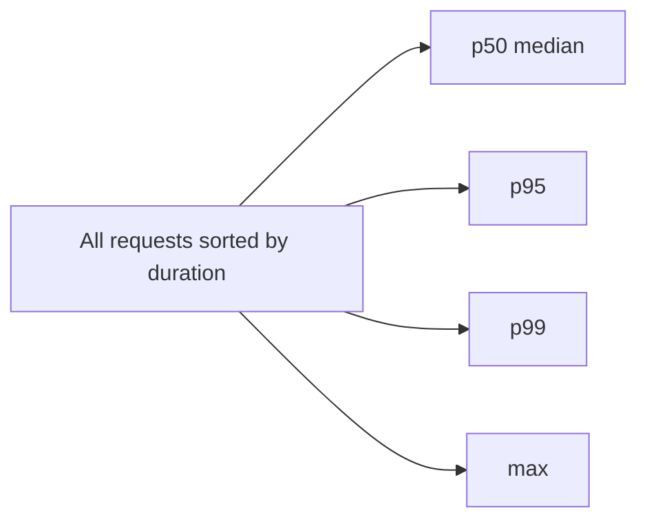

# Why percentiles p95 and p99 matter more than averages

---

## 🟢 Junior Level

### 1. What is a percentile?

The **p95** latency is the value below which 95% of requests fall. If p95 = 300 ms, then 95 of every 100 requests finish in 300 ms or less, and 5 are slower. **p99** means 1 in 100 is slower; **p50** is the median.

The **average (mean)** adds all times and divides by the count. It hides outliers.

### 2. Real-world analogy

A pizza shop says "average delivery: 25 minutes". But 9 of 10 pizzas arrive in 15 minutes and 1 arrives after 115 minutes: `(9×15 + 115)/10 = 25`. The average looks fine, yet one customer is furious. The p90/p99 tells the real story.

### 3. Minimal Java example

```java
import java.util.Arrays;

public class PercentileDemo {

    static long percentile(long[] sortedMillis, double p) {
        int index = (int) Math.ceil(p / 100.0 * sortedMillis.length) - 1;
        return sortedMillis[Math.max(0, index)];
    }

    public static void main(String[] args) {
        long[] latencies = new long[100];
        Arrays.fill(latencies, 15);   // 99 fast requests
        latencies[99] = 2_000;        // 1 very slow request
        Arrays.sort(latencies);

        double avg = Arrays.stream(latencies).average().orElse(0);
        System.out.printf("avg = %.1f ms%n", avg);                    // ~34.9 ms
        System.out.println("p50 = " + percentile(latencies, 50));      // 15
        System.out.println("p95 = " + percentile(latencies, 95));      // 15
        System.out.println("p99 = " + percentile(latencies, 99));      // 15
        System.out.println("max = " + latencies[99]);                  // 2000
    }
}
```

Note: with only 100 samples, the single outlier sits above p99. This is why you also track **max** and use enough samples (p99.9 needs thousands of requests).



> [!IMPORTANT]
> Latency distributions are almost never bell-shaped. They are **long-tailed**, so the mean is a poor description.

---

## 🟡 Middle Level

### 1. Why tails matter more than they look

1. **Users hit the tail often.** A page that makes 20 backend calls each with p99 = 1 s: probability that all 20 are fast is `0.99^20 ≈ 82%`, so ~18% of page loads experience at least one slow call. With 100 fan-out calls it is `0.99^100 ≈ 37%`. This is the "tail at scale" effect (Dean and Barroso).
2. **Heavy users are the slowest.** Customers with most data (big carts, long histories) hit the slow path and are often your most valuable customers.
3. **Averages mix populations.** Cache hits (1 ms) and cache misses (400 ms) average into a number nobody actually experiences.

### 2. You cannot average percentiles

p99 of service A and p99 of service B do not give the p99 of the combination, and the mean of per-instance p99 values is statistically meaningless. Aggregate **histograms** (bucket counts) across instances, then compute the percentile from the merged histogram. This is why Prometheus uses histogram buckets and `histogram_quantile` rather than pre-computed client-side quantiles in multi-instance deployments.

### 3. Percentiles in Micrometer

```java
import io.micrometer.core.instrument.MeterRegistry;
import io.micrometer.core.instrument.Timer;
import org.springframework.stereotype.Service;

import java.util.function.Supplier;

@Service
public class CheckoutService {

    private final Timer checkoutTimer;

    public CheckoutService(MeterRegistry registry) {
        this.checkoutTimer = Timer.builder("checkout.duration")
                .description("Time spent processing checkout")
                .publishPercentileHistogram()                 // histogram buckets for Prometheus
                .serviceLevelObjectives(
                        java.time.Duration.ofMillis(100),
                        java.time.Duration.ofMillis(300),
                        java.time.Duration.ofMillis(1000))
                .register(registry);
    }

    public <T> T timed(Supplier<T> action) {
        return checkoutTimer.record(action);
    }
}
```

PromQL for p99 across all instances over 5 minutes:

```promql
histogram_quantile(0.99,
  sum by (le) (rate(checkout_duration_seconds_bucket[5m])))
```

### 4. Choosing a metric

| Metric | Good for | Weakness |
| :--- | :--- | :--- |
| Mean | Capacity math (Little's Law), cost | Hides tails |
| p50 | "Typical" experience | Hides everything slow |
| p95 / p99 | SLOs, user experience | Needs many samples, can't be averaged |
| p99.9 / max | Fan-out, strict SLAs | Noisy |
| Histogram / heatmap | Seeing multi-modal behavior | More storage |

### 5. Common mistakes

- Alerting on average latency (misses incidents affecting 5% of users).
- Averaging per-pod p99 in Grafana (`avg(p99)`) instead of merging buckets.
- Too few histogram buckets around the SLO threshold, giving inaccurate quantile interpolation.
- Measuring only server-side time; the user also experiences queueing at the load balancer and network.
- Excluding errors from latency (fast failures make latency look good; track success and failure separately).

---

## 🔴 Senior Level

### 1. HdrHistogram: accurate, mergeable, low overhead

HdrHistogram records values in a fixed-size array with configurable significant digits, giving constant-time recording and tiny memory use. It supports merging and correcting for coordinated omission.

```java
import org.HdrHistogram.Histogram;

public class HdrDemo {
    public static void main(String[] args) throws Exception {
        // track 1 µs to 1 hour, 3 significant digits
        Histogram h = new Histogram(3_600_000_000L, 3);
        long expectedIntervalMicros = 1_000; // we intend to send 1 request/ms

        for (int i = 0; i < 10_000; i++) {
            long start = System.nanoTime();
            Thread.sleep(0, 500_000);                 // simulated work
            long micros = (System.nanoTime() - start) / 1_000;
            h.recordValueWithExpectedInterval(micros, expectedIntervalMicros);
        }
        System.out.printf("p50=%d µs p99=%d µs p99.9=%d µs max=%d µs%n",
                h.getValueAtPercentile(50), h.getValueAtPercentile(99),
                h.getValueAtPercentile(99.9), h.getMaxValue());
    }
}
```

Maven dependency: `org.hdrhistogram:HdrHistogram` (JMH and Micrometer use it internally).

### 2. Coordinated omission in depth

If a request stalls for 10 s and the generator is closed-loop, it silently skips 9,999 scheduled requests that would have also suffered. The reported p99 can be 100× too optimistic. Countermeasures: open-model load generators, `recordValueWithExpectedInterval`, wrk2 (`wrk2 -R 1000`), k6 arrival-rate executors, and measuring from *intended* start time, not actual send time.

### 3. Where tails come from in JVM systems

| Source | Signature | Diagnosis |
| :--- | :--- | :--- |
| GC pauses | Periodic spikes, all requests in that window slow | GC logs, JFR `GarbageCollection` events |
| JIT deoptimization / warm-up | Slow after deploy | `-XX:+PrintCompilation`, warm-up in readiness probe |
| Lock contention | p99 grows with concurrency | Thread dumps, JFR `JavaMonitorEnter` |
| Connection pool wait | `hikaricp.connections.pending` > 0 | Pool metrics |
| Slow downstream / retries | Latency = timeout multiples | Distributed traces |
| Safepoint bias, THP, CPU throttling in containers | Unexplained 100 ms stalls | `-Xlog:safepoint`, cgroup `cpu.stat` throttled periods |
| Cache misses / cold data | Bimodal latency | Hit ratio vs latency heatmap |

Tip: a latency distribution with multiple humps (bimodal) points to two different code paths (cache hit/miss, replica/primary). Look at a **heatmap** rather than a single line.

### 4. Hedging, timeouts and tail mitigation

- **Timeouts** must be shorter than the caller's budget; propagate deadlines.
- **Hedged requests**: send a second request to another replica after p95 elapsed, cancel the loser. Only for idempotent reads, and it adds load (typically ~5%).
- **Load shedding / bulkheads** (Resilience4j) keep p99 of the healthy path predictable.
- Reduce fan-out; cache; use async aggregation with budgets.

### 5. SLOs on percentiles

Define SLIs as "proportion of good events": `99% of requests < 300 ms over 30 days`. Compute with bucket counts:

```promql
sum(rate(http_server_requests_seconds_bucket{le="0.3",uri="/api/orders"}[5m]))
/
sum(rate(http_server_requests_seconds_count{uri="/api/orders"}[5m]))
```

This is mergeable, exact at the bucket boundary, and feeds burn-rate alerts (see [How to design SLO based alerts](19.%20How%20to%20design%20SLO%20based%20alerts.md)).

### 6. Sample size rules

- p99 needs ≥ ~1,000 samples per window to be stable; p99.9 needs ≥ ~10,000.
- Low-traffic endpoints: use longer windows or synthetic probes, otherwise p99 equals max.

---

## 🎯 Interview Cheat Sheet

### 30-second elevator pitch
"Averages hide the slow minority; latency is long-tailed. p95 and p99 show what the worst 5% or 1% of users experience, and with fan-out those tails hit a large share of page loads. I record histograms (Micrometer, HdrHistogram), merge buckets across instances rather than averaging percentiles, avoid coordinated omission in tests, and set SLOs like 99% under 300 ms."

### Must-know bullets
- Mean is fine for capacity math, wrong for user experience.
- Never average percentiles; merge histograms.
- Fan-out amplifies tails: `0.99^N`.
- Coordinated omission underestimates tails in closed-loop tests.
- Enable `publishPercentileHistogram()` for Prometheus-side quantiles.
- Look at heatmaps to spot bimodal behavior.

### Common follow-up questions
1. Why is p99 of two services not the sum of their p99s?
2. How many samples do you need for p99.9?
3. How would you compute p99 across 50 pods?
4. What causes a long tail on the JVM?
5. When is average still useful?

### 🚩 Red flags
- "Our average response is 80 ms so we're fine."
- Alerting only on mean latency.
- Not knowing a histogram from a summary.
- Reporting p99 from a 30-second test with 200 requests.

### Related topics
- [What is the difference between performance scalability latency and throughput](01.%20What%20is%20the%20difference%20between%20performance%20scalability%20latency%20and%20throughput.md)
- [How to expose metrics with Micrometer and Spring Boot Actuator](15.%20How%20to%20expose%20metrics%20with%20Micrometer%20and%20Spring%20Boot%20Actuator.md)
- [How to design SLO based alerts](19.%20How%20to%20design%20SLO%20based%20alerts.md)
- [How to do load testing and capacity planning](21.%20How%20to%20do%20load%20testing%20and%20capacity%20planning.md)
