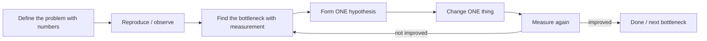

# How to troubleshoot Java performance problems methodically

---

## 🟢 Junior Level

### 1. The core idea

Performance troubleshooting is **detective work, not guessing**. The golden rule: **measure first, change one thing, measure again**. Premature optimization (guessing the slow part) wastes time and adds risk.

### 2. Real-world analogy

A doctor does not prescribe surgery because "the patient looks tired". They take vitals, order tests, form a hypothesis, treat, and recheck. You should do the same with a slow application: symptoms → measurements → hypothesis → fix → verify.

### 3. The simple loop



### 4. Minimal Java example: measure before guessing

```java
public class SlowPathFinder {

    static String loadFromDb() throws InterruptedException {
        Thread.sleep(120);        // pretend this is a slow query
        return "data";
    }

    static String format(String s) {
        return s.toUpperCase();   // cheap
    }

    public static void main(String[] args) throws Exception {
        long t0 = System.nanoTime();
        String data = loadFromDb();
        long t1 = System.nanoTime();
        String out = format(data);
        long t2 = System.nanoTime();

        System.out.printf("db     : %d ms%n", (t1 - t0) / 1_000_000);
        System.out.printf("format : %d ms%n", (t2 - t1) / 1_000_000);
        System.out.println(out);
    }
}
```

The numbers instantly show the database call dominates; optimizing `format` would be pointless. (Manual timing is crude - later you will use profilers and traces.)

### 5. First questions to ask

1. What is slow - a specific endpoint, everything, only at certain times?
2. How slow, compared to what? (Numbers, percentiles.)
3. When did it start? What changed (deploy, config, data volume, traffic)?
4. Who is affected - all users or some?

> [!IMPORTANT]
> "It's slow" is not a problem statement. "p99 of `GET /orders` rose from 200 ms to 1.8 s after Tuesday's release for tenants with more than 10k orders" is.

---

## 🟡 Middle Level

### 1. A practical top-down methodology

| Step | Question | Tools |
| :--- | :--- | :--- |
| 1. Define | What is the SLI and target? | Dashboards, SLOs |
| 2. Scope | Which service/endpoint/tenant/instance? | Metrics by label, traces |
| 3. Saturation check | Is any resource saturated (CPU, memory, GC, threads, pool, disk, network)? | USE method |
| 4. Request path | Where does time go in one slow request? | Distributed tracing, APM |
| 5. Drill down | Which code, lock, query or GC event? | Profiler (JFR, async-profiler), thread dump, slow query log |
| 6. Hypothesis + experiment | Does the fix change the metric? | Canary, A/B, load test |
| 7. Verify + prevent | Add a benchmark/alert/regression test | CI, alerts |

### 2. Triage by symptom

| Symptom | Likely area | First tool |
| :--- | :--- | :--- |
| High CPU in the JVM | Hot loop, regex, serialization, GC thrash, JIT | `top -H`, async-profiler CPU, JFR |
| Low CPU but slow | Waiting: I/O, locks, pool exhaustion, downstream | Thread dumps, traces, pool metrics |
| Gradual slowdown, growing memory | Leak, unbounded cache | Heap histogram, heap dump |
| Periodic stalls | GC, safepoints, scheduled jobs | GC log, JFR |
| Slow only at startup | JIT warm-up, class loading, cold caches | Readiness warm-up, CDS |
| Slow DB-heavy endpoint | N+1, missing index, lock waits | SQL logs, `EXPLAIN ANALYZE` |

### 3. Quick command-line triage on a Linux host

```bash
# 1. Which process and which thread is hot?
top -H -p $(pgrep -f myapp.jar)

# 2. Convert the hot thread id (decimal) to hex and find it in a thread dump
printf '%x\n' 12345
jcmd $(pgrep -f myapp.jar) Thread.print | grep -A 20 'nid=0x3039'

# 3. Live heap composition
jcmd $(pgrep -f myapp.jar) GC.class_histogram | head -20

# 4. JVM flags and GC status
jcmd $(pgrep -f myapp.jar) VM.flags
jstat -gcutil $(pgrep -f myapp.jar) 1000 5
```

### 4. Instrument the code cheaply with a Timer

```java
import io.micrometer.core.annotation.Timed;
import org.springframework.web.bind.annotation.*;

@RestController
public class ReportController {

    private final ReportService service;

    public ReportController(ReportService service) { this.service = service; }

    @Timed(value = "report.generate", histogram = true)
    @GetMapping("/reports/{id}")
    public Report get(@PathVariable long id) {
        return service.generate(id);
    }
}
```

`@Timed` requires the `TimedAspect` bean (`@Bean TimedAspect timedAspect(MeterRegistry r) { return new TimedAspect(r); }`) except on controllers, where Spring Boot's `http.server.requests` already times each endpoint.

### 5. Common mistakes

- Changing many things at once (impossible to attribute the gain).
- Optimizing without a reproducible benchmark or baseline.
- Profiling a dev laptop with different data volume from production.
- Fixing the loudest component instead of the biggest contributor (Amdahl: a 10% part sped up 2× gives only 5%).
- Treating the JVM as the culprit when the DB, network, or container CPU limit is.
- Forgetting to check **recent changes** - most regressions correlate with a deploy, config flag, or data growth.

---

## 🔴 Senior Level

### 1. Hypothesis-driven approaches

**USE method** (Brendan Gregg) for resources: for each resource check *Utilization, Saturation, Errors*. **RED** for services: *Rate, Errors, Duration*. Start with RED to find the failing service, then USE on its resources. See [What are the RED and USE methods](17.%20What%20are%20the%20RED%20and%20USE%20methods.md).

**Drill-down chain** for a latency regression:

1. Dashboard: p99 up for service X only (RED).
2. Traces: slow spans concentrate in `db.query` of one repository method.
3. DB: pool metrics show `hikaricp.connections.pending` > 0, `usage` time grew.
4. Slow query log / `pg_stat_statements`: one query's mean time rose 20× after table growth.
5. `EXPLAIN (ANALYZE, BUFFERS)` shows a sequential scan: missing index.
6. Fix, canary, compare p99. Add an alert on that query's duration.

### 2. Beware of observer effects and bias

| Tool | Bias / cost |
| :--- | :--- |
| Safepoint-biased profilers (older VisualVM sampler, `jstack` loops) | Attribute samples to safepoint polls, misleading hot spots |
| Instrumentation profilers | High overhead, change inlining decisions |
| JFR | ~1-2% overhead, uses safepoint-free sampling of most events |
| async-profiler | Uses `AsyncGetCallTrace` + perf events; no safepoint bias |
| Debug logging at high rate | Can itself become the bottleneck |

Always compare "before" and "after" under the same conditions, and avoid profiling at 100% saturation unless that is the actual issue.

### 3. Always capture evidence before restarting

On a production incident the instinct is to restart. Capture first (seconds, not minutes):

```bash
PID=$(pgrep -f myapp.jar)
jcmd $PID Thread.print -l > threads-$(date +%s).txt            # 3 dumps, 5 s apart
jcmd $PID GC.heap_info > heap-info.txt
jcmd $PID JFR.start name=incident duration=60s filename=/tmp-safe/incident.jfr settings=profile
```

(Write to a directory with enough space and permissions - not the root partition.) In Kubernetes, `kubectl exec` the pod or use an ephemeral debug container, and ship dumps to object storage.

### 4. Statistical rigor for "did it improve?"

A single run proves nothing. Use repeated A/B runs, compare **distributions** (p50/p95/p99 and error rate), keep load, data and hardware identical, and watch noisy neighbors (cloud CPU steal, CPU throttling: check `container_cpu_cfs_throttled_periods_total`). Differences below run-to-run variance are noise. For microbenchmarks use JMH (see [How to write reliable JMH microbenchmarks](05.%20How%20to%20write%20reliable%20JMH%20microbenchmarks.md)).

### 5. Typical root causes by tier

- **Application:** N+1, unbounded collections, synchronous I/O in request thread, excessive logging, reflection and serialization in hot path, regex backtracking, `String.format`.
- **JVM:** wrong heap size, GC thrash, container-unaware flags (use `-XX:MaxRAMPercentage`), JIT deopt storms, code cache full.
- **Framework:** Hibernate lazy loading, Jackson on huge payloads, Tomcat max threads, HTTP client connection pool defaults.
- **Infra:** CPU throttling due to low CFS quota, noisy neighbors, DNS latency, TLS handshakes without keep-alive, cross-AZ chatter.
- **Data:** table growth, skewed tenants, stale statistics, lock contention, long transactions.

### 6. Make it permanent

Every resolved performance bug should leave behind (a) a metric or alert that would have detected it earlier, (b) a regression test or benchmark, and (c) a short post-mortem. See [How to catch performance regressions in CI](22.%20How%20to%20catch%20performance%20regressions%20in%20CI.md).

---

## 🎯 Interview Cheat Sheet

### 30-second elevator pitch
"I treat performance like science: define the symptom with percentiles, scope it by service and time, check resource saturation with USE, find where time goes with traces, then drill down with a profiler, thread dump or slow query log. I change one thing, measure again against a baseline, and add a metric or test so it doesn't return."

### Must-know bullets
- Measure → hypothesize → change one thing → measure.
- Start with RED for the service, USE for the resources.
- High CPU vs low CPU slow behaves very differently (compute vs waiting).
- Capture thread dumps, heap info and JFR before restarting.
- Use non-safepoint-biased profilers (JFR, async-profiler).
- Check "what changed" first.

### Common follow-up questions
1. The app is slow but CPU is at 10%. What now?
2. How do you find which thread burns CPU?
3. How do you prove your fix helped?
4. What is observer effect in profiling?
5. How do you troubleshoot in Kubernetes?

### 🚩 Red flags
- "Let's add a cache" or "increase the heap" before any measurement.
- Restarting production without collecting evidence.
- Benchmarking with different data/hardware than prod and claiming victory.
- Ignoring the database and network.

### Related topics
- [How to profile a Java application with JFR and async-profiler](04.%20How%20to%20profile%20a%20Java%20application%20with%20JFR%20and%20async-profiler.md)
- [How to diagnose deadlocks and high CPU with thread dumps](07.%20How%20to%20diagnose%20deadlocks%20and%20high%20CPU%20with%20thread%20dumps.md)
- [What are the RED and USE methods](17.%20What%20are%20the%20RED%20and%20USE%20methods.md)
- [Production incident debugging playbook](23.%20Production%20incident%20debugging%20playbook.md)
