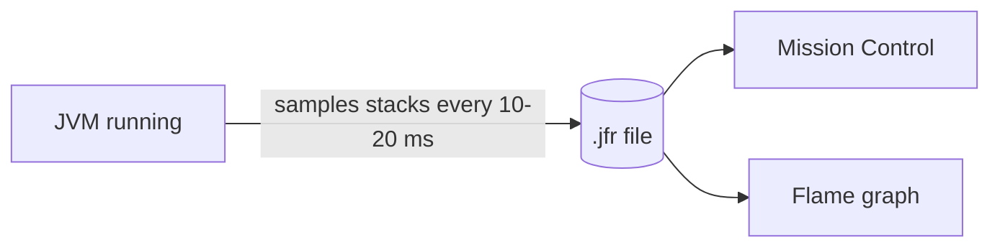
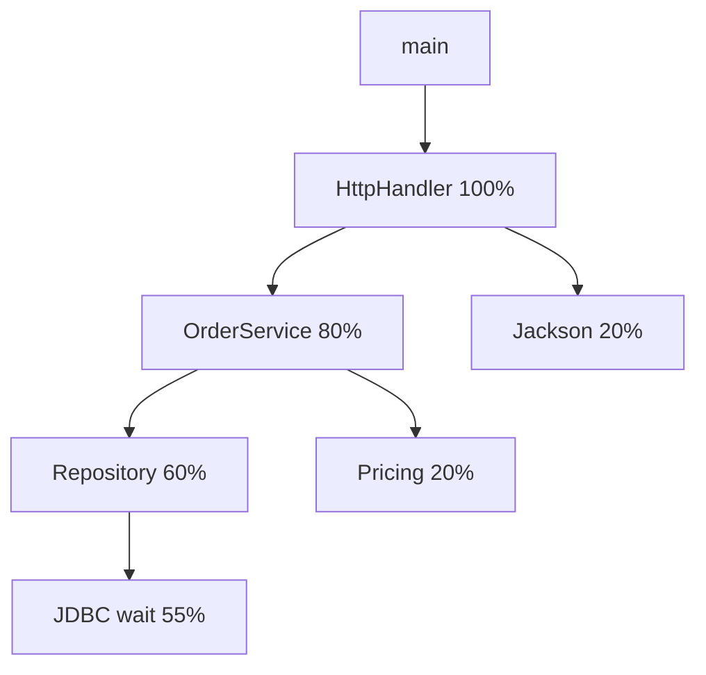

# How to profile a Java application with JFR and async-profiler

---

## 🟢 Junior Level

### 1. What is profiling?

A **profiler** observes a running program and tells you *where time (or memory) is spent*: which methods use the CPU, which allocate the most objects, where threads wait. Instead of guessing, you look at data.

### 2. Real-world analogy

Imagine a security camera in a factory that records which workstation is busy and which is waiting. After a day you see the real bottleneck. A profiler is that camera for your JVM.

### 3. The tools in one table

| Tool | What it is | Overhead | Best for |
| :--- | :--- | :--- | :--- |
| **JFR (Java Flight Recorder)** | Event recorder built into the JDK (open source since JDK 11) | ~1-2% | Always-on production profiling |
| **JDK Mission Control (JMC)** | GUI to open `.jfr` files | n/a | Analysing JFR recordings |
| **async-profiler** | Low-overhead sampling profiler (CPU, alloc, lock, wall-clock) | low | Flame graphs, native + Java frames |
| **VisualVM** | Free GUI: sampler, heap, threads | medium | Local development |
| **Flame graph** | A visualization of stack samples | n/a | Seeing hot paths at a glance |

### 4. Minimal working example: record with JFR

Create a program that burns CPU:

```java
public class BurnCpu {

    static double slow(int n) {
        double sum = 0;
        for (int i = 1; i < n; i++) {
            sum += Math.sqrt(i) * Math.sin(i);
        }
        return sum;
    }

    public static void main(String[] args) {
        long end = System.currentTimeMillis() + 30_000;
        double total = 0;
        while (System.currentTimeMillis() < end) {
            total += slow(1_000_000);
        }
        System.out.println(total);
    }
}
```

Run with JFR enabled from the start:

```bash
javac BurnCpu.java
java -XX:StartFlightRecording=duration=30s,filename=burn.jfr,settings=profile BurnCpu
jfr print --events jdk.ExecutionSample burn.jfr | head -40
```

Open `burn.jfr` in JDK Mission Control (Method Profiling / Flame Graph pages) and you will see `BurnCpu.slow` dominating.



> [!IMPORTANT]
> Profile with realistic load and data. A profile of an idle application is useless.

---

## 🟡 Middle Level

### 1. How to start JFR on a running process

```bash
# find the pid
jcmd -l

# start a 2-minute profile recording
jcmd <pid> JFR.start name=prof duration=120s settings=profile filename=/var/data/prof.jfr

# check recordings, dump on demand, stop
jcmd <pid> JFR.check
jcmd <pid> JFR.dump name=prof filename=/var/data/now.jfr
jcmd <pid> JFR.stop name=prof
```

`settings=default` (~1% overhead) is safe for continuous production recording; `settings=profile` collects more samples and allocation events (~2%). A continuous ring buffer is a great production practice:

```bash
java -XX:StartFlightRecording=maxage=6h,maxsize=500m,disk=true,dumponexit=true,filename=/var/data/last.jfr -jar app.jar
```

When an incident happens, `JFR.dump` gives you the last hours of data from *before* anyone noticed.

### 2. Reading flame graphs

In a flame graph:
- The **x-axis** is the share of samples (width = time), **not** chronological order.
- The **y-axis** is stack depth; the bottom is the entry point, the top is the leaf function actually running.
- Look for **wide plateaus at the top**: those are functions burning time themselves.



### 3. async-profiler quick start

```bash
# download a release from https://github.com/async-profiler/async-profiler
# CPU flame graph for 30 s of pid 4242 (JDK 11+; version 3.x uses "asprof")
asprof -d 30 -e cpu -f /var/data/cpu.html 4242

# allocation profile (where objects are created)
asprof -d 30 -e alloc -f /var/data/alloc.html 4242

# lock contention
asprof -d 30 -e lock -f /var/data/lock.html 4242

# wall-clock mode: includes threads waiting on I/O, good for "slow but low CPU"
asprof -d 30 -e wall -t -f /var/data/wall.html 4242
```

Attach at startup instead:

```bash
java -agentpath:/opt/async-profiler/lib/libasyncProfiler.so=start,event=cpu,file=/var/data/profile.jfr,jfr -jar app.jar
```

Output as `.jfr` can be opened in JMC or IntelliJ IDEA's profiler.

### 4. Programmatic JFR custom events

```java
import jdk.jfr.Category;
import jdk.jfr.Event;
import jdk.jfr.Label;
import jdk.jfr.Name;
import jdk.jfr.StackTrace;

@Name("com.example.OrderProcessed")
@Label("Order Processed")
@Category("Business")
@StackTrace(false)
public class OrderProcessedEvent extends Event {
    @Label("Order Id") public long orderId;
    @Label("Items") public int items;
}

class OrderService {
    void process(long id, int items) {
        OrderProcessedEvent e = new OrderProcessedEvent();
        e.begin();
        try {
            // ... business work ...
        } finally {
            e.orderId = id;
            e.items = items;
            e.commit();   // cheap when event is disabled
        }
    }
}
```

Custom events appear in JMC alongside GC, I/O, and lock events, so you can correlate business operations with JVM behavior.

### 5. Picking the profile type

| Symptom | Profile mode |
| :--- | :--- |
| High CPU | `cpu` |
| Slow, low CPU (waiting) | `wall` |
| High GC rate / allocation pressure | `alloc` (or JFR `ObjectAllocationSample`) |
| Contention | `lock` / JFR `JavaMonitorEnter` |
| Native memory growth | `nativemem` (async-profiler 3.x) |

### 6. VisualVM

Free GUI (`visualvm.github.io`) with Sampler, thread view, heap histogram and heap dump. Fine for local work; avoid attaching remotely to production via JMX without TLS and authentication. Its instrumenting "Profiler" mode adds large overhead.

### 7. Common mistakes

- Profiling in a debug IDE run with different JIT behavior.
- Short profiles (5 s) that capture noise, or profiling before warm-up completes.
- Reading the flame graph as a timeline.
- Looking at self time only and missing that an expensive caller invokes a cheap method millions of times; use both top-down and bottom-up (callers) views.
- Using safepoint-biased tools (`jstack` sampling loops).

---

## 🔴 Senior Level

### 1. Why safepoint bias matters

Classic JVMTI-based samplers can only take stacks at safepoints. Hot, tight loops compiled without safepoint polls (counted loops) are under-reported, and code right after the safepoint is over-reported. JFR's sampler and async-profiler use `AsyncGetCallTrace`/`SIGPROF`-style asynchronous sampling and are largely free of this bias; use them. Enabling `-XX:+UnlockDiagnosticVMOptions -XX:+DebugNonSafepoints` improves attribution of inlined frames to the correct source line for both.

### 2. JFR event model highlights

| Event | Insight |
| :--- | :--- |
| `jdk.ExecutionSample` / `jdk.NativeMethodSample` | CPU / native samples |
| `jdk.ObjectAllocationSample` (JDK 16+) | Throttled allocation sampling, low overhead |
| `jdk.GarbageCollection`, `jdk.GCPhasePause` | Pause causes and durations |
| `jdk.JavaMonitorEnter`, `jdk.ThreadPark` | Lock waits |
| `jdk.FileRead`, `jdk.SocketRead` | Slow I/O with durations |
| `jdk.CPULoad`, `jdk.ContainerCPUThrottling` | Container throttling |
| `jdk.OldObjectSample` | Leak candidates with path to GC roots (`path-to-gc-roots=true`) |

Query programmatically (JDK 17+):

```java
import jdk.jfr.consumer.RecordedEvent;
import jdk.jfr.consumer.RecordingFile;

import java.nio.file.Path;

public class JfrTopMethods {
    public static void main(String[] args) throws Exception {
        var counts = new java.util.HashMap<String, Integer>();
        try (RecordingFile rf = new RecordingFile(Path.of(args[0]))) {
            while (rf.hasMoreEvents()) {
                RecordedEvent e = rf.readEvent();
                if (e.getEventType().getName().equals("jdk.ExecutionSample")
                        && e.getStackTrace() != null
                        && !e.getStackTrace().getFrames().isEmpty()) {
                    var top = e.getStackTrace().getFrames().get(0);
                    String key = top.getMethod().getType().getName() + "." + top.getMethod().getName();
                    counts.merge(key, 1, Integer::sum);
                }
            }
        }
        counts.entrySet().stream()
              .sorted((a, b) -> b.getValue() - a.getValue())
              .limit(15)
              .forEach(en -> System.out.println(en.getValue() + "  " + en.getKey()));
    }
}
```

Run: `java JfrTopMethods.java burn.jfr`. Also available from the CLI: `jfr summary`, `jfr print --events`, `jfr view hot-methods burn.jfr` (JDK 21+), and `jfr scrub`.

### 3. Continuous profiling in production

Tools such as Pyroscope, Grafana Cloud Profiles, Parca, and Datadog/Elastic continuous profilers run async-profiler or JFR constantly (~1% cost) and let you diff a flame graph before vs after a deploy. A **differential flame graph** is the fastest way to localize a regression to a code path.

### 4. Containers and permissions

- async-profiler's perf-events mode needs `kernel.perf_event_paranoid` ≤ 1 (or `CAP_PERFMON`) and `kptr_restrict`; otherwise it falls back to `itimer` (`-e itimer`), which works unprivileged in containers.
- Attach needs the same user as the JVM and a shared `/tmp`, so in Kubernetes use a sidecar/ephemeral container with `shareProcessNamespace: true`, or bake the agent in via `-agentpath`.
- JFR needs a writable dump path; in read-only containers use an `emptyDir`.

### 5. Interpreting what profiles do not show

- CPU profiles ignore blocked time: a service waiting on a DB shows nothing in `cpu`. Use `wall`.
- JIT and GC threads appear as separate roots: high `C2 CompilerThread` share at start-up is normal warm-up.
- Inlining hides small methods; compare with `-XX:+PrintInlining` when needed.
- Sampling needs enough samples: below ~1,000 samples, small frames are noise.

### 6. Production workflow

1. Confirm saturation or latency anomaly (metrics).
2. Pull a 60 s `wall` + `cpu` profile from one affected instance (and one healthy for comparison).
3. Look for dominant plateau; correlate with traces.
4. Fix the hot spot, deploy to canary, compare differential flame graph.

---

## 🎯 Interview Cheat Sheet

### 30-second elevator pitch
"I use JFR as a low-overhead always-on recorder and open it in Mission Control, and async-profiler when I need flame graphs in CPU, wall-clock, allocation, or lock modes without safepoint bias. I read flame graphs by width, not time, pick the mode that matches the symptom, and verify the fix with a differential profile."

### Must-know bullets
- JFR: built into the JDK, ~1-2% overhead, `-XX:StartFlightRecording`, `jcmd JFR.start/dump`.
- async-profiler: `asprof -d 30 -e cpu -f out.html <pid>`; modes cpu/wall/alloc/lock.
- Flame graph width = proportion of samples.
- CPU profile ≠ wall-clock profile.
- Safepoint bias makes naive sampling misleading.
- Profile under realistic load and after warm-up.

### Common follow-up questions
1. Why not just use VisualVM in production?
2. CPU is low but requests are slow: which profile mode?
3. How would you find allocation hot spots?
4. What is a differential flame graph?
5. What is `DebugNonSafepoints`?

### 🚩 Red flags
- "I add System.currentTimeMillis everywhere."
- Profiling a cold, idle JVM.
- Treating flame graph x-axis as time.
- Attaching an instrumenting profiler to production at peak.

### Related topics
- [How to troubleshoot Java performance problems methodically](03.%20How%20to%20troubleshoot%20Java%20performance%20problems%20methodically.md)
- [How JIT and tiered compilation work in the JVM](06.%20How%20JIT%20and%20tiered%20compilation%20work%20in%20the%20JVM.md)
- [How to diagnose deadlocks and high CPU with thread dumps](07.%20How%20to%20diagnose%20deadlocks%20and%20high%20CPU%20with%20thread%20dumps.md)
- [How to find memory leaks with heap dumps and MAT](08.%20How%20to%20find%20memory%20leaks%20with%20heap%20dumps%20and%20MAT.md)
