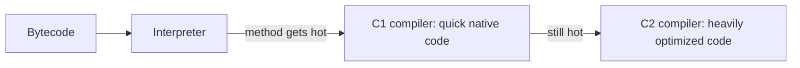

# How JIT and tiered compilation work in the JVM

---

## 🟢 Junior Level

### 1. What is JIT?

Java source compiles to **bytecode**. The JVM first **interprets** the bytecode (slow but starts instantly). It watches which methods run often ("hot" methods) and compiles those to fast **native machine code** *while the program is running*. This is **Just-In-Time (JIT) compilation**.

### 2. Real-world analogy

A tour guide translating a foreign speech word by word (interpreter). When the same sentence is repeated 100 times, the guide memorizes the translation (compiled code) and says it instantly. Rarely used sentences are never memorized.

### 3. Why you care

- A Java program is **slow right after start** and gets faster: the **warm-up** effect.
- Benchmarks that ignore warm-up are wrong.
- The first requests after a deployment have higher latency.

### 4. Minimal example showing warm-up

```java
public class WarmUpDemo {

    static long work(int n) {
        long sum = 0;
        for (int i = 0; i < n; i++) {
            sum += i % 7;
        }
        return sum;
    }

    public static void main(String[] args) {
        for (int round = 1; round <= 8; round++) {
            long t0 = System.nanoTime();
            long r = work(5_000_000);
            long micros = (System.nanoTime() - t0) / 1_000;
            System.out.println("round " + round + ": " + micros + " µs (result " + r + ")");
        }
    }
}
```

Early rounds are slower; later rounds speed up as the JIT compiles `work`. See what it compiles:

```bash
javac WarmUpDemo.java
java -XX:+PrintCompilation WarmUpDemo | head -30
```



> [!IMPORTANT]
> HotSpot has two JIT compilers: **C1** (fast compile, light optimization) and **C2** (slow compile, aggressive optimization). **Tiered compilation** uses both and is on by default.

---

## 🟡 Middle Level

### 1. The five tiers

| Tier | Meaning |
| :--- | :--- |
| 0 | Interpreter (collects profile data) |
| 1 | C1, full optimization, no profiling (trivial methods) |
| 2 | C1 with limited profiling |
| 3 | C1 with full profiling (invocation and branch counters) |
| 4 | C2, fully optimized using the collected profile |

Typical path: 0 → 3 → 4. Code gets compiled when invocation + loop back-edge counters pass thresholds (e.g. `Tier3InvocationThreshold=200`, `Tier4InvocationThreshold=5000`; they scale with queue load). Loops can be compiled mid-execution via **OSR (On-Stack Replacement)**, indicated by `%` in `PrintCompilation`.

### 2. Reading PrintCompilation

```
    112   45       3       WarmUpDemo::work (22 bytes)
    115   46 %     4       WarmUpDemo::work @ 4 (22 bytes)
    120   47       4       WarmUpDemo::work (22 bytes)
    121   45       3       WarmUpDemo::work (22 bytes)   made not entrant
```

Columns: timestamp ms, compile id, flags (`%` OSR, `s` synchronized, `!` has exception handlers, `n` native), tier, method, bytecode size. "made not entrant" means older code was replaced or **deoptimized**.

### 3. Main JIT optimizations

| Optimization | Idea |
| :--- | :--- |
| **Inlining** | Replace a call with the callee body (limits: `MaxInlineSize=35` bytes cold, `FreqInlineSize=325` hot) |
| **Escape analysis** | Object doesn't escape → allocate on stack or scalar-replace; lock elision |
| **Loop unrolling / vectorization** | Fewer branches, SIMD |
| **Dead-code elimination, constant folding** | Remove or precompute |
| **Devirtualization** | Monomorphic/bimorphic call site → direct call via type profile |
| **Range-check elimination** | Hoist array bounds checks out of loops |

### 4. Deoptimization

C2 compiles with **speculative assumptions** (e.g. "this branch is never taken", "this call site only sees class A"). If the assumption fails (class B loads or the rare branch fires), the JVM **deoptimizes**: discards the compiled code, goes back to the interpreter, and recompiles. Frequent deopts cause latency spikes. Watch via `-XX:+PrintCompilation` ("made not entrant") or JFR events `jdk.Deoptimization`.

### 5. Practical flags

```bash
# See compilation activity and inlining decisions
java -XX:+PrintCompilation -XX:+UnlockDiagnosticVMOptions -XX:+PrintInlining -jar app.jar

# Code cache usage (full cache stops JIT!)
java -XX:ReservedCodeCacheSize=256m -XX:+UseCodeCacheFlushing -jar app.jar
jcmd <pid> Compiler.codecache
jcmd <pid> Compiler.queue

# Compiler threads
java -XX:CICompilerCount=4 -jar app.jar

# Fast start, lower peak (good for short-lived CLI tools, serverless)
java -XX:TieredStopAtLevel=1 -jar app.jar
```

### 6. Impact on application behavior

- After a **deploy/scale-out event**, new pods are slow for the first seconds/minutes. Mitigations: warm-up requests before readiness, gradual traffic ramp (slow start in load balancer), CDS/AppCDS for class loading, GraalVM native image (AOT, no warm-up, lower peak), CRaC (checkpoint/restore, e.g. in Spring Boot 3.2+ with a CRaC JDK), and Java 24+ AOT cache (JEP 483 and follow-ups).
- In containers with tight CPU limits, JIT threads compete with application threads, extending warm-up: a pod limited to 0.5 CPU may take minutes.

### 7. Common mistakes

- Benchmarking before warm-up (see [How to write reliable JMH microbenchmarks](05.%20How%20to%20write%20reliable%20JMH%20microbenchmarks.md)).
- Setting `-Xint` or disabling tiered compilation "to be faster".
- Making methods huge (> 8000 bytecodes, `HugeMethodLimit`) which are **never JIT compiled** by default.
- Filling the code cache with generated classes (dynamic proxies, Groovy scripts), after which "CodeCache is full. Compiler has been disabled".

---

## 🔴 Senior Level

### 1. Profile-guided speculation

Tier 3 code records: invocation/back-edge counts, branch taken/not-taken ratios, receiver type profiles at call sites (`TypeProfileWidth=2`), null-seen flags. C2 uses them:

- **Monomorphic call site** → inline with a guard (`if (receiver.class == A)`), uncommon trap otherwise.
- **Bimorphic** → two inlined guarded paths.
- **Megamorphic (3+ types)** → virtual/itable dispatch, no inline. This is why a shared utility called with many lambdas/types (e.g. generic `Function` in a stream pipeline library) can be slower than expected: profile pollution.

An **uncommon trap** is the deopt point for a speculation that fails; the JVM then reprofiles, and may recompile with a more general version.

### 2. Escape analysis example

```java
public class EscapeDemo {

    record Point(int x, int y) {}

    static int distSquared(int x, int y) {
        Point p = new Point(x, y);      // does not escape: scalar-replaced by C2
        return p.x() * p.x() + p.y() * p.y();
    }

    public static void main(String[] args) {
        long total = 0;
        for (int i = 0; i < 100_000_000; i++) {
            total += distSquared(i & 255, i & 127);
        }
        System.out.println(total);
    }
}
```

Run with `java -verbose:gc -Xmx64m -XX:-DoEscapeAnalysis EscapeDemo` vs the default: with EA disabled you see heavy GC activity; with EA enabled there is almost none because no `Point` is ever allocated. This also explains why microbenchmarks may under-report allocation cost.

### 3. Compiler diagnostics

```bash
# LogCompilation produces XML (use JITWatch to visualise)
java -XX:+UnlockDiagnosticVMOptions -XX:+LogCompilation -XX:LogFile=jit.log -jar app.jar

# Why was a method not inlined?
java -XX:+UnlockDiagnosticVMOptions -XX:+PrintInlining -XX:+PrintCompilation -jar app.jar 2>&1 | grep -E "too big|callee is too large|already compiled into a big method"

# Compile-level status of a single method
jcmd <pid> Compiler.directives_print
```

Use **compiler directives** (`-XX:CompilerDirectivesFile=`) or `@CompilerControl` in JMH to force/forbid inlining for experiments. Do not ship these flags in production without evidence.

### 4. Tiered compilation behavior under load

Compilation queues grow when many methods turn hot simultaneously (typical right after traffic arrives). The policy adapts thresholds via `Tier3LoadFeedback`/`Tier4LoadFeedback`. Slow warm-up manifests as high CPU (`C2 CompilerThread`) in the first minutes. Diagnose with `jcmd <pid> Compiler.queue` and JFR `jdk.Compilation` events; remedy with more CPU during start-up (Kubernetes startup CPU burst, `startupProbe`, or Burstable QoS), warm-up traffic, or AppCDS plus AOT features.

### 5. Warm-up strategies compared

| Strategy | Pros | Cons |
| :--- | :--- | :--- |
| Synthetic warm-up requests in readiness | Simple, real code paths | Must not pollute data; need representative mix |
| Slow-start traffic ramp (LB) | Natural | Latency still elevated briefly |
| AppCDS | Faster startup, less class loading | Doesn't persist JIT profile (pre-JDK 24 AOT work) |
| CRaC | Restores warmed JIT state | Needs CRaC JDK, resource re-open handling |
| GraalVM Native Image | Instant start, low memory | Lower peak throughput (no PGO unless Oracle GraalVM), reflection config, longer builds |
| Oracle GraalVM JIT (Graal compiler) | Can beat C2 in some workloads | Licensing, different behavior |

### 6. Edge cases that hurt in production

- **Deoptimization storms** after loading a new subclass dynamically (e.g. new Hibernate proxy or plugin class), invalidating CHA (class hierarchy analysis) assumptions.
- **Huge methods** (generated parsers, big `switch`, enormous Spring `@Configuration` initializer) staying interpreted.
- **Code cache fragmentation**: segmented code cache (JDK 9+) has separate non-method, profiled and non-profiled regions; monitor each with `jcmd Compiler.codecache` or Micrometer `jvm.memory.used{id=~"CodeHeap.*"}`.
- **Safepoint-based deopt** can contribute to pauses; check `-Xlog:safepoint`.

---

## 🎯 Interview Cheat Sheet

### 30-second elevator pitch
"HotSpot starts by interpreting bytecode while collecting profile data. Hot methods are compiled by C1 for a quick win and then by C2, which makes speculative optimizations such as inlining, escape analysis and devirtualization based on the profile. If assumptions break the JVM deoptimizes. This is why Java needs warm-up and why microbenchmarks and fresh pods behave differently from steady state."

### Must-know bullets
- Interpreter → C1 (tier 1-3) → C2 (tier 4); tiered compilation is the default.
- Hot = counters over thresholds; loops use OSR.
- Key optimizations: inlining, escape analysis, loop opts, devirtualization.
- Deoptimization = speculation failed; "made not entrant".
- Code cache can fill and disable JIT.
- Warm-up mitigations: warm-up traffic, CDS/AOT, CRaC, native image.

### Common follow-up questions
1. What is OSR?
2. Why is the first request slow?
3. What is escape analysis?
4. What is a megamorphic call site?
5. Native image vs JIT: trade-offs?

### 🚩 Red flags
- Believing Java is "interpreted so always slow".
- Turning off tiered compilation without data.
- Ignoring warm-up when load-testing or autoscaling.
- Not knowing what `PrintCompilation` shows.

### Related topics
- [How to write reliable JMH microbenchmarks](05.%20How%20to%20write%20reliable%20JMH%20microbenchmarks.md)
- [How to profile a Java application with JFR and async-profiler](04.%20How%20to%20profile%20a%20Java%20application%20with%20JFR%20and%20async-profiler.md)
- [How to configure health checks and Kubernetes probes](17.%20How%20to%20configure%20health%20checks%20and%20Kubernetes%20probes.md)
- [How to do load testing and capacity planning](18.%20How%20to%20do%20load%20testing%20and%20capacity%20planning.md)
