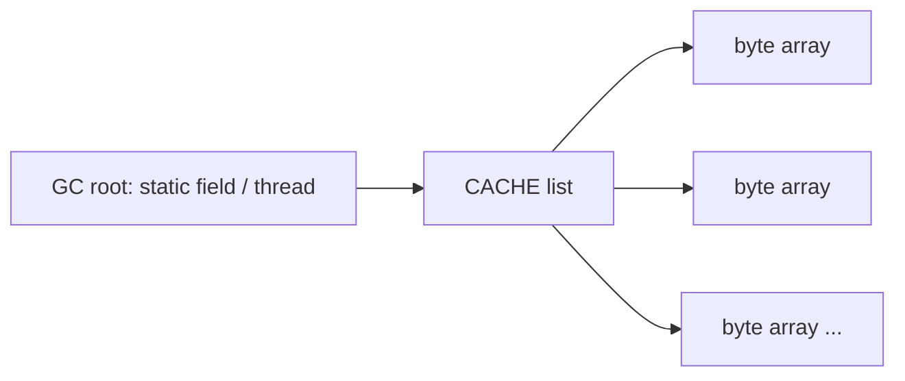

# How to find memory leaks with heap dumps and MAT

---

## 🟢 Junior Level

### 1. What is a memory leak in Java?

Java has a garbage collector, so a "leak" does not mean forgotten `free()`. A Java **memory leak** means objects that are no longer *useful* are still **reachable** (referenced), so the GC cannot reclaim them. Heap usage grows until `OutOfMemoryError: Java heap space`.

### 2. Real-world analogy

A hotel that never checks out guests: the room list only grows. The cleaning staff (GC) is willing to clean empty rooms but each "guest" is still registered, so rooms stay occupied.

### 3. Minimal leaking example

```java
import java.util.ArrayList;
import java.util.List;

public class LeakDemo {

    private static final List<byte[]> CACHE = new ArrayList<>();   // static: lives forever

    public static void main(String[] args) throws Exception {
        while (true) {
            CACHE.add(new byte[1024 * 1024]);   // 1 MB added, never removed
            Thread.sleep(100);
        }
    }
}
```

Run with a small heap and ask the JVM to dump on failure:

```bash
javac LeakDemo.java
java -Xmx128m -XX:+HeapDumpOnOutOfMemoryError -XX:HeapDumpPath=./leak.hprof LeakDemo
```

After `OutOfMemoryError`, `leak.hprof` is created. Open it in **Eclipse MAT** (Memory Analyzer Tool) and run the "Leak Suspects Report": it points to `LeakDemo.CACHE` retaining ~99% of the heap.

### 4. Quick checks without a dump

```bash
jcmd <pid> GC.class_histogram | head -15     # live objects by class (forces a full GC)
jstat -gcutil <pid> 1000                     # watch Old gen (O) % climbing after Full GCs
```



> [!IMPORTANT]
> The signature of a leak: the **post-GC (live set) heap usage keeps rising** over time. A high but flat usage is not a leak; it is just a big working set.

---

## 🟡 Middle Level

### 1. Taking heap dumps

```bash
# Live objects only (triggers a full GC first), preferred
jcmd <pid> GC.heap_dump /var/data/heap.hprof

# jmap alternative (use -dump:live to dump only reachable objects)
jmap -dump:live,format=b,file=/var/data/heap.hprof <pid>

# Automatic dump on OOM + exit so orchestrator restarts the pod
java -XX:+HeapDumpOnOutOfMemoryError -XX:HeapDumpPath=/var/data/ -XX:+ExitOnOutOfMemoryError -jar app.jar
```

Heap dumps are as large as the used heap (several GB), **pause the JVM** during writing, and contain **sensitive data** (passwords, tokens, PII). Treat them like secrets. Spring Boot Actuator `/actuator/heapdump` exists but should be disabled/locked down in production.

### 2. Analyzing with Eclipse MAT

Start the parser headless for big dumps (increase MAT's own heap in `MemoryAnalyzer.ini`, e.g. `-Xmx16g`):

```bash
./ParseHeapDump.sh heap.hprof org.eclipse.mat.api:suspects org.eclipse.mat.api:overview org.eclipse.mat.api:top_components
```

Key MAT concepts:

| Concept | Meaning |
| :--- | :--- |
| **Shallow heap** | Memory of the object itself |
| **Retained heap** | Memory that would be freed if the object were collected (the object plus everything only it keeps alive) |
| **Dominator tree** | Objects ordered by retained heap, shows who "owns" memory |
| **Histogram** | Instance count and shallow size per class |
| **Path to GC Roots (exclude weak/soft refs)** | Why an object is still alive: the chain to a root |
| **Leak Suspects** | Automated report of biggest accumulators |
| **OQL** | SQL-like query over objects |

Workflow: Histogram → find suspicious class with many instances → "List objects with incoming references" → "Path to GC Roots → exclude all phantom/weak/soft references" → identify the owning field.

### 3. The usual suspects

| Cause | Example | Fix |
| :--- | :--- | :--- |
| Unbounded static collection / cache | `static Map<String,Session>` | Bounded cache (Caffeine with `maximumSize`, TTL) |
| Missing listener/callback removal | `eventBus.register(this)` never unregistered | Unregister in lifecycle callbacks |
| `ThreadLocal` not cleaned in pools | Request context kept by pooled threads (and classloader pinning) | `try/finally { threadLocal.remove(); }` |
| Classloader leaks | Hot redeploy in app servers | Clean up threads, JDBC drivers, `ThreadLocal`s |
| Inner class / lambda capturing outer reference | Anonymous class holding a huge `this` | Static nested class / avoid capture |
| Unclosed resources | Streams, `HttpClient` responses, `Session`s | try-with-resources |
| Hibernate session/persistence context growth | Long batch with one `EntityManager` | `flush()` + `clear()` every N rows, stateless sessions |
| Metrics with unbounded tags | `userId` as a Micrometer tag | Low-cardinality tags only |
| Mutable keys in HashMap, `equals` bugs | Duplicates accumulate | Correct `equals/hashCode` |

### 4. Example fix: bounded cache

```java
import com.github.benmanes.caffeine.cache.Cache;
import com.github.benmanes.caffeine.cache.Caffeine;

import java.time.Duration;

public class ProductCache {

    private final Cache<Long, Product> cache = Caffeine.newBuilder()
            .maximumSize(10_000)
            .expireAfterWrite(Duration.ofMinutes(10))
            .recordStats()
            .build();

    public Product get(long id, java.util.function.LongFunction<Product> loader) {
        return cache.get(id, loader::apply);
    }

    public record Product(long id, String name) {}
}
```

### 5. ThreadLocal leak pattern

```java
public final class RequestContext {

    private static final ThreadLocal<String> USER = new ThreadLocal<>();

    public static void runAs(String user, Runnable r) {
        USER.set(user);
        try {
            r.run();
        } finally {
            USER.remove();      // essential with thread pools
        }
    }
}
```

### 6. Common mistakes

- Confusing a leak with undersized heap or a temporary spike.
- Taking a dump right after startup (no signal); take two dumps 30+ minutes apart and compare (MAT "Compare to another heap dump" / baseline).
- Opening a 20 GB dump on a laptop with 8 GB RAM.
- Forgetting `-XX:HeapDumpPath` on a read-only or small filesystem (the dump fails to write).

---

## 🔴 Senior Level

### 1. Native, metaspace, and direct memory leaks look different

"Heap is fine but the container is OOM-killed (exit code 137)." The heap dump will not show it. Check:

| Area | Flag / command |
| :--- | :--- |
| Metaspace | `jcmd <pid> VM.metaspace`, `-XX:MaxMetaspaceSize` |
| Direct buffers (Netty, NIO) | `-XX:MaxDirectMemorySize`, Micrometer `jvm.buffer.memory.used` |
| Thread stacks | `-Xss`, thread count × stack size |
| Code cache | `jcmd <pid> Compiler.codecache` |
| Everything native | `-XX:NativeMemoryTracking=summary` then `jcmd <pid> VM.native_memory summary` / `baseline` + `summary.diff` |
| glibc malloc arenas fragmentation | `MALLOC_ARENA_MAX=2`, or use jemalloc |

Container memory budget = heap + metaspace + code cache + threads + direct + native libs. Use `-XX:MaxRAMPercentage=70` rather than a static `-Xmx` that ignores the other regions.

```bash
java -XX:NativeMemoryTracking=summary -jar app.jar &
jcmd <pid> VM.native_memory baseline
# ... wait ...
jcmd <pid> VM.native_memory summary.diff
```

### 2. Low-overhead leak detection with JFR

`jdk.OldObjectSample` samples objects that survive long and (optionally) records the path to GC roots, at low cost, in production:

```bash
jcmd <pid> JFR.start name=leak settings=profile path-to-gc-roots=true duration=30m filename=/var/data/leak.jfr
jfr print --events jdk.OldObjectSample /var/data/leak.jfr | head -80
```

Open in JMC → "Memory → Old Object Sample" for suspect allocation stack traces. This answers "which code allocates the retained objects", something a heap dump alone cannot.

### 3. OQL and programmatic analysis

MAT OQL examples:

```sql
SELECT * FROM java.util.HashMap WHERE size > 100000
SELECT toString(s.name) AS name, s.@retainedHeapSize FROM com.example.Session s ORDER BY s.@retainedHeapSize DESC
```

For scripting dumps outside MAT, use the VisualVM OQL console or the `hprof` parsers (e.g. Shark, Netbeans heap library). In pipelines, parse `GC.class_histogram` output from two points in time and diff:

```bash
jcmd <pid> GC.class_histogram > h1.txt; sleep 600; jcmd <pid> GC.class_histogram > h2.txt
diff <(awk 'NR>3{print $4,$2}' h1.txt | sort) <(awk 'NR>3{print $4,$2}' h2.txt | sort) | head -30
```

### 4. Pitfalls with soft/weak references and caches

`SoftReference` caches get cleared only under memory pressure, and cause GC thrash right before OOM; heap usage never "looks" like a leak but latency tanks. `WeakHashMap` with values referencing keys never frees. In MAT, always check path to GC roots **excluding** weak/soft refs to see the strong chain. Prefer Caffeine with explicit size/time bounds and metrics (`recordStats`, Micrometer `CaffeineCacheMetrics`).

### 5. Dumping safely in production

- Pause time ≈ proportional to heap used (~1-3 s per GB on fast disks); do it on one instance that has been removed from the load balancer.
- Use `-XX:+HeapDumpOnOutOfMemoryError` plus persistent volume/ephemeral storage large enough (≥ max heap).
- Dumps cross security boundaries: encrypt, restrict access, and delete after analysis (GDPR/PCI).
- On Kubernetes, use `kubectl cp` or a sidecar uploading to a restricted bucket. Set `ephemeral-storage` limits accordingly to avoid eviction while dumping.
- Prefer comparison of **two** dumps and the `GC.class_histogram` diff when the dump itself is too disruptive.

### 6. Leak vs. high allocation rate

If live set is flat but GC runs constantly, it is an **allocation rate** problem, not a leak: use allocation profiling (`async-profiler -e alloc`, JFR `ObjectAllocationSample`). See [How to read GC logs and tune the garbage collector](09.%20How%20to%20read%20GC%20logs%20and%20tune%20the%20garbage%20collector.md).

---

## 🎯 Interview Cheat Sheet

### 30-second elevator pitch
"A Java leak is unintentionally reachable objects. I confirm it by watching post-GC old-gen usage grow, capture a heap dump with `jcmd GC.heap_dump` or on OOM, and analyze it in Eclipse MAT: dominator tree, retained size, and path to GC roots. Typical culprits are unbounded static caches, listeners, ThreadLocals in pools, and unbounded metric tags. If the heap is healthy but the container dies, I look at native memory with NMT."

### Must-know bullets
- Leak = reachable but useless; signal = rising live set after GC.
- `-XX:+HeapDumpOnOutOfMemoryError`, `jcmd GC.heap_dump`, `jmap -dump:live`.
- MAT: shallow vs retained heap, dominator tree, paths to GC roots, leak suspects.
- Dumps contain secrets and pause the JVM.
- JFR `OldObjectSample` for low-overhead leak hunting.
- NMT for non-heap leaks.

### Common follow-up questions
1. Shallow vs retained heap?
2. Why compare two dumps?
3. How does a ThreadLocal leak?
4. The pod is OOMKilled but heap is 50%: why?
5. Leak vs high allocation rate?

### 🚩 Red flags
- "Just increase -Xmx."
- Emailing a heap dump to a vendor.
- Using `System.gc()` as a fix.
- Ignoring direct/native memory in containers.

### Related topics
- [How to read GC logs and tune the garbage collector](09.%20How%20to%20read%20GC%20logs%20and%20tune%20the%20garbage%20collector.md)
- [How to profile a Java application with JFR and async-profiler](04.%20How%20to%20profile%20a%20Java%20application%20with%20JFR%20and%20async-profiler.md)
- [Common Java performance anti-patterns](21.%20Common%20Java%20performance%20anti-patterns.md)
- [Production incident debugging playbook](20.%20Production%20incident%20debugging%20playbook.md)
