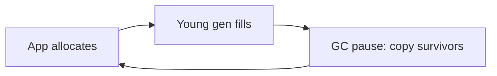

# How to read GC logs and tune the garbage collector

---

## 🟢 Junior Level

### 1. Why read GC logs?

The garbage collector runs invisibly, but when it pauses your application, users see slow responses. A **GC log** is the black-box recorder: it lists every collection, how long it paused the application, and how much memory it freed. (For *how* collectors work, see the Garbage Collection section of this repository; here we focus on observing and tuning.)

### 2. Real-world analogy

A garbage truck that sometimes blocks the street. The log tells you how often the truck comes, how long the street was blocked, and how much trash it removed. If it blocks the street for 2 seconds every minute, residents complain.

### 3. Enable the unified GC log (JDK 9+)

```bash
java -Xlog:gc*:file=gc.log:time,uptime,level,tags:filecount=5,filesize=20m -jar app.jar
```

Simplest form: `-Xlog:gc` prints one line per collection:

```
[2.345s][info][gc] GC(12) Pause Young (Normal) (G1 Evacuation Pause) 512M->140M(1024M) 8.412ms
```

Reading it: collection #12, a young pause, heap went from 512 MB to 140 MB (total heap 1024 MB), pause 8.4 ms.

### 4. Minimal Java program to see GC in action

```java
import java.util.ArrayList;
import java.util.List;

public class GcChurn {
    public static void main(String[] args) {
        List<byte[]> keep = new ArrayList<>();
        for (int i = 0; i < 2_000_000; i++) {
            byte[] tmp = new byte[10_000];        // short-lived garbage
            if (i % 5000 == 0) keep.add(tmp);      // a little survives
        }
        System.out.println("kept " + keep.size());
    }
}
```

```bash
javac GcChurn.java
java -Xmx256m -Xlog:gc GcChurn
```

You will see many `Pause Young` lines. Many frequent, short young pauses are normal.



> [!IMPORTANT]
> Healthy: frequent short young pauses, old gen stable. Unhealthy: Full GCs, long pauses, old gen near full after every collection.

---

## 🟡 Middle Level

### 1. Key log tags and what to read

```bash
-Xlog:gc*,gc+age=trace,safepoint:file=gc.log:time,uptime,level,tags
```

| Line / event | Meaning |
| :--- | :--- |
| `Pause Young (Normal)` | Regular young GC |
| `Pause Young (Concurrent Start)` | G1 begins concurrent marking (old gen occupancy over IHOP) |
| `Pause Young (Mixed)` | Also reclaims some old regions |
| `Pause Full (G1 Compaction Pause)` | Fallback stop-the-world full GC. **Red flag** in G1 |
| `To-space exhausted` / `Evacuation Failure` | Not enough free regions to copy survivors, usually expensive |
| `Humongous` allocations | Objects ≥ half a region; allocated in old gen directly, can hurt G1 |
| `Allocation Failure` | Young/old full; ordinary trigger |
| `Metadata GC Threshold` | Metaspace growth triggered a GC |
| `Pause Remark` / `Pause Cleanup` | Short G1 concurrent cycle pauses |

### 2. Metrics to extract

1. **Pause time distribution** (p50, p99, max) - determines latency impact.
2. **GC throughput**: `1 - (total pause time / wall time)`. Target ≥ 95-99%.
3. **Allocation rate**: bytes allocated per second between collections. High rate → frequent young GCs.
4. **Promotion rate**: bytes promoted young → old per second; high → old gen fills fast.
5. **Live set after Full/mixed GC**: the app's real memory need; size the heap at ~3-4× live set.
6. **Frequency of Full GC**: should be zero in steady state.

Tools: GCeasy (online), GCViewer, JMC, `jfr print --events GarbageCollection`, Grafana from Micrometer metrics (`jvm.gc.pause`, `jvm.gc.memory.promoted`, `jvm.gc.memory.allocated`, `jvm.memory.used`).

### 3. Quick live stats

```bash
jstat -gcutil <pid> 1000        # S0 S1 E O M CCS YGC YGCT FGC FGCT GCT per second
jcmd <pid> GC.heap_info
jcmd <pid> VM.flags | tr ' ' '\n' | grep -E "Use.*GC|Heap|Pause"
```

### 4. Tuning basics - the order that matters

1. **Don't tune first.** Measure with the defaults (G1 on server-class machines JDK 9+).
2. **Set heap sizes deliberately**: `-Xms` = `-Xmx` in servers to avoid resize pauses; in containers prefer `-XX:MaxRAMPercentage=75 -XX:InitialRAMPercentage=75` or explicit values leaving room for non-heap memory.
3. **Fix allocation** (reduce garbage) before flags: avoid boxing, repeated copying, giant temporary lists, `String.format` in hot paths.
4. **Choose collector** for goal:

| Goal | Choice | Flag |
| :--- | :--- | :--- |
| Balanced default | G1 | `-XX:+UseG1GC` (default), `-XX:MaxGCPauseMillis=200` |
| Max throughput batch jobs | Parallel | `-XX:+UseParallelGC` |
| Low latency, large heap | ZGC (generational default in JDK 23+; opt in with `-XX:+ZGenerational` on 21-22) | `-XX:+UseZGC` |
| Low latency alternative | Shenandoah | `-XX:+UseShenandoahGC` |
| Tiny containers (< 2 CPUs or < 1.8 GB) | JVM auto-selects Serial | `-XX:+UseSerialGC` |

5. Change one flag at a time and compare logs under the same load.

### 5. Example tuned launch for a 4 GB container

```bash
java -XX:MaxRAMPercentage=70 \
     -XX:+UseG1GC -XX:MaxGCPauseMillis=150 \
     -XX:+HeapDumpOnOutOfMemoryError -XX:HeapDumpPath=/var/data \
     -Xlog:gc*,safepoint:file=/var/log/app/gc-%t.log:time,uptime,level,tags:filecount=10,filesize=50m \
     -jar app.jar
```

### 6. Export GC metrics via Micrometer

```java
import io.micrometer.core.instrument.MeterRegistry;
import io.micrometer.core.instrument.binder.jvm.JvmGcMetrics;
import io.micrometer.core.instrument.binder.jvm.JvmMemoryMetrics;
import org.springframework.context.annotation.Bean;
import org.springframework.context.annotation.Configuration;

@Configuration
public class JvmMetricsConfig {

    @Bean JvmGcMetrics jvmGcMetrics() { return new JvmGcMetrics(); }       // Spring Boot registers it already
    @Bean JvmMemoryMetrics jvmMemoryMetrics() { return new JvmMemoryMetrics(); }
}
```

Spring Boot Actuator auto-configures these binders; the explicit beans only matter in plain Micrometer setups.

### 7. Common mistakes

- Copy-pasting a long flag list from the internet (CMS flags on G1, flags removed in newer JDKs → startup warnings or failures).
- `-XX:MaxGCPauseMillis=10` expecting a guarantee (it is a goal; too aggressive hurts throughput).
- Setting `-Xmx` equal to container memory (OOMKilled due to non-heap memory).
- Manually setting `-Xmn` (disables G1's adaptive young sizing).
- Calling `System.gc()` or leaving `-XX:+ExplicitGCInvocation` surprises from libraries (RMI triggers hourly full GC); use `-XX:+DisableExplicitGC` only knowing consequences (direct buffer cleanup).

---

## 🔴 Senior Level

### 1. Diagnosing from logs: patterns and their causes

| Pattern | Likely cause | Action |
| :--- | :--- | :--- |
| Young pauses growing linearly | Many survivors/large live young set, too small young gen | Reduce allocation of long-lived objects, check caches |
| Frequent concurrent cycles + Full GC | Old gen fills faster than marking finishes | Lower `-XX:InitiatingHeapOccupancyPercent` (default adaptive), raise heap, more `-XX:ConcGCThreads` |
| `Evacuation Failure` | Fragmentation, too few free regions | Larger heap, `-XX:G1ReservePercent` up, avoid humongous |
| Many `Humongous` allocs | Arrays > region/2 (e.g. 4 MB buffers with 8 MB regions) | Raise `-XX:G1HeapRegionSize`, chunk buffers, reuse |
| Pause `sys` time high | OS swapping, THP, container throttling | Disable swap, `AlwaysPreTouch`, cgroup limits |
| `real` >> `user+sys` | Waiting for CPU (container limits) or I/O writing the log | Check CPU limits, put logs on fast disk |
| Long "Time to safepoint" | Counted loops, JNI | `-Xlog:safepoint`, find offending thread |
| ZGC "Allocation Stall" | Allocation outruns reclamation | More heap headroom, more concurrent threads, generational ZGC |

### 2. Allocation and promotion arithmetic

If allocation rate is 800 MB/s and young gen is 400 MB, you get 2 young GCs per second. With 10 ms each that is 2% overhead - fine. Halving allocation rate halves frequency. If survivors per GC are 20 MB and the old gen headroom is 2 GB, premature promotion fills it in 100 collections (~50 s) and triggers mixed/concurrent cycles - this is why short-lived request data accidentally held for a few seconds (e.g. big in-flight batches) costs more than steady garbage.

### 3. Use JFR for structured GC analysis

```bash
jfr print --events jdk.GarbageCollection,jdk.GCPhasePause,jdk.GCHeapSummary recording.jfr | head -60
jfr summary recording.jfr
```

JFR provides cause, name (G1New, G1Old), sum of pauses, and heap summaries, enabling programmatic analysis:

```java
import jdk.jfr.consumer.RecordedEvent;
import jdk.jfr.consumer.RecordingFile;

import java.nio.file.Path;
import java.time.Duration;
import java.util.ArrayList;
import java.util.List;

public class GcPauseReport {
    public static void main(String[] args) throws Exception {
        List<Long> pausesMs = new ArrayList<>();
        try (RecordingFile f = new RecordingFile(Path.of(args[0]))) {
            while (f.hasMoreEvents()) {
                RecordedEvent e = f.readEvent();
                if (e.getEventType().getName().equals("jdk.GCPhasePause")) {
                    pausesMs.add(e.getDuration().toMillis());
                }
            }
        }
        pausesMs.sort(Long::compare);
        if (pausesMs.isEmpty()) { System.out.println("no pauses"); return; }
        System.out.println("count=" + pausesMs.size()
                + " p50=" + pausesMs.get(pausesMs.size() / 2)
                + " p99=" + pausesMs.get((int) (pausesMs.size() * 0.99))
                + " max=" + pausesMs.get(pausesMs.size() - 1));
    }
}
```

### 4. Container-aware sizing

JVM reads cgroup limits (JDK 10+, cgroup v2 supported since JDK 15). `-XX:ActiveProcessorCount` can override CPU detection. GC threads default derive from CPU count: with CPU quota 1 core in a 64-core host, the JVM sees 1 CPU (container support) and may choose SerialGC. Don't assume G1 in tiny pods; verify with `jcmd <pid> VM.info | grep -i gc` or log `-Xlog:gc+init`.

### 5. Trade-off matrix

| Knob | Pro | Con |
| :--- | :--- | :--- |
| Larger heap | Fewer GCs, fewer promotions | Longer individual pauses in Parallel, cost, longer dump |
| Lower pause goal | Shorter pauses | More frequent GCs, lower throughput |
| ZGC / Shenandoah | Sub-ms pauses | ~10-20% more CPU/memory, load barrier overhead |
| `AlwaysPreTouch` | Avoids page-fault jitter | Slow startup |
| Large pages (`-XX:+UseTransparentHugePages`) | Fewer TLB misses | Possible latency stalls (khugepaged), measure |
| String deduplication (`-XX:+UseStringDeduplication`) | Saves memory with many identical strings | CPU cost |

### 6. Process for a GC-related latency incident

1. Overlay GC pause events on the p99 latency graph. Do spikes align?
2. If aligned: identify pause type from the log (young/mixed/full/evacuation failure).
3. Compute allocation and promotion rates. Reduce or fix leak (see [How to find memory leaks with heap dumps and MAT](08.%20How%20to%20find%20memory%20leaks%20with%20heap%20dumps%20and%20MAT.md)).
4. Adjust heap headroom or collector; re-test with realistic load.
5. Add alerts on `jvm_gc_pause_seconds_max` and old-gen usage after GC.

---

## 🎯 Interview Cheat Sheet

### 30-second elevator pitch
"I enable unified GC logging with `-Xlog:gc*`, then read pause times, frequency, allocation and promotion rates and the live set after GC. I fix allocation and heap sizing before flags, keep G1 as default, move to ZGC for strict latency with big heaps, never accept Full GCs in steady state, and overlay GC pauses on latency graphs to prove causality."

### Must-know bullets
- `-Xlog:gc*:file=gc.log:time,uptime,level,tags` (JDK 9+); old `-XX:+PrintGCDetails` is obsolete.
- Metrics: pause p99, GC overhead %, allocation rate, promotion rate, live set.
- Full GC in G1 = red flag; humongous objects and evacuation failures matter.
- `MaxGCPauseMillis` is a goal, not a guarantee.
- Heap in containers: `MaxRAMPercentage`, leave room for non-heap.
- Tools: GCeasy, GCViewer, JMC, `jstat`, Micrometer.

### Common follow-up questions
1. How do you decide between G1 and ZGC?
2. What is a humongous allocation?
3. What does `Pause Young (Concurrent Start)` mean?
4. How would you reduce GC pauses without changing the collector?
5. Why might real time exceed user + sys in the log?

### 🚩 Red flags
- Tuning by random flags from blog posts.
- Setting `-Xmx` to the full container limit.
- Never looking at the GC log during a latency incident.
- Using `System.gc()` in code.

### Related topics
- [How to find memory leaks with heap dumps and MAT](08.%20How%20to%20find%20memory%20leaks%20with%20heap%20dumps%20and%20MAT.md)
- [How to profile a Java application with JFR and async-profiler](04.%20How%20to%20profile%20a%20Java%20application%20with%20JFR%20and%20async-profiler.md)
- [Why percentiles p95 and p99 matter more than averages](02.%20Why%20percentiles%20p95%20and%20p99%20matter%20more%20than%20averages.md)
- [Common Java performance anti-patterns](21.%20Common%20Java%20performance%20anti-patterns.md)
