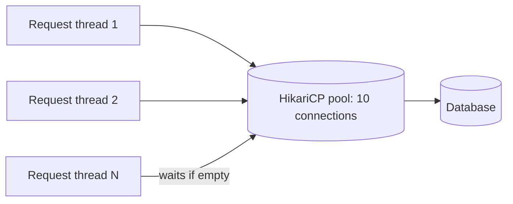

# How to tune a connection pool with HikariCP

---

## 🟢 Junior Level

### 1. What is a connection pool?

Opening a database connection is expensive (TCP handshake, TLS, authentication, session setup: often 5-50 ms or more). A **connection pool** opens a fixed set of connections once and **lends** them to your code, taking them back when you finish. **HikariCP** is the default pool in Spring Boot 2.x/3.x.

### 2. Real-world analogy

A taxi rank: instead of building a new taxi for each passenger, there are 10 taxis. Passengers wait in line if all are busy. Too few taxis → long queues; too many → traffic jams on the road (the database).

### 3. Minimal working example

```java
import com.zaxxer.hikari.HikariConfig;
import com.zaxxer.hikari.HikariDataSource;

import java.sql.Connection;
import java.sql.ResultSet;
import java.sql.Statement;

public class HikariDemo {
    public static void main(String[] args) throws Exception {
        HikariConfig cfg = new HikariConfig();
        cfg.setJdbcUrl("jdbc:postgresql://localhost:5432/shop");
        cfg.setUsername("app");
        cfg.setPassword(System.getenv("DB_PASSWORD"));
        cfg.setMaximumPoolSize(10);

        try (HikariDataSource ds = new HikariDataSource(cfg);
             Connection c = ds.getConnection();
             Statement st = c.createStatement();
             ResultSet rs = st.executeQuery("select 1")) {
            rs.next();
            System.out.println(rs.getInt(1));
        } // connection returns to the pool on close()
    }
}
```

In Spring Boot, configure it in `application.yml`:

```yaml
spring:
  datasource:
    url: jdbc:postgresql://localhost:5432/shop
    username: app
    password: ${DB_PASSWORD}
    hikari:
      maximum-pool-size: 10
```



> [!IMPORTANT]
> `close()` on a pooled connection does **not** close the socket; it returns the connection to the pool. Forgetting to close = **connection leak**.

---

## 🟡 Middle Level

### 1. The important settings

| Property | Default | Meaning / guidance |
| :--- | :--- | :--- |
| `maximumPoolSize` | 10 | Max connections (idle + in use). The most important knob |
| `minimumIdle` | = max | HikariCP recommends leaving the default (fixed-size pool) for best performance under spikes |
| `connectionTimeout` | 30000 ms | How long a thread waits for a connection before `SQLTransientConnectionException`. Lower it (e.g. 2-5 s) to fail fast |
| `idleTimeout` | 600000 | Only matters if `minimumIdle < maximumPoolSize` |
| `maxLifetime` | 1800000 | Retire connections before DB/firewall/LB kills them. Set **a few minutes shorter** than the DB or proxy timeout |
| `keepaliveTime` | 0 (off) | Pings idle connections (e.g. every 2-5 min) to survive idle-killing firewalls |
| `validationTimeout` | 5000 | Time to validate a connection |
| `leakDetectionThreshold` | 0 (off) | Log a stack trace if a connection is held longer than N ms (e.g. 10000) |
| `autoCommit` | true | Keep consistent with your transaction management |

### 2. How large should the pool be?

The HikariCP "About Pool Sizing" guidance (based on PostgreSQL's research) gives a starting formula:

```
connections = (core_count × 2) + effective_spindle_count
```

For a DB server with 8 cores and SSD: ~17-20 *total across all app instances*. Surprisingly **small pools are faster**: a database can only run about as many queries truly in parallel as it has CPU cores/disk channels; extra connections only add context switching and lock contention.

Use Little's Law for the application side: `connections ≈ queries/s × average connection hold time (s)`. At 500 queries/s and 8 ms hold time: 4 connections in use on average; a pool of 10 gives headroom.

**Critical:** total connections = `pool size × number of app instances` (plus other clients). 20 pods × 10 = 200 connections, which may exceed PostgreSQL `max_connections` (default 100) or the DB's efficient parallelism. Use a pooler (PgBouncer, RDS Proxy) in transaction mode if you scale pods widely.

### 3. Production-ready Spring Boot config

```yaml
spring:
  datasource:
    hikari:
      pool-name: orders-db
      maximum-pool-size: 12
      minimum-idle: 12
      connection-timeout: 3000          # fail fast: 3 s
      max-lifetime: 1500000             # 25 min (DB/proxy kills at 30)
      keepalive-time: 300000            # 5 min
      leak-detection-threshold: 15000   # 15 s
      data-source-properties:
        prepStmtCacheSize: 250
        cachePrepStmts: true
        useServerPrepStmts: true
```

(The `data-source-properties` above follow MySQL Connector/J conventions. For PostgreSQL use `prepareThreshold` and `reWriteBatchedInserts=true` URL parameters.)

### 4. Metrics that tell the truth

Spring Boot + Micrometer expose HikariCP metrics automatically:

| Metric | Meaning |
| :--- | :--- |
| `hikaricp.connections.active` | In use now |
| `hikaricp.connections.idle` | Free connections |
| `hikaricp.connections.pending` | Threads waiting. **> 0 for sustained time = pool is the bottleneck** |
| `hikaricp.connections.acquire` | Time waiting to get a connection (timer) |
| `hikaricp.connections.usage` | Time connections were held by code (timer) |
| `hikaricp.connections.timeout` | Count of acquisition timeouts |
| `hikaricp.connections.creation` | Time to open a physical connection |

PromQL: `max(hikaricp_connections_pending{pool="orders-db"}) > 0` for 2 minutes → alert. Compare `acquire` time vs `usage` time: high acquire means too few connections *or* connections held too long.

### 5. Common mistakes

- **Raising pool size to "fix" slow queries.** If connections are held 400 ms because of a slow query, more connections increases DB load and makes it worse.
- **Holding a connection across slow non-DB work:** e.g. `@Transactional` method that calls a remote HTTP API inside. The connection is occupied during the HTTP latency. Narrow the transaction.
- **`open-in-view` enabled** (Spring Boot default `spring.jpa.open-in-view=true`): the `EntityManager`/connection can remain bound to the request through view rendering/serialization. Set it to `false` for APIs.
- **Per-pod pool × pods > DB capacity.**
- **maxLifetime longer than infrastructure timeouts** → "Connection reset" / "closed connection" errors.
- **Not closing connections** (manual JDBC without try-with-resources).

```java
// Correct: connection held for the shortest possible time
@Transactional(readOnly = true)
public OrderView load(long id) {
    Order o = repo.findById(id).orElseThrow();
    return OrderView.from(o);       // no remote calls inside the transaction
}
```

---

## 🔴 Senior Level

### 1. How HikariCP achieves its speed

HikariCP uses a lock-free `ConcurrentBag` with thread-local lists of recently used connections (so a thread typically gets the same connection back), `FastList` instead of `ArrayList` for statements (no range checks), proxies generated with Javassist (now straightforward `ProxyConnection` classes) with minimal overhead, and a handoff queue (`SynchronousQueue`) to wake waiters. Connection state is compared via cached fields, and `isValid()` is called only if the connection was idle for more than 500 ms (`aliveBypassWindowMs`).

### 2. Diagnosing pool exhaustion

Symptom: `HikariPool-1 - Connection is not available, request timed out after 30000ms (total=10, active=10, idle=0, waiting=37)`.

Steps:

1. Dump threads (see [How to diagnose deadlocks and high CPU with thread dumps](07.%20How%20to%20diagnose%20deadlocks%20and%20high%20CPU%20with%20thread%20dumps.md)): are 10 threads running SQL (slow query) or holding connections while doing something else (HTTP call, lock wait)?
2. Check `hikaricp.connections.usage` p99: how long are connections held?
3. Check the DB: `SELECT state, count(*) FROM pg_stat_activity GROUP BY 1;` - many `idle in transaction` = application holds transactions open without issuing queries. Set `idle_in_transaction_session_timeout`.
4. Turn on `leakDetectionThreshold` to log the stack trace of the code that holds a connection too long.
5. Check for a **connection leak**: `active` never returns to 0 even at zero traffic.
6. Check for deadlock between a pool thread and a connection: a thread holding connection A needs connection B (nested `REQUIRES_NEW` transactions) while the pool is exhausted → deadlock-like starvation. With pool size P, `REQUIRES_NEW` nested inside a transaction requires up to 2 connections per thread. Pool size ≥ `threads × 2` or avoid nesting.

### 3. Programmatic access and tuning

```java
import com.zaxxer.hikari.HikariConfig;
import com.zaxxer.hikari.HikariDataSource;
import com.zaxxer.hikari.HikariPoolMXBean;
import io.micrometer.core.instrument.MeterRegistry;
import org.springframework.context.annotation.Bean;
import org.springframework.context.annotation.Configuration;

import javax.sql.DataSource;

@Configuration
public class DataSourceConfig {

    @Bean
    public DataSource dataSource(MeterRegistry registry) {
        HikariConfig cfg = new HikariConfig();
        cfg.setPoolName("orders-db");
        cfg.setJdbcUrl(System.getenv("DB_URL"));
        cfg.setUsername(System.getenv("DB_USER"));
        cfg.setPassword(System.getenv("DB_PASSWORD"));
        cfg.setMaximumPoolSize(12);
        cfg.setConnectionTimeout(3_000);
        cfg.setMaxLifetime(25 * 60_000L);
        cfg.setKeepaliveTime(5 * 60_000L);
        cfg.setLeakDetectionThreshold(15_000);
        cfg.setMetricRegistry(registry);                 // Hikari native Micrometer integration
        cfg.setRegisterMbeans(true);                     // JMX: HikariPoolMXBean
        return new HikariDataSource(cfg);
    }

    public static String snapshot(HikariDataSource ds) {
        HikariPoolMXBean p = ds.getHikariPoolMXBean();
        return "active=" + p.getActiveConnections()
             + " idle=" + p.getIdleConnections()
             + " waiting=" + p.getThreadsAwaitingConnection();
    }
}
```

When Spring Boot auto-configures the `DataSource`, don't define your own unless needed; use `spring.datasource.hikari.*`.

### 4. Virtual threads and pool sizing

With Java 21 virtual threads (`spring.threads.virtual.enabled=true` in Boot 3.2+), thousands of concurrent requests may attempt to borrow connections. The pool remains the limiter; many virtual threads parked waiting is cheap but increases latency via queueing. Keep `connectionTimeout` short, apply bulkheads/semaphores for non-critical paths, and don't increase the pool just because threads are cheap.

### 5. Failover and DNS

During DB failover (Aurora, RDS Multi-AZ), existing connections break. Hikari evicts broken ones on use; set JDBC driver TCP timeouts (`socketTimeout`, `connectTimeout`, PostgreSQL `tcpKeepAlive=true`) so threads do not hang for minutes. Use `maxLifetime` jitter (Hikari already applies ~2.5% variance) to avoid thundering reconnect herds. Consider AWS JDBC wrapper drivers for fast failover.

### 6. Benchmark-driven tuning

Change pool size in steps (5, 10, 20, 40) in a load test, measuring throughput and p99 plus DB CPU. Typically throughput peaks near the DB's parallelism and then drops. Select the smallest pool near the peak. Remember to multiply by instance count.

---

## 🎯 Interview Cheat Sheet

### 30-second elevator pitch
"A pool reuses expensive DB connections. HikariCP is Spring Boot's default; the key knob is `maximumPoolSize`, and smaller is usually better: roughly cores×2 on the DB side, shared across all instances. I watch `hikaricp.connections.pending`, `acquire` and `usage` timers, set a short `connectionTimeout`, a `maxLifetime` under infrastructure timeouts, and use leak detection. Exhaustion is usually slow queries or long transactions, not a too-small pool."

### Must-know bullets
- `close()` returns the connection to the pool.
- Total DB connections = pool size × instances.
- `pending > 0` sustained → pool is a bottleneck; investigate hold time first.
- `maxLifetime` < DB/proxy idle kill time; `keepaliveTime` for firewalls.
- Disable `open-in-view` for APIs, keep transactions short, no remote calls inside them.
- Nested `REQUIRES_NEW` can deadlock on exhausted pools.

### Common follow-up questions
1. What pool size would you choose and why?
2. How do you detect a connection leak?
3. What's the difference between acquire and usage time?
4. Do virtual threads change pool sizing?
5. Why PgBouncer or RDS Proxy?

### 🚩 Red flags
- "Set max pool size to 200 to be safe."
- Not knowing how many instances share the DB.
- Remote HTTP calls inside `@Transactional`.
- Default 30 s connection timeout on a user-facing API.

### Related topics
- [How to detect and fix N+1 queries and slow SQL](11.%20How%20to%20detect%20and%20fix%20N+1%20queries%20and%20slow%20SQL.md)
- [How to size thread pools correctly](12.%20How%20to%20size%20thread%20pools%20correctly.md)
- [How to expose metrics with Micrometer and Spring Boot Actuator](15.%20How%20to%20expose%20metrics%20with%20Micrometer%20and%20Spring%20Boot%20Actuator.md)
- [What are the RED and USE methods](17.%20What%20are%20the%20RED%20and%20USE%20methods.md)
