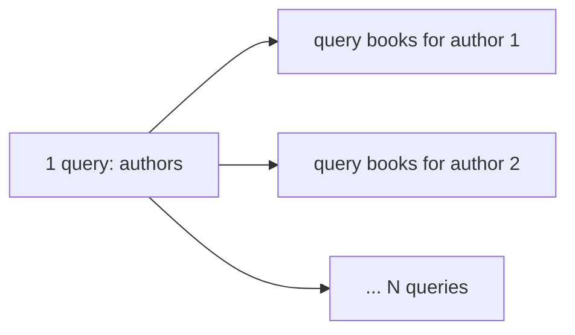

# How to detect and fix N+1 queries and slow SQL

---

## 🟢 Junior Level

### 1. What is the N+1 problem?

You run **1** query to fetch a list of N parent rows, then your code triggers **N more** queries, one per parent, to fetch each parent's children. Total: `1 + N` queries instead of 1 or 2. It is the most common ORM performance bug.

### 2. Real-world analogy

You ask the library for a list of 100 authors, then walk back to the desk 100 separate times asking "what books did author #1 write?", "author #2?"... Instead of one request: "give me every book by these 100 authors".

### 3. Minimal JPA example

```java
import jakarta.persistence.*;
import java.util.ArrayList;
import java.util.List;

@Entity
public class Author {
    @Id @GeneratedValue private Long id;
    private String name;

    @OneToMany(mappedBy = "author")          // LAZY by default for collections
    private List<Book> books = new ArrayList<>();

    public String getName() { return name; }
    public List<Book> getBooks() { return books; }
}

@Entity
public class Book {
    @Id @GeneratedValue private Long id;
    private String title;

    @ManyToOne(fetch = FetchType.LAZY)
    private Author author;
}
```

```java
List<Author> authors = authorRepository.findAll();            // 1 query
for (Author a : authors) {
    System.out.println(a.getName() + " wrote " + a.getBooks().size()); // N queries!
}
```

With 100 authors you get 101 SQL statements. The fix:

```java
public interface AuthorRepository extends JpaRepository<Author, Long> {

    @Query("select distinct a from Author a left join fetch a.books")
    List<Author> findAllWithBooks();        // 1 query with a JOIN
}
```



> [!IMPORTANT]
> Rule of thumb: **number of SQL statements per request should not grow with the number of rows returned.**

---

## 🟡 Middle Level

### 1. Detecting N+1

| Method | How |
| :--- | :--- |
| SQL logging (dev only) | `spring.jpa.show-sql=true` or `logging.level.org.hibernate.SQL=DEBUG` |
| Hibernate statistics | `spring.jpa.properties.hibernate.generate_statistics=true`, log `org.hibernate.stat` |
| Datasource proxy | `datasource-proxy` / `p6spy` count queries per request |
| Test-time assertion | `hypersistence-utils` `SQLStatementCountValidator`, Spring `QueryCountHolder`, or `hibernate-test-utils` |
| APM / tracing | Spans: dozens of identical `SELECT` spans in one trace |
| DB side | `pg_stat_statements` shows the same query with huge `calls` count |

Example: a unit/integration test that fails when a request issues too many statements (using Hibernate's `Statistics`):

```java
import org.hibernate.SessionFactory;
import org.hibernate.stat.Statistics;
import org.junit.jupiter.api.Test;
import org.springframework.beans.factory.annotation.Autowired;
import org.springframework.boot.test.context.SpringBootTest;

import jakarta.persistence.EntityManagerFactory;

import static org.junit.jupiter.api.Assertions.assertTrue;

@SpringBootTest
class AuthorQueryCountTest {

    @Autowired EntityManagerFactory emf;
    @Autowired AuthorService service;

    @Test
    void listAuthorsDoesNotTriggerNPlusOne() {
        Statistics stats = emf.unwrap(SessionFactory.class).getStatistics();
        stats.setStatisticsEnabled(true);
        stats.clear();

        service.listAuthorsWithBookCounts();

        long queries = stats.getPrepareStatementCount();
        assertTrue(queries <= 2, "Expected <= 2 queries but was " + queries);
    }
}
```

(Requires `spring.jpa.properties.hibernate.generate_statistics=true` in the test profile and an `AuthorService` in your application.)

### 2. Fixes, from most to least targeted

| Fix | Example | Notes |
| :--- | :--- | :--- |
| **`JOIN FETCH`** | `select a from Author a join fetch a.books` | One query; cartesian row multiplication; can't paginate collections in SQL (Hibernate warns `HHH000104` and paginates in memory) |
| **`@EntityGraph`** | `@EntityGraph(attributePaths = "books")` on repository method | Declarative alternative to JOIN FETCH |
| **Batch fetching** | `@BatchSize(size = 50)` or `hibernate.default_batch_fetch_size=50` | Loads children with `where author_id in (?, ?, ...)`: N+1 → N/50 + 1. Great with pagination |
| **Projections / DTOs** | `select new com.x.AuthorSummary(a.name, count(b)) ... group by` | Read-only screens: skip entity overhead |
| **Subselect fetch** | `@Fetch(FetchMode.SUBSELECT)` | One extra query for all collections of the original result |
| **Fix the mapping** | `@ManyToOne` default is **EAGER** → set `fetch = LAZY` explicitly | Eager `@ManyToOne` often creates hidden N+1 in JPQL queries |

### 3. Pagination with collections: the correct pattern

```java
// Step 1: paginate parent IDs only
Page<Long> ids = authorRepository.findIds(PageRequest.of(0, 20));

// Step 2: fetch the entities with their collections by ids
List<Author> authors = authorRepository.findAllWithBooksByIdIn(ids.getContent());
```

```java
public interface AuthorRepository extends JpaRepository<Author, Long> {

    @Query("select a.id from Author a order by a.name")
    Page<Long> findIds(Pageable pageable);

    @Query("select distinct a from Author a left join fetch a.books where a.id in :ids order by a.name")
    List<Author> findAllWithBooksByIdIn(@Param("ids") List<Long> ids);
}
```

### 4. Common mistakes

- `FetchType.EAGER` everywhere "to avoid LazyInitializationException" → loads huge graphs.
- Fixing N+1 with `JOIN FETCH` on two `List` collections (`MultipleBagFetchException` or massive cartesian product) - use `Set`, batch fetching, or separate queries.
- `open-in-view=true` hiding lazy loading in JSON serialization: N+1 happens in the controller/serializer.
- Calling a repository inside a loop (`for (id : ids) repo.findById(id)`) → use `findAllById`.
- `@Transactional` missing, so each lazy access opens its own session (with `enable_lazy_load_no_trans`).

---

## 🔴 Senior Level

### 1. Systematic slow-query diagnosis

**PostgreSQL:**

```sql
-- enable once per DB (needs shared_preload_libraries = 'pg_stat_statements')
CREATE EXTENSION IF NOT EXISTS pg_stat_statements;

SELECT calls, round(total_exec_time::numeric, 1) AS total_ms,
       round(mean_exec_time::numeric, 2) AS mean_ms, rows, left(query, 100) AS query
FROM pg_stat_statements
ORDER BY total_exec_time DESC
LIMIT 10;
```

Order by `total_exec_time` (frequency × cost), not only mean: a 2 ms query called 50M times per day outweighs a 3 s monthly report.

Slow query log: `log_min_duration_statement = 500` (ms). `auto_explain` extension logs plans of slow statements automatically.

**MySQL:** `slow_query_log=1`, `long_query_time=0.5`, `performance_schema.events_statements_summary_by_digest`, `pt-query-digest` from Percona Toolkit.

### 2. Reading the plan

```sql
EXPLAIN (ANALYZE, BUFFERS, VERBOSE)
SELECT * FROM orders WHERE customer_id = 42 AND status = 'OPEN' ORDER BY created_at DESC LIMIT 20;
```

What to look for:

| Plan signal | Meaning | Typical fix |
| :--- | :--- | :--- |
| `Seq Scan` on a large table with selective filter | Missing/unused index | Add a composite index matching `WHERE` + `ORDER BY` |
| `rows=1` estimated vs `rows=50000` actual | Stale statistics | `ANALYZE`, extended statistics |
| `Sort Method: external merge Disk` | Sort spilled to disk | Index providing order, raise `work_mem` carefully |
| `Nested Loop` with huge outer rows | Bad join order/estimate | Better indexes, rewrite |
| `Buffers: read=...` high | Cold cache / IO-bound | Index, cache, working set vs RAM |
| `Rows Removed by Filter` large | Index not selective for the filter | Composite/partial index |

Index example matching the query above: `CREATE INDEX CONCURRENTLY idx_orders_cust_status_created ON orders (customer_id, status, created_at DESC);` Equality columns first, then the sort column.

### 3. ORM-specific costs besides query count

- **Cartesian explosion:** fetch-joining two collections multiplies rows (`books × reviews`). Fetch one collection per query.
- **Offset pagination at depth:** `OFFSET 1000000` scans and discards a million rows. Use **keyset pagination** (`WHERE (created_at, id) < (?, ?) ORDER BY created_at DESC, id DESC LIMIT 20`).
- **Persistence context bloat and dirty checking:** loading 50k entities costs memory and flush time. Use read-only transactions (`@Transactional(readOnly = true)` sets Hibernate flush mode MANUAL), DTO projections, or stateless sessions for batches.
- **Insert performance:** `GenerationType.IDENTITY` disables JDBC batching; use sequences with `allocationSize` and set `hibernate.jdbc.batch_size=50`, `hibernate.order_inserts=true`.
- **`select *` with LOBs/JSON blobs** moving MBs of unused data.
- **Lock waits:** long transactions + `SELECT ... FOR UPDATE`; check `pg_locks`/`pg_stat_activity` where `wait_event_type = 'Lock'`.
- **Prepared statement / plan issues:** parameter sniffing, generic vs custom plans in PostgreSQL (`plan_cache_mode`).

Batch insert settings:

```yaml
spring:
  jpa:
    properties:
      hibernate:
        jdbc:
          batch_size: 50
          order_inserts: true
          order_updates: true
        default_batch_fetch_size: 50
        generate_statistics: false
```

### 4. DTO projection without entity overhead

```java
public interface OrderRow {
    Long getId();
    String getCustomerName();
    java.math.BigDecimal getTotal();
}

public interface OrderRepository extends JpaRepository<Order, Long> {

    @Query("""
           select o.id as id, c.name as customerName, o.total as total
           from Order o join o.customer c
           where o.status = :status
           """)
    List<OrderRow> findRows(@Param("status") OrderStatus status, Pageable pageable);
}
```

### 5. Production workflow for a DB-driven latency issue

1. Traces show slow DB spans → find the statement.
2. `pg_stat_statements` for top total time and queries with surging `calls`.
3. `EXPLAIN (ANALYZE, BUFFERS)` on a production-like copy (same data volume and stats!).
4. Apply index via `CREATE INDEX CONCURRENTLY` (avoids table-level write blocks), verify with plan and latency.
5. Check for index bloat/write amplification: every new index slows writes; drop unused ones (`pg_stat_user_indexes.idx_scan = 0`).
6. Add query-count tests and an alert on DB latency or `hikaricp.connections.usage`. See [How to tune a connection pool with HikariCP](10.%20How%20to%20tune%20a%20connection%20pool%20with%20HikariCP.md).

### 6. When ORM is the wrong tool

Reporting, bulk updates and analytics: use native SQL, jOOQ, or JdbcTemplate/`NamedParameterJdbcTemplate` with `batchUpdate`. A single `UPDATE ... WHERE` beats loading 100k entities and mutating them.

---

## 🎯 Interview Cheat Sheet

### 30-second elevator pitch
"N+1 is one query for N parents plus N queries for their lazy children. I detect it with SQL/statistics logging, query-count assertions in tests and repeated SELECT spans in traces, then fix it with `JOIN FETCH` or `@EntityGraph` for single collections, batch fetching for paginated lists, or DTO projections for read models. For slow SQL I rank statements by total time in `pg_stat_statements`, read `EXPLAIN (ANALYZE, BUFFERS)`, and add targeted indexes."

### Must-know bullets
- Make associations `LAZY`; `@ManyToOne` defaults to EAGER.
- `JOIN FETCH` + pagination on collections = in-memory paging warning.
- `default_batch_fetch_size` is a cheap global mitigation.
- Keyset pagination beats `OFFSET`.
- IDENTITY ids disable JDBC batch inserts.
- Add indexes for `WHERE` + `ORDER BY`; verify with the plan; use `CONCURRENTLY`.

### Common follow-up questions
1. How do you fetch two collections without a cartesian product?
2. Why is `open-in-view` dangerous?
3. How do you find top queries in PostgreSQL?
4. What is a covering index?
5. Why might the planner ignore your index?

### 🚩 Red flags
- Solving every LazyInitializationException with EAGER.
- Looping over repository calls.
- Adding indexes blindly without checking plans or write cost.
- Testing with 100 rows locally and shipping.

### Related topics
- [How to tune a connection pool with HikariCP](10.%20How%20to%20tune%20a%20connection%20pool%20with%20HikariCP.md)
- [How distributed tracing works with OpenTelemetry and APM tools](15.%20How%20distributed%20tracing%20works%20with%20OpenTelemetry%20and%20APM%20tools.md)
- [Common Java performance anti-patterns](21.%20Common%20Java%20performance%20anti-patterns.md)
- [How to troubleshoot Java performance problems methodically](03.%20How%20to%20troubleshoot%20Java%20performance%20problems%20methodically.md)
