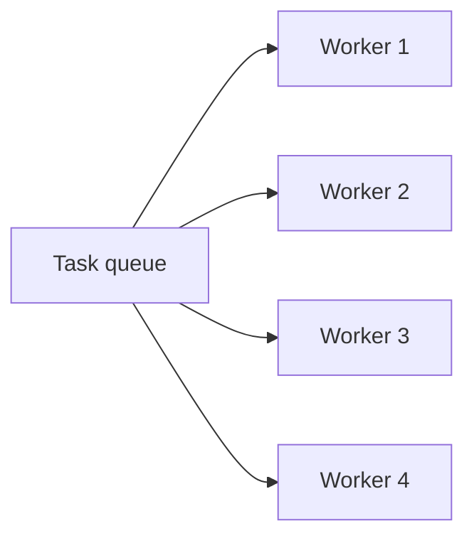

# How to size thread pools correctly

---

## 🟢 Junior Level

### 1. What is a thread pool?

Creating a thread per task is expensive and unbounded. A **thread pool** keeps a fixed number of worker threads and feeds them tasks from a queue. In Java: `ExecutorService` / `ThreadPoolExecutor`. Spring Boot's Tomcat also has a request thread pool (default 200 threads), and `@Async` uses an executor.

### 2. Real-world analogy

A restaurant with 5 cooks (threads) and a rail of order tickets (queue). Hire too few cooks and customers wait; hire too many in a tiny kitchen and they bump into each other.

### 3. Minimal example

```java
import java.util.concurrent.ExecutorService;
import java.util.concurrent.Executors;
import java.util.concurrent.TimeUnit;

public class PoolDemo {
    public static void main(String[] args) throws Exception {
        ExecutorService pool = Executors.newFixedThreadPool(4);

        for (int i = 1; i <= 10; i++) {
            final int id = i;
            pool.submit(() -> System.out.println(
                    "task " + id + " on " + Thread.currentThread().getName()));
        }

        pool.shutdown();
        pool.awaitTermination(10, TimeUnit.SECONDS);
    }
}
```

Only 4 threads run 10 tasks.

### 4. The first sizing rule

| Task type | Threads should be about |
| :--- | :--- |
| **CPU-bound** (computation, hashing, parsing) | number of CPU cores (or cores + 1) |
| **I/O-bound** (DB, HTTP, disk waits) | more than cores, depends on how long tasks wait |

Get the core count: `Runtime.getRuntime().availableProcessors()`.



> [!IMPORTANT]
> `Executors.newFixedThreadPool` uses an **unbounded** queue: under overload memory grows without limit. Prefer an explicit `ThreadPoolExecutor` with a bounded queue.

---

## 🟡 Middle Level

### 1. The sizing formula

For a task that spends time `W` waiting (I/O) and `C` computing, on `N` cores with target utilization `U` (0-1):

```
threads = N × U × (1 + W / C)
```

Example: 8 cores, 80% target, tasks 90 ms waiting on DB and 10 ms CPU: `8 × 0.8 × (1 + 9) = 64` threads. This is Little's Law in disguise. Then **cap by the downstream resource**: if the DB pool has 10 connections, 64 threads simply queue on the pool; a larger executor does not add throughput.

### 2. `ThreadPoolExecutor` behavior surprises

```java
import java.util.concurrent.*;

public class Pools {

    public static ThreadPoolExecutor create(String name, int core, int max, int queue) {
        ThreadFactory tf = new ThreadFactory() {
            private final java.util.concurrent.atomic.AtomicInteger n = new java.util.concurrent.atomic.AtomicInteger();
            @Override public Thread newThread(Runnable r) {
                Thread t = new Thread(r, name + "-" + n.incrementAndGet());
                t.setDaemon(false);
                return t;
            }
        };
        ThreadPoolExecutor ex = new ThreadPoolExecutor(
                core, max,
                60, TimeUnit.SECONDS,
                new ArrayBlockingQueue<>(queue),            // bounded
                tf,
                new ThreadPoolExecutor.CallerRunsPolicy()); // back-pressure
        ex.allowCoreThreadTimeOut(true);
        return ex;
    }
}
```

Submission algorithm: (1) if running threads < `corePoolSize` → start a new thread; (2) else try to **enqueue**; (3) only if the queue is **full** and threads < `maximumPoolSize` → add a thread; (4) else apply the **rejection policy**. So with an unbounded queue, `maximumPoolSize` is never used. A common mistake is setting `core=10, max=100` with `LinkedBlockingQueue` and expecting scale to 100.

| Rejection policy | Behavior |
| :--- | :--- |
| `AbortPolicy` (default) | Throws `RejectedExecutionException` |
| `CallerRunsPolicy` | Submitter runs the task: natural back-pressure (slows producers) |
| `DiscardPolicy` / `DiscardOldestPolicy` | Silently drops: dangerous |

### 3. Spring configuration

```java
import org.springframework.context.annotation.Bean;
import org.springframework.context.annotation.Configuration;
import org.springframework.scheduling.annotation.EnableAsync;
import org.springframework.scheduling.concurrent.ThreadPoolTaskExecutor;

import java.util.concurrent.Executor;
import java.util.concurrent.ThreadPoolExecutor;

@Configuration
@EnableAsync
public class AsyncConfig {

    @Bean("emailExecutor")
    public Executor emailExecutor() {
        ThreadPoolTaskExecutor ex = new ThreadPoolTaskExecutor();
        ex.setThreadNamePrefix("email-");
        ex.setCorePoolSize(4);
        ex.setMaxPoolSize(16);
        ex.setQueueCapacity(200);
        ex.setRejectedExecutionHandler(new ThreadPoolExecutor.CallerRunsPolicy());
        ex.setWaitForTasksToCompleteOnShutdown(true);
        ex.setAwaitTerminationSeconds(30);
        ex.initialize();
        return ex;
    }
}
```

Use `@Async("emailExecutor")` on methods. Note: Spring Boot's auto-configured `applicationTaskExecutor` has an unbounded queue by default (`spring.task.execution.pool.queue-capacity` default `Integer.MAX_VALUE`) and `core-size=8`; override it. Tomcat: `server.tomcat.threads.max` (default 200), `server.tomcat.accept-count` (default 100), `server.tomcat.max-connections` (default 8192).

### 4. One pool per bottleneck (bulkheads)

A single shared pool for everything lets one slow dependency consume all threads and starve unrelated work. Separate pools per downstream (payments, email, search) with their own limits so failures stay contained. Resilience4j offers `Bulkhead` / `ThreadPoolBulkhead`.

### 5. Monitoring

Micrometer binds executors automatically for Spring beans (`executor.active`, `executor.queued`, `executor.pool.size`, `executor.completed`) when wrapped using `ExecutorServiceMetrics.monitor(registry, executor, "emailExecutor")`. Alert on `executor.queued` growth and rejected tasks. In Tomcat: `tomcat.threads.busy` and `tomcat.threads.current`.

### 6. Common mistakes

- `Executors.newCachedThreadPool()` in server code: unbounded thread creation under load → OOM (`unable to create native thread`).
- Using `parallelStream()` or `CompletableFuture.supplyAsync` without an executor for **blocking** work: it uses the shared `ForkJoinPool.commonPool` (size = cores - 1), which blocks everything else.
- Submitting a task that waits on another task in the same pool (starvation deadlock).
- Swallowing exceptions: `submit()` stores them in the `Future`; nobody calls `get()`. Use `execute()` with an uncaught handler or wrap tasks with logging.
- Unnamed threads (`pool-3-thread-1`), making dumps unreadable.
- Not shutting the pool down: JVM does not exit, threads leak.

---

## 🔴 Senior Level

### 1. Beyond the formula: measure the knee

The formula gives a starting guess. Real sizing runs a load test with increasing concurrency and plots throughput and p99. Throughput increases, flattens at the saturation point (the "knee"), then p99 explodes and throughput may drop due to contention. Choose slightly below the knee with headroom. Verify the **bottleneck**: CPU (USE), DB pool, lock, or downstream. See [How to do load testing and capacity planning](21.%20How%20to%20do%20load%20testing%20and%20capacity%20planning.md).

### 2. Queue sizing and back-pressure

Unbounded or huge queues turn overload into **latency** (requests wait minutes, clients time out, and you still do the work for abandoned requests). Size the queue by latency budget: `maxQueue ≈ throughput × acceptable_wait`. If you process 200 tasks/s and can tolerate 500 ms of queueing, queue ≈ 100. Beyond that, reject early (HTTP 429/503) or use `CallerRunsPolicy`. Prefer a **fail-fast** system: bounded queue, short timeouts, load shedding.

### 3. Containers and `availableProcessors()`

With CPU limits (`resources.limits.cpu: 2`), JDK 10+ derives `availableProcessors()` from the cgroup quota (rounded up). Pools sized from it adapt, but `ForkJoinPool.commonPool` parallelism and GC thread counts also change; with `cpu: 500m` the JVM sees 1 CPU. CFS throttling with many runnable threads creates latency spikes: check `container_cpu_cfs_throttled_periods_total`. Prefer CPU limits ≥ typical thread parallelism, or use only requests without limits where allowed. Override with `-XX:ActiveProcessorCount=N` if necessary.

### 4. Virtual threads (Java 21+)

Virtual threads make "one thread per request" cheap for blocking I/O, so pools for **I/O concurrency** become unnecessary: use `Executors.newVirtualThreadPerTaskExecutor()`. However:

```java
import java.util.concurrent.ExecutorService;
import java.util.concurrent.Executors;
import java.util.concurrent.Semaphore;

public class VirtualThreadLimit {

    private static final Semaphore DB_PERMITS = new Semaphore(20);   // protect scarce resource

    public static void main(String[] args) throws Exception {
        try (ExecutorService ex = Executors.newVirtualThreadPerTaskExecutor()) {
            for (int i = 0; i < 10_000; i++) {
                ex.submit(() -> {
                    DB_PERMITS.acquire();           // limit concurrency explicitly
                    try {
                        Thread.sleep(50);           // pretend DB call
                    } finally {
                        DB_PERMITS.release();
                    }
                    return null;
                });
            }
        }
    }
}
```

- Do **not** pool virtual threads; create one per task.
- Concurrency limits move from pool size to **semaphores / bulkheads / connection pools**.
- CPU-bound work still needs a bounded platform-thread pool sized to cores.
- Pinning: blocking inside `synchronized` (until JDK 24 improvements) or native calls pins the carrier thread; replace with `ReentrantLock`, watch `jdk.VirtualThreadPinned` JFR events, `-Djdk.virtualThreadScheduler.parallelism` controls carriers.
- Spring Boot 3.2+: `spring.threads.virtual.enabled=true`.

### 5. Reactive vs thread-per-request

WebFlux/Netty use few event-loop threads (≈ cores) and require **never blocking** them. If you must call blocking code, use `Schedulers.boundedElastic()` (bounded, default cap `10 × cores`). Blocking on an event-loop thread shows as huge latency under moderate CPU; detect with BlockHound in tests.

### 6. Diagnosing a saturated pool

- Thread dump: all `exec` threads in the same method → downstream slow.
- Metrics: `executor.queued` rising, `tomcat.threads.busy == max`.
- Little's Law check: `in-flight = RPS × latency`; if `in-flight` approaches pool size, you are at saturation; latency will inflate rapidly (queueing).
- Fix order: speed up the task (remove blocking, add timeouts), cache/skip work, then add capacity (threads only if the downstream can handle it, or scale out), then protect (bulkhead, rate limit, shed load).

### 7. Timeouts everywhere

Pool sizing without timeouts is meaningless: a hung dependency holds threads forever. Set connect/read timeouts on HTTP clients (`RestClient`/`WebClient`, Apache `HttpClient`), JDBC `socketTimeout`/query timeout, `Future.get(timeout)`, and propagate deadlines so downstream work is abandoned when the caller has given up.

---

## 🎯 Interview Cheat Sheet

### 30-second elevator pitch
"CPU-bound pools should be about the core count; I/O-bound pools follow `N × U × (1 + W/C)` but are capped by the downstream resource such as the DB pool. I use bounded queues with a rejection policy for back-pressure, separate pools per dependency, name the threads, monitor active/queued tasks, and validate by load testing for the throughput knee. With virtual threads I limit concurrency using semaphores and connection pools instead."

### Must-know bullets
- `ThreadPoolExecutor` order: core threads → queue → extra threads up to max → reject.
- Unbounded queue means `maxPoolSize` is ignored and overload becomes latency/OOM.
- `newCachedThreadPool` and unbounded `newFixedThreadPool` are risky in servers.
- Don't block `ForkJoinPool.commonPool` or Netty event loops.
- Size to the bottleneck; threads beyond DB capacity only queue.
- Spring Boot defaults: Tomcat 200 threads; `applicationTaskExecutor` unbounded queue.

### Common follow-up questions
1. How many threads for CPU-bound vs I/O-bound tasks?
2. Why isn't my pool growing to `maximumPoolSize`?
3. How do virtual threads change sizing?
4. What happens when the queue is full?
5. How do you prevent one slow dependency from taking down the app?

### 🚩 Red flags
- "Just set 500 threads."
- Unnamed, unmonitored, unbounded pools.
- Blocking calls inside parallel streams.
- No timeouts on remote calls.

### Related topics
- [How to diagnose deadlocks and high CPU with thread dumps](07.%20How%20to%20diagnose%20deadlocks%20and%20high%20CPU%20with%20thread%20dumps.md)
- [How to tune a connection pool with HikariCP](10.%20How%20to%20tune%20a%20connection%20pool%20with%20HikariCP.md)
- [What is the difference between performance scalability latency and throughput](01.%20What%20is%20the%20difference%20between%20performance%20scalability%20latency%20and%20throughput.md)
- [Common Java performance anti-patterns](24.%20Common%20Java%20performance%20anti-patterns.md)
