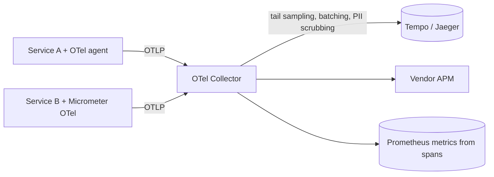

# How distributed tracing works with OpenTelemetry and APM tools

---

## 🟢 Junior Level

**OpenTelemetry (OTel)** is the CNCF standard for telemetry: APIs, SDKs, a wire protocol (**OTLP**) and the **Collector** for traces, metrics and logs. Vendors (Datadog, New Relic, Dynatrace, Honeycomb, Elastic, Grafana Tempo, Jaeger) accept OTLP, so you instrument once and choose or switch backends freely.

A trace is a tree of **spans**. Each span has:
* a trace ID and span ID, a parent span ID,
* a name (`GET /api/orders/{id}`, `SELECT orders`), start/end timestamps,
* attributes (`http.response.status_code=200`, `db.system=postgresql`),
* events (exceptions) and status.

Context crosses process boundaries in headers (**W3C Trace Context** `traceparent`/`tracestate`; Kafka/AMQP message headers for async).

### Three ways to instrument a Java service
1. **OpenTelemetry Java agent** (`-javaagent:opentelemetry-javaagent.jar`) — automatic bytecode instrumentation of 100+ libraries (Servlet, Spring MVC/WebFlux, JDBC, Hibernate, Kafka, gRPC, HTTP clients) with zero code changes.
2. **Spring Boot + Micrometer Tracing with the OTel bridge** — Spring's own Observation instrumentation, exported via OTLP.
3. **Vendor APM agents** — proprietary agents (often now built on or compatible with OTel).

```bash
java -javaagent:/otel/opentelemetry-javaagent.jar \
     -Dotel.service.name=order-service \
     -Dotel.exporter.otlp.endpoint=http://otel-collector:4317 \
     -Dotel.traces.sampler=parentbased_traceidratio -Dotel.traces.sampler.arg=0.1 \
     -jar app.jar
```

---

## 🟡 Middle Level

### The Collector as a hub



The Collector receives telemetry, processes it (batching, attribute redaction, resource detection for Kubernetes metadata, tail sampling) and exports to one or more backends. Apps only know the Collector endpoint; backend changes don't require redeploying services.

### Manual spans for business operations

```java
private static final Tracer tracer = GlobalOpenTelemetry.getTracer("com.shop.pricing");

Price price(Cart cart) {
    Span span = tracer.spanBuilder("pricing.calculate")
            .setAttribute("cart.items", cart.items().size())
            .startSpan();
    try (Scope scope = span.makeCurrent()) {          // child spans (DB, HTTP) attach to this one
        return rules.apply(cart);
    } catch (RuntimeException e) {
        span.recordException(e);
        span.setStatus(StatusCode.ERROR);
        throw e;
    } finally {
        span.end();
    }
}
```

With the agent, `@WithSpan` on a method creates a span declaratively.

### Semantic conventions
OTel defines standard attribute names (`http.request.method`, `url.path`, `db.system`, `messaging.destination.name`, `server.address`). Following them makes backends render service maps, database panels and messaging views automatically.

---

## 🔴 Senior Level

### Sampling strategy
* **Head sampling** (`parentbased_traceidratio`): decided at the root and honored downstream via the `sampled` flag — cheap and consistent, but blind to which traces turn out to be interesting.
* **Tail sampling** in the Collector: buffer spans per trace (e.g. 10–30 s), then keep 100% of traces with errors or latency > threshold and a small percentage of the rest. Requires all spans of a trace to reach the same Collector instance (load-balancing exporter keyed by trace ID).
* **Span metrics**: the Collector's `spanmetrics` connector derives RED metrics from 100% of spans before sampling, so dashboards stay accurate even with 1% trace retention.

### What APM tools add on top of traces
Service maps, automatic anomaly detection, code-level profiling correlated with traces, database query analytics, error grouping, deployment markers, and real-user monitoring that starts traces in the browser — useful, but you pay per host/span/GB. OTel keeps the instrumentation portable so you can negotiate or mix tools.

### Pitfalls
* **Broken context propagation** — thread pools, `CompletableFuture`, reactive pipelines, and message consumers lose context unless instrumented (agent handles many; custom executors may need wrapping; Reactor needs context propagation hooks).
* **Double instrumentation** — running the OTel agent *and* Micrometer Tracing for the same HTTP/JDBC calls creates duplicate spans; disable one (`otel.instrumentation.spring-webmvc.enabled=false`, or don't add Micrometer tracing bridges).
* **High-cardinality span names** — use route templates, not raw URLs; put IDs in attributes.
* **PII leakage** — query parameters, SQL with literals, headers; scrub in the Collector (`attributes`/`transform` processors) and disable `db.statement` capture of literal values where needed.
* **Overhead** — typically a few percent CPU with the agent; measure, and tune by disabling unneeded instrumentations and lowering sampling.

### Logs and traces together
Inject `trace_id`/`span_id` into MDC (agent does it for Logback/Log4j 2) and ship logs with the same resource attributes, so a trace view shows the logs of each span and vice versa. OTel logs (via the Collector) unify the pipeline.

---

## 🎯 Interview Cheat Sheet

**30-second pitch:** OpenTelemetry standardizes tracing: spans with trace/span IDs, W3C `traceparent` propagation, semantic conventions and the OTLP protocol. In Java I use the OTel agent for zero-code auto-instrumentation or Micrometer Tracing with the OTel bridge, send everything to an OTel Collector for batching, scrubbing and tail sampling, and export to Tempo, Jaeger or a vendor APM. Key concerns are sampling, context propagation across async boundaries, duplicate instrumentation, cardinality and PII.

**Must know:**
* Span structure; W3C Trace Context.
* Agent vs Micrometer Tracing vs vendor agents.
* Collector pipelines; tail sampling; span metrics.
* Manual spans with `Tracer`, `Scope`, `recordException`.
* Pitfalls: propagation, duplicates, cardinality, PII.

**Common follow-ups:**
* Head vs tail sampling — trade-offs?
* How do traces cross Kafka?
* Why use a Collector instead of exporting directly?

**Red flags:** raw URLs as span names; both agent and bridge instrumenting the same calls; tracing without log correlation.

**Related:**
* [Distributed tracing with Micrometer Tracing and Zipkin](../25.%20Spring%20Cloud%20and%20Resilience/15.%20Distributed%20tracing%20with%20Micrometer%20Tracing%20and%20Zipkin.md)
* [How to expose metrics with Micrometer and Spring Boot Actuator](13.%20How%20to%20expose%20metrics%20with%20Micrometer%20and%20Spring%20Boot%20Actuator.md)
* [Production incident debugging playbook](20.%20Production%20incident%20debugging%20playbook.md)
* [CloudWatch and X-Ray](../33.%20Cloud%20and%20AWS/16.%20CloudWatch%20and%20X-Ray.md)
