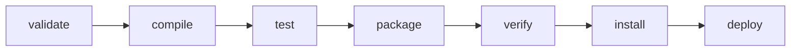

# Explain the Maven lifecycle phases and goals

---

## 🟢 Junior Level

### 1. Plain Definition

Maven organises every build into a **lifecycle**: an ordered list of **phases**. A **goal** is a concrete task provided by a **plugin**. Phases do nothing by themselves; they are *hooks* to which plugin goals are bound.

- **Phase** = a stage in the lifecycle (`compile`, `test`, `package`).
- **Goal** = one unit of work (`compiler:compile`, `surefire:test`, `jar:jar`).
- **Plugin** = a bundle of goals.

When you run a phase, Maven runs **all earlier phases first**. `mvn package` runs `validate → compile → test → package`.

### 2. Real-World Analogy

A lifecycle is a **car assembly line**. Stations (phases) are in a fixed order: chassis, engine, paint, inspection. Each station has workers (goals from plugins). If you ask for "paint", the line must first perform chassis and engine.

### 3. The Default Lifecycle (Most Important Phases)

| Phase | What happens | Default plugin goal |
| :--- | :--- | :--- |
| `validate` | Check the POM is correct | – |
| `compile` | Compile `src/main/java` | `compiler:compile` |
| `test-compile` | Compile tests | `compiler:testCompile` |
| `test` | Run unit tests | `surefire:test` |
| `package` | Create JAR/WAR | `jar:jar` / `war:war` |
| `verify` | Run integration tests, quality checks | `failsafe:verify` |
| `install` | Copy artifact to local `~/.m2` | `install:install` |
| `deploy` | Upload to remote repository | `deploy:deploy` |

There are two other built-in lifecycles: **clean** (`pre-clean → clean → post-clean`) deletes `target/`, and **site** generates documentation.

### 4. Minimal Examples

```bash
mvn clean            # delete target/
mvn test             # compile and run unit tests
mvn clean package    # fresh JAR in target/
mvn clean install    # also place JAR in local repository
mvn compiler:compile # run a single goal directly (no lifecycle before it)
```



> [!NOTE]
> `mvn clean package` mixes two lifecycles: `clean` first, then the default lifecycle up to `package`.

---

## 🟡 Middle Level

### 1. How Goals Bind to Phases

Packaging type (`jar`, `war`, `pom`) selects default bindings. You can add your own bindings in `<build><plugins>` using `<executions>`:

```xml
<build>
  <plugins>
    <plugin>
      <groupId>org.apache.maven.plugins</groupId>
      <artifactId>maven-compiler-plugin</artifactId>
      <version>3.13.0</version>
      <configuration>
        <release>21</release>
        <parameters>true</parameters>
      </configuration>
    </plugin>

    <plugin>
      <groupId>org.codehaus.mojo</groupId>
      <artifactId>exec-maven-plugin</artifactId>
      <version>3.2.0</version>
      <executions>
        <execution>
          <id>generate-docs</id>
          <phase>generate-resources</phase>
          <goals><goal>exec</goal></goals>
          <configuration>
            <executable>./scripts/gen-docs.sh</executable>
          </configuration>
        </execution>
      </executions>
    </plugin>
  </plugins>
</build>
```

The full default lifecycle actually has 23 phases, including `generate-sources`, `process-resources`, `process-classes`, `prepare-package`, `pre-integration-test`, `integration-test`, `post-integration-test`. Plugins often bind to these finer-grained phases.

### 2. Surefire vs Failsafe

| | Surefire | Failsafe |
| :--- | :--- | :--- |
| Phase | `test` | `integration-test` + `verify` |
| Naming | `*Test`, `Test*`, `*Tests` | `*IT`, `IT*`, `*ITCase` |
| Failure behaviour | Fails build immediately | Lets `post-integration-test` (stop containers) run, then fails at `verify` |

```xml
<plugin>
  <artifactId>maven-failsafe-plugin</artifactId>
  <version>3.2.5</version>
  <executions>
    <execution>
      <goals>
        <goal>integration-test</goal>
        <goal>verify</goal>
      </goals>
    </execution>
  </executions>
</plugin>
```
Always run `mvn verify` (not `mvn integration-test`) in CI, otherwise the failure-check goal never runs.

### 3. Profiles and Properties

Profiles toggle configuration per environment or per CI job:

```xml
<profiles>
  <profile>
    <id>ci</id>
    <properties><skipITs>false</skipITs></properties>
  </profile>
  <profile>
    <id>fast</id>
    <properties><skipTests>true</skipTests></properties>
  </profile>
</profiles>
```
```bash
mvn -Pci verify
mvn help:active-profiles
mvn help:effective-pom   # inspect the final POM after inheritance + profiles
```

### 4. Common Mistakes

- **Running `mvn install` in CI for libraries** when `verify` is enough; `install` pollutes the shared local repo and slows the build.
- **Skipping tests with `-DskipTests` but forgetting `-Dmaven.test.skip=true` skips even test compilation** – they differ.
- **Plugin without version**: Maven warns, resolves a default from the super-POM, and builds become unreproducible.
- **Calling a goal and expecting prior phases**: `mvn jar:jar` does *not* compile first.
- **Using `deploy` locally by accident** – protect with `distributionManagement` and credentials only on CI.

### 5. Useful Command-Line Options

| Flag | Meaning |
| :--- | :--- |
| `-B` | Batch mode (no colours/prompts; CI) |
| `-ntp` | No transfer progress noise |
| `-T 1C` | One thread per core |
| `-pl a,b -am` | Only modules a,b and their dependencies |
| `-o` | Offline |
| `-U` | Force update snapshots |
| `-DskipITs` | Skip integration tests |
| `-X` | Debug logging |

---

## 🔴 Senior Level

### 1. Internals: Mojos, Lifecycle Mappings and the Reactor

A goal is implemented by a **Mojo** (Maven plain Old Java Object), a Java class annotated with `@Mojo(name = "...", defaultPhase = ...)`. Maven's **reactor** sorts modules by dependency order and then, for each module, executes the phase plan. A *lifecycle mapping* defined by the packaging type creates the default plugin bindings; `META-INF/maven/lifecycle.xml` can define custom packaging.

A minimal custom Mojo:

```java
@Mojo(name = "print-info", defaultPhase = LifecyclePhase.INITIALIZE)
public class PrintInfoMojo extends AbstractMojo {

    @Parameter(defaultValue = "${project.version}", readonly = true)
    private String version;

    @Override
    public void execute() {
        getLog().info("Building version " + version);
    }
}
```

### 2. Execution Order Inside a Phase

When several plugins bind to the same phase, they run in **POM declaration order**, with inherited ones from parents first. Use `mvn help:describe -Dcmd=package` and `mvn -X` to see the precise plan. A senior should know `mvn help:effective-pom` is the truth, not the visible pom.

### 3. Production Patterns

**Release process.** Use `versions-maven-plugin` or CI-friendly versions (`${revision}`) rather than the heavy `maven-release-plugin`:

```xml
<version>${revision}</version>
<properties><revision>1.0.0-SNAPSHOT</revision></properties>
```
```bash
mvn -Drevision=1.4.2 -B clean deploy
```
Pair with `flatten-maven-plugin` so published POMs contain resolved versions.

**Enforcing rules at `validate`:**

```xml
<plugin>
  <artifactId>maven-enforcer-plugin</artifactId>
  <version>3.5.0</version>
  <executions>
    <execution>
      <id>enforce</id>
      <goals><goal>enforce</goal></goals>
      <configuration>
        <rules>
          <requireJavaVersion><version>[21,)</version></requireJavaVersion>
          <requireMavenVersion><version>[3.9,)</version></requireMavenVersion>
          <dependencyConvergence/>
          <banDuplicatePomDependencyVersions/>
        </rules>
      </configuration>
    </execution>
  </executions>
</plugin>
```

### 4. Performance and Caching

- Parallel builds require **thread-safe plugins**; check the plugin's documentation (`@threadSafe`). Non-thread-safe ones emit warnings with `-T`.
- Surefire fork settings influence speed: `forkCount=1C` with `reuseForks=true` is a good default; `reuseForks=false` isolates tests but multiplies JVM start time.
- Use the **Maven Build Cache Extension** (`.mvn/extensions.xml`) to skip unchanged modules; keys derive from inputs and plugin parameters.
- Use the **Maven Daemon (`mvnd`)** locally for warm JVMs.

### 5. Edge Cases

- **Phase `package` in multi-module with `-pl`** without `-am` fails when sibling artifacts are not in `~/.m2` – the reactor resolves `target/classes` only for `compile`-and-later phases in the same run, and for `package`+ it needs the JAR.
- **Attached artifacts** (`sources`, `javadoc`, `tests` classifiers) must be bound to `package` to be deployed.
- **Environment-specific profiles baked into artifacts** violate "build once, deploy many": the same JAR must be promoted through environments; configuration comes from outside (see [Environment configuration and secrets management](14.%20Environment%20configuration%20and%20secrets%20management.md)).
- Lifecycle extension via `<extensions>true</extensions>` on a plugin can change packaging handlers – powerful but confusing; document it.

---

## 🎯 Interview Cheat Sheet

### ⏱️ 30-Second Elevator Pitch

> "Maven has three lifecycles – clean, default and site. The default lifecycle is an ordered chain of phases from validate to deploy; each phase is only a hook to which plugin goals are bound by packaging type or by my POM. Running a phase runs all previous phases. Surefire runs unit tests at `test`, Failsafe runs `*IT` tests at `integration-test` and checks at `verify`, which is why CI should call `mvn verify`."

### ✅ Must-Know Bullets

- Phase ≠ goal; goals belong to plugins and are bound to phases.
- Order: validate, compile, test, package, verify, install, deploy.
- `clean` is a separate lifecycle.
- Surefire = unit tests, Failsafe = integration tests.
- `help:effective-pom` shows the final merged configuration.
- Pin all plugin versions; use the enforcer plugin.

### ❓ Common Follow-Up Questions

1. Difference between `install` and `deploy`?
2. How do you skip tests vs skip compiling tests?
3. Why use Failsafe instead of Surefire for integration tests?
4. How do you run only one module and its dependencies?
5. How can you bind a custom script to a phase?

### 🚩 Red Flags

- Saying "`mvn clean` is a phase of the default lifecycle."
- `mvn install` in every CI job without reason.
- Unpinned plugin versions.
- Not knowing what `-DskipTests` really skips.

### 🔗 Related Topics

- [What is the difference between Maven and Gradle](01.%20What%20is%20the%20difference%20between%20Maven%20and%20Gradle.md)
- [How does Maven dependency management work](03.%20How%20does%20Maven%20dependency%20management%20work.md)
- [How to organize a multi-module build](04.%20How%20to%20organize%20a%20multi-module%20build.md)
- [How to design a CI CD pipeline for a Java application](11.%20How%20to%20design%20a%20CI%20CD%20pipeline%20for%20a%20Java%20application.md)
