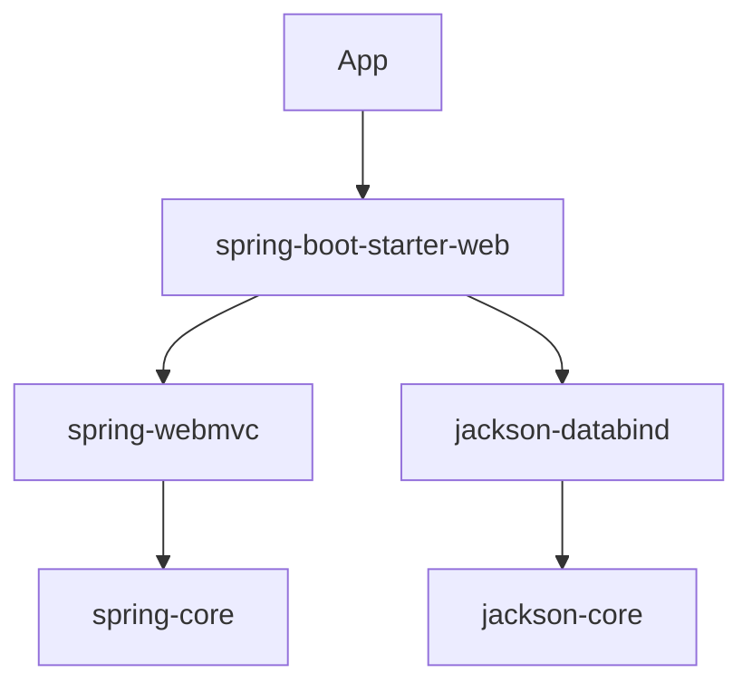

# How does Maven dependency management work

---

## 🟢 Junior Level

### 1. Plain Definition

Dependency management means declaring **which external libraries** your project needs, and letting the build tool download them (and the libraries *they* need) from a **repository** such as Maven Central. Each library is identified by coordinates: **`groupId:artifactId:version`** (GAV).

### 2. Real-World Analogy

You order a **bookshelf from a furniture store**. The bookshelf needs screws and shelves; the shelves need brackets. You only list the bookshelf – the store brings the rest. Those automatically-included parts are **transitive dependencies**.

### 3. Minimal Example

```xml
<dependencies>
  <dependency>
    <groupId>org.springframework.boot</groupId>
    <artifactId>spring-boot-starter-web</artifactId>
    <version>3.3.0</version>
  </dependency>
  <dependency>
    <groupId>org.projectlombok</groupId>
    <artifactId>lombok</artifactId>
    <version>1.18.32</version>
    <scope>provided</scope>
  </dependency>
  <dependency>
    <groupId>org.junit.jupiter</groupId>
    <artifactId>junit-jupiter</artifactId>
    <version>5.10.2</version>
    <scope>test</scope>
  </dependency>
</dependencies>
```

Maven downloads JARs to the **local repository** `~/.m2/repository` and reuses them in every project.

### 4. Scopes

| Scope | On compile classpath | On test classpath | On runtime classpath | Packaged | Typical use |
| :--- | :---: | :---: | :---: | :---: | :--- |
| `compile` (default) | ✅ | ✅ | ✅ | ✅ | Spring, Jackson |
| `provided` | ✅ | ✅ | ❌ | ❌ | Servlet API, Lombok |
| `runtime` | ❌ | ✅ | ✅ | ✅ | JDBC driver |
| `test` | ❌ | ✅ | ❌ | ❌ | JUnit, Mockito |
| `import` | – | – | – | – | Only inside `dependencyManagement` for BOMs |



> [!TIP]
> To *see* what you actually get, run `mvn dependency:tree`.

---

## 🟡 Middle Level

### 1. `dependencyManagement` vs `dependencies`

`<dependencyManagement>` **declares versions and settings but does not add anything** to the classpath. Child modules then declare the dependency without a version. `<dependencies>` actually adds it.

```xml
<!-- parent pom -->
<dependencyManagement>
  <dependencies>
    <dependency>
      <groupId>com.google.guava</groupId>
      <artifactId>guava</artifactId>
      <version>33.1.0-jre</version>
    </dependency>
  </dependencies>
</dependencyManagement>

<!-- child pom -->
<dependencies>
  <dependency>
    <groupId>com.google.guava</groupId>
    <artifactId>guava</artifactId> <!-- version inherited -->
  </dependency>
</dependencies>
```

### 2. BOM (Bill of Materials)

A BOM is a POM with only a `dependencyManagement` section that pins a **consistent set of versions**. Import it with scope `import` and `type` `pom`:

```xml
<dependencyManagement>
  <dependencies>
    <dependency>
      <groupId>org.springframework.boot</groupId>
      <artifactId>spring-boot-dependencies</artifactId>
      <version>3.3.0</version>
      <type>pom</type>
      <scope>import</scope>
    </dependency>
    <dependency>
      <groupId>org.testcontainers</groupId>
      <artifactId>testcontainers-bom</artifactId>
      <version>1.19.8</version>
      <type>pom</type>
      <scope>import</scope>
    </dependency>
  </dependencies>
</dependencyManagement>
```
This is how you use Spring Boot **without** inheriting from `spring-boot-starter-parent`. Order matters: for the same artifact the **first imported BOM wins**.

### 3. Transitive Dependency Resolution and Conflicts

When two paths bring different versions of the same artifact, Maven applies **"nearest definition wins"** (shortest path in the dependency tree); if depths are equal, **first declaration wins**. It does **not** pick the highest version.

```
App
 ├── A 1.0 → X 1.0      (depth 2)
 └── B 1.0 → C 1.0 → X 2.0   (depth 3)   => X 1.0 is chosen
```

Fixing conflicts:
1. Declare the desired version **directly** (depth 1 always wins) or in `dependencyManagement`.
2. **Exclude** the transitive artifact:

```xml
<dependency>
  <groupId>org.apache.kafka</groupId>
  <artifactId>kafka-clients</artifactId>
  <version>3.7.0</version>
  <exclusions>
    <exclusion>
      <groupId>org.slf4j</groupId>
      <artifactId>slf4j-api</artifactId>
    </exclusion>
  </exclusions>
</dependency>
```

### 4. Diagnostic Commands

```bash
mvn dependency:tree                                   # whole tree
mvn dependency:tree -Dincludes=org.slf4j              # filter
mvn dependency:tree -Dverbose                         # show omitted/conflicting
mvn dependency:analyze                                # used-undeclared / unused-declared
mvn dependency:resolve-sources
mvn versions:display-dependency-updates               # available upgrades
```

### 5. Common Mistakes

- Using `compile` for Servlet API → duplicate classes in the WAR/Tomcat.
- Forgetting that `dependencyManagement` doesn't add dependencies.
- Relying on **transitive** dependencies for classes you import directly (breaks when the parent library changes). `dependency:analyze` finds "used undeclared" ones.
- Using `SNAPSHOT` versions in release builds.
- Version ranges `[1.0,2.0)` – unstable builds.
- Declaring versions in every child instead of centrally.

---

## 🔴 Senior Level

### 1. Resolution Internals

Maven (3.x) uses the **Aether / Maven Resolver** library. For each artifact it reads the POM first (dependency *collection*), builds a graph, applies the conflict-resolution `ConflictResolver` (nearest-wins), then downloads JARs (*resolution*). Important details:

- Dependency **mediation** ignores a version's recency; `dependencyManagement` forces versions even for transitive ones, overriding mediation.
- Scope mediation: if `X` is `compile` in one path and `test` in another, the **widest** scope wins.
- Optional dependencies (`<optional>true</optional>`) are not transitive.
- Metadata (`maven-metadata.xml`) controls SNAPSHOT/RELEASE lookups; `_remote.repositories` files and update policies control re-fetching.

### 2. Enforcing Convergence

Silent version drift is a classic cause of `NoSuchMethodError` in production. Enforce with the enforcer plugin:

```xml
<plugin>
  <artifactId>maven-enforcer-plugin</artifactId>
  <version>3.5.0</version>
  <executions>
    <execution>
      <goals><goal>enforce</goal></goals>
      <configuration>
        <rules>
          <dependencyConvergence/>
          <requireUpperBoundDeps/>
          <bannedDependencies>
            <excludes>
              <exclude>commons-logging:commons-logging</exclude>
              <exclude>log4j:log4j</exclude>
            </excludes>
          </bannedDependencies>
        </rules>
      </configuration>
    </execution>
  </executions>
</plugin>
```
`requireUpperBoundDeps` fails the build when mediation picks a *lower* version than another path requested.

### 3. Production Scenarios

**Scenario – `NoSuchMethodError` after upgrade.** Steps: (1) reproduce locally; (2) `mvn dependency:tree -Dverbose -Dincludes=<groupId>`; (3) find the loser of mediation; (4) pin the correct version in `dependencyManagement`; (5) add the enforcer rule so it never regresses.

**Scenario – corporate internal repository.** Route everything through Nexus/Artifactory via `settings.xml` mirror, never directly to Central:

```xml
<settings>
  <mirrors>
    <mirror>
      <id>corp</id>
      <mirrorOf>*</mirrorOf>
      <url>https://nexus.example.com/repository/maven-public/</url>
    </mirror>
  </mirrors>
  <servers>
    <server>
      <id>corp</id>
      <username>${env.NEXUS_USER}</username>
      <password>${env.NEXUS_TOKEN}</password>
    </server>
  </servers>
</settings>
```
This gives caching, availability, licence/security policy enforcement and protection against dependency-confusion attacks.

### 4. Supply Chain and Security

- Verify checksums (Maven does by default; `-C` fails on mismatch).
- Scan with OWASP Dependency-Check or Dependabot (see [Static analysis and dependency vulnerability scanning](12.%20Static%20analysis%20and%20dependency%20vulnerability%20scanning.md)).
- Generate an **SBOM** with `cyclonedx-maven-plugin` for compliance.
- Pin plugin versions and consider `maven-dependency-plugin:go-offline` for hermetic builds.

### 5. Edge Cases

- **Shaded JARs** (`maven-shade-plugin`) bundle dependencies and relocate packages; transitive info is hidden unless you generate a *dependency-reduced POM*.
- **BOM ordering**: Importing Spring Boot BOM *after* another BOM that manages `jackson` changes the Jackson version silently. Use `mvn help:effective-pom` to verify.
- **Property overrides**: Spring Boot's BOM exposes properties (e.g., `<jackson-bom.version>`) so you can override one family without redefining each artifact.
- **Classifier artifacts** (`tests`, `sources`, `jdk17`) are distinct from the main artifact and must be requested explicitly.
- **Parallel builds and local repo corruption**: concurrent writes to `~/.m2` on shared CI agents can corrupt; use per-job caches or Maven Resolver's locking (`-Daether.syncContext.named...`).

---

## 🎯 Interview Cheat Sheet

### ⏱️ 30-Second Elevator Pitch

> "Maven resolves dependencies by GAV coordinates from repositories, transitively. Conflicts are mediated by nearest-wins, not highest-wins, so I pin versions centrally with `dependencyManagement` or import a BOM, inspect with `dependency:tree`, exclude problem artifacts, and enforce convergence with the enforcer plugin. Scopes control what ends up on which classpath."

### ✅ Must-Know Bullets

- GAV coordinates; local `~/.m2` and remote repositories.
- Scopes: compile, provided, runtime, test, import.
- `dependencyManagement` ≠ `dependencies`.
- BOM = imported `dependencyManagement`.
- Nearest-wins, then first-declared wins.
- `mvn dependency:tree`, `dependency:analyze`.
- Exclusions, optional dependencies.

### ❓ Common Follow-Up Questions

1. How does Maven choose between two versions of the same library?
2. What is a BOM and how do you import one?
3. Difference between `provided` and `runtime` scope?
4. How would you debug `NoSuchMethodError` in production?
5. How do you prevent dependency confusion attacks?

### 🚩 Red Flags

- Believing Maven always picks the highest version.
- Using version ranges or `LATEST`.
- Declaring all versions in each child POM.
- Never running `dependency:tree` when debugging classpath problems.

### 🔗 Related Topics

- [What is the difference between Maven and Gradle](01.%20What%20is%20the%20difference%20between%20Maven%20and%20Gradle.md)
- [How to organize a multi-module build](04.%20How%20to%20organize%20a%20multi-module%20build.md)
- [Static analysis and dependency vulnerability scanning](12.%20Static%20analysis%20and%20dependency%20vulnerability%20scanning.md)
- [Reproducible builds](18.%20Reproducible%20builds.md)
