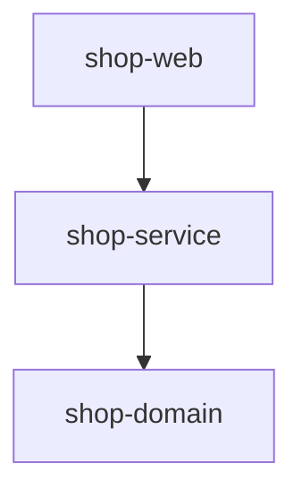

# How to organize a multi-module build

---

## 🟢 Junior Level

### 1. Plain Definition

A **multi-module build** splits one large project into several smaller **modules** (sub-projects), each producing its own artifact (JAR/WAR), all built together from a single root. Typical split: `domain`, `persistence`, `service`, `web-api`, `app`.

### 2. Real-World Analogy

A building is made of **prefabricated rooms**. Each room (module) can be built and inspected separately, but a master plan (parent/root project) says how they are joined and which room needs which other room first.

### 3. Minimal Maven Example

Layout:
```
shop/
├── pom.xml                (parent, packaging=pom)
├── shop-domain/pom.xml
├── shop-service/pom.xml
└── shop-web/pom.xml
```

Parent `pom.xml`:
```xml
<project xmlns="http://maven.apache.org/POM/4.0.0">
  <modelVersion>4.0.0</modelVersion>
  <groupId>com.example.shop</groupId>
  <artifactId>shop</artifactId>
  <version>1.0.0-SNAPSHOT</version>
  <packaging>pom</packaging>

  <modules>
    <module>shop-domain</module>
    <module>shop-service</module>
    <module>shop-web</module>
  </modules>
</project>
```

Child `shop-service/pom.xml`:
```xml
<project xmlns="http://maven.apache.org/POM/4.0.0">
  <modelVersion>4.0.0</modelVersion>
  <parent>
    <groupId>com.example.shop</groupId>
    <artifactId>shop</artifactId>
    <version>1.0.0-SNAPSHOT</version>
  </parent>
  <artifactId>shop-service</artifactId>
  <dependencies>
    <dependency>
      <groupId>com.example.shop</groupId>
      <artifactId>shop-domain</artifactId>
      <version>${project.version}</version>
    </dependency>
  </dependencies>
</project>
```

Run `mvn clean install` in the root; Maven builds modules in the correct dependency order (the **reactor**).



> [!IMPORTANT]
> **Inheritance** (`<parent>`) shares configuration. **Aggregation** (`<modules>`) shares the build. They are independent – often the same POM does both, but not required.

---

## 🟡 Middle Level

### 1. Designing the Module Graph

Good modules have **high cohesion, low coupling** and a **directed acyclic** dependency graph – Maven rejects cycles. Common strategies:

| Strategy | Example | Pros | Cons |
| :--- | :--- | :--- | :--- |
| By layer | `domain`, `repository`, `service`, `web` | Familiar, enforces layering | Features spread over many modules |
| By feature / bounded context | `orders`, `payments`, `catalog` | Easier to extract to microservices | Needs discipline on shared kernel |
| Hybrid | `orders-api`, `orders-impl` | Clear public contract | More modules |

Rule of thumb: create a module when you need **independent reuse, enforced boundaries, or different dependencies/packaging** – not merely to have folders.

### 2. Centralising Configuration in the Parent

```xml
<properties>
  <maven.compiler.release>21</maven.compiler.release>
  <project.build.sourceEncoding>UTF-8</project.build.sourceEncoding>
  <spring-boot.version>3.3.0</spring-boot.version>
</properties>

<dependencyManagement>
  <dependencies>
    <dependency>
      <groupId>org.springframework.boot</groupId>
      <artifactId>spring-boot-dependencies</artifactId>
      <version>${spring-boot.version}</version>
      <type>pom</type>
      <scope>import</scope>
    </dependency>
    <dependency>
      <groupId>com.example.shop</groupId>
      <artifactId>shop-domain</artifactId>
      <version>${project.version}</version>
    </dependency>
  </dependencies>
</dependencyManagement>

<build>
  <pluginManagement>
    <plugins>
      <plugin>
        <groupId>org.springframework.boot</groupId>
        <artifactId>spring-boot-maven-plugin</artifactId>
        <version>${spring-boot.version}</version>
      </plugin>
    </plugins>
  </pluginManagement>
</build>
```
Only the executable module (`shop-web` or `shop-app`) activates the Spring Boot plugin; library modules produce plain JARs.

### 3. Building a Subset

```bash
mvn -pl shop-service -am clean verify    # module + the modules it needs
mvn -pl shop-domain -amd verify          # module + everything that depends on it
mvn -rf :shop-web verify                 # resume from a module
mvn -T 1C clean verify                   # parallel reactor
```

### 4. Gradle Equivalent

`settings.gradle.kts`:
```kotlin
rootProject.name = "shop"
include("shop-domain", "shop-service", "shop-web")
```
`shop-service/build.gradle.kts`:
```kotlin
plugins { `java-library` }

dependencies {
    api(project(":shop-domain"))
    implementation("org.springframework:spring-context:6.1.8")
}
```
`api` vs `implementation` controls what leaks to consumers – a key advantage for compile avoidance.

### 5. Common Mistakes

- **Circular dependencies** solved by "util" modules that become dumping grounds.
- **Giant `common` module** that everything depends on; any change rebuilds everything.
- **Hardcoding child versions** instead of `${project.version}` / `revision`.
- **Duplicating plugin config** instead of using `pluginManagement`.
- **Too many tiny modules** → slow configuration, cognitive overhead.
- **Different Java versions per module** without toolchains.

---

## 🔴 Senior Level

### 1. Reactor Internals

The Maven reactor reads every `<modules>` entry recursively, builds a project dependency graph (considering `<dependencies>`, `<parent>`, plugin dependencies and extensions), topologically sorts it and executes the requested phases module by module. With `-T`, independent branches run in parallel threads. In a reactor build, a dependency on a sibling resolves to its `target/classes` (or JAR for `package`+) rather than `~/.m2` – which is why `mvn compile -pl B` fails without `-am` if A hasn't been installed.

### 2. CI-Friendly Versions and Release

Avoid editing every child POM at release. Use `${revision}`:

```xml
<!-- parent -->
<version>${revision}</version>
<properties><revision>2.5.0-SNAPSHOT</revision></properties>

<!-- child -->
<parent>
  <groupId>com.example.shop</groupId>
  <artifactId>shop</artifactId>
  <version>${revision}</version>
  <relativePath>../pom.xml</relativePath>
</parent>
```
Add `flatten-maven-plugin` (`flattenMode=resolveCiFriendliesOnly`) so deployed POMs have concrete versions. CI then runs `mvn -Drevision=2.5.0 deploy`.

### 3. BOM Module for Internal Libraries

Publish a `shop-bom` module so other teams import consistent internal versions:

```xml
<project>
  <artifactId>shop-bom</artifactId>
  <packaging>pom</packaging>
  <dependencyManagement>
    <dependencies>
      <dependency>
        <groupId>com.example.shop</groupId>
        <artifactId>shop-domain</artifactId>
        <version>${project.version}</version>
      </dependency>
      <dependency>
        <groupId>com.example.shop</groupId>
        <artifactId>shop-service</artifactId>
        <version>${project.version}</version>
      </dependency>
    </dependencies>
  </dependencyManagement>
</project>
```

### 4. Architecture Enforcement

Module boundaries are compile-time enforced, but *package* rules inside modules need tools: ArchUnit tests, the Java Platform Module System (`module-info.java`), or Maven enforcer `bannedDependencies` (e.g., `web` must not depend on `persistence`).

```java
@AnalyzeClasses(packages = "com.example.shop")
class ArchitectureTest {
    @ArchTest
    static final ArchRule web_does_not_touch_repositories =
        noClasses().that().resideInAPackage("..web..")
            .should().dependOnClassesThat().resideInAPackage("..repository..");
}
```

### 5. Production Concerns

- **Incremental CI**: compute changed modules via `git diff --name-only origin/main...HEAD`, map to modules, then `mvn -pl <list> -amd verify`. Gradle does this natively with `--build-cache` and `affected module` plugins.
- **Aggregated coverage**: use a `report-aggregate` module (JaCoCo) that depends on all modules.
- **Test fixtures**: share test helpers through a `*-test-support` module (Maven `test-jar` goal or Gradle `java-test-fixtures`).
- **Deployment units**: only the app module is built into a Docker image; library modules are never deployed alone.
- **Build time vs modularity**: Gradle's configuration time grows with module count; mitigate with the configuration cache and convention plugins in `build-logic` instead of `allprojects {}` blocks.
- **Dependency hygiene**: `maven-dependency-plugin:analyze-only` fails when a module uses classes from undeclared transitive dependencies, so extractions never break.

Gradle convention plugin snippet:

```kotlin
// build-logic/src/main/kotlin/java-conventions.gradle.kts
plugins { `java-library`; jacoco }
java { toolchain { languageVersion.set(JavaLanguageVersion.of(21)) } }
tasks.withType<Test> { useJUnitPlatform() }
```
```kotlin
// shop-service/build.gradle.kts
plugins { id("java-conventions") }
```

---

## 🎯 Interview Cheat Sheet

### ⏱️ 30-Second Elevator Pitch

> "A multi-module build has a root that aggregates modules and a parent that shares configuration. Maven's reactor orders modules by dependency and can build subsets with `-pl -am`. I keep versions and plugin config in the parent via `dependencyManagement` and `pluginManagement`, use `${revision}` for releases, keep a thin acyclic module graph aligned with boundaries, and enforce architecture with ArchUnit or the enforcer."

### ✅ Must-Know Bullets

- Aggregation (`<modules>`) vs inheritance (`<parent>`).
- Reactor sorts modules and rejects cycles.
- `-pl`, `-am`, `-amd`, `-rf`, `-T`.
- Parent holds `dependencyManagement`, `pluginManagement`.
- Gradle: `include(...)`, `api` vs `implementation`, convention plugins.
- Avoid a giant `common` module.

### ❓ Common Follow-Up Questions

1. Difference between parent POM and aggregator POM?
2. How do you avoid cyclic dependencies between modules?
3. How do you version and release dozens of modules?
4. How would you build only changed modules in CI?
5. When should you NOT split into modules?

### 🚩 Red Flags

- One `utils` module imported by everything.
- Copy-pasted plugin configuration in each module.
- Releasing modules with inconsistent versions.
- Modules created per package "for cleanliness".

### 🔗 Related Topics

- [How does Maven dependency management work](03.%20How%20does%20Maven%20dependency%20management%20work.md)
- [How do Gradle incremental builds and build cache work](05.%20How%20do%20Gradle%20incremental%20builds%20and%20build%20cache%20work.md)
- [Monorepo vs polyrepo](17.%20Monorepo%20vs%20polyrepo.md)
- [Semantic versioning in Code review practices and semantic versioning](09.%20Code%20review%20practices%20and%20semantic%20versioning.md)
