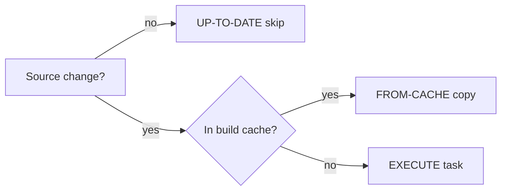

# How do Gradle incremental builds and build cache work

---

## 🟢 Junior Level

### 1. Plain Definition

Gradle models a build as a set of **tasks** (`compileJava`, `test`, `jar`, ...). Each task has **inputs** (source files, properties) and **outputs** (class files, JARs). Gradle's speed comes from not redoing work:

- **Incremental build / up-to-date check**: if a task's inputs and outputs did not change since the last run, Gradle skips it (`UP-TO-DATE`).
- **Build cache**: if the same inputs were ever built before (by you, a teammate or CI), Gradle copies the stored outputs (`FROM-CACHE`).
- **Daemon**: a long-lived JVM that keeps compiled build logic warm.

### 2. Real-World Analogy

A baker checks the order list: "Did the recipe or ingredients change since yesterday's batch? No? Then re-use yesterday's bread." The **build cache** is a shared fridge in the whole bakery chain: if another branch already baked the identical loaf, just take it.

### 3. Minimal Example

```kotlin
// build.gradle.kts
plugins { java }

repositories { mavenCentral() }

dependencies {
    testImplementation("org.junit.jupiter:junit-jupiter:5.10.2")
}

tasks.test { useJUnitPlatform() }
```

```bash
./gradlew build
# > Task :compileJava
# > Task :test
./gradlew build
# > Task :compileJava UP-TO-DATE
# > Task :test UP-TO-DATE
```

Useful commands:
```bash
./gradlew tasks               # list tasks
./gradlew build --scan        # build scan with performance details
./gradlew build --dry-run     # show what would run
./gradlew clean build --build-cache
```



---

## 🟡 Middle Level

### 1. Task Anatomy: Inputs and Outputs

Gradle derives up-to-date-ness from declared inputs/outputs. Custom tasks must declare them with annotations, otherwise they always run:

```kotlin
abstract class GenerateVersionFile : DefaultTask() {
    @get:Input
    abstract val appVersion: Property<String>

    @get:OutputFile
    abstract val outputFile: RegularFileProperty

    @TaskAction
    fun generate() {
        outputFile.get().asFile.writeText("version=${appVersion.get()}\n")
    }
}

tasks.register<GenerateVersionFile>("generateVersion") {
    appVersion.set(project.version.toString())
    outputFile.set(layout.buildDirectory.file("version.properties"))
}
```
Annotations: `@Input`, `@InputFile`, `@InputFiles`, `@InputDirectory`, `@Classpath`, `@OutputFile`, `@OutputDirectory`, `@Internal` (ignored), `@PathSensitive`, `@CacheableTask`.

### 2. Enabling the Build Cache

```properties
# gradle.properties
org.gradle.caching=true
org.gradle.parallel=true
```
Cache key = hash of task implementation + inputs (files, classpath, properties, JDK version). Make a custom task cacheable with `@CacheableTask`, and use `@PathSensitive(PathSensitivity.RELATIVE)` so absolute paths on different machines do not change the key.

Remote cache in `settings.gradle.kts`:

```kotlin
buildCache {
    local { isEnabled = true }
    remote<HttpBuildCache> {
        url = uri("https://gradle-cache.example.com/cache/")
        isPush = System.getenv("CI") != null   // only CI writes
        credentials {
            username = System.getenv("CACHE_USER")
            password = System.getenv("CACHE_PASS")
        }
    }
}
```
Best practice: **developers read, CI writes**, so a bad local build never poisons the cache.

### 3. Version Catalogs

Central, type-safe dependency declarations in `gradle/libs.versions.toml`:

```toml
[versions]
junit = "5.10.2"
spring-boot = "3.3.0"

[libraries]
junit-jupiter = { module = "org.junit.jupiter:junit-jupiter", version.ref = "junit" }
spring-web = { module = "org.springframework.boot:spring-boot-starter-web", version.ref = "spring-boot" }

[bundles]
testing = ["junit-jupiter"]

[plugins]
spring-boot = { id = "org.springframework.boot", version.ref = "spring-boot" }
```
```kotlin
plugins { alias(libs.plugins.spring.boot) }
dependencies {
    implementation(libs.spring.web)
    testImplementation(libs.bundles.testing)
}
```
Benefits: IDE autocompletion, one place for versions across modules, and Dependabot/Renovate can update the TOML.

### 4. Incremental Compilation and Compile Avoidance

Gradle recompiles only classes affected by a change (incremental Java compile) and, thanks to **compile avoidance**, does not recompile consumers when only a method body or private member in a dependency changes (ABI unchanged). Using `implementation` instead of `api` narrows what triggers recompilation. Annotation processors must be incremental (`gradle/incremental` metadata) – Lombok, MapStruct support it; custom ones often don't.

### 5. Common Mistakes

- Task has no declared outputs → never up-to-date.
- Task reads files outside declared inputs (e.g., `System.getenv()` or `new Date()` inside the action) → false up-to-date or never cached.
- Using `tasks.create` and `afterEvaluate` heavily; prefer **lazy** `tasks.register` and `Provider` APIs to avoid configuration cost.
- Using absolute paths in inputs → cache misses between machines.
- Running `clean` before every build – defeats incrementality.
- Embedding a timestamp or git SHA in a task that is otherwise deterministic.

---

## 🔴 Senior Level

### 1. How Gradle Decides: The Execution Pipeline

For each task Gradle (a) resolves its inputs, (b) computes a **build cache key** (SHA-1/MD5 of implementation classpath, input property values, normalized input file contents), (c) checks the local, then remote, cache, (d) if miss, checks previous execution history for **up-to-date** (same inputs and outputs unchanged on disk), (e) otherwise executes and stores the result. `UP-TO-DATE` is local history; `FROM-CACHE` is content-addressed and portable. Input normalization (runtime classpath normalization ignoring timestamps and `META-INF/MANIFEST.MF` ordering) lets semantically identical inputs map to one key:

```kotlin
normalization {
    runtimeClasspath {
        metaInf { ignoreAttribute("Implementation-Build-Time") }
        ignoreFile("build-info.properties")
    }
}
```

### 2. Diagnosing Cache Misses

```bash
./gradlew help --scan
./gradlew compileJava -Dorg.gradle.caching.debug=true
./gradlew compileJava --build-cache -Dorg.gradle.internal.operations.trace=build/ops
```
Compare two build scans using **Develocity (Gradle Enterprise) build comparison** to see which input property differs (typical culprits: absolute paths, JDK vendor/version difference between local and CI, non-deterministic generated sources, `-parameters` flag differences). Pin the JDK with **toolchains** so keys match across machines:

```kotlin
java {
    toolchain {
        languageVersion.set(JavaLanguageVersion.of(21))
        vendor.set(JvmVendorSpec.ADOPTIUM)
    }
}
```

### 3. Configuration Cache and Configuration Time

In large builds, *configuration time* (evaluating all `build.gradle.kts`) can take tens of seconds. The **configuration cache** serialises the task graph so repeat builds skip configuration. It requires tasks not to capture `Project` at execution time:

```kotlin
// BAD: accesses project at execution time
tasks.register("bad") { doLast { println(project.name) } }

// GOOD: capture at configuration time via Provider
tasks.register("good") {
    val n = project.name
    doLast { println(n) }
}
```
Enable: `org.gradle.configuration-cache=true`. Also use **convention plugins** in `build-logic` (included build) instead of `buildSrc`, because any change to `buildSrc` invalidates all tasks' caches.

### 4. Production Scenarios

**CI optimisation.** On GitHub Actions:

```yaml
- uses: actions/setup-java@v4
  with: { distribution: temurin, java-version: 21 }
- uses: gradle/actions/setup-gradle@v4
  with:
    cache-read-only: ${{ github.ref != 'refs/heads/main' }}
- run: ./gradlew build --build-cache --scan
```
Only `main` writes the cache; PRs read it. With a remote cache, typical PR builds drop from 15 to 3 minutes because only the changed module and its dependents execute.

**Dependency locking and verification.**
```bash
./gradlew dependencies --write-locks          # gradle.lockfile
./gradlew --write-verification-metadata sha256 help   # gradle/verification-metadata.xml
```
Locking gives repeatable resolution; verification protects against tampered artifacts.

### 5. Edge Cases

- **Test task caching**: `test` is cacheable; flaky tests get cached as passes only if they passed – failures are never stored. Tests that read the clock, network, or random seeds should declare inputs or opt out with `outputs.upToDateWhen { false }`.
- **Parallel execution safety**: tasks that write to the same output dir cause overlaps; Gradle warns about implicit dependencies. Declare `mustRunAfter`/`dependsOn` or fix outputs.
- **Gradle daemon memory** on CI agents: set `org.gradle.jvmargs=-Xmx3g` and `kotlin.daemon.jvmargs`; watch `OutOfMetaspaceError` after many builds.
- **File-system watching** speeds local incremental builds but can be unreliable on network drives; disable via `org.gradle.vfs.watch=false`.
- **Secrets in cache**: never place secrets in task inputs; they would be hashed (safe) but outputs containing secrets (generated config) must not be cacheable.

---

## 🎯 Interview Cheat Sheet

### ⏱️ 30-Second Elevator Pitch

> "Gradle treats each task as a pure function of its declared inputs. If inputs and outputs are unchanged the task is UP-TO-DATE; if the same inputs were built anywhere before, outputs come from the local or remote build cache. Combined with the daemon, incremental compile, compile avoidance and the configuration cache, rebuilds only do the minimal work. Version catalogs centralise dependency versions, and CI is the only writer to the remote cache."

### ✅ Must-Know Bullets

- Tasks, inputs/outputs, `UP-TO-DATE`, `FROM-CACHE`, `NO-SOURCE`.
- Build cache keys depend on inputs, classpath and JDK.
- `org.gradle.caching`, `parallel`, `configuration-cache`.
- `libs.versions.toml` version catalog.
- `implementation` vs `api` for compile avoidance.
- Wrapper + toolchains for consistency.
- `--scan` / Develocity for diagnosis.

### ❓ Common Follow-Up Questions

1. Why was my task not up-to-date even though nothing changed?
2. Difference between up-to-date check and build cache?
3. Who should write to the remote cache and why?
4. What is the configuration cache and what breaks it?
5. `buildSrc` vs included build for convention plugins?

### 🚩 Red Flags

- Running `clean` every time "to be safe".
- Custom tasks without declared inputs/outputs.
- Dynamic versions (`+`) in a cached build.
- Allowing developers to push to the remote cache.

### 🔗 Related Topics

- [What is the difference between Maven and Gradle](01.%20What%20is%20the%20difference%20between%20Maven%20and%20Gradle.md)
- [How to organize a multi-module build](04.%20How%20to%20organize%20a%20multi-module%20build.md)
- [How to design a CI CD pipeline for a Java application](11.%20How%20to%20design%20a%20CI%20CD%20pipeline%20for%20a%20Java%20application.md)
- [Reproducible builds](18.%20Reproducible%20builds.md)
