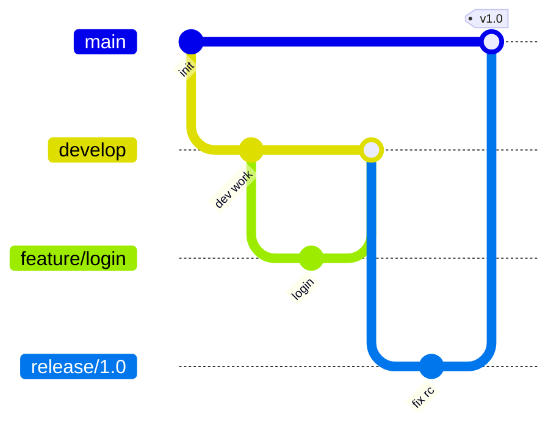

# What are the main Git branching strategies

---

## 🟢 Junior Level

### 1. Plain Definition

A **branching strategy** is a team agreement on *how and when branches are created, named, merged and deleted*. Git itself allows any workflow; the strategy keeps many developers from stepping on each other and defines how code travels from idea to production.

Three strategies you must know: **Git Flow**, **GitHub Flow**, **Trunk-Based Development**.

### 2. Real-World Analogy

A newspaper: **Git Flow** is a weekly magazine with a long editing cycle, separate "release edition" and hotfix errata. **GitHub Flow** is a news site where each article is reviewed and published straight away. **Trunk-based** is a live wiki where everyone edits the same page in tiny, safe steps.

### 3. Branch Basics

```bash
git switch -c feature/ORD-123-add-discount   # create and switch
git add . && git commit -m "ORD-123 Add discount calculation"
git push -u origin feature/ORD-123-add-discount
# open a Pull Request, get review, merge, delete branch
git switch main && git pull
git branch -d feature/ORD-123-add-discount
```

### 4. The Three Strategies at a Glance

| | Git Flow | GitHub Flow | Trunk-Based |
| :--- | :--- | :--- | :--- |
| Long-lived branches | `main`, `develop` | `main` only | `main` (trunk) only |
| Short-lived branches | feature, release, hotfix | feature | very short (<1-2 days) or none |
| Release process | `release/*` branch stabilised | Merge to main = deploy | Release from trunk (or `release/*` cut) |
| Best for | Versioned products, on-prem, mobile | SaaS, web apps | High-performing CD teams |
| Risk | Merge hell, slow feedback | Needs good tests | Needs feature flags, strong CI |



> [!TIP]
> Whatever strategy you choose: protect `main` (no direct pushes, required reviews, required green CI).

---

## 🟡 Middle Level

### 1. Git Flow in Detail

Branches: `main` (production tags), `develop` (integration), `feature/*` (from develop), `release/*` (stabilise a version, from develop → merges to main and develop), `hotfix/*` (from main → merges to main and develop).

Pros: clear versions, parallel maintenance of multiple releases. Cons: long-lived branches diverge, big-bang integrations, delayed feedback, heavy ceremony – at odds with continuous delivery. Nowadays used mostly for libraries and products with several supported versions.

### 2. GitHub Flow

Rules: `main` is always deployable; branch from `main`; open a PR early; review + CI; merge; deploy immediately. Simple and fits SaaS. The weakness: unfinished work needs feature flags or stays in the PR for too long.

### 3. Trunk-Based Development

Developers integrate to `main` **at least daily**, using tiny commits, **feature flags** for unfinished work, and **branch by abstraction** for large refactors. Release branches, if used, are cut from trunk and receive only cherry-picked fixes. It is the strategy most correlated with high DORA performance (see [DevOps culture and DORA metrics](16.%20DevOps%20culture%20and%20DORA%20metrics.md)).

Branch-protection and CI config for GitHub:

```yaml
# .github/workflows/ci.yml
name: CI
on:
  pull_request:
    branches: [main]
  push:
    branches: [main]
jobs:
  build:
    runs-on: ubuntu-latest
    steps:
      - uses: actions/checkout@v4
      - uses: actions/setup-java@v4
        with: { distribution: temurin, java-version: 21, cache: maven }
      - run: mvn -B -ntp verify
```
Require this check in **Settings → Branches → Branch protection rules** (or rulesets).

### 4. Naming and Commit Conventions

```
feature/ORD-123-add-discount
bugfix/ORD-456-null-pointer-checkout
hotfix/1.4.1-payment-timeout
release/1.5.0
```
Use **Conventional Commits** (`feat:`, `fix:`, `chore:`, `BREAKING CHANGE:`) so changelogs and semantic versions can be generated automatically (see [Code review practices and semantic versioning](09.%20Code%20review%20practices%20and%20semantic%20versioning.md)).

### 5. Common Mistakes

- **Long-lived feature branches** (weeks) → painful merges, hidden integration bugs.
- **Giant PRs** (2000+ lines) that no one reviews properly.
- **Committing directly to main** without protection.
- **Not deleting merged branches** → clutter.
- **Using Git Flow for a service deployed ten times a day.**
- **Feature flags never removed** → permanent technical debt.

---

## 🔴 Senior Level

### 1. Choosing a Strategy: Decision Factors

| Factor | Leans toward |
| :--- | :--- |
| Single deployed version (SaaS) | GitHub Flow / Trunk-based |
| Multiple supported versions (library, on-prem) | Git Flow or trunk + `release/x.y` maintenance branches |
| Test automation weak | Git Flow (stabilisation) – but fix the root cause |
| Team size > 100, monorepo | Trunk-based + merge queue |
| Regulated (audit trail, sign-off) | GitHub Flow with protected branches and environments |

### 2. Trunk-Based with Release Branches

```bash
git switch -c release/2.4 origin/main      # cut at a known good commit
git tag v2.4.0
# fix lands on main first, then:
git switch release/2.4
git cherry-pick -x <sha-from-main>         # -x records original commit
git tag v2.4.1
```
"Fix forward on main, backport to release" prevents regressions where a bug is fixed in the release branch but forgotten in `main`.

### 3. Merge Queue and Required Checks

At scale, two green PRs can break `main` when combined. GitHub **merge queue** (or GitLab merge trains) tests each PR against the latest queue state:

```yaml
on:
  pull_request:
  merge_group:          # required for merge queue
jobs:
  test:
    runs-on: ubuntu-latest
    steps:
      - uses: actions/checkout@v4
      - run: ./gradlew build --build-cache
```

### 4. Feature Flags as Branching Replacement

```java
@Service
class CheckoutService {
    private final FeatureFlags flags;

    BigDecimal price(Order o) {
        if (flags.isEnabled("new-pricing-engine", o.customerId())) {
            return newEngine.price(o);
        }
        return legacyEngine.price(o);
    }
}
```
Lifecycle: create flag → dark launch → percentage rollout → 100% → **delete flag and old code**. Track flags with owners and expiry dates (see [Deployment strategies rolling blue-green canary and feature flags](13.%20Deployment%20strategies%20rolling%20blue-green%20canary%20and%20feature%20flags.md)).

### 5. Production Scenarios and Edge Cases

- **Hotfix when `main` already contains unreleased work**: with trunk-based, branch from the release tag (`git switch -c hotfix/2.4.1 v2.4.0`), cherry-pick the fix, release, then forward-port.
- **Squash vs merge commit vs rebase-merge** on PR completion: squash gives linear, one-commit-per-feature history and easy revert; merge commits preserve detail; choose one policy and enforce via repository settings.
- **Signed commits and protected tags** for supply-chain integrity (`git commit -S`, rulesets requiring signatures).
- **CODEOWNERS** for mandatory review by owners of sensitive paths:

```
# .github/CODEOWNERS
/payments/        @org/payments-team
/infra/           @org/platform-team
*.sql             @org/dba-team
```
- **Monorepo scale**: sparse checkout, partial clone (`git clone --filter=blob:none`) and path-filtered pipelines keep branch workflows fast (see [Monorepo vs polyrepo](17.%20Monorepo%20vs%20polyrepo.md)).
- **Long-running migrations** (e.g., database change) use expand/contract steps over multiple small merges instead of one long branch (see [Database migrations and rollback strategies in pipelines](15.%20Database%20migrations%20and%20rollback%20strategies%20in%20pipelines.md)).

---

## 🎯 Interview Cheat Sheet

### ⏱️ 30-Second Elevator Pitch

> "Git Flow uses develop plus release and hotfix branches – good for versioned products but slow and merge-heavy. GitHub Flow keeps one always-deployable main with short-lived PR branches. Trunk-based goes further: tiny commits to main daily, feature flags for unfinished work, which correlates best with fast delivery. I pick based on release model and test maturity, and always protect main with required reviews and CI."

### ✅ Must-Know Bullets

- Git Flow: main, develop, feature, release, hotfix.
- GitHub Flow: main + short PR branches, deploy on merge.
- Trunk-based: daily integration, flags, release branches optional.
- Branch protection, CODEOWNERS, merge queue.
- Squash vs merge commit policy.
- Conventional Commits for automation.

### ❓ Common Follow-Up Questions

1. Why is Git Flow considered harmful for CD?
2. How do you ship unfinished features in trunk-based development?
3. How do you handle a hotfix for an old release?
4. How do you stop two green PRs from breaking main?
5. How long should a branch live?

### 🚩 Red Flags

- "We use Git Flow because everyone does."
- Branches living for weeks.
- No branch protection on `main`.
- Force-pushing to shared branches.

### 🔗 Related Topics

- [Git merge vs rebase and how to resolve conflicts](07.%20Git%20merge%20vs%20rebase%20and%20how%20to%20resolve%20conflicts.md)
- [How to undo changes in Git with reset revert cherry-pick and reflog](08.%20How%20to%20undo%20changes%20in%20Git%20with%20reset%20revert%20cherry-pick%20and%20reflog.md)
- [Code review practices and semantic versioning](09.%20Code%20review%20practices%20and%20semantic%20versioning.md)
- [Deployment strategies rolling blue-green canary and feature flags](13.%20Deployment%20strategies%20rolling%20blue-green%20canary%20and%20feature%20flags.md)
