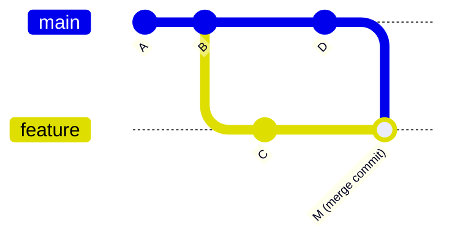

# Git merge vs rebase and how to resolve conflicts

---

## 🟢 Junior Level

### 1. Plain Definition

Both `git merge` and `git rebase` integrate changes from one branch into another, but they produce different history.

- **Merge** joins two histories with a new **merge commit**. History is preserved exactly as it happened.
- **Rebase** *replays* your commits on top of another branch, creating **new commits** with new hashes. History becomes a straight line.

A **conflict** occurs when two branches changed the same lines (or one deleted what the other edited) and Git cannot decide automatically.

### 2. Real-World Analogy

Two authors edit chapters of the same book. **Merge**: staple both drafts together with a note "merged on Tuesday" – you can see both timelines. **Rebase**: take the other author's final version as the base and re-type your changes on top as if you had started after them – tidy, but you rewrote your history.

### 3. Minimal Example

```bash
# Merge main into feature
git switch feature/login
git merge main

# Rebase feature onto main
git switch feature/login
git rebase main
```



After **rebase** the picture is linear: `A - B - D - C'` where `C'` is a copy of `C` with a new hash.

### 4. Resolving a Conflict Step by Step

Git marks the file:

```text
<<<<<<< HEAD
int discount = 10;
=======
int discount = 15;
>>>>>>> feature/discount
```

1. Open the file, decide the correct result, remove the markers.
2. `git add <file>`
3. Finish: `git commit` (merge) or `git rebase --continue` (rebase).
4. Abort if lost: `git merge --abort` / `git rebase --abort`.

```bash
git status                # shows "both modified" files
git diff --name-only --diff-filter=U   # list conflicted files
```

> [!WARNING]
> **Golden rule of rebase:** never rebase commits that others already pulled (shared/public branches). It rewrites history.

---

## 🟡 Middle Level

### 1. Comparison

| Aspect | Merge | Rebase |
| :--- | :--- | :--- |
| History | Non-linear, keeps true timeline | Linear, rewritten |
| Commit hashes | Unchanged | New for each replayed commit |
| Conflict resolution | Once (in merge commit) | Possibly per commit |
| Safe on shared branches | ✅ | ❌ (needs force-push) |
| Traceability (`git log --graph`) | Shows branch context | Loses branch context |
| Revert a feature | `git revert -m 1 <merge>` easy | Revert each commit or squash first |
| `git bisect` | Works, more noise | Easier with linear history |

### 2. Typical Team Workflows

- **Update your feature branch** with `git pull --rebase origin main` (clean, no meaningless "Merge branch main into feature" commits).
- **Integrate the feature into main**: via PR using **squash merge** (one commit), **merge commit** (`--no-ff`), or **rebase merge** (linear, keeps commits).
- **Clean up local commits** before opening a PR with interactive rebase:

```bash
git rebase -i HEAD~4
# pick  a1b2c3 Add endpoint
# squash d4e5f6 fix typo
# reword 7a8b9c add tests
# drop   0f1e2d debug logging
```
Commands: `pick`, `reword`, `edit`, `squash`, `fixup`, `drop`. With `git commit --fixup <sha>` plus `git rebase -i --autosquash origin/main` fixups are auto-ordered.

### 3. Configuration That Helps

```bash
git config --global pull.rebase true          # pull = fetch + rebase
git config --global rebase.autoStash true
git config --global rebase.autoSquash true
git config --global merge.conflictStyle zdiff3   # show base version in markers
git config --global rerere.enabled true       # remember conflict resolutions
```
`rerere` ("reuse recorded resolution") is gold when you repeatedly rebase a long-running branch.

### 4. Choosing a Conflict Resolution Strategy

```bash
git checkout --ours   path/File.java     # during merge: keep current branch's version
git checkout --theirs path/File.java     # take the incoming version
git merge -X ours main                   # prefer ours only for conflicting hunks
git mergetool                            # open configured tool (IntelliJ, VS Code, kdiff3)
```
Note: during a **rebase**, `ours` and `theirs` are *reversed* – "ours" is the branch you're rebasing onto and "theirs" is your commit being replayed. This trips up many engineers.

### 5. Common Mistakes

- Blindly choosing "accept theirs/ours" for a whole file, discarding someone else's work.
- Resolving a conflict, forgetting to compile/test, and pushing a broken build (a merge can be clean textually but broken semantically – always rebuild).
- Rebasing a shared branch and force-pushing with `--force` instead of `--force-with-lease`.
- Committing conflict markers (`<<<<<<<`). Add a pre-commit hook or CI grep to detect.
- Resolving conflicts in generated files (lockfiles, `pom.xml` formatting) by hand rather than regenerating.

---

## 🔴 Senior Level

### 1. Internals

A **merge** finds the *merge base* (lowest common ancestor) of two tips, performs a three-way merge between base, ours, theirs and records a commit with two parents. Git's default strategy is **ort** (replaced `recursive` in Git 2.34): it handles renames well and, when several merge bases exist (criss-cross merges), recursively merges them first.

A **rebase** computes the commits reachable from your branch but not from the target, saves them as patches (in `.git/rebase-merge`), resets to the target, then applies them one at a time (cherry-pick-like). Each applied commit gets a new SHA, and the old commits stay reachable via `reflog` (~90 days) which makes rebases recoverable (see [How to undo changes in Git with reset revert cherry-pick and reflog](08.%20How%20to%20undo%20changes%20in%20Git%20with%20reset%20revert%20cherry-pick%20and%20reflog.md)).

### 2. Safe Force Pushing

After rebasing a branch only *you* use:

```bash
git push --force-with-lease=feature/login:<expected-sha>
# or simply
git push --force-with-lease
```
`--force-with-lease` refuses to overwrite if the remote moved since you last fetched, protecting a teammate's pushed commits. Enforce in CI: block force-push on protected branches via rulesets.

### 3. Rebasing Stacked Branches

For PR chains (`feature-b` based on `feature-a`):

```bash
git switch feature-b
git rebase --onto main feature-a feature-b
# "take commits of feature-b that are not in feature-a and put them on main"
# Or, with Git 2.38+:
git rebase --update-refs main      # also moves intermediate branch pointers
```

### 4. Production Scenarios

**Scenario – a conflict in Flyway migration versions.** Two branches add `V12__x.sql` and `V12__y.sql`. There's no textual conflict (different files), but the build fails at startup with a version clash. Prevention: CI that runs the application against the merged result (merge queue), and a naming convention using timestamps (`V20250114_1130__add_index.sql`). See [Database migrations and rollback strategies in pipelines](19.%20Database%20migrations%20and%20rollback%20strategies%20in%20pipelines.md).

**Scenario – lockfile conflicts.** Don't hand-merge `gradle.lockfile` or `package-lock.json`; take main's version and regenerate:

```bash
git checkout --theirs gradle.lockfile     # (during merge)
./gradlew dependencies --write-locks
git add gradle.lockfile
```

**Scenario – huge divergence between a release branch and main.** Use `git merge-base`, `git range-diff` to verify the rebased series equals the original:

```bash
git range-diff main...old-feature main...new-feature
```
`range-diff` shows what changed between two versions of a patch series – excellent for reviewing a rebase or force-pushed PR.

### 5. Edge Cases

- **Merge commits in a rebase**: `git rebase` flattens them by default; use `--rebase-merges` to preserve topology.
- **Revert of a merge commit** requires choosing the mainline parent: `git revert -m 1 <merge-sha>`. Re-merging that branch later requires first "reverting the revert".
- **Whitespace/rename noise**: `git merge -X renormalize` after line-ending policy change (`.gitattributes` with `* text=auto eol=lf`) and `-X ignore-space-change`.
- **Binary files** can't be merged; pick one side and regenerate, or use Git LFS file locking.
- **Semantic conflicts** (clean merge, broken behaviour) are the real danger at scale – mitigated by merge queues, fast tests, and small PRs.
- **Policy**: many orgs pick "squash-merge PRs + rebase locally" – the shared history is linear and each commit is a releasable unit, while merge commits are reserved for long-lived release branch integration.

---

## 🎯 Interview Cheat Sheet

### ⏱️ 30-Second Elevator Pitch

> "Merge ties two histories together with a merge commit and preserves reality; rebase replays my commits onto a new base for a linear history but rewrites hashes, so I only rebase my own unshared branches and push with `--force-with-lease`. For conflicts I inspect both sides, resolve, run the build and tests, then `add` and `continue`. I enable `rerere`, keep PRs small, and use a merge queue to catch semantic conflicts."

### ✅ Must-Know Bullets

- Merge = new commit with two parents; rebase = replay commits with new SHAs.
- Never rebase shared history.
- `--force-with-lease` over `--force`.
- Conflict flow: edit → `git add` → `continue`/`commit`; `--abort` to escape.
- `ours` / `theirs` are swapped during rebase.
- Interactive rebase: squash, fixup, reword, drop.
- `rerere`, `zdiff3`, `range-diff`.

### ❓ Common Follow-Up Questions

1. When would you prefer merge over rebase?
2. Why is `ours` vs `theirs` confusing in a rebase?
3. How do you revert a merge commit?
4. How do you avoid broken builds after a "clean" merge?
5. Squash merge vs rebase merge vs merge commit on a PR?

### 🚩 Red Flags

- `git push --force` on shared branches.
- Accepting a whole file "mine" to make conflicts disappear.
- Not building/testing after resolving conflicts.
- Never having used `reflog` to recover from a rebase.

### 🔗 Related Topics

- [What are the main Git branching strategies](06.%20What%20are%20the%20main%20Git%20branching%20strategies.md)
- [How to undo changes in Git with reset revert cherry-pick and reflog](08.%20How%20to%20undo%20changes%20in%20Git%20with%20reset%20revert%20cherry-pick%20and%20reflog.md)
- [Code review practices and semantic versioning](09.%20Code%20review%20practices%20and%20semantic%20versioning.md)
- [Monorepo vs polyrepo](21.%20Monorepo%20vs%20polyrepo.md)
