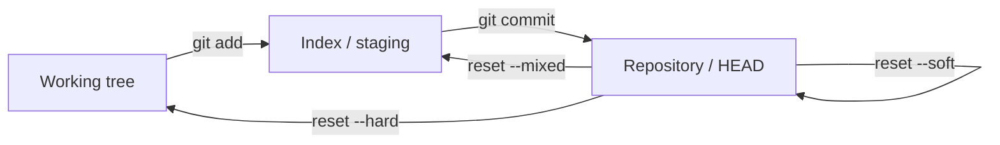

# How to undo changes in Git with reset revert cherry-pick and reflog

---

## 🟢 Junior Level

### 1. Plain Definition

Git keeps every commit, so almost any mistake can be undone. The commands differ in **what they touch**:

- **`git restore`** – discard changes in your working files.
- **`git reset`** – move the branch pointer (and optionally index/working tree) *backwards*, rewriting local history.
- **`git revert`** – create a **new commit** that cancels an earlier commit; history is kept.
- **`git cherry-pick`** – copy *one specific commit* onto the current branch.
- **`git reflog`** – the safety net: a local log of where `HEAD` has been, used to recover "lost" commits.

### 2. Real-World Analogy

A document with *track changes*. **Restore** = throw away unsaved edits. **Reset** = rewind the document to yesterday's version (and erase the later versions from your own copy). **Revert** = add a new edit that undoes paragraph 3, visibly. **Cherry-pick** = copy one paragraph from another draft. **Reflog** = the "version history" that remembers even versions you rewound away.

### 3. Minimal Examples

```bash
# Discard uncommitted changes to a file
git restore src/App.java

# Unstage a file (keep the edits)
git restore --staged src/App.java

# Undo the last commit, keep the changes staged
git reset --soft HEAD~1

# Safely undo a commit that was already pushed
git revert a1b2c3d

# Copy a bug fix from main to release branch
git switch release/1.4
git cherry-pick 9f8e7d6

# Find a "lost" commit
git reflog
git switch -c rescue HEAD@{3}
```

### 4. The Three Reset Modes

| Mode | Moves branch pointer | Resets index (staging) | Resets working tree |
| :--- | :---: | :---: | :---: |
| `--soft` | ✅ | ❌ | ❌ |
| `--mixed` (default) | ✅ | ✅ | ❌ |
| `--hard` | ✅ | ✅ | ✅ (**destroys uncommitted work**) |



> [!IMPORTANT]
> **Rule:** *reset* for local, unpushed history. *revert* for anything already shared.

---

## 🟡 Middle Level

### 1. Choosing the Right Tool

| Situation | Command |
| :--- | :--- |
| Edited file, want original back | `git restore <file>` |
| Wrongly staged a file | `git restore --staged <file>` |
| Last local commit has a typo | `git commit --amend` |
| Last 3 local commits should be one | `git reset --soft HEAD~3 && git commit` (or interactive rebase) |
| Bad commit already on `main` | `git revert <sha>` |
| Bad merge commit on `main` | `git revert -m 1 <merge-sha>` |
| Need one fix on another branch | `git cherry-pick -x <sha>` |
| Committed on the wrong branch | `git switch correct && git cherry-pick <sha>`, then `git reset --hard HEAD~1` on the wrong one |
| Branch deleted / reset --hard by mistake | `git reflog` → `git branch rescue <sha>` |

### 2. Revert in Depth

`git revert` applies the inverse patch as a new commit; if later commits touched the same lines it may conflict.

```bash
git revert --no-commit HEAD~3..HEAD    # revert a range without committing each
git commit -m "Revert checkout rewrite (caused ORD-991)"
git revert -n a1b2c3d e4f5a6b          # several commits, one revert commit
```
Good revert messages explain **why**: others will read them during incidents.

### 3. Cherry-Pick in Depth

```bash
git cherry-pick -x a1b2c3d             # appends "(cherry picked from commit ...)"
git cherry-pick a1b2c3d..f4e5d6c       # range (excludes the first)
git cherry-pick -m 1 <merge-sha>       # pick a merge commit
git cherry-pick --continue | --abort | --skip
```
Pitfall: the cherry-picked commit is a **different commit** (new SHA). When branches later merge, Git usually handles it, but duplicates can cause conflicts. Prefer merging when you need *everything*; cherry-pick for hotfix backports.

### 4. Reflog Basics

```bash
git reflog                                # HEAD movements
git reflog show feature/login             # branch-specific
git reset --hard HEAD@{2}                 # go back to where you were 2 moves ago
git log -g --since="2 days ago"
```
Reflog entries are **local only**, expire after 90 days (reachable) / 30 days (unreachable) by default, and are *not* pushed. `git fsck --lost-found` can find dangling commits beyond that.

### 5. Common Mistakes

- `git reset --hard` with uncommitted work → unrecoverable (not in reflog since never committed). Use `git stash` first.
- Resetting a pushed branch then `git push --force` → teammates' history diverges.
- Reverting a merge without `-m`, then being unable to re-merge the branch later (Git thinks those changes were already merged, so you have to revert the revert).
- Cherry-picking without `-x` → nobody knows where the commit came from.
- Using `git checkout .` which silently discards changes (prefer `git restore` for clarity).

---

## 🔴 Senior Level

### 1. How It Works Underneath

Everything in Git is a graph of immutable objects (commits, trees, blobs). A branch is just a pointer file (`.git/refs/heads/<name>`). `reset` moves that pointer (and, depending on mode, rewrites the index and working tree) – it deletes nothing; old commits become *unreachable* but stay in the object database until garbage collection prunes them (`gc.reflogExpire`, `gc.pruneExpire`). Reflog records pointer updates, which is why recovery is possible.

`revert` and `cherry-pick` both use a **three-way merge** where the "base" is the commit's parent: revert applies (commit → parent), cherry-pick applies (parent → commit).

### 2. Incident Playbooks

**Bad release is live; the culprit is a merged PR.**

```bash
git switch main && git pull
git revert -m 1 <merge-sha>        # or revert the squash commit
git push                           # CI/CD ships the revert
# create ticket, fix forward on a branch, re-land with tests
```
Revert-first-then-investigate is usually the fastest mitigation (see [Rollback strategies - Database migrations and rollback strategies in pipelines](15.%20Database%20migrations%20and%20rollback%20strategies%20in%20pipelines.md)).

**A secret was committed and pushed.** Revert does *not* remove it from history. Rotate the secret immediately, then purge with `git filter-repo`:

```bash
git filter-repo --path config/secrets.properties --invert-paths
git push --force-with-lease --all
git push --force-with-lease --tags
```
Then ask all clones to re-clone, and invalidate caches/forks. Prevention: pre-commit secret scanners (gitleaks, GitHub push protection).

**Large file accidentally committed.** Same `filter-repo` approach with `--strip-blobs-bigger-than 10M`; adopt Git LFS afterwards.

### 3. Finding the Culprit: `bisect`

```bash
git bisect start
git bisect bad                    # current commit is broken
git bisect good v2.3.0            # last known good
git bisect run ./mvnw -q -Dtest=PaymentServiceTest test
# Git binary-searches commits automatically; prints the first bad commit
git bisect reset
```
Linear history (squash/rebase merges) makes bisect cleaner; each commit should build.

### 4. Backports at Scale

```bash
for sha in $(git log --reverse --format=%H main --grep="^fix(" ^release/2.4); do
  git cherry-pick -x "$sha" || break
done
```
Tools such as GitHub's `backport` bot or Mergify automate "backport to release/x" labels. Use `git cherry` (`git cherry -v release/2.4 main`) to list commits on `main` not yet applied (by patch-id) to the release branch.

### 5. Edge Cases and Safety Nets

- **`git reset --keep`** aborts if it would lose local modifications – safer than `--hard`.
- **ORIG_HEAD**: after merge/rebase/reset Git stores the previous tip in `ORIG_HEAD`; `git reset --hard ORIG_HEAD` undoes an unwanted pull/merge in one step.
- **Stash is a commit**: `git stash` stores WIP; if you drop it accidentally, `git fsck --unreachable | grep commit` can recover it.
- **Protected branches** block force-pushes, so on `main` *only* `revert` is possible – which is exactly the intended audit trail.
- **Submodules** need `git submodule update --init` after reset/checkout, else the superproject points to unexpected commits.
- **Garbage collection on servers** (GitHub, GitLab) eventually deletes unreachable commits; recover through local reflog or hosting-provider support before that.

---

## 🎯 Interview Cheat Sheet

### ⏱️ 30-Second Elevator Pitch

> "`restore` discards working-tree changes, `reset` moves my local branch pointer – soft keeps changes staged, mixed unstages, hard destroys – and is only for unshared history. For anything already pushed I use `revert`, which adds an inverse commit and is auditable; for merges I need `-m 1`. `cherry-pick -x` backports a single fix to a release branch. If I lose work I look in `git reflog`, which records every `HEAD` move for about 90 days."

### ✅ Must-Know Bullets

- reset (--soft/--mixed/--hard) rewrites history; revert adds a commit.
- Revert a merge: `git revert -m 1 <sha>`.
- `cherry-pick -x` for traceable backports.
- Reflog is local, expires; `ORIG_HEAD` shortcut.
- `git commit --amend`, `git stash`, `git bisect`.
- Leaked secrets: rotate first, `filter-repo` second.

### ❓ Common Follow-Up Questions

1. Difference between `reset --hard` and `revert`?
2. How do you undo a pushed merge commit?
3. How can you recover a deleted branch?
4. When is cherry-pick a bad idea?
5. A password was pushed to GitHub – what do you do?

### 🚩 Red Flags

- Force-pushing to `main` to "fix" a bad commit.
- Not knowing reflog exists.
- Believing `revert` deletes the original commit.
- Removing a secret only with a new commit.

### 🔗 Related Topics

- [Git merge vs rebase and how to resolve conflicts](07.%20Git%20merge%20vs%20rebase%20and%20how%20to%20resolve%20conflicts.md)
- [What are the main Git branching strategies](06.%20What%20are%20the%20main%20Git%20branching%20strategies.md)
- [Database migrations and rollback strategies in pipelines](15.%20Database%20migrations%20and%20rollback%20strategies%20in%20pipelines.md)
- [Environment configuration and secrets management](14.%20Environment%20configuration%20and%20secrets%20management.md)
