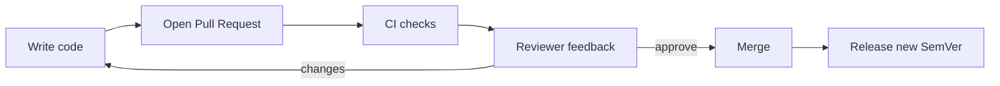

# Code review practices and semantic versioning

---

## 🟢 Junior Level

### 1. Plain Definition

**Code review** is the practice of having another engineer read and discuss your change *before* it is merged. **Semantic Versioning (SemVer)** is a numbering convention `MAJOR.MINOR.PATCH` that tells consumers what kind of change a release contains.

They belong together: reviews check that a change is correct and that its **compatibility impact** is understood; SemVer communicates that impact to users.

### 2. Real-World Analogy

Code review is a **proofreader** reading a chapter before print. SemVer is the **edition number on a book**: 2.0 means chapters were reorganised (old references break), 1.3 means a new chapter was added (old references still work), 1.2.1 means a typo fix.

### 3. SemVer Rules

Version `MAJOR.MINOR.PATCH`, e.g. `3.7.2`:

| Part | Increment when | Example |
| :--- | :--- | :--- |
| **MAJOR** | Incompatible API change | Removing a public method |
| **MINOR** | Backwards-compatible new functionality | Adding an endpoint |
| **PATCH** | Backwards-compatible bug fix | Fixing a null check |

Extras: pre-release `1.0.0-rc.1`, build metadata `1.0.0+20250101`. In Maven, `-SNAPSHOT` marks a work-in-progress build (`1.4.0-SNAPSHOT` < `1.4.0`).

```xml
<version>2.3.1</version>
```

### 4. A Simple Review Checklist for Beginners

- Does the code do what the ticket asks?
- Is it readable? Names, small methods.
- Are there tests covering the change (including failure cases)?
- Any obvious bugs: null handling, off-by-one, resource leaks?
- Any secrets, debug prints or commented-out code?
- Is the PR small enough to review in about 30 minutes?



---

## 🟡 Middle Level

### 1. Effective Code Review Practices

**As an author:** keep PRs small (<400 lines), self-review first, write a meaningful description (what, why, how to test, screenshots, risks), link the ticket, mark follow-ups explicitly.

**As a reviewer:** review within one working day; start with design and behaviour, not style; ask questions instead of commanding ("What happens if the list is empty?"); prefix severity - `nit:`, `suggestion:`, `blocking:`; approve when remaining comments are non-blocking.

**Automate the boring parts** so humans focus on design: formatter (Spotless), linters (Checkstyle), static analysis (SonarQube), tests, security scans (see [Static analysis and dependency vulnerability scanning](12.%20Static%20analysis%20and%20dependency%20vulnerability%20scanning.md)).

PR template:

```markdown
<!-- .github/pull_request_template.md -->
## What and why
## How to test
## Risk / rollback plan
- [ ] Tests added/updated
- [ ] DB migration included and backward compatible
- [ ] Feature flag / config documented
- [ ] Breaking API change? (needs MAJOR bump)
```

### 2. Review Focus Areas for Java Services

| Area | Questions |
| :--- | :--- |
| Correctness | Edge cases, concurrency (shared mutable state), transaction boundaries |
| API | Backward-compatible? Validation? Error contract? |
| Persistence | N+1 queries, indexes, migration safety |
| Security | Input validation, authz checks, secrets, logging PII |
| Performance | Blocking calls in reactive flows, unbounded collections |
| Operability | Logs, metrics, health checks, config toggles |
| Tests | Meaningful assertions, no sleeps, deterministic |

### 3. SemVer in Practice with Java

For **libraries**, public API = public/protected classes/methods plus serialised formats. Binary compatibility tools detect accidental breaks:

```xml
<plugin>
  <groupId>com.github.siom79.japicmp</groupId>
  <artifactId>japicmp-maven-plugin</artifactId>
  <version>0.20.0</version>
  <configuration>
    <oldVersion>
      <dependency>
        <groupId>com.example</groupId><artifactId>shop-client</artifactId>
        <version>RELEASE</version><type>jar</type>
      </dependency>
    </oldVersion>
    <parameter><breakBuildOnBinaryIncompatibleModifications>true</breakBuildOnBinaryIncompatibleModifications></parameter>
  </configuration>
  <executions><execution><phase>verify</phase><goals><goal>cmp</goal></goals></execution></executions>
</plugin>
```
For **REST services**, "public API" = the OpenAPI contract. Adding an optional field is MINOR; removing a field or changing its type is MAJOR; many teams version via URL (`/v2/orders`) only on MAJOR.

### 4. Conventional Commits Drive the Version

```
feat(orders): add bulk cancel endpoint        -> MINOR
fix(payments): handle null currency           -> PATCH
feat(api)!: remove legacy /v1/search          -> MAJOR  (or BREAKING CHANGE: footer)
chore(deps): bump jackson to 2.17.1           -> no release
```

### 5. Common Mistakes

- **Rubber-stamp approvals** ("LGTM" in 20 seconds on 1500 lines).
- **Style wars** in reviews that a formatter should settle.
- **Hostile tone** – critique code, not people.
- Treating **PATCH releases as safe** while changing behaviour.
- Forgetting that **Spring Boot 3.x → 4.x** type upgrades are MAJOR for you too.
- Releasing `1.0.0` too early or never leaving `0.x`.

---

## 🔴 Senior Level

### 1. Review as a Quality and Knowledge-Sharing System

Metrics worth watching: *time to first review*, *PR size distribution*, *review cycles per PR*, *rework rate*. Google's research and DORA show that **small batches + fast review** correlate with better delivery performance. Seniors also run **design reviews / ADRs** (Architecture Decision Records) *before* coding when a change is expensive to reverse, so PR review is not the first time design is discussed.

Enforce policies with branch rules and CODEOWNERS:

```
# CODEOWNERS
/src/main/resources/db/migration/  @org/dba
/src/main/java/**/security/        @org/security-champions
pom.xml                            @org/platform
```
Settings: require 1-2 approvals, dismiss stale approvals on new commits, require review from code owners, require status checks, require conversation resolution, restrict who can bypass.

### 2. Automating SemVer and Releases

Use **semantic-release**, **release-please**, or **JReleaser** to compute the next version from Conventional Commits, create the tag, changelog and GitHub release.

```yaml
# .github/workflows/release.yml
name: release
on:
  push: { branches: [main] }
permissions: { contents: write, pull-requests: write }
jobs:
  release-please:
    runs-on: ubuntu-latest
    steps:
      - uses: googleapis/release-please-action@v4
        with:
          release-type: maven
```
release-please opens a "Release PR" that bumps `pom.xml`, updates `CHANGELOG.md`; merging it tags and publishes.

### 3. SemVer Edge Cases and Policy for Services

- SemVer was written for **libraries**. For deployable services, many teams use **CalVer** (`2025.03.1`) or a build number, since consumers depend on the API contract, not the binary version. Containers should still be tagged with the **git SHA** (immutable) plus a human version.
- **Deprecation policy**: mark `@Deprecated(since = "2.4", forRemoval = true)`, document the replacement, remove only in next MAJOR after N months.
- **Behavioural changes** (default values, timeouts, serialisation format, ordering guarantees) can break clients even if signatures remain; treat as MAJOR or gate behind opt-in flags.
- **Transitive API exposure**: if your public class exposes a Guava type, upgrading Guava's MAJOR is *your* MAJOR. Use `api` vs `implementation` carefully (see [How do Gradle incremental builds and build cache work](05.%20How%20do%20Gradle%20incremental%20builds%20and%20build%20cache%20work.md)).
- **Maven ranges and SNAPSHOT**: consumers should not use ranges; release builds must reject SNAPSHOT deps via the enforcer rule `requireReleaseDeps`.
- **Pre-1.0**: anything may change; document stability.
- **Database schema** has its own version (Flyway/Liquibase) independent of application SemVer; ensure N and N-1 compatibility.

### 4. Production Scenario: Breaking Change in an Internal Library

A shared `shop-client` library needs a method signature change used by 14 services.
1. Add the new method, deprecate the old (MINOR release).
2. Provide an OpenRewrite recipe to auto-migrate callers.
3. Open automated PRs to consumers (Renovate/Dependabot or custom script).
4. Track adoption via dependency analysis; after the deadline, remove it (MAJOR).

```yaml
# rewrite.yml (OpenRewrite)
type: specs.openrewrite.org/v1beta/recipe
name: com.example.MigrateShopClient
recipeList:
  - org.openrewrite.java.ChangeMethodName:
      methodPattern: com.example.shop.Client oldCall(..)
      newMethodName: newCall
```

### 5. Reviewing for Reviewers' Fatigue

Large generated or mechanical changes (formatting, renames) go in separate PRs, with a note "no behaviour change; review with `?w=1`". Use `git blame --ignore-revs-file .git-blame-ignore-revs` so mass formatting commits don't pollute blame. Pair programming or mob sessions can replace async review for risky work, provided CI gates still apply.

---

## 🎯 Interview Cheat Sheet

### ⏱️ 30-Second Elevator Pitch

> "Good code review is small, fast, automated-first and focused on design, correctness, security and operability, with a clear tone. SemVer's MAJOR.MINOR.PATCH communicates compatibility: MAJOR breaks, MINOR adds, PATCH fixes. I drive versions from Conventional Commits with release-please or semantic-release, guard library APIs with japicmp, and treat deprecation as a process rather than a surprise."

### ✅ Must-Know Bullets

- PR size, description, tests, CI green before human review.
- Review comment severities (`nit`, `blocking`).
- CODEOWNERS, required reviews, stale approval dismissal.
- SemVer: MAJOR/MINOR/PATCH, pre-release, SNAPSHOT.
- Conventional Commits → automated version/changelog.
- Deprecation lifecycle; binary compatibility tools.
- Services may prefer CalVer/SHA tags.

### ❓ Common Follow-Up Questions

1. What do you look for in a code review beyond style?
2. How do you handle disagreements with a reviewer?
3. Is adding a field to a JSON response MINOR or MAJOR?
4. How do you automate release versions?
5. How do you deprecate a public API safely?

### 🚩 Red Flags

- "LGTM" without reading.
- Mega-PRs and week-long review queues.
- Bumping only PATCH for breaking changes.
- Treating review as gatekeeping instead of collaboration.

### 🔗 Related Topics

- [What are the main Git branching strategies](06.%20What%20are%20the%20main%20Git%20branching%20strategies.md)
- [Static analysis and dependency vulnerability scanning](12.%20Static%20analysis%20and%20dependency%20vulnerability%20scanning.md)
- [Difference between CI CD and continuous deployment](10.%20Difference%20between%20CI%20CD%20and%20continuous%20deployment.md)
- [DevOps culture and DORA metrics](16.%20DevOps%20culture%20and%20DORA%20metrics.md)
