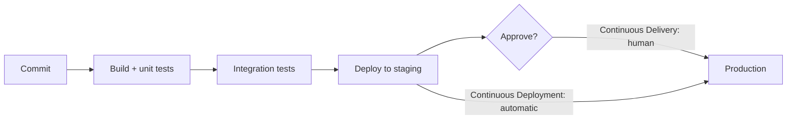

# Difference between CI CD and continuous deployment

---

## 🟢 Junior Level

Three related practices, each building on the previous one:

| Practice | What it means | Ends with |
| --- | --- | --- |
| **Continuous Integration (CI)** | Developers merge small changes into the main branch frequently (at least daily); every change is automatically built and tested | A verified build on every commit |
| **Continuous Delivery (CD)** | Every change that passes the pipeline is **releasable**: packaged, deployed to test/staging environments, and ready for production at the push of a button | A production-ready artifact; release is a **business decision** (manual approval) |
| **Continuous Deployment** | Every change that passes the pipeline is deployed to production **automatically**, with no manual step | Production updated many times a day |

### Key idea
CI is about **integrating code safely**; continuous delivery is about **always being able to release**; continuous deployment removes the human gate entirely — which requires very high confidence in automated tests, monitoring and rollback.

---

## 🟡 Middle Level

### What "real" CI requires
* **Trunk-based or short-lived branches** — merging a two-week branch isn't continuous integration.
* **Fast, reliable pipeline** — feedback in minutes; flaky tests destroy trust.
* **Main always green** — a broken build is fixed or reverted immediately.
* **Everything automated** — build, tests, static analysis, packaging.

### What continuous delivery adds
* **Build once, deploy many** — the same immutable artifact (JAR, container image digest) moves through environments; configuration differs, binaries don't.
* **Automated deployments** to every environment, including production (the approval is a button, not a manual procedure).
* **Environment parity** — staging resembles production (infrastructure as code).
* **Database migrations** run automatically and are backward-compatible.
* **Release ≠ deploy** — feature flags let you deploy code dark and release features later.

### Requirements for continuous deployment
* High test coverage at the right levels, including contract tests.
* **Progressive delivery**: canary or blue-green rollouts with automated analysis of error rate and latency.
* **Automatic rollback** on SLO regression.
* Feature flags for risky changes.
* Strong observability and on-call ownership by the team that deploys.

---

## 🔴 Senior Level

### Choosing the model per context
* **Regulated environments** (banking, healthcare, medical devices) often keep continuous *delivery* with an approval step — but the approval should be a quick, auditable decision backed by automated evidence (test reports, change records generated by the pipeline), not a manual testing phase.
* **SaaS products** with mature pipelines benefit most from continuous *deployment*: smaller changes → smaller risk per deploy → easier rollback and debugging.
* **Mobile apps / on-prem software** can't deploy continuously to users; they practice continuous delivery to internal tracks and ship on a cadence.

### Why small, frequent releases are safer (counter-intuitive but measurable)
* Each deploy contains fewer changes, so failures are easier to attribute and roll back.
* Teams practice deploying constantly; the process is reliable and boring.
* DORA research shows elite performers combine high deployment frequency with *lower* change failure rate and faster recovery — speed and stability aren't trade-offs when practices are good.

### Pipeline anti-patterns
* "CI" that only compiles; tests run nightly.
* Rebuilding artifacts per environment (what you tested isn't what you deployed).
* Manual steps documented in wiki pages ("SSH and run this script").
* Long-lived release branches with cherry-picks.
* Change Advisory Board meetings for every deploy regardless of risk — replace with automated risk assessment and peer review.

### Metrics to track
Deployment frequency, lead time for changes (commit → production), change failure rate, time to restore service (the four DORA metrics), plus pipeline duration and flake rate.

---

## 🎯 Interview Cheat Sheet

**30-second pitch:** Continuous Integration means merging small changes frequently with automated build and tests on every commit. Continuous Delivery means every passing change is deployable — one immutable artifact promoted through environments with automated deployments — and production release is a button press. Continuous Deployment removes that button: every passing change goes to production automatically, which requires strong tests, progressive delivery, monitoring and automatic rollback.

**Must know:**
* CI vs continuous delivery vs continuous deployment.
* Build once, deploy many; environment parity.
* Deploy vs release; feature flags.
* Progressive delivery and auto-rollback for continuous deployment.
* DORA metrics.

**Common follow-ups:**
* What would you need before enabling continuous deployment?
* How do approvals work in regulated companies?
* Why are frequent releases less risky?

**Red flags:** long-lived feature branches called "CI"; rebuilding per environment; manual deployment runbooks.

**Related:**
* [How to design a CI CD pipeline for a Java application](11.%20How%20to%20design%20a%20CI%20CD%20pipeline%20for%20a%20Java%20application.md)
* [Deployment strategies rolling blue-green canary and feature flags](13.%20Deployment%20strategies%20rolling%20blue-green%20canary%20and%20feature%20flags.md)
* [DevOps culture and DORA metrics](16.%20DevOps%20culture%20and%20DORA%20metrics.md)
* [What are the main Git branching strategies](06.%20What%20are%20the%20main%20Git%20branching%20strategies.md)
