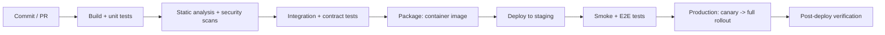

# How to design a CI CD pipeline for a Java application

---

## 🟢 Junior Level

A pipeline turns a commit into a running, verified deployment through **stages**, each a quality gate:



### Minimal GitHub Actions pipeline for a Spring Boot service

```yaml
name: ci
on:
  pull_request:
  push:
    branches: [main]

jobs:
  build:
    runs-on: ubuntu-latest
    steps:
      - uses: actions/checkout@v4
      - uses: actions/setup-java@v4
        with: { distribution: temurin, java-version: 21, cache: maven }
      - name: Build, test, verify
        run: ./mvnw -B -ntp verify            # unit + integration tests (Failsafe, Testcontainers)
      - uses: actions/upload-artifact@v4
        if: always()
        with: { name: test-reports, path: "**/target/*-reports/*.xml" }
```

---

## 🟡 Middle Level

### Building and publishing the image

```yaml
  image:
    needs: build
    if: github.ref == 'refs/heads/main'
    runs-on: ubuntu-latest
    permissions: { contents: read, packages: write, id-token: write }
    steps:
      - uses: actions/checkout@v4
      - uses: actions/setup-java@v4
        with: { distribution: temurin, java-version: 21, cache: maven }
      - name: Build OCI image with Buildpacks (no Dockerfile needed)
        run: ./mvnw -B -ntp spring-boot:build-image -DskipTests
             -Dspring-boot.build-image.imageName=ghcr.io/shop/orders:${{ github.sha }}
      - run: echo "${{ secrets.GITHUB_TOKEN }}" | docker login ghcr.io -u ${{ github.actor }} --password-stdin
      - run: docker push ghcr.io/shop/orders:${{ github.sha }}
```

Tag images with the **commit SHA** (immutable), never only `latest`. Deploy by **digest** (`@sha256:...`) so the exact tested image runs everywhere.

### Dockerfile alternative with layered JARs

```dockerfile
FROM eclipse-temurin:21-jre AS extract
WORKDIR /app
COPY target/orders.jar app.jar
RUN java -Djarmode=tools -jar app.jar extract --layers --launcher --destination extracted

FROM eclipse-temurin:21-jre
WORKDIR /app
RUN useradd --system --uid 10001 app
COPY --from=extract /app/extracted/dependencies/ ./
COPY --from=extract /app/extracted/spring-boot-loader/ ./
COPY --from=extract /app/extracted/snapshot-dependencies/ ./
COPY --from=extract /app/extracted/application/ ./
USER 10001
ENTRYPOINT ["java", "-XX:MaxRAMPercentage=75", "org.springframework.boot.loader.launch.JarLauncher"]
```

Dependency layers change rarely, so rebuilds only push the small application layer.

### Deploying
* **GitOps** (Argo CD / Flux): the pipeline updates the image digest in a Git repository of Kubernetes manifests (Helm/Kustomize); the cluster agent syncs it. Audit trail = Git history; rollback = `git revert`.
* **Push-based**: pipeline runs `helm upgrade` / `kubectl apply` with short-lived credentials (OIDC federation to the cloud, no stored keys).

---

## 🔴 Senior Level

### Quality gates worth having

| Gate | Tooling | Fails when |
| --- | --- | --- |
| Tests | Surefire/Failsafe, Testcontainers | Any failure (flakes quarantined separately) |
| Coverage on changed code | JaCoCo + Sonar/diff-cover | Below threshold on new code |
| Static analysis | Error Prone, SpotBugs, Sonar quality gate | New critical issues |
| Dependency vulnerabilities | OWASP Dependency-Check, Snyk, Trivy | New critical/high CVEs with fixes available |
| Image scan + SBOM | Trivy/Grype, CycloneDX/Syft | Critical OS-level CVEs; SBOM attached to release |
| Contracts | Pact `can-i-deploy` | Incompatible with deployed consumers/providers |
| Migrations | Flyway validate against a prod-like DB | Migration fails or isn't backward-compatible |
| Post-deploy | Smoke tests, canary analysis (Argo Rollouts) | SLO regression → auto-rollback |

### Supply chain security
* **Pin** third-party actions by commit SHA, not tags.
* **Least-privilege tokens** (`permissions:` per job), OIDC to cloud providers instead of long-lived secrets.
* **Sign** images (Sigstore cosign, keyless) and **verify** signatures at admission (Kyverno/Connaisseur) so only pipeline-built images run.
* Generate **provenance attestations** (SLSA) linking image → commit → workflow.
* Dependency caching keyed by lockfile/`pom.xml` hash; never cache build outputs that could be poisoned across branches.

### Speed
* Parallel jobs (unit vs integration vs analysis), Maven `-T 1C`, Gradle build cache (remote), Testcontainers reuse of images, test sharding.
* Run only what changed in monorepos (affected-module detection).
* Target: PR feedback < 10 minutes, main-to-production < 1 hour.

### Environments and promotion
* Ephemeral preview environments per PR (namespace per branch) for E2E tests and reviews.
* Promotion = changing which **digest** an environment points to; configuration per environment comes from config maps/secrets managers, never baked into images.
* Database migrations run as a pipeline step or init job **before** the new version rolls out, and must be backward-compatible with the running version (expand/contract).

---

## 🎯 Interview Cheat Sheet

**30-second pitch:** My Java pipeline builds and tests every PR in minutes, runs static analysis, dependency and image scans, integration and contract tests, then builds one immutable image tagged by commit and deployed by digest. Deployment goes through staging to production via GitOps with canary analysis and automatic rollback, migrations are backward-compatible, and the supply chain is secured with pinned actions, OIDC credentials, signed images and SBOMs.

**Must know:**
* Stage layout and quality gates.
* Build once, deploy many; tag by SHA, deploy by digest.
* Buildpacks or layered Dockerfiles; non-root images; `MaxRAMPercentage`.
* GitOps vs push deployments.
* Supply chain: pinning, OIDC, cosign, SBOM, SLSA provenance.

**Common follow-ups:**
* How do you roll back?
* Where do database migrations run?
* How do you keep the pipeline fast?

**Red flags:** `latest` tags; secrets in pipeline YAML; rebuilding images per environment; manual production steps.

**Related:**
* [Difference between CI CD and continuous deployment](10.%20Difference%20between%20CI%20CD%20and%20continuous%20deployment.md)
* [Static analysis and dependency vulnerability scanning](12.%20Static%20analysis%20and%20dependency%20vulnerability%20scanning.md)
* [Database migrations and rollback strategies in pipelines](15.%20Database%20migrations%20and%20rollback%20strategies%20in%20pipelines.md)
* [CI test strategy](../22.%20Testing/23.%20CI%20test%20strategy.md)
