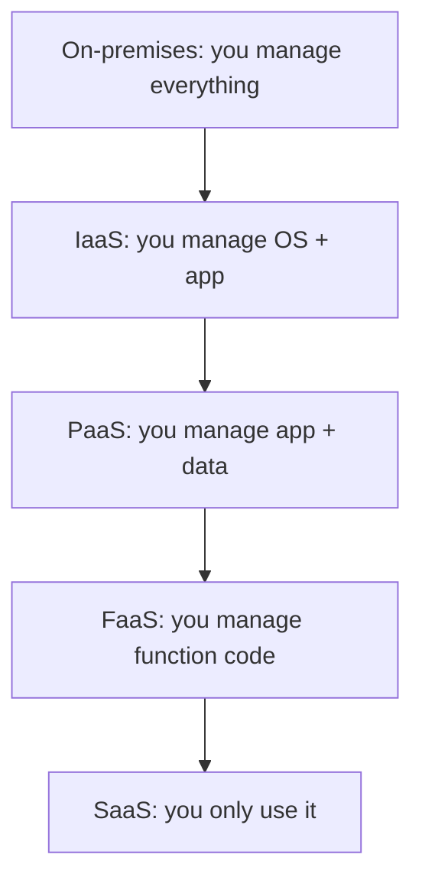

# Cloud computing basics IaaS PaaS SaaS and FaaS

---

## 🟢 Junior Level

**Cloud computing** is the on-demand delivery of computing resources (servers, storage, databases, networking, software) over the internet with **pay-as-you-go** pricing. Instead of buying and racking your own servers, you rent capacity from a provider such as AWS, Microsoft Azure or Google Cloud and release it when you no longer need it.

The five essential characteristics (NIST definition): on-demand self-service, broad network access, resource pooling, rapid elasticity, and measured service.

### Real-world analogy
Think of electricity. You do not build a power plant; you plug in and pay for the kilowatt-hours you use. Cloud is "utility computing".

### Service models

| Model | You manage | Provider manages | AWS example |
|---|---|---|---|
| **IaaS** (Infrastructure) | OS, runtime, app, data | Hardware, virtualization, network | EC2, EBS, VPC |
| **PaaS** (Platform) | App and data | OS, runtime, scaling, patching | Elastic Beanstalk, RDS, App Runner |
| **FaaS** (Function) | Function code only | Everything else, scales to zero | Lambda |
| **SaaS** (Software) | Only configuration/users | The whole application | Amazon WorkMail, Gmail, Salesforce |



### Deployment models
- **Public cloud** - shared provider infrastructure (AWS, Azure, GCP).
- **Private cloud** - dedicated to one organisation (OpenStack, VMware).
- **Hybrid cloud** - on-prem plus public cloud connected (AWS Outposts, Direct Connect).

### Minimal example: listing S3 buckets with the AWS SDK for Java v2

```java
import software.amazon.awssdk.regions.Region;
import software.amazon.awssdk.services.s3.S3Client;

public class HelloCloud {
    public static void main(String[] args) {
        try (S3Client s3 = S3Client.builder().region(Region.EU_WEST_1).build()) {
            s3.listBuckets().buckets()
              .forEach(b -> System.out.println(b.name()));
        }
    }
}
```

Credentials are discovered automatically (environment variables, `~/.aws/credentials`, or an IAM role) - never hard-code them.

---

## 🟡 Middle Level

### Why companies move to the cloud
1. **CapEx to OpEx** - no upfront hardware purchase; costs follow usage.
2. **Elasticity** - scale out for Black Friday, scale in at night.
3. **Global reach** - deploy to many regions in minutes.
4. **Managed services** - offload undifferentiated heavy lifting (patching, backups, failover).
5. **Speed** - provision an environment in minutes through code.

### Choosing the right abstraction level
The higher you go, the less control and the less operational burden you carry.

| Concern | IaaS (EC2) | PaaS (Beanstalk/RDS) | FaaS (Lambda) |
|---|---|---|---|
| OS patching | You | Provider | Provider |
| Scaling | Auto Scaling config | Built in | Automatic per request |
| Idle cost | Pay while running | Pay while running | Zero |
| Execution limits | None | Few | 15 min, 10 GB memory |
| Lock-in | Low | Medium | High (event model) |

### Infrastructure as Code
Clicking in the console is not repeatable. Declare resources in code instead:

```yaml
# CloudFormation: one S3 bucket with versioning
AWSTemplateFormatVersion: "2010-09-09"
Resources:
  ReportsBucket:
    Type: AWS::S3::Bucket
    Properties:
      VersioningConfiguration:
        Status: Enabled
      PublicAccessBlockConfiguration:
        BlockPublicAcls: true
        BlockPublicPolicy: true
        IgnorePublicAcls: true
        RestrictPublicBuckets: true
```

```hcl
# Terraform equivalent
resource "aws_s3_bucket" "reports" {
  bucket = "acme-reports-prod"
}
resource "aws_s3_bucket_versioning" "reports" {
  bucket = aws_s3_bucket.reports.id
  versioning_configuration { status = "Enabled" }
}
```

### Common mistakes
- Lifting-and-shifting a monolith and expecting cost savings; idle oversized VMs are *more* expensive than a data centre.
- Treating servers as pets (manual SSH changes) instead of cattle (immutable, replaceable).
- Leaving resources running in dev accounts.
- Storing credentials in code or Git.

---

## 🔴 Senior Level

### Architecture implications of cloud-native design
Cloud-native systems assume **failure is normal**. Design principles:

- **Stateless compute, stateful managed services** - sessions in ElastiCache/DynamoDB, files in S3.
- **Immutable infrastructure** - build an AMI or container image, replace instead of patch.
- **Horizontal scaling** over vertical scaling.
- **Loose coupling** through queues and events.
- **Automation of everything** - CI/CD, IaC, policy as code.

### Total cost of ownership reasoning
A senior engineer compares not only list prices but also: engineering hours for patching and on-call, licence costs, data-transfer fees (egress is often the hidden killer), and the opportunity cost of slower delivery. Managed PostgreSQL (RDS) costs about 1.3-2x the EC2 price, yet typically beats self-managed once backups, failover testing and upgrades are priced in.

### FaaS trade-offs in depth
Lambda bills per request and per GB-second (rounded to 1 ms). A function with 1 GB running 200 ms at 10 M requests/month costs roughly the same as one small always-on instance, but it scales to zero and handles spikes. Beyond sustained high throughput (hundreds of requests per second 24/7) containers on Fargate or EC2 are usually cheaper. Also consider: cold starts for Java (see the Lambda question), 6 MB sync payload limit, no long-lived connections, and concurrency limits per account/region.

### Cloud-agnostic abstractions in Java
If you want portability of business code while using provider services, hide SDK calls behind ports:

```java
public interface ObjectStore {
    void put(String key, byte[] data, String contentType);
    byte[] get(String key);
}

@Component
class S3ObjectStore implements ObjectStore {
    private final S3Client s3;
    private final String bucket;

    S3ObjectStore(S3Client s3, @Value("${app.bucket}") String bucket) {
        this.s3 = s3;
        this.bucket = bucket;
    }

    @Override
    public void put(String key, byte[] data, String contentType) {
        s3.putObject(b -> b.bucket(bucket).key(key).contentType(contentType),
                     RequestBody.fromBytes(data));
    }

    @Override
    public byte[] get(String key) {
        return s3.getObjectAsBytes(b -> b.bucket(bucket).key(key)).asByteArray();
    }
}
```

### Production considerations
- **Account strategy**: separate AWS accounts per environment and workload under AWS Organizations, with SCPs as guardrails.
- **Quotas**: every service has soft limits (Lambda concurrency, EC2 vCPUs, API rate limits); request increases before launches.
- **Observability and governance** from day one: tagging, CloudTrail, Config, budgets.
- **Exit and DR strategy**: know how you would restore in another region.
- **Anti-pattern**: "cloud washing" - running VMs the same way as on-prem and ignoring managed services.

---

## 🎯 Interview Cheat Sheet

**30-second pitch:** Cloud computing is renting IT resources on demand with pay-per-use pricing. IaaS gives raw VMs, PaaS gives a managed runtime, FaaS runs individual functions that scale to zero, and SaaS delivers a finished application. The higher the abstraction, the less you operate and the less control you have.

**Must-know bullets**
- IaaS = EC2, PaaS = Beanstalk/RDS, FaaS = Lambda, SaaS = hosted apps.
- NIST characteristics: on-demand, elastic, measured, pooled, network accessible.
- Public / private / hybrid deployment models.
- Use IaC (CloudFormation, Terraform, CDK) rather than console clicks.
- Credentials come from the default provider chain / IAM roles, never from code.

**Common follow-ups**
- When would you choose containers over Lambda?
- What are hidden cloud costs? (egress, idle resources, cross-AZ traffic)
- What does "elasticity" mean versus "scalability"?

**Red flags**
- "Cloud is just someone else's server" with no discussion of managed services.
- Hard-coded access keys.
- Claiming the cloud is always cheaper.

**Related topics**
- [AWS shared responsibility model](02.%20AWS%20shared%20responsibility%20model.md)
- [AWS Regions and Availability Zones](03.%20AWS%20Regions%20and%20Availability%20Zones.md)
- [Lambda and serverless Java](13.%20Lambda%20and%20serverless%20Java.md)
- [Cloud cost optimization and FinOps](20.%20Cloud%20cost%20optimization%20and%20FinOps.md)
