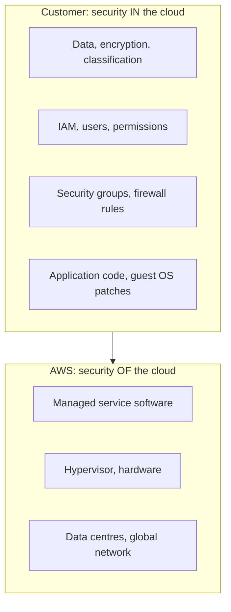

# AWS shared responsibility model

---

## 🟢 Junior Level

The **shared responsibility model** divides security duties between AWS and the customer:

- **AWS is responsible for security *of* the cloud** - physical data centres, hardware, host operating system, hypervisor (Nitro), global network, and the managed-service software itself.
- **The customer is responsible for security *in* the cloud** - your data, identity and access management, guest OS (on EC2), network configuration, application code, and encryption choices.

### Real-world analogy
Renting an apartment: the landlord secures the building, the roof and the main door. You are responsible for locking your own door, who you give keys to, and what you store inside.



### Responsibility shifts with the service type

| Service | AWS handles | You handle |
|---|---|---|
| EC2 (IaaS) | Hardware, hypervisor | Guest OS patching, firewall, app, data |
| RDS (managed) | OS patching, backups engine, failover | DB users, network access, encryption settings, data |
| S3 | Durability, infrastructure | Bucket policies, public access, encryption, data |
| Lambda | Runtime patching, servers | Function code, dependencies, IAM role |

### Minimal example: blocking public access on a bucket

```bash
aws s3api put-public-access-block \
  --bucket acme-reports-prod \
  --public-access-block-configuration \
  BlockPublicAcls=true,IgnorePublicAcls=true,BlockPublicPolicy=true,RestrictPublicBuckets=true
```

Leaked S3 buckets are almost always *customer* misconfiguration, not an AWS failure.

---

## 🟡 Middle Level

### What exactly do you own?
Even with fully managed services you always own:
1. **Data** - classification, encryption at rest and in transit, retention, backups you configure.
2. **Identity** - IAM users, roles, MFA, key rotation, least privilege.
3. **Configuration** - security groups, NACLs, bucket policies, public endpoints.
4. **Application security** - injection flaws, dependency CVEs (Log4Shell is *your* problem on Lambda too), authentication logic.
5. **Compliance mapping** - AWS provides PCI/ISO/SOC reports via AWS Artifact; you must prove your workload complies.

### Shared controls
Some controls are shared: *patch management* (AWS patches the infrastructure, you patch guest OS and apps), *configuration management* (AWS configures its devices, you configure your resources), and *awareness and training*.

### Tools that help you fulfil your part
| Goal | Tool |
|---|---|
| Who did what? | CloudTrail |
| Is the config compliant? | AWS Config, Security Hub |
| Detect threats | GuardDuty |
| Find vulnerable software | Amazon Inspector (EC2, ECR images, Lambda) |
| Find public/sensitive data | IAM Access Analyzer, Macie |
| Encrypt | KMS, ACM |

### Enforce encryption in transit on S3
```json
{
  "Version": "2012-10-17",
  "Statement": [{
    "Sid": "DenyInsecureTransport",
    "Effect": "Deny",
    "Principal": "*",
    "Action": "s3:*",
    "Resource": ["arn:aws:s3:::acme-reports-prod", "arn:aws:s3:::acme-reports-prod/*"],
    "Condition": { "Bool": { "aws:SecureTransport": "false" } }
  }]
}
```

### Common mistakes
- Assuming "it is in AWS so it is encrypted and secure by default".
- Opening security group `0.0.0.0/0` on port 22 or 3389.
- Not patching AMIs and container base images.
- Using the root account for daily work.

---

## 🔴 Senior Level

### Designing guardrails, not gates
At enterprise scale you cannot review every resource by hand. You encode your half of the model as **preventive** and **detective** controls:

- **Preventive**: Service Control Policies (SCPs) in AWS Organizations, permission boundaries, IAM conditions, S3 Block Public Access at account level.
- **Detective**: AWS Config rules, Security Hub standards (CIS, AWS Foundational), GuardDuty findings routed via EventBridge.
- **Responsive**: automated remediation (Lambda/SSM Automation) for known drifts, such as closing a world-open security group.

```json
{
  "Version": "2012-10-17",
  "Statement": [{
    "Sid": "DenyLeavingOrg",
    "Effect": "Deny",
    "Action": ["organizations:LeaveOrganization"],
    "Resource": "*"
  },{
    "Sid": "RestrictRegions",
    "Effect": "Deny",
    "NotAction": ["iam:*", "organizations:*", "support:*", "cloudfront:*"],
    "Resource": "*",
    "Condition": { "StringNotEquals": { "aws:RequestedRegion": ["eu-west-1", "eu-central-1"] } }
  }]
}
```

### Responsibility in containers and Kubernetes
On EKS, AWS operates the control plane; you secure worker node AMIs (unless Fargate), pod security, network policies, IRSA/Pod Identity roles, and image provenance. On ECS Fargate AWS patches the host, but you still own the image contents. Scan images in ECR and pin base images by digest.

### Data protection patterns
- Envelope encryption with KMS customer-managed keys and key policies that separate key administrators from key users.
- S3 default encryption SSE-KMS plus bucket keys to cut KMS request costs.
- RDS encryption must be enabled at creation; encrypting later requires snapshot-copy-restore.
- Cross-account backups (AWS Backup vault lock) protect against ransomware and compromised admin accounts.

### Incident response and evidence
Under the model AWS will tell you about its infrastructure issues; investigating *your* compromised credential is yours. Prepare: centralised CloudTrail organization trail to a locked-down log-archive account, immutable logs (S3 Object Lock), runbooks, and an isolated forensic account. Practise with game days.

### Compliance subtleties
Customer-managed responsibilities differ for HIPAA, PCI-DSS and GDPR: you must sign a BAA, restrict regions for data residency, and honour data-subject requests. AWS "compliant infrastructure" does not make your application compliant.

### Edge cases
- A Lambda function with `AdministratorAccess` is a breach waiting for a dependency exploit; scope roles per function.
- Customer-managed keys deleted by mistake make data permanently unreadable - use a 7-30 day deletion window and alarms.
- Public AMIs and public EBS snapshots leak data; use account-level block settings.

---

## 🎯 Interview Cheat Sheet

**30-second pitch:** AWS secures the cloud itself - facilities, hardware, hypervisor and the managed service software. I secure what I put in the cloud - data, identities, network rules, OS and application code. The more managed the service, the more AWS owns, but identity, data and configuration are always mine.

**Must-know bullets**
- "Of the cloud" (AWS) versus "in the cloud" (customer).
- EC2: you patch the guest OS. RDS: AWS patches the engine on a window. Lambda: you own code and IAM role.
- Most breaches are misconfiguration: public buckets, open security groups, leaked keys.
- Use CloudTrail, Config, GuardDuty, Security Hub, SCPs.
- AWS Artifact provides compliance reports.

**Common follow-ups**
- Who is responsible for RDS backups and encryption?
- How would you stop engineers creating public S3 buckets across 100 accounts?
- What changes with Fargate versus EC2?

**Red flags**
- "AWS handles all security."
- Root credentials in use, no MFA.
- No audit logging enabled.

**Related topics**
- [AWS IAM users roles and policies](04.%20AWS%20IAM%20users%20roles%20and%20policies.md)
- [VPC subnets security groups and NAT](07.%20VPC%20subnets%20security%20groups%20and%20NAT.md)
- [Secrets Manager Parameter Store and KMS](17.%20Secrets%20Manager%20Parameter%20Store%20and%20KMS.md)
- [Cloud computing basics IaaS PaaS SaaS and FaaS](01.%20Cloud%20computing%20basics%20IaaS%20PaaS%20SaaS%20and%20FaaS.md)
