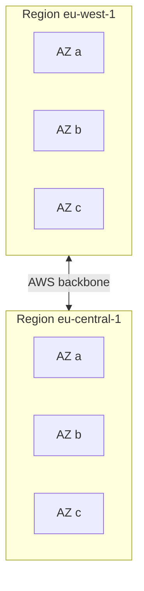

# AWS Regions and Availability Zones

---

## 🟢 Junior Level

An **AWS Region** is a separate geographic area (for example `eu-west-1` Ireland, `us-east-1` N. Virginia, `ap-south-1` Mumbai). Each Region contains multiple isolated **Availability Zones (AZs)** - one or more discrete data centres with independent power, cooling and networking, connected to each other by low-latency, high-bandwidth links. Names look like `eu-west-1a`, `eu-west-1b`, `eu-west-1c`.

There are also **Edge Locations** (CloudFront CDN, Route 53) and **Local Zones / Wavelength** for ultra-low latency.

### Real-world analogy
A Region is a city; AZs are separate districts of that city, each with its own power station. A flood in one district does not take out the whole city, but a hurricane could hit the entire city - which is why you may also want a second city.



### Key facts
- Regions are **isolated** from each other: data does not leave a Region unless you configure replication.
- Most services are **regional** (S3 buckets, DynamoDB tables, Lambda). IAM, Route 53 and CloudFront are **global**.
- Not all services or instance types exist in every Region.
- Price differs per Region.

### Minimal example: choosing a Region in Java

```java
import software.amazon.awssdk.regions.Region;
import software.amazon.awssdk.services.ec2.Ec2Client;

try (Ec2Client ec2 = Ec2Client.builder().region(Region.EU_CENTRAL_1).build()) {
    ec2.describeAvailabilityZones().availabilityZones()
       .forEach(z -> System.out.println(z.zoneName() + " " + z.zoneId()));
}
```

---

## 🟡 Middle Level

### How to choose a Region
1. **Latency** - close to your users.
2. **Compliance and data residency** - GDPR, local regulations (e.g. keep EU data in EU).
3. **Service availability** - new services launch first in `us-east-1`, `us-west-2`, `eu-west-1`.
4. **Cost** - `us-east-1` is usually cheapest; São Paulo is among the priciest.
5. **Disaster-recovery pairing** - a second Region within the same legal area.

### AZ naming trap
`us-east-1a` in your account may map to a different physical AZ than in another account. Use the **AZ ID** (`use1-az1`) when coordinating across accounts (for example for PrivateLink or shared subnets).

```bash
aws ec2 describe-availability-zones --region eu-west-1 \
  --query "AvailabilityZones[].[ZoneName,ZoneId,State]" --output table
```

### Multi-AZ vs multi-Region

| Aspect | Multi-AZ | Multi-Region |
|---|---|---|
| Protects against | Data-centre failure | Regional outage, disasters |
| Latency between sites | Single-digit ms | Tens to hundreds ms |
| Replication | Often synchronous (RDS Multi-AZ) | Asynchronous (Aurora Global, S3 CRR, DynamoDB Global Tables) |
| Complexity / cost | Low | High |
| Data transfer cost | Cross-AZ ~ $0.01/GB each way | Inter-region higher |

### Practical usage
- Run **at least two AZs** for every production workload: an Auto Scaling group spanning subnets in 2-3 AZs behind an ALB, RDS Multi-AZ.
- Cross-AZ traffic is billed, so chatty microservices should prefer same-AZ routing where possible (topology-aware routing in Kubernetes).

```yaml
# CloudFormation: Auto Scaling group across AZs through subnets
WebAsg:
  Type: AWS::AutoScaling::AutoScalingGroup
  Properties:
    MinSize: "2"
    MaxSize: "6"
    VPCZoneIdentifier: [!Ref PrivateSubnetA, !Ref PrivateSubnetB, !Ref PrivateSubnetC]
    LaunchTemplate:
      LaunchTemplateId: !Ref WebLaunchTemplate
      Version: !GetAtt WebLaunchTemplate.LatestVersionNumber
```

### Common mistakes
- Deploying everything in one AZ "to save on cross-AZ costs".
- Forgetting that the default region in the CLI/SDK may not be the one you intended (`AWS_REGION`, `~/.aws/config`).
- Placing S3 data in a Region that violates compliance.

---

## 🔴 Senior Level

### Failure domains and blast radius
Reason in terms of **failure domains**: instance < AZ < Region < global control plane. Design every tier to survive the loss of the next level up that your SLO requires. Typical targets:

| Strategy | RTO | RPO | Cost |
|---|---|---|---|
| Backup and restore | Hours | Hours | $ |
| Pilot light | Tens of minutes | Minutes | $$ |
| Warm standby | Minutes | Seconds-minutes | $$$ |
| Multi-site active/active | Near zero | Near zero | $$$$ |

### Control plane vs data plane
During large events the **control plane** (creating instances, changing Route 53 records) is more likely to be impaired than the **data plane** (running instances, serving DNS). For DR, pre-provision capacity and use **static stability**: do not depend on control-plane calls to fail over. Route 53 health checks plus Application Recovery Controller routing controls are designed for that.

### Active/active across Regions
Requires solving data:
- **DynamoDB Global Tables** - multi-writer, last-writer-wins by timestamp; design idempotent writes and avoid conflicting updates to the same item.
- **Aurora Global Database** - one writer Region, <1 s typical replication lag, managed planned switchover; managed unplanned failover requires promotion.
- **S3 Cross-Region Replication** with replication time control (15 min SLA).
- Per-region caches, per-region secrets (Secrets Manager multi-region replication), per-region KMS multi-Region keys.

```hcl
resource "aws_route53_record" "api_primary" {
  zone_id        = var.zone_id
  name           = "api.acme.com"
  type           = "A"
  set_identifier = "eu-west-1"
  failover_routing_policy { type = "PRIMARY" }
  health_check_id = aws_route53_health_check.eu_west.id
  alias {
    name                   = aws_lb.eu_west.dns_name
    zone_id                = aws_lb.eu_west.zone_id
    evaluate_target_health = true
  }
}
```

### Java client considerations
SDK v2 clients are Region-bound and thread-safe; create one per Region and reuse. For multi-region failover in the app tier, wrap clients in a policy (Resilience4j circuit breaker) rather than retrying blindly:

```java
Map<Region, DynamoDbClient> clients = Stream.of(Region.EU_WEST_1, Region.EU_CENTRAL_1)
    .collect(Collectors.toMap(r -> r, r -> DynamoDbClient.builder().region(r).build()));
```

### Edge cases and gotchas
- Some global features depend on `us-east-1` (CloudFront ACM certificates, some billing/IAM control-plane operations); an outage there can ripple out.
- Opt-in Regions (Hong Kong, Bahrain, Milan...) must be enabled per account and use regional STS endpoints.
- Quotas are per Region; capacity (especially GPU or rare instance types) is per AZ - use capacity reservations for critical launches.
- Latency budgets: cross-region synchronous calls in a request path destroy tail latency; prefer async replication and local reads.

---

## 🎯 Interview Cheat Sheet

**30-second pitch:** A Region is an isolated geographic area; it contains at least three Availability Zones, each one or more physically separate data centres. I deploy production across at least two AZs for high availability and add a second Region only when RTO/RPO, regulation or latency demand it.

**Must-know bullets**
- Region = isolation boundary for data, services and quotas; AZ = fault-isolation boundary within it.
- Multi-AZ is synchronous and cheap; multi-Region is asynchronous and complex.
- Use AZ IDs, not names, across accounts.
- Choose Region by latency, compliance, service availability and price.
- IAM, Route 53, CloudFront are global services.

**Common follow-ups**
- How would you design DR with RTO 15 minutes?
- What does cross-AZ traffic cost and how do you reduce it?
- What is static stability?

**Red flags**
- Single-AZ production database.
- Ignoring data-residency rules.
- Assuming multi-Region is free of data-consistency problems.

**Related topics**
- [High availability and the Well-Architected Framework](19.%20High%20availability%20and%20the%20Well-Architected%20Framework.md)
- [RDS and Aurora](09.%20RDS%20and%20Aurora.md)
- [Elastic Load Balancing and ALB](06.%20Elastic%20Load%20Balancing%20and%20ALB.md)
- [VPC subnets security groups and NAT](07.%20VPC%20subnets%20security%20groups%20and%20NAT.md)
