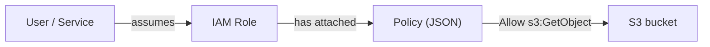

# AWS IAM users roles and policies

---

## 🟢 Junior Level

**AWS Identity and Access Management (IAM)** controls *who* (authentication) can do *what* (authorization) on *which* resources. It is global and free.

Core building blocks:
- **Root user** - the account owner with unlimited power. Enable MFA, lock away, never use daily.
- **IAM user** - a long-lived identity for a person or program (with a password and/or access keys). Modern practice prefers IAM Identity Center (SSO) for humans.
- **IAM group** - a collection of users to attach policies to.
- **IAM role** - an identity with *temporary* credentials that can be *assumed* by a user, an AWS service (EC2, Lambda), or another account.
- **Policy** - a JSON document that grants or denies permissions.

### Real-world analogy
A hotel: a *user* is a guest with a personal ID card, a *role* is a staff uniform anyone authorised can put on temporarily (and gets the uniform's access), and a *policy* is the list of rooms that the keycard opens.



### Minimal policy

```json
{
  "Version": "2012-10-17",
  "Statement": [{
    "Effect": "Allow",
    "Action": ["s3:GetObject", "s3:PutObject"],
    "Resource": "arn:aws:s3:::acme-reports-prod/uploads/*"
  }]
}
```

### Principle of least privilege
Give only the permissions needed for the task, nothing more. Start with nothing and add; do not start with `AdministratorAccess` and try to remove.

### Key rule: use roles for applications
An application running on EC2, ECS or Lambda should use the **attached role**, never embedded access keys. The SDK default credentials provider finds the role credentials automatically:

```java
S3Client s3 = S3Client.create(); // picks credentials from the role/environment
```

---

## 🟡 Middle Level

### Policy types and evaluation
| Type | Attached to | Purpose |
|---|---|---|
| Identity-based | User/group/role | What the identity can do |
| Resource-based | S3 bucket, SQS queue, KMS key, role trust | Who can access this resource (can grant cross-account) |
| Permissions boundary | User/role | Maximum permissions ceiling |
| SCP | Organization/OU/account | Guardrail across accounts |
| Session policy | Assumed-role session | Further narrows a session |

**Evaluation logic:** by default everything is *implicitly denied*; an explicit `Allow` is needed; an explicit `Deny` always wins. For same-account access, identity *or* resource policy Allow suffices (and no deny); for cross-account both sides must allow.

### Policy anatomy
`Effect`, `Action`, `Resource`, optional `Principal` (resource policies), and `Condition`:

```json
{
  "Effect": "Allow",
  "Action": "dynamodb:*Item",
  "Resource": "arn:aws:dynamodb:eu-west-1:111122223333:table/Orders",
  "Condition": {
    "ForAllValues:StringEquals": {
      "dynamodb:LeadingKeys": ["${aws:userid}"]
    }
  }
}
```

### Role trust policy and assuming a role
A role has two policies: the **trust policy** (who may assume it) and **permission policies** (what it can do).

```json
{
  "Version": "2012-10-17",
  "Statement": [{
    "Effect": "Allow",
    "Principal": { "Service": "ecs-tasks.amazonaws.com" },
    "Action": "sts:AssumeRole"
  }]
}
```

Assume a role from Java (e.g. cross-account):

```java
StsClient sts = StsClient.create();
StsAssumeRoleCredentialsProvider provider = StsAssumeRoleCredentialsProvider.builder()
    .stsClient(sts)
    .refreshRequest(r -> r.roleArn("arn:aws:iam::444455556666:role/PartnerReader")
                          .roleSessionName("orders-service"))
    .build();

S3Client partnerS3 = S3Client.builder().credentialsProvider(provider).build();
```

The provider refreshes temporary credentials automatically.

### Credentials provider chain (SDK v2)
Java system properties, environment variables, web identity token (EKS), shared credentials/config profile (incl. SSO), container credentials (ECS), then instance profile (EC2 IMDS). Know the order when debugging "wrong identity" bugs; `aws sts get-caller-identity` shows who you are.

### Common mistakes
- `"Action": "*", "Resource": "*"` in production.
- Long-lived access keys committed to Git or baked into images.
- Sharing one role among many services.
- Forgetting that `s3:ListBucket` applies to the bucket ARN while `s3:GetObject` applies to `bucket/*`.
- No MFA on privileged users.

---

## 🔴 Senior Level

### Designing a scalable access model
- **Multi-account** with AWS Organizations; humans authenticate through **IAM Identity Center** with a corporate IdP (SAML/OIDC) and assume permission sets per account.
- **Workload identities**: EC2 instance profiles, ECS task roles (distinct from the execution role), Lambda execution role, EKS **IRSA** or **EKS Pod Identity**, and **OIDC federation** for CI (GitHub Actions assumes a role without stored keys).
- **Break-glass** role with MFA, alarm on every use.

```hcl
data "aws_iam_policy_document" "github_trust" {
  statement {
    actions = ["sts:AssumeRoleWithWebIdentity"]
    principals {
      type        = "Federated"
      identifiers = [aws_iam_openid_connect_provider.github.arn]
    }
    condition {
      test     = "StringLike"
      variable = "token.actions.githubusercontent.com:sub"
      values   = ["repo:acme/orders-service:ref:refs/heads/main"]
    }
  }
}
```

### Least privilege in practice
1. Start from managed policy or generated policy via **IAM Access Analyzer policy generation** from CloudTrail activity.
2. Use **Access Advisor** (last-accessed) to prune unused permissions.
3. Use `Condition` keys: `aws:SourceVpce`, `aws:PrincipalOrgID`, `aws:RequestedRegion`, `aws:ResourceTag/...` for **ABAC** (attribute-based access control) so a few policies scale to many teams.
4. **Permissions boundaries** let teams create their own roles safely while capping privilege escalation.

### Privilege-escalation pitfalls
`iam:PassRole`, `iam:CreatePolicyVersion`, `iam:AttachRolePolicy`, `lambda:UpdateFunctionCode` plus a powerful role can all be turned into admin. Always restrict `iam:PassRole` by resource and `iam:PassedToService` condition:

```json
{
  "Effect": "Allow",
  "Action": "iam:PassRole",
  "Resource": "arn:aws:iam::111122223333:role/orders-task-role",
  "Condition": { "StringEquals": { "iam:PassedToService": "ecs-tasks.amazonaws.com" } }
}
```

### Confused deputy
When a third-party or service assumes a role in your account, require `sts:ExternalId` or `aws:SourceArn`/`aws:SourceAccount` conditions so another customer cannot trick the service into acting on your resources.

### Performance, limits and edge cases
- Role session duration 1-12 h; role chaining caps at 1 h.
- Policy size limits (managed policy 6,144 characters, inline per role 10,240); 10 managed policies per role by default - another reason for ABAC and boundaries.
- STS regional endpoints reduce latency and blast radius; credential refresh failures in long-running jobs surface as `ExpiredToken` errors - rely on SDK providers, do not cache credentials manually.
- Eventual consistency: IAM changes propagate within seconds; new role creation then immediate use in a template can fail - retry.
- Detective controls: CloudTrail, Access Analyzer external-access findings, Config rule `iam-no-inline-policy`, alarms on root login.

### Debugging an AccessDenied
1. Read the exact error: action, resource, and whether it was an explicit deny.
2. Check SCP, boundary, session policy, resource policy (KMS key policy!), and VPC endpoint policy.
3. Use the **IAM Policy Simulator** and `aws iam simulate-principal-policy`.
4. Decode authorization message: `aws sts decode-authorization-message`.

---

## 🎯 Interview Cheat Sheet

**30-second pitch:** IAM is AWS's authN/authZ layer. Humans federate through SSO, workloads use roles with temporary credentials, and permissions are JSON policies evaluated as deny-by-default where an explicit deny always wins. I enforce least privilege with scoped policies, conditions, boundaries and SCPs, and avoid long-lived access keys.

**Must-know bullets**
- User = long-lived identity; role = assumable, temporary credentials.
- Trust policy (who assumes) versus permissions policy (what they can do).
- Explicit deny > explicit allow > implicit deny.
- Identity-based vs resource-based policies; cross-account needs both.
- Use task/instance/Lambda roles; IRSA or Pod Identity on EKS; OIDC for CI.
- Lock down `iam:PassRole`; MFA on root; do not use root.

**Common follow-ups**
- How do you give a Lambda in account A access to an S3 bucket in account B?
- What is a permissions boundary versus an SCP?
- How would you find unused permissions?
- ECS task role versus task execution role?

**Red flags**
- Access keys in source code or `application.properties`.
- `*:*` policies.
- Not knowing implicit versus explicit deny.

**Related topics**
- [AWS shared responsibility model](02.%20AWS%20shared%20responsibility%20model.md)
- [Secrets Manager Parameter Store and KMS](17.%20Secrets%20Manager%20Parameter%20Store%20and%20KMS.md)
- [Lambda and serverless Java](13.%20Lambda%20and%20serverless%20Java.md)
- [ECS Fargate EKS and Elastic Beanstalk](15.%20ECS%20Fargate%20EKS%20and%20Elastic%20Beanstalk.md)
