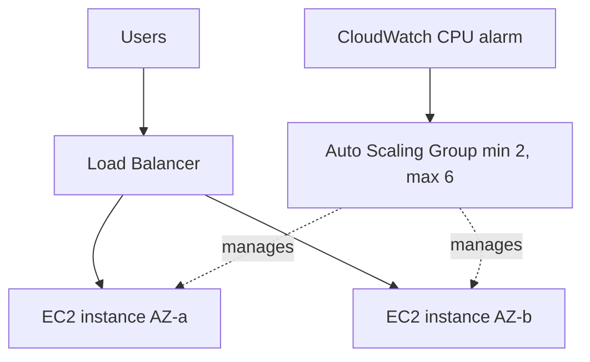

# EC2 and Auto Scaling

---

## 🟢 Junior Level

**Amazon EC2 (Elastic Compute Cloud)** provides resizable virtual servers (*instances*) in the cloud. You choose an **AMI** (machine image: OS plus software), an **instance type** (CPU/RAM/network, e.g. `t3.micro`, `m7g.large`), storage (**EBS** volumes), a network location (subnet), and a **security group** (firewall).

**Auto Scaling Groups (ASG)** automatically keep a desired number of instances running and add or remove instances based on demand or schedule, replacing unhealthy instances.

### Real-world analogy
EC2 is renting taxis; an ASG is a dispatcher who calls more taxis when queues grow, sends them home when quiet, and replaces any that break down.



### Instance families (quick map)
| Family | Use | Example |
|---|---|---|
| T / M | General purpose | `t3.medium`, `m7i.large` |
| C | Compute optimised | `c7g.xlarge` |
| R / X | Memory optimised (JVM heaps, caches) | `r7g.2xlarge` |
| G / P | GPU | `g5.xlarge` |
| `g` suffix | Graviton (ARM), usually ~20% cheaper | `m7g` |

### Minimal example: launch an instance from Java

```java
Ec2Client ec2 = Ec2Client.create();
RunInstancesResponse resp = ec2.runInstances(r -> r
    .imageId("ami-0abcdef1234567890")
    .instanceType(InstanceType.T3_MICRO)
    .minCount(1).maxCount(1)
    .securityGroupIds("sg-0123456789abcdef0")
    .subnetId("subnet-0123456789abcdef0")
    .iamInstanceProfile(p -> p.name("orders-app-profile")));
System.out.println(resp.instances().get(0).instanceId());
```

---

## 🟡 Middle Level

### Purchasing options
| Option | Discount | Use |
|---|---|---|
| On-Demand | 0 | Unpredictable, short-lived |
| Savings Plans / Reserved | up to ~70% | Steady baseline (1 or 3 years) |
| Spot | up to ~90% | Fault-tolerant, batch, stateless workers (2-minute interruption notice) |
| Dedicated Hosts | - | Licensing, compliance |

### EBS vs instance store
EBS volumes are network-attached, persistent, snapshot-able (`gp3` default general SSD, `io2` for high IOPS). Instance store is ephemeral local NVMe - data is lost on stop/terminate; good for caches/scratch.

### Launch templates and ASG
Use **launch templates** (versioned) instead of legacy launch configurations. Spread across at least two AZs. Health check type `ELB` replaces instances failing the load balancer check, not only the EC2 status check.

```hcl
resource "aws_launch_template" "web" {
  name_prefix   = "orders-web-"
  image_id      = data.aws_ami.al2023.id
  instance_type = "m7g.large"
  iam_instance_profile { name = aws_iam_instance_profile.web.name }
  vpc_security_group_ids = [aws_security_group.web.id]
  metadata_options { http_tokens = "required" } # enforce IMDSv2
  user_data = base64encode(file("${path.module}/boot.sh"))
}

resource "aws_autoscaling_group" "web" {
  min_size            = 2
  max_size            = 8
  vpc_zone_identifier = var.private_subnet_ids
  target_group_arns   = [aws_lb_target_group.web.arn]
  health_check_type   = "ELB"
  health_check_grace_period = 120
  launch_template {
    id      = aws_launch_template.web.id
    version = "$Latest"
  }
}
```

### Scaling policies
- **Target tracking** (recommended): "keep average CPU at 50%" or `ALBRequestCountPerTarget`.
- **Step scaling**: different adjustments by alarm breach size.
- **Scheduled**: known peaks (9am).
- **Predictive scaling**: ML forecasts from history.
- **Lifecycle hooks** let you drain connections or run bootstrap before an instance goes InService/Terminated.

```bash
aws autoscaling put-scaling-policy --auto-scaling-group-name orders-web \
  --policy-name cpu50 --policy-type TargetTrackingScaling \
  --target-tracking-configuration '{"PredefinedMetricSpecification":{"PredefinedMetricType":"ASGAverageCPUUtilization"},"TargetValue":50.0}'
```

### Running a Spring Boot jar on EC2
Build an AMI (Packer/EC2 Image Builder) with Corretto 21 and a systemd unit; configure the JVM for containers/instances: `-XX:MaxRAMPercentage=75`. Prefer baked AMIs over long user-data scripts for fast scale-out.

### Common mistakes
- Single instance with no ASG, SSH-fixed "pet" servers.
- Using CPU-burstable `t` instances for sustained load and getting throttled (watch CPU credit balance).
- Storing state on the instance disk or in memory sessions.
- Wide-open security groups; IMDSv1 enabled (SSRF risk).
- Health check grace period shorter than app startup, causing replacement loops with slow-starting JVMs.

---

## 🔴 Senior Level

### Scaling a JVM application properly
JVM warm-up (class loading, JIT) means new instances are slow at first. Mitigations: set the ASG **instance warmup** so metrics from new instances are ignored, use ALB **slow start** mode on the target group, keep a warm pool of pre-initialised stopped instances, and consider CRaC or AppCDS to shorten startup.

```bash
aws autoscaling put-warm-pool --auto-scaling-group-name orders-web \
  --pool-state Stopped --min-size 2
```

### Mixed instances and Spot
Use a **mixed instances policy** with several instance types/families and `price-capacity-optimized` allocation to cut Spot interruption. Keep an on-demand base:

```json
{
  "InstancesDistribution": {
    "OnDemandBaseCapacity": 2,
    "OnDemandPercentageAboveBaseCapacity": 25,
    "SpotAllocationStrategy": "price-capacity-optimized"
  }
}
```
Handle the Spot interruption notice via IMDS or EventBridge (`EC2 Spot Instance Interruption Warning`) to deregister and drain gracefully; Spring Boot's `server.shutdown=graceful` helps.

### Networking and performance
- Nitro-based instances give enhanced networking (ENA); select a type with enough network bandwidth, not only vCPU.
- Placement groups: *cluster* (low latency), *spread* (fault isolation), *partition* (Kafka/Cassandra).
- Throughput of `gp3` is independently provisioned (up to 16,000 IOPS, 1,000 MB/s); `gp2` ties it to size.
- EBS-optimised, multi-attach (`io2`), and snapshot fast restore for DR.

### Deployment strategies
- **Instance refresh** for rolling updates with `MinHealthyPercentage` and checkpoints, or **blue/green** with two ASGs and weighted target groups (CodeDeploy).
- Immutable AMI pipeline: code -> Packer build -> test -> launch template version -> refresh -> automatic rollback on alarm.

```bash
aws autoscaling start-instance-refresh --auto-scaling-group-name orders-web \
  --preferences '{"MinHealthyPercentage":90,"InstanceWarmup":180,"AutoRollback":true}'
```

### Operations and cost
- Rightsize with Compute Optimizer; adopt Graviton (build multi-arch, Corretto supports aarch64).
- Patch via SSM Patch Manager or, better, rebuild AMIs; avoid SSH - use SSM Session Manager.
- Capacity: insufficient capacity errors are per instance type per AZ; diversify types.
- Scale-in protection and termination policies for stateful or long-running tasks.

### Edge cases
- Scaling metric flapping: use cooldown/target tracking, not hand-tuned alarms.
- ASG across AZs rebalances after AZ failure and again when it recovers - expect churn.
- Clock/NTP via Amazon Time Sync Service (`169.254.169.123`).
- Do not scale on CPU for I/O-bound or queue-driven workers; scale on SQS backlog per instance.

---

## 🎯 Interview Cheat Sheet

**30-second pitch:** EC2 gives virtual servers from an AMI and instance type; an Auto Scaling Group built on a launch template keeps capacity across multiple AZs, scales on target-tracking metrics, and replaces failed instances behind a load balancer. I build immutable AMIs, use Graviton and Spot where possible, and tune warm-up for JVM startup.

**Must-know bullets**
- AMI + instance type + EBS + security group + IAM instance profile.
- ASG: min/desired/max, multi-AZ, ELB health checks, launch templates.
- Target tracking is the default scaling choice.
- Purchase: On-Demand, Savings Plans, Spot.
- Enforce IMDSv2; use SSM instead of SSH.
- Stateless instances; state goes to S3, RDS, ElastiCache.

**Common follow-ups**
- Why do instances get replaced in a loop right after launch?
- How do you deploy with zero downtime?
- Spot versus On-Demand for a payment API?
- Vertical vs horizontal scaling?

**Red flags**
- Manual SSH deployments.
- One instance, one AZ.
- Using local disk for persistent data.

**Related topics**
- [Elastic Load Balancing and ALB](06.%20Elastic%20Load%20Balancing%20and%20ALB.md)
- [VPC subnets security groups and NAT](07.%20VPC%20subnets%20security%20groups%20and%20NAT.md)
- [CloudWatch and X-Ray](16.%20CloudWatch%20and%20X-Ray.md)
- [Cloud cost optimization and FinOps](18.%20Cloud%20cost%20optimization%20and%20FinOps.md)
