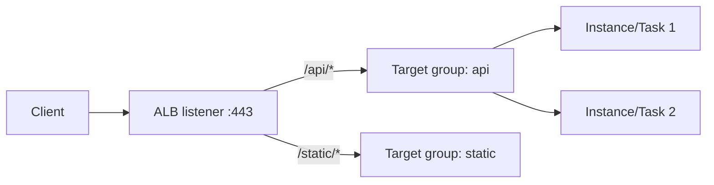

# Elastic Load Balancing and ALB

---

## 🟢 Junior Level

**Elastic Load Balancing (ELB)** distributes incoming traffic across multiple targets (EC2 instances, containers, IP addresses, Lambda functions) in one or more Availability Zones, and routes only to **healthy** targets.

Four types:
| Type | Layer | Best for |
|---|---|---|
| **Application Load Balancer (ALB)** | 7 (HTTP/HTTPS, gRPC, WebSocket) | Web apps, microservices, path/host routing |
| **Network Load Balancer (NLB)** | 4 (TCP/UDP/TLS) | Extreme performance, static IPs, non-HTTP protocols |
| **Gateway Load Balancer (GWLB)** | 3 | Third-party virtual appliances (firewalls) |
| Classic Load Balancer | 4/7 | Legacy, avoid for new work |

### Real-world analogy
A restaurant host at the door seats guests at tables with free waiters, and never sends guests to a closed section.



### Key concepts
- **Listener** - protocol and port the LB listens on (80, 443).
- **Rule** - conditions (path, host, header, query) and an action (forward, redirect, fixed response).
- **Target group** - the set of targets plus health check settings.
- **Health check** - the LB periodically calls e.g. `/actuator/health`; unhealthy targets receive no traffic.

### Minimal example: Spring Boot health endpoint for the ALB

```yaml
# application.yml
management:
  endpoints:
    web:
      exposure:
        include: health
  endpoint:
    health:
      probes:
        enabled: true
server:
  shutdown: graceful
```

Configure the target group health check path to `/actuator/health/readiness`.

---

## 🟡 Middle Level

### ALB routing
Rules evaluate by priority. Examples: host-based (`api.acme.com`), path-based (`/orders/*`), header or query-based, HTTP method, source IP. Actions: forward (with weighted target groups), redirect (HTTP to HTTPS), fixed-response, authenticate via Cognito/OIDC.

```hcl
resource "aws_lb_listener" "https" {
  load_balancer_arn = aws_lb.web.arn
  port              = 443
  protocol          = "HTTPS"
  ssl_policy        = "ELBSecurityPolicy-TLS13-1-2-2021-06"
  certificate_arn   = aws_acm_certificate.web.arn
  default_action {
    type = "fixed-response"
    fixed_response { content_type = "text/plain" message_body = "Not found" status_code = "404" }
  }
}

resource "aws_lb_listener_rule" "orders" {
  listener_arn = aws_lb_listener.https.arn
  priority     = 10
  action { type = "forward" target_group_arn = aws_lb_target_group.orders.arn }
  condition { path_pattern { values = ["/orders/*"] } }
}
```

### TLS termination
Certificates come from **ACM** (free, auto-renewing). The ALB terminates TLS and forwards HTTP or re-encrypts to targets. The client IP is passed in `X-Forwarded-For`; Spring Boot needs `server.forward-headers-strategy=native` (or `framework`) to honour `X-Forwarded-Proto` and generate correct redirect URLs.

### ALB vs NLB
- ALB: content-aware, WebSockets, HTTP/2, gRPC, WAF integration, Lambda targets; price by LCU.
- NLB: millions of requests per second with ultra-low latency, **static/Elastic IPs**, preserves client IP, TLS pass-through, PrivateLink endpoints service.
- Typical combo: NLB in front for static IPs forwarding to ALB targets.

### Health checks and draining
- Tune `healthy-threshold`, `interval`, `timeout`; do not make the health check hit the database in a way that causes cascading outage.
- **Deregistration delay** (default 300 s) lets in-flight requests complete. Align it with Spring's `spring.lifecycle.timeout-per-shutdown-phase`.
- **Stickiness** (cookie-based) is available but prefer stateless apps.

### Load-balancing algorithms
ALB: round robin (default) and **least outstanding requests**. NLB: flow hash. Cross-zone load balancing is always on for ALB (no inter-AZ charge for ALB LCU traffic), configurable on NLB (charges apply).

### Common mistakes
- Using one health endpoint that depends on all downstreams.
- Security group of targets open to the world instead of only the ALB security group.
- No HTTP->HTTPS redirect, or ALB in private subnets when it should be public.
- Forgetting that ALB idle timeout (60 s) cuts long requests - tune to match application keep-alive (app timeout should be greater than ALB idle timeout to avoid 502s).

---

## 🔴 Senior Level

### Diagnosing 5xx errors
| Code | Meaning | Typical cause |
|---|---|---|
| 502 | Bad gateway | Target closed connection early, keep-alive shorter than ALB idle timeout, malformed response |
| 503 | No healthy targets | All targets failing health check or none registered |
| 504 | Gateway timeout | Target did not respond within idle timeout |
| 460/463 | Client closed / bad X-Forwarded-For | Client aborted request |

Enable **access logs** to S3 and **connection logs**, use CloudWatch metrics `HTTPCode_Target_5XX_Count`, `TargetResponseTime`, `UnHealthyHostCount`. Set Tomcat keep-alive greater than 60 s:

```yaml
server:
  tomcat:
    keep-alive-timeout: 75s
    max-keep-alive-requests: 1000
```

### Zero-downtime and progressive delivery
Weighted forward actions enable canary releases; combine with CodeDeploy blue/green for ECS, or Argo Rollouts/AWS Load Balancer Controller on EKS.

```json
{
  "Type": "forward",
  "ForwardConfig": {
    "TargetGroups": [
      {"TargetGroupArn": "arn:...:targetgroup/orders-blue/abc", "Weight": 90},
      {"TargetGroupArn": "arn:...:targetgroup/orders-green/def", "Weight": 10}
    ],
    "TargetGroupStickinessConfig": {"Enabled": true, "DurationSeconds": 600}
  }
}
```

### Scaling and capacity
ALBs scale automatically but not instantaneously: sudden 10x spikes may require **pre-warming** (contact AWS support) or gradual ramps; NLB handles sudden volumes better. Load-balancer capacity is measured in LCUs (new connections, active connections, processed bytes, rule evaluations); hundreds of rules raise cost.

### Security
- Attach **AWS WAF** with managed rule groups and rate-based rules to the ALB.
- Use `routing.http.drop_invalid_header_fields.enabled`, `routing.http.desync_mitigation_mode=strictest` to resist request smuggling.
- Restrict targets using security-group references (`sg-alb`) rather than CIDR blocks.
- mTLS on ALB (trust stores) for B2B traffic.
- Authenticate with OIDC at the ALB and read `x-amzn-oidc-data` JWT in Spring Security - verify the signature using the regional public key.

### Kubernetes and containers
On EKS the **AWS Load Balancer Controller** provisions ALBs from `Ingress` and NLBs from `Service type=LoadBalancer`; use **IP target mode** to send directly to pod IPs (needs VPC CNI). On ECS the service registers task IPs automatically (`awsvpc`).

```yaml
apiVersion: networking.k8s.io/v1
kind: Ingress
metadata:
  name: orders
  annotations:
    alb.ingress.kubernetes.io/scheme: internet-facing
    alb.ingress.kubernetes.io/target-type: ip
    alb.ingress.kubernetes.io/healthcheck-path: /actuator/health/readiness
spec:
  ingressClassName: alb
  rules:
    - http:
        paths:
          - path: /orders
            pathType: Prefix
            backend: { service: { name: orders, port: { number: 8080 } } }
```

### Edge cases
- Lambda as an ALB target is limited to 1 MB payloads and has no streaming.
- gRPC needs HTTP/2 target groups and the `grpc` protocol version.
- WebSocket connections survive up to the idle timeout; send pings.
- Client IP preservation with NLB differs between instance and IP targets.

---

## 🎯 Interview Cheat Sheet

**30-second pitch:** ELB spreads traffic across healthy targets in multiple AZs. I use an ALB for HTTP(S) apps - TLS termination via ACM, path/host routing to target groups, health checks on Actuator - and an NLB when I need static IPs, raw TCP/UDP or extreme throughput.

**Must-know bullets**
- ALB (L7), NLB (L4), GWLB (appliances), CLB (legacy).
- Listener -> rules -> target group -> targets with health checks.
- TLS via ACM; forwarded headers handling in Spring Boot.
- Deregistration delay and graceful shutdown for zero downtime.
- 502/503/504 meanings and keep-alive versus idle timeout.
- Attach WAF, restrict targets to the LB security group.

**Common follow-ups**
- Why do I get 502s sporadically?
- How would you do a canary release behind an ALB?
- ALB vs API Gateway?
- How do you get a static IP in front of an ALB?

**Red flags**
- Health check hitting expensive dependencies.
- Public targets reachable directly, bypassing the LB.
- No HTTPS redirect.

**Related topics**
- [EC2 and Auto Scaling](05.%20EC2%20and%20Auto%20Scaling.md)
- [VPC subnets security groups and NAT](07.%20VPC%20subnets%20security%20groups%20and%20NAT.md)
- [API Gateway](14.%20API%20Gateway.md)
- [ECS Fargate EKS and Elastic Beanstalk](15.%20ECS%20Fargate%20EKS%20and%20Elastic%20Beanstalk.md)
