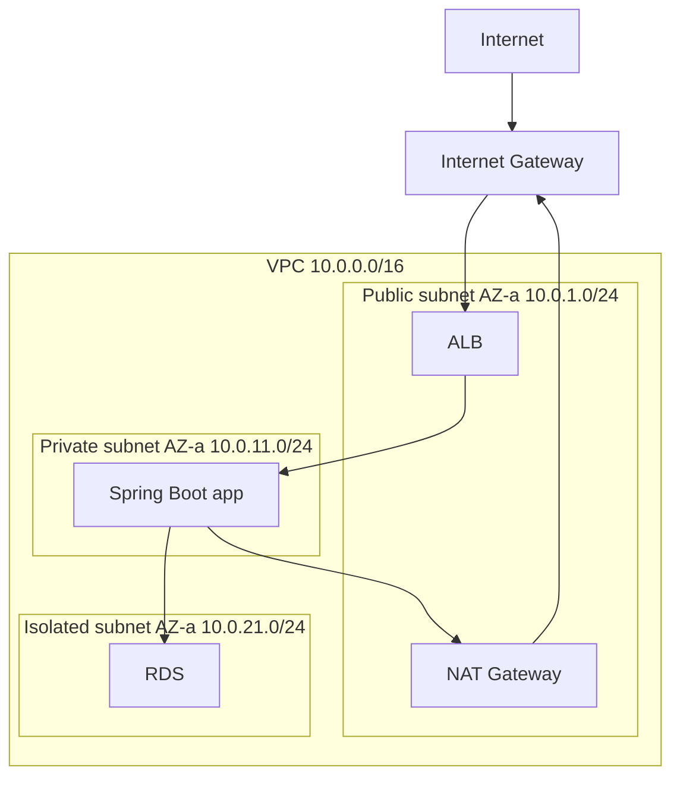

# VPC subnets security groups and NAT

---

## 🟢 Junior Level

A **Virtual Private Cloud (VPC)** is your own logically isolated virtual network inside an AWS Region. You choose its IP range (CIDR, e.g. `10.0.0.0/16`) and carve it into **subnets**, each living in exactly one Availability Zone.

Key components:
- **Subnet** - a slice of the VPC CIDR in one AZ. **Public** if its route table has a route to an **Internet Gateway (IGW)**; **private** otherwise.
- **Route table** - rules that say where traffic for a destination CIDR goes.
- **Internet Gateway** - lets public subnets talk to the internet in both directions.
- **NAT Gateway** - lets resources in private subnets make **outbound** connections to the internet (updates, third-party APIs) without being reachable from it.
- **Security group** - a stateful firewall attached to a network interface (instance, task, Lambda-in-VPC, RDS...).
- **Network ACL (NACL)** - a stateless firewall at subnet level.

### Real-world analogy
The VPC is an office campus. Public subnets are the lobby with a street-facing door (IGW); private subnets are internal floors. The NAT gateway is the mailroom: staff can send mail out, outsiders cannot walk in. Security groups are the badge readers on each room.



### Minimal example: security group rule via CLI

```bash
# Only the ALB's security group may reach the app on 8080
aws ec2 authorize-security-group-ingress \
  --group-id sg-app --protocol tcp --port 8080 \
  --source-group sg-alb
```

---

## 🟡 Middle Level

### Typical three-tier layout
1. **Public subnets** - ALB, NAT gateways, (bastion - prefer SSM instead).
2. **Private app subnets** - EC2/ECS/EKS, default route `0.0.0.0/0 -> NAT`.
3. **Private data subnets** - RDS, ElastiCache; no route to the internet at all.
Repeat across at least two AZs, with one NAT gateway per AZ for resilience.

### Security group vs NACL

| | Security group | NACL |
|---|---|---|
| Level | ENI / resource | Subnet |
| State | **Stateful** (return traffic allowed) | **Stateless** (must allow both directions, ephemeral ports) |
| Rules | Allow only | Allow and Deny, ordered numbers |
| Default | Deny inbound, allow outbound | Default NACL allows all |
| Reference other groups | Yes | No (CIDR only) |

Reference security groups instead of IP ranges so rules survive scaling.

### Terraform VPC example

```hcl
module "vpc" {
  source  = "terraform-aws-modules/vpc/aws"
  version = "~> 5.0"

  name = "orders"
  cidr = "10.0.0.0/16"
  azs             = ["eu-west-1a", "eu-west-1b", "eu-west-1c"]
  public_subnets  = ["10.0.1.0/24", "10.0.2.0/24", "10.0.3.0/24"]
  private_subnets = ["10.0.11.0/24", "10.0.12.0/24", "10.0.13.0/24"]
  database_subnets = ["10.0.21.0/24", "10.0.22.0/24", "10.0.23.0/24"]

  enable_nat_gateway     = true
  one_nat_gateway_per_az = true
}
```

### VPC endpoints
Reach AWS services without traversing the NAT/internet:
- **Gateway endpoints** (S3, DynamoDB) - free, route table entry.
- **Interface endpoints (PrivateLink)** - ENIs with private IPs for SQS, Secrets Manager, ECR, etc.; hourly plus data charges.
This reduces NAT data-processing costs ($0.045/GB) and improves security.

```bash
aws ec2 create-vpc-endpoint --vpc-id vpc-123 --service-name com.amazonaws.eu-west-1.s3 \
  --route-table-ids rtb-private-a rtb-private-b
```

### Connectivity options
VPC Peering (non-transitive, no overlapping CIDRs), **Transit Gateway** (hub-and-spoke for many VPCs), Site-to-Site VPN, **Direct Connect** (dedicated line), PrivateLink (expose a service privately).

### Common mistakes
- Overlapping CIDRs between environments, which blocks peering later. Plan the IP space (`/16` per VPC, `/20-/24` per subnet).
- A single NAT gateway for all AZs (AZ failure kills egress; cross-AZ charges).
- Putting databases in public subnets with `0.0.0.0/0` in the security group.
- Forgetting NACL ephemeral ports (1024-65535) when tightening NACLs.
- Lambda in a VPC without a NAT or endpoints cannot reach the internet/AWS APIs.

---

## 🔴 Senior Level

### IP address planning and scale
EKS with the VPC CNI assigns one VPC IP per pod; large clusters exhaust small subnets quickly. Use `/19-/20` pod subnets, a secondary CIDR (`100.64.0.0/10`), prefix delegation, or custom networking. Five reserved IPs per subnet (first four and last). IPv6 dual-stack and egress-only internet gateways avoid NAT cost.

### Cost and performance of NAT
NAT Gateway: hourly fee + per-GB processing. Typical bill shock sources: pulling Docker images, S3 traffic, logging to CloudWatch through NAT. Mitigation: gateway endpoints for S3/DynamoDB, interface endpoints for ECR/STS/CloudWatch Logs, caching package repositories, VPC Flow Logs analysis for top talkers. A NAT gateway scales to 100 Gbps but each destination tuple supports ~55,000 simultaneous connections; high-fan-out clients need multiple EIPs.

### Traffic inspection and segmentation
- **VPC Flow Logs** (to S3/CloudWatch) for forensics; **Traffic Mirroring** for IDS.
- **AWS Network Firewall** or Gateway Load Balancer + appliances for centralised egress filtering (domain allow-lists).
- Centralised egress VPC attached through Transit Gateway; **Route 53 Resolver DNS Firewall**.
- Security group per role (alb, app, db, cache); data tier accepts only app SG:

```hcl
resource "aws_security_group_rule" "db_from_app" {
  type                     = "ingress"
  from_port                = 5432
  to_port                  = 5432
  protocol                 = "tcp"
  security_group_id        = aws_security_group.db.id
  source_security_group_id = aws_security_group.app.id
}
```

### Connection tracking gotchas
Security groups track connections; idle tracked connections time out (350 s TCP established by default) and long-idle connections through NLB/NAT can be silently dropped, producing "connection reset" in JDBC pools. Configure TCP keepalive and `maxLifetime`/`keepaliveTime` in HikariCP below the idle limit:

```java
HikariConfig cfg = new HikariConfig();
cfg.setJdbcUrl("jdbc:postgresql://orders-db.cluster-xyz.eu-west-1.rds.amazonaws.com:5432/orders");
cfg.setMaxLifetime(Duration.ofMinutes(20).toMillis());
cfg.setKeepaliveTime(Duration.ofMinutes(4).toMillis());
```

Also, Lambda in a VPC with RDS should use **RDS Proxy** to avoid exhausting connections.

### DNS inside the VPC
`enableDnsSupport` and `enableDnsHostnames` must be on for private DNS of interface endpoints; use **Route 53 private hosted zones**, and Resolver inbound/outbound endpoints for hybrid DNS with on-prem.

### Multi-account networking
Shared VPC via **AWS RAM** subnet sharing; Transit Gateway with route table segmentation (prod vs non-prod); **VPC Lattice** for service-to-service networking with IAM-based auth across VPCs without managing peering.

### Edge cases
- Peering and TGW are non-transitive/transitive respectively; asymmetric routing breaks with stateful firewalls.
- NACL rules are evaluated in order and the first match wins; an explicit deny can shadow an allow.
- Instance metadata (IMDSv2, hop limit 1 vs 2 for containers).
- Public IPv4 addresses are billed hourly since 2024 - minimise them.

---

## 🎯 Interview Cheat Sheet

**30-second pitch:** A VPC is my isolated network in a Region. I split it into public, private-app and private-data subnets across at least two AZs; public ones route to an Internet Gateway, private ones egress through a NAT gateway per AZ or VPC endpoints. Security groups are stateful allow-lists referencing each other; NACLs are a stateless second layer.

**Must-know bullets**
- Subnet = one AZ; public = route to IGW.
- NAT gateway is for outbound only; one per AZ.
- Security groups: stateful, allow-only, reference other SGs. NACLs: stateless, ordered, allow/deny.
- Gateway endpoints (S3, DynamoDB) are free; interface endpoints cost money.
- Peering is non-transitive; use Transit Gateway at scale.
- Plan non-overlapping CIDRs.

**Common follow-ups**
- How does a private instance reach the internet?
- How would you reduce NAT gateway costs?
- Why are my Lambda calls timing out in a VPC?
- How do you let two VPCs talk with overlapping CIDRs? (PrivateLink)

**Red flags**
- Databases in public subnets.
- SSH open to the world.
- Not knowing stateful versus stateless.

**Related topics**
- [AWS shared responsibility model](02.%20AWS%20shared%20responsibility%20model.md)
- [Elastic Load Balancing and ALB](06.%20Elastic%20Load%20Balancing%20and%20ALB.md)
- [RDS and Aurora](09.%20RDS%20and%20Aurora.md)
- [Lambda and serverless Java](13.%20Lambda%20and%20serverless%20Java.md)
