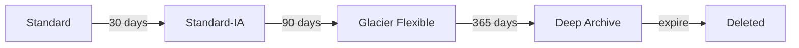

# Amazon S3 storage classes presigned URLs and consistency

---

## 🟢 Junior Level

**Amazon S3 (Simple Storage Service)** is highly durable (99.999999999% - eleven nines), virtually unlimited **object storage** accessed over HTTP. Data lives in **buckets** (globally unique names, regional) as **objects**: a **key** (like `invoices/2026/01/inv-1.pdf`), the bytes (up to 5 TB), metadata and optional tags. S3 has no real folders - the `/` in keys is just a naming convention (a *prefix*).

### Real-world analogy
A giant self-storage warehouse where each box has a unique label (the key). You hand over a box and get it back by label; you cannot edit half a box - you replace it entirely.

### Storage classes
| Class | Use | Retrieval |
|---|---|---|
| **Standard** | Frequently accessed | ms |
| **Intelligent-Tiering** | Unknown/changing access; auto-moves | ms |
| **Standard-IA / One Zone-IA** | Infrequent (30-day minimum) | ms, per-GB retrieval fee |
| **Glacier Instant Retrieval** | Archive with rare ms access | ms |
| **Glacier Flexible Retrieval** | Archive | minutes-hours |
| **Glacier Deep Archive** | Cheapest, compliance (180-day min) | up to 12-48 h |



### Minimal example: upload and download (SDK v2)

```java
S3Client s3 = S3Client.create();

s3.putObject(PutObjectRequest.builder()
        .bucket("acme-reports-prod")
        .key("invoices/inv-1.pdf")
        .contentType("application/pdf")
        .build(),
    RequestBody.fromFile(Path.of("inv-1.pdf")));

s3.getObject(GetObjectRequest.builder()
        .bucket("acme-reports-prod").key("invoices/inv-1.pdf").build(),
    ResponseTransformer.toFile(Path.of("copy.pdf")));
```

### Security basics
Buckets are **private by default**. Keep **Block Public Access** on, use IAM roles, and enable default encryption (SSE-S3 is on by default now).

---

## 🟡 Middle Level

### Presigned URLs
A presigned URL grants **time-limited access** to one specific operation on one object using the signer's permissions - ideal for letting a browser upload or download directly without proxying bytes through your Spring Boot server.

```java
try (S3Presigner presigner = S3Presigner.create()) {
    GetObjectPresignRequest req = GetObjectPresignRequest.builder()
        .signatureDuration(Duration.ofMinutes(10))
        .getObjectRequest(g -> g.bucket("acme-reports-prod").key("invoices/inv-1.pdf"))
        .build();
    String url = presigner.presignGetObject(req).url().toString();

    PutObjectPresignRequest putReq = PutObjectPresignRequest.builder()
        .signatureDuration(Duration.ofMinutes(5))
        .putObjectRequest(p -> p.bucket("acme-reports-prod")
                                .key("uploads/" + UUID.randomUUID())
                                .contentType("image/png"))
        .build();
    String uploadUrl = presigner.presignPutObject(putReq).url().toString();
}
```

Notes: the URL's lifetime is capped by the credentials' lifetime (a role session expiring earlier invalidates it). Generate the key server-side to prevent overwriting. For size/type control on uploads use presigned **POST** policies.

### Consistency model
Since December 2020, S3 provides **strong read-after-write consistency** for all PUT, DELETE and LIST operations in all Regions - new objects, overwrites and deletes are immediately visible, and list results are consistent. (Older "eventual consistency" answers are outdated.) There is still no multi-object transaction and no locking; concurrent writers to one key: last writer wins; use **conditional writes** (`If-None-Match: *`, `If-Match` ETag) to prevent overwrites.

### Versioning, lifecycle, replication
- **Versioning** protects from accidental overwrite/delete (delete creates a delete marker); combine with MFA delete or Object Lock for immutability.
- **Lifecycle rules** transition and expire objects, abort incomplete multipart uploads.
- **Replication** SRR/CRR for DR or compliance.

```yaml
LifecycleConfiguration:
  Rules:
    - Id: archive-logs
      Status: Enabled
      Prefix: logs/
      Transitions:
        - { StorageClass: STANDARD_IA, TransitionInDays: 30 }
        - { StorageClass: GLACIER, TransitionInDays: 90 }
      ExpirationInDays: 730
      AbortIncompleteMultipartUpload: { DaysAfterInitiation: 7 }
```

### Common mistakes
- Public buckets; wide `s3:*` policies.
- Many tiny objects in IA/Glacier (minimum billable size and per-object overhead).
- Loading large files into byte arrays in memory instead of streaming.
- Using S3 as a database or file system with frequent renames (rename = copy + delete).
- Not cleaning up incomplete multipart uploads.

---

## 🔴 Senior Level

### Performance
S3 supports at least **3,500 PUT/COPY/POST/DELETE and 5,500 GET/HEAD requests per second per prefix**, and prefixes are unlimited, so parallelise across prefixes and connections. For large objects use **multipart upload** (5 MB-5 GB parts, up to 10,000 parts) and byte-range GETs. The SDK v2 **Transfer Manager** (built on the CRT-based async client) does this automatically:

```java
S3AsyncClient crt = S3AsyncClient.crtBuilder()
    .targetThroughputInGbps(10.0)
    .minimumPartSizeInBytes(8L * 1024 * 1024)
    .build();

try (S3TransferManager tm = S3TransferManager.builder().s3Client(crt).build()) {
    FileUpload up = tm.uploadFile(u -> u
        .putObjectRequest(p -> p.bucket("acme-data").key("exports/big.parquet"))
        .source(Path.of("big.parquet")));
    up.completionFuture().join();
}
```

Other accelerators: Transfer Acceleration (edge-optimised uploads), S3 Express One Zone (single-digit-ms directory buckets), multi-region access points, and CloudFront in front for downloads.

### Security architecture
- Enforce SSE-KMS with bucket keys (reduces KMS request cost by up to 99%) and policy denying unencrypted puts and non-TLS requests.
- Use **VPC gateway endpoint** and `aws:SourceVpce` conditions to keep traffic private.
- **Object Ownership = BucketOwnerEnforced** (ACLs disabled); cross-account access via bucket policy.
- **Object Lock** (governance/compliance) for WORM regulation; Macie for PII discovery.
- Presigned URLs are bearer tokens: short expiry, log them out of access logs, never put sensitive tokens into URLs that get cached by proxies.

### Event-driven pipelines
S3 events (to SQS/SNS/Lambda/EventBridge) are at-least-once and unordered; design idempotent consumers keyed by `bucket+key+versionId+sequencer`.

```java
public class ThumbnailHandler implements RequestHandler<S3Event, Void> {
    @Override
    public Void handleRequest(S3Event event, Context ctx) {
        event.getRecords().forEach(r -> {
            String key = URLDecoder.decode(r.getS3().getObject().getKey(), StandardCharsets.UTF_8);
            // idempotent: skip if the thumbnail already exists (HeadObject)
        });
        return null;
    }
}
```
Note: keys in event notifications are URL-encoded.

### Cost optimisation
- Intelligent-Tiering for unpredictable access (monitoring fee per object, ignore objects < 128 KB).
- **S3 Storage Lens** and Storage Class Analysis for tuning lifecycle.
- Request cost matters for billions of small objects: batch into larger files (Parquet).
- Requester Pays, and data-transfer-out costs; CloudFront reduces egress price.

### Edge cases
- Max object 5 TB; single PUT 5 GB.
- ETag is not always an MD5 (multipart, KMS); use checksums (`CRC32C`, `SHA-256`) with `ChecksumAlgorithm`.
- Delete markers make list "versions" huge; lifecycle `NoncurrentVersionExpiration`.
- Bucket names are DNS-global and reusable after deletion - beware subdomain-takeover patterns.
- Restoring Glacier objects is an asynchronous operation (`RestoreObject`), temporary copy.

---

## 🎯 Interview Cheat Sheet

**30-second pitch:** S3 is durable, regional object storage with strong read-after-write consistency. I pick storage classes by access pattern with lifecycle rules, keep buckets private with Block Public Access and KMS encryption, and let clients upload and download directly via short-lived presigned URLs so my servers never proxy bytes.

**Must-know bullets**
- Objects, keys, buckets; no true folders; 11 nines durability.
- Classes: Standard, Intelligent-Tiering, IA, Glacier tiers, Deep Archive.
- Strong consistency since Dec 2020 (no more eventual-consistency caveat).
- Presigned URLs: time-limited, single operation, signer's permissions.
- Multipart upload, Transfer Manager, lifecycle rule to abort incomplete uploads.
- Versioning + Object Lock + replication for protection.

**Common follow-ups**
- How would you let a mobile app upload 2 GB videos securely?
- Is S3 eventually consistent? (No, strongly consistent.)
- How do you avoid overwriting an existing key concurrently?
- How to cut S3 costs for logs?

**Red flags**
- Public bucket for convenience.
- Proxying all file uploads through the application server.
- Claiming S3 is a file system.

**Related topics**
- [AWS IAM users roles and policies](04.%20AWS%20IAM%20users%20roles%20and%20policies.md)
- [SQS SNS and EventBridge](12.%20SQS%20SNS%20and%20EventBridge.md)
- [Secrets Manager Parameter Store and KMS](17.%20Secrets%20Manager%20Parameter%20Store%20and%20KMS.md)
- [Cloud cost optimization and FinOps](20.%20Cloud%20cost%20optimization%20and%20FinOps.md)
