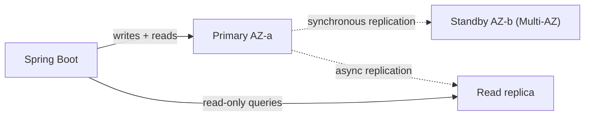

# RDS and Aurora

---

## 🟢 Junior Level

**Amazon RDS (Relational Database Service)** is a managed relational database: AWS provisions the server, installs the engine (PostgreSQL, MySQL, MariaDB, Oracle, SQL Server, Db2), patches it, takes backups and can fail over automatically. **Amazon Aurora** is AWS's cloud-native MySQL- and PostgreSQL-compatible engine with a distributed storage layer, offering higher throughput and faster failover.

### Real-world analogy
Running your own database is owning a car and doing every oil change yourself. RDS is a leased car with a maintenance plan: you drive (schema, queries), the leasing company does servicing.

### What you still do
Design schema and indexes, tune queries, manage users, choose instance size, and configure security groups. You do **not** get OS access (except RDS Custom).

### Key features
- **Automated backups** (point-in-time recovery, retention 1-35 days) and manual snapshots.
- **Multi-AZ** for high availability.
- **Read replicas** for read scaling.
- **Storage autoscaling**, encryption with KMS, IAM database authentication.



### Minimal example: Spring Boot connecting to RDS PostgreSQL

```yaml
spring:
  datasource:
    url: jdbc:postgresql://orders-db.abc123.eu-west-1.rds.amazonaws.com:5432/orders
    username: ${DB_USER}
    password: ${DB_PASSWORD}
    hikari:
      maximum-pool-size: 10
```

Always connect through the **endpoint DNS name**, never an IP, because failover changes the underlying address.

---

## 🟡 Middle Level

### Multi-AZ vs read replicas
| | Multi-AZ (instance) | Read replica |
|---|---|---|
| Purpose | High availability / durability | Read scaling, reporting, DR |
| Replication | **Synchronous** | **Asynchronous** (lag!) |
| Readable? | Standby not readable (classic Multi-AZ) | Yes |
| Failover | Automatic, 60-120 s DNS flip | Manual promotion |
| Cross-Region | No | Yes |

**Multi-AZ DB cluster** (PostgreSQL/MySQL) has one writer and two readable standbys in three AZs with ~35 s failover and faster commits.

### Aurora architecture
Compute and storage are separated. The cluster volume is replicated **six ways across three AZs**, auto-grows to 128 TiB, and self-heals. Up to 15 low-lag (typically < 100 ms) Aurora Replicas share the same storage. You get two endpoints: **cluster (writer)** and **reader** (load balances replicas). Failover typically takes under 30 s. Variants: **Aurora Serverless v2** (scales in 0.5 ACU steps, can pause to 0 ACU), **Aurora Global Database** (cross-Region, < 1 s lag), **Aurora I/O-Optimized** pricing.

### Read/write splitting in Spring
```java
@Configuration
class DataSourceConfig {
    @Bean @Primary
    DataSource writer(@Value("${db.writer.url}") String url) { return hikari(url, false); }

    @Bean
    DataSource reader(@Value("${db.reader.url}") String url) { return hikari(url, true); }

    private HikariDataSource hikari(String url, boolean readOnly) {
        HikariDataSource ds = new HikariDataSource();
        ds.setJdbcUrl(url);
        ds.setReadOnly(readOnly);
        ds.setMaximumPoolSize(10);
        return ds;
    }
}
```
Route `@Transactional(readOnly = true)` to the reader with `AbstractRoutingDataSource`. Beware replica lag: a read after write may not see the data - read your own writes from the primary.

### Provisioning with Terraform
```hcl
resource "aws_db_instance" "orders" {
  identifier              = "orders"
  engine                  = "postgres"
  engine_version          = "16.4"
  instance_class          = "db.m7g.large"
  allocated_storage       = 100
  max_allocated_storage   = 500
  multi_az                = true
  storage_encrypted       = true
  backup_retention_period = 14
  deletion_protection     = true
  db_subnet_group_name    = aws_db_subnet_group.data.name
  vpc_security_group_ids  = [aws_security_group.db.id]
  manage_master_user_password = true # stored in Secrets Manager
}
```

### Common mistakes
- Deploying a single-AZ production database.
- Exposing the DB publicly.
- Not testing failover and not handling connection re-establishment (stale pooled connections after failover - set short DNS TTL in the JVM: `networkaddress.cache.ttl=10`).
- Using replicas for strongly consistent reads.
- Ignoring maintenance windows and minor-version upgrades; forgetting to enable `deletion_protection`.

---

## 🔴 Senior Level

### Connection management at scale
Each Lambda or autoscaled container opens connections; the DB has a max (`max_connections` is derived from instance memory). Use **RDS Proxy** to pool and multiplex connections, preserve connections during failover (reducing failover impact by up to ~66%) and support IAM auth. For pinned sessions (temp tables, prepared statements in some engines) multiplexing is reduced. Size HikariCP carefully: (instances x pool size) < max connections.

```java
// IAM database authentication: generate a short-lived token (15 min) instead of a password
RdsUtilities utils = RdsClient.create().utilities();
String token = utils.generateAuthenticationToken(r -> r
    .hostname("orders-db.abc123.eu-west-1.rds.amazonaws.com")
    .port(5432).username("app_iam_user"));
```

### Failure behavior and DR
- Multi-AZ failover: DNS CNAME flips; JVM DNS caching and pools must cope; use the **AWS Advanced JDBC Wrapper** for fast failover (it reads cluster topology, bypasses DNS TTL, supports Aurora failover plugin and read/write splitting).
- DR objectives: backups and PITR give RPO ~5 minutes; cross-Region read replica or Aurora Global gives RPO ~1 s, RTO minutes after promotion.
- Always run restore drills; snapshots are only useful if restore succeeds.

### Performance
- Use **Performance Insights** and Enhanced Monitoring to find top SQL and wait events; add `pg_stat_statements`.
- Choose storage: `gp3` (baseline 3,000 IOPS), `io2 Block Express` for heavy OLTP; Aurora removes IOPS provisioning but bills I/O (unless I/O-Optimized).
- Graviton instance classes save around 20%.
- Aurora writer is a single node: scale writes by vertical size, sharding, or limitless database; scale reads with replicas and **auto scaling of read replicas**.
- Long transactions and vacuum bloat (PostgreSQL) are bigger risks than instance size.

### Security and compliance
Encryption at rest must be enabled at creation (or restore an encrypted snapshot copy), TLS enforced via `rds.force_ssl=1`, credentials rotated by Secrets Manager (managed rotation for RDS), no public accessibility, audit through pgaudit/Database Activity Streams, and network isolation in data subnets.

### Zero-downtime upgrades and migrations
**Blue/Green Deployments** create a synchronized staging copy, let you test an engine upgrade or schema change, then switch in typically under a minute. For heterogeneous migrations (Oracle -> PostgreSQL) use **AWS SCT + DMS** with CDC. Apply schema migrations with Flyway/Liquibase using expand-contract patterns so old and new app versions work concurrently.

```bash
aws rds create-blue-green-deployment --blue-green-deployment-name orders-pg17 \
  --source arn:aws:rds:eu-west-1:111122223333:db:orders --target-engine-version 17.2
```

### Edge cases
- Replica lag metric `ReplicaLag` / `AuroraReplicaLag`; alarm and fall back to the writer.
- Storage full on RDS causes read-only mode; enable autoscaling and alarms on `FreeStorageSpace`.
- Burstable `db.t` classes run out of credits.
- Aurora Serverless v2 min ACU affects cold buffer cache; set a floor for latency-sensitive workloads.
- Large-table DDL can lock; use online schema tools.

---

## 🎯 Interview Cheat Sheet

**30-second pitch:** RDS is a managed relational database with automated backups, patching and Multi-AZ synchronous failover; read replicas scale reads asynchronously. Aurora separates compute from a six-way replicated storage layer across three AZs, offers up to 15 replicas, sub-30-second failover and global databases. I connect via endpoints, pool through RDS Proxy, and test failover.

**Must-know bullets**
- Multi-AZ = HA (sync); read replica = scale/DR (async, lag).
- Aurora: 6 copies / 3 AZs, shared storage, cluster and reader endpoints.
- Always use DNS endpoints; handle failover in the pool.
- Backups with PITR up to 35 days; encrypt at creation.
- RDS Proxy for Lambda/high-connection workloads.
- Blue/Green deployments for upgrades.

**Common follow-ups**
- RDS Multi-AZ versus read replica?
- When Aurora and when plain RDS PostgreSQL?
- How do you handle replica lag in the app?
- How to migrate an on-prem Oracle DB with minimal downtime?

**Red flags**
- Public database with a password in code.
- Treating a read replica as a backup.
- No failover testing.

**Related topics**
- [VPC subnets security groups and NAT](07.%20VPC%20subnets%20security%20groups%20and%20NAT.md)
- [DynamoDB basics](10.%20DynamoDB%20basics.md)
- [ElastiCache](11.%20ElastiCache.md)
- [High availability and the Well-Architected Framework](19.%20High%20availability%20and%20the%20Well-Architected%20Framework.md)
