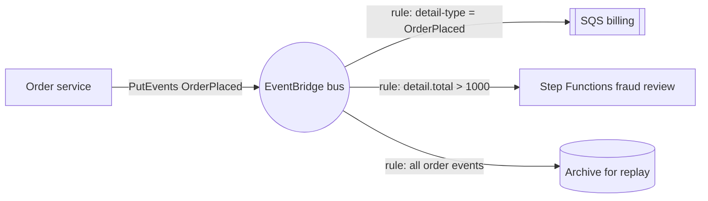

# SQS SNS and EventBridge

---

## 🟢 Junior Level

AWS offers three managed messaging services with different shapes:

| Service | Pattern | Delivery | Typical use |
| --- | --- | --- | --- |
| **SQS** | Queue (point-to-point), consumers **poll** | At-least-once (Standard) or ordered/deduplicated (FIFO) | Work queues, buffering, decoupling a producer from a slower consumer |
| **SNS** | Pub/sub topic, **pushes** to subscribers | Fan-out to SQS, Lambda, HTTP, email, SMS | Broadcasting an event to many consumers |
| **EventBridge** | Event **bus** with content-based **rules** | Routes events to targets (Lambda, SQS, Step Functions, API destinations, other buses) | Event-driven integration across services, accounts and SaaS; scheduling |



### Publishing to EventBridge from Java

```java
EventBridgeClient events = EventBridgeClient.create();

events.putEvents(r -> r.entries(PutEventsRequestEntry.builder()
        .eventBusName("shop-events")
        .source("com.shop.orders")
        .detailType("OrderPlaced")
        .detail("""
                {"orderId":"o-42","customerId":"c-7","total":1250.00,"currency":"EUR"}
                """)
        .build()));
```

---

## 🟡 Middle Level

### EventBridge rules and patterns

```json
{
  "source": ["com.shop.orders"],
  "detail-type": ["OrderPlaced"],
  "detail": {
    "total": [{ "numeric": [">", 1000] }],
    "currency": ["EUR", "USD"]
  }
}
```

Rules filter on any field of the event JSON (prefix, numeric ranges, exists, anything-but). Targets get transformed input (input transformers) and their own retry policy and **dead-letter queue**.

### Choosing between them
* **One consumer, buffering, control over consumption rate** → SQS.
* **Simple fan-out with high throughput and low latency** → SNS → multiple SQS queues (each consumer gets a durable queue); SNS filter policies route subsets.
* **Many producers and consumers, routing by content, cross-account, SaaS sources, archive/replay, schema registry** → EventBridge (higher latency per event — typically tens to hundreds of ms — and lower default throughput quotas than SNS; good for business events, not for very high-volume telemetry).
* **Scheduled jobs** → EventBridge Scheduler (cron/rate, one-time schedules, millions of schedules) instead of cron on instances.
* **Ordered, high-throughput event streams with replay by consumers** → Kinesis Data Streams or MSK (Kafka).

### Reliability patterns
* SNS → SQS subscriptions with **raw message delivery** and per-queue DLQs.
* EventBridge target DLQs + retry policy (up to 24 hours / 185 attempts by default).
* Consumers idempotent (all three are at-least-once).
* **Transactional outbox** in the producer so events are published only for committed state.

---

## 🔴 Senior Level

### EventBridge features worth knowing
* **Archive and replay** — store events on a bus and replay a time range to a rule (rebuild a read model, recover a consumer).
* **Schema registry and discovery** — infers schemas from events; generates Java bindings.
* **Pipes** — point-to-point integrations source → (filter, enrich) → target (e.g. DynamoDB Stream → filter → Step Functions) without glue Lambdas.
* **Cross-account/cross-region buses** — central event bus patterns for organizations, with resource policies.
* **API destinations** — call external HTTP APIs with rate limiting and auth from rules.

### Quotas and limits to design around
* SQS message size 256 KB (use S3 pointers for larger payloads), retention up to 14 days, visibility timeout up to 12 hours.
* SNS message size 256 KB; FIFO topics only deliver to FIFO queues.
* EventBridge event size 256 KB; `PutEvents` up to 10 entries per call; per-region `PutEvents` throughput quotas (soft limits, raisable); check `FailedEntryCount` in responses — partial failures don't throw.

```java
PutEventsResponse resp = events.putEvents(request);
if (resp.failedEntryCount() > 0) {
    resp.entries().stream().filter(e -> e.errorCode() != null)
        .forEach(e -> log.warn("event rejected: {} {}", e.errorCode(), e.errorMessage()));
    // retry only the failed entries
}
```

### Observability and cost
* CloudWatch metrics: SQS `ApproximateAgeOfOldestMessage` (best backlog alarm), `NumberOfMessagesSent/Deleted`; SNS `NumberOfNotificationsFailed`; EventBridge `FailedInvocations`, `ThrottledRules`, `MatchedEvents`.
* Pricing per request/event: batching (SQS batch APIs, EventBridge 10 entries per `PutEvents`) and long polling reduce cost. EventBridge custom events cost more per million than SNS publishes — at very high volume, SNS/SQS or Kinesis is cheaper.
* Trace context: propagate `traceparent` in message attributes (SQS/SNS) or event detail; X-Ray/OTel instrumentation for the SDK can do this automatically.

---

## 🎯 Interview Cheat Sheet

**30-second pitch:** SQS is a pull-based queue for one logical consumer with buffering and retries; SNS is push-based fan-out, usually into per-consumer SQS queues; EventBridge is an event bus with content-based rules, cross-account routing, archives and replay, schema registry and a scheduler. All are at-least-once, so consumers are idempotent, failures go to DLQs, and producers use an outbox.

**Must know:**
* Queue vs topic vs bus; SNS → SQS fan-out.
* EventBridge rule patterns, targets, DLQs, archive/replay, Pipes, Scheduler.
* Size limits (256 KB), batching, `FailedEntryCount` partial failures.
* When to use Kinesis/MSK instead.
* Key CloudWatch metrics for backlog and failures.

**Common follow-ups:**
* EventBridge or SNS for 50,000 events per second?
* How do you replay events after fixing a consumer bug?
* How do you schedule a job per customer?

**Red flags:** ignoring partial `PutEvents` failures; one shared SQS queue consumed by unrelated services; no DLQ.

**Related:**
* [AWS SQS and SNS standard vs FIFO and visibility timeout](../28.%20Messaging%20Beyond%20Kafka/11.%20AWS%20SQS%20and%20SNS%20standard%20vs%20FIFO%20and%20visibility%20timeout.md)
* [Event-driven architecture and message types](../28.%20Messaging%20Beyond%20Kafka/13.%20Event-driven%20architecture%20and%20message%20types.md)
* [Lambda and serverless Java](13.%20Lambda%20and%20serverless%20Java.md)
* [Transactional outbox pattern](../28.%20Messaging%20Beyond%20Kafka/12.%20Transactional%20outbox%20pattern.md)
