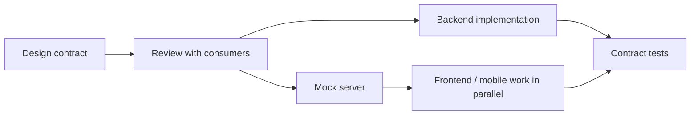

# What is API-first design and contract-first versus code-first

---

## 🟢 Junior Level

### 1. Plain Definition

**API-first** means the API is treated as a product with its own life cycle. You design and agree on the *interface* (URLs, payloads, status codes, errors) **before** writing the implementation. The interface is written down in a machine-readable **contract**, most often an **OpenAPI** document (YAML or JSON).

Two ways to get the contract:

| Approach | Who is the source of truth? | Flow |
| :--- | :--- | :--- |
| **Contract-first** (design-first) | The OpenAPI file | Write `openapi.yaml` → generate server interfaces and client SDKs → implement the business logic |
| **Code-first** | The Java code | Write controllers and DTOs → a library (springdoc) generates `openapi.yaml` from annotations |

### 2. Real-World Analogy

Building a house. **Contract-first** = the architect draws the blueprint, the client signs it, and only then do the builders start. **Code-first** = builders start laying bricks and, when finished, someone draws the blueprint of what happened to get built.

### 3. Minimal Contract Example

```yaml
openapi: 3.0.3
info:
  title: Books API
  version: 1.0.0
paths:
  /books/{id}:
    get:
      operationId: getBook
      parameters:
        - name: id
          in: path
          required: true
          schema: { type: integer, format: int64 }
      responses:
        "200":
          description: The book
          content:
            application/json:
              schema:
                $ref: "#/components/schemas/Book"
        "404":
          description: Book not found
components:
  schemas:
    Book:
      type: object
      required: [id, title]
      properties:
        id: { type: integer, format: int64 }
        title: { type: string }
```

The implementation is just a class that fulfils the generated interface:

```java
@RestController
public class BookController implements BooksApi { // BooksApi is generated from the YAML

    private final BookService service;

    public BookController(BookService service) {
        this.service = service;
    }

    @Override
    public ResponseEntity<Book> getBook(Long id) {
        return ResponseEntity.ok(service.find(id));
    }
}
```

### 4. Why Bother?



* Frontend and mobile teams can start with a **mock** while the backend is still being built.
* The contract is reviewed like code (pull request) **before** anything is expensive to change.
* Clients and documentation are generated, not hand-written.

---

## 🟡 Middle Level

### 1. Contract-First in a Spring Boot 3 Build

The most common tool is **openapi-generator** with the `spring` generator. Using Maven:

```xml
<plugin>
  <groupId>org.openapitools</groupId>
  <artifactId>openapi-generator-maven-plugin</artifactId>
  <version>7.5.0</version>
  <executions>
    <execution>
      <goals><goal>generate</goal></goals>
      <configuration>
        <inputSpec>${project.basedir}/src/main/resources/openapi/books.yaml</inputSpec>
        <generatorName>spring</generatorName>
        <apiPackage>com.example.books.api</apiPackage>
        <modelPackage>com.example.books.model</modelPackage>
        <configOptions>
          <interfaceOnly>true</interfaceOnly>
          <useSpringBoot3>true</useSpringBoot3>
          <useTags>true</useTags>
          <skipDefaultInterface>true</skipDefaultInterface>
          <openApiNullable>false</openApiNullable>
        </configOptions>
      </configuration>
    </execution>
  </executions>
</plugin>
```

`interfaceOnly=true` is the key setting: you only get interfaces and DTOs, never a generated controller with logic. `useSpringBoot3=true` switches the imports to `jakarta.*`.

### 2. Code-First with springdoc

```java
@RestController
@RequestMapping("/books")
@Tag(name = "Books")
class BookController {

    @Operation(summary = "Find a book by id")
    @ApiResponse(responseCode = "404", description = "Not found")
    @GetMapping("/{id}")
    BookDto get(@PathVariable long id) {
        return new BookDto(id, "Effective Java");
    }

    record BookDto(long id, String title) {}
}
```

The spec is then available at `/v3/api-docs` and the UI at `/swagger-ui.html`.

### 3. Trade-Offs

| Criterion | Contract-first | Code-first |
| :--- | :--- | :--- |
| Speed for a tiny internal service | Slower start | Very fast |
| Parallel work of teams | Excellent | Poor (need running code) |
| Design quality | Forces thought about the consumer | Leaks internal class structure |
| Spec drift | Impossible if the interface is generated | Spec always matches code but may change **accidentally** |
| Polyglot consumers | First-class | Generated afterwards |
| Learning curve | YAML/JSON Schema skill needed | Annotations only |

### 4. Common Mistakes

1. **Generating the controller with logic** (`interfaceOnly=false`) and editing generated files; they are overwritten on the next build.
2. **Committing generated code** to Git: noise and merge conflicts. Generate at build time into `target/generated-sources`.
3. **Using code-first and treating the spec as an afterthought**: a renamed Java field silently breaks every client.
4. **One giant YAML file**: split with `$ref` into `schemas/*.yaml`, bundle in the build.
5. Not linting the spec. Use **Spectral** or **Redocly CLI** rules in CI (naming, mandatory error responses, examples).

---

## 🔴 Senior Level

### 1. API-First as an Organisation Practice

At scale, API-first is a governance topic, not just a tool choice:

* **API style guide** (naming, pagination, error format, versioning) enforced with Spectral rules in CI.
* **Design review** for new or changed contracts; breaking-change detection with `oasdiff` or `openapi-diff` on every pull request.
* **Contract repository** or an API catalog (Backstage, Apicurio Registry) so teams discover existing APIs before building new ones.
* **Mock servers** (Prism, WireMock stubs generated from examples) so consumers integrate early.
* The spec drives **tests**: schema-validate real responses against the contract in integration tests.

### 2. Verifying That the Implementation Honours the Contract

With contract-first you still need to prove the code respects the spec. A response-validating test with `swagger-request-validator`:

```java
@SpringBootTest
@AutoConfigureMockMvc
class BookContractTest {

    private static final OpenApiInteractionValidator VALIDATOR = OpenApiInteractionValidator
            .createFor("openapi/books.yaml")
            .build();

    @Autowired
    MockMvc mvc;

    @Test
    void getBookMatchesContract() throws Exception {
        mvc.perform(get("/books/1").accept(MediaType.APPLICATION_JSON))
           .andExpect(status().isOk())
           .andExpect(OpenApiValidationMatchers.openApi().isValid(VALIDATOR));
    }
}
```

(Matchers come from `com.atlassian.oai:swagger-request-validator-mockmvc`.)

### 3. Breaking-Change Gate in CI

```yaml
# GitHub Actions step
- name: Detect breaking changes
  run: |
    docker run --rm -v "$PWD:/spec" tufin/oasdiff breaking \
      /spec/base/books.yaml /spec/books.yaml --fail-on ERR
```

The pipeline compares the PR spec with the one on `main`. Removing a field, narrowing an enum or making an optional parameter required fails the build.

### 4. Hybrid Strategy Used in Real Companies

Pure approaches are rare. A pragmatic pattern:

1. **Public / partner APIs** → contract-first, strict governance, hand-curated spec with examples.
2. **Internal CRUD microservices** → code-first with springdoc, but the generated spec is **committed as a snapshot** and diffed in CI (a "golden file" test), so accidental changes become visible.

```java
@SpringBootTest(webEnvironment = SpringBootTest.WebEnvironment.RANDOM_PORT)
class OpenApiSnapshotTest {

    @Autowired
    TestRestTemplate rest;

    @Test
    void specDidNotChange() throws IOException {
        String actual = rest.getForObject("/v3/api-docs.yaml", String.class);
        String expected = Files.readString(Path.of("src/test/resources/openapi-snapshot.yaml"));
        assertThat(actual).isEqualTo(expected); // intentional change => update the snapshot in the same PR
    }
}
```

### 5. Edge Cases and Pitfalls

* **Generator quirks**: `oneOf`/`allOf` with discriminators produce awkward Java hierarchies; prefer simple composition for public contracts.
* **Nullable vs optional**: JSON Schema distinguishes "absent" from `null`. Generators often collapse them; for PATCH semantics this matters (see the PATCH question in this section).
* **Date-time formats**: pin `format: date-time` (RFC 3339) and configure Jackson `WRITE_DATES_AS_TIMESTAMPS=false`.
* **Spec version**: OpenAPI 3.1 aligns with JSON Schema 2020-12, but not every Java generator supports it fully; 3.0.3 is the safest for codegen. springdoc 2.x can emit 3.1 if configured.
* **Server-side extra properties**: set `spring.jackson.deserialization.fail-on-unknown-properties` consciously; being lenient helps forward compatibility.

---

## 🎯 Interview Cheat Sheet

### 30-Second Elevator Pitch
"API-first means the contract is designed and reviewed before code. In contract-first, the OpenAPI file is the source of truth and I generate server interfaces and clients from it, so consumers and backend can work in parallel and drift is impossible. In code-first, I annotate controllers and generate the spec with springdoc, which is quicker but couples the contract to implementation classes. In practice I use contract-first for public APIs and code-first plus a snapshot diff for internal ones."

### Must-Know Bullets
- Contract = machine-readable OpenAPI (or AsyncAPI/Protobuf for other styles).
- `openapi-generator` with `interfaceOnly=true`; never edit generated code.
- springdoc-openapi produces `/v3/api-docs` and Swagger UI from code.
- Lint (Spectral) and diff (oasdiff) the contract in CI.
- Contract-first unlocks mocks and parallel development.

### Common Follow-Up Questions
1. How do you prevent the implementation from drifting from the spec?
2. What happens when a generated model does not fit your domain model?
3. How do you detect breaking changes automatically?
4. When would you deliberately pick code-first?

### 🚩 Red Flags
- "We generate the API docs at the end of the project."
- Exposing JPA entities directly and calling it the contract.
- Committing generated sources and hand-editing them.

### Related Topics
- [How to document an API with OpenAPI and springdoc](02.%20How%20to%20document%20an%20API%20with%20OpenAPI%20and%20springdoc.md)
- [How to manage backward compatibility and breaking changes](14.%20How%20to%20manage%20backward%20compatibility%20and%20breaking%20changes.md)
- [What are consumer-driven contract tests](15.%20What%20are%20consumer-driven%20contract%20tests.md)
