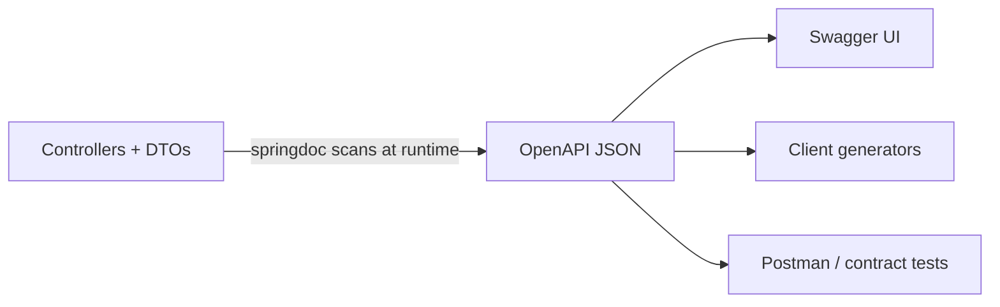

# How to document an API with OpenAPI and springdoc

---

## 🟢 Junior Level

### 1. Plain Definition

**OpenAPI** (formerly Swagger Specification) is a standard format that describes an HTTP API: paths, parameters, request/response bodies, status codes, security. **Swagger UI** is a web page that renders that description and lets you try calls in the browser. **springdoc-openapi** is the library that scans your Spring controllers and **produces** the OpenAPI document automatically.

> Note: Spring Boot 3 requires `springdoc-openapi` **2.x** (`springdoc-openapi-starter-webmvc-ui`). The old `springfox` library does not work with Boot 3 and is abandoned.

### 2. Real-World Analogy

OpenAPI is the **restaurant menu**: it lists every dish (endpoint), ingredients (parameters), and what arrives at the table (response). Swagger UI is the menu with a "taste it" button.

### 3. Minimal Working Setup

```xml
<dependency>
  <groupId>org.springdoc</groupId>
  <artifactId>springdoc-openapi-starter-webmvc-ui</artifactId>
  <version>2.5.0</version>
</dependency>
```

```java
@RestController
@RequestMapping("/api/books")
public class BookController {

    @GetMapping("/{id}")
    public Book get(@PathVariable long id) {
        return new Book(id, "Clean Code");
    }

    public record Book(long id, String title) {}
}
```

Start the app and open:

* `http://localhost:8080/v3/api-docs` – JSON spec
* `http://localhost:8080/v3/api-docs.yaml` – YAML spec
* `http://localhost:8080/swagger-ui.html` – interactive UI



---

## 🟡 Middle Level

### 1. Enriching the Documentation

Default output is only structural. Real documentation needs descriptions, examples and error responses:

```java
@Tag(name = "Orders", description = "Order management")
@RestController
@RequestMapping("/api/orders")
class OrderController {

    @Operation(summary = "Create an order",
               description = "Creates an order and returns its location")
    @ApiResponses({
        @ApiResponse(responseCode = "201", description = "Created",
                     headers = @Header(name = "Location", description = "URI of the new order")),
        @ApiResponse(responseCode = "400", description = "Validation failed",
                     content = @Content(mediaType = "application/problem+json",
                                        schema = @Schema(implementation = ProblemDetail.class))),
        @ApiResponse(responseCode = "409", description = "Duplicate order")
    })
    @PostMapping
    ResponseEntity<Void> create(@RequestBody @Valid CreateOrderRequest request) {
        return ResponseEntity.created(URI.create("/api/orders/42")).build();
    }
}

@Schema(description = "Data needed to create an order")
record CreateOrderRequest(
        @Schema(description = "Customer id", example = "1001") @NotNull Long customerId,
        @Schema(description = "Product SKU", example = "SKU-123") @NotBlank String sku,
        @Schema(example = "2") @Min(1) int quantity) {}
```

springdoc reads Bean Validation annotations (`@NotNull`, `@Min`, `@Size`) and turns them into `required`, `minimum`, `maxLength` in the schema.

### 2. Global Configuration

```java
@Configuration
class OpenApiConfig {

    @Bean
    OpenAPI api() {
        return new OpenAPI()
            .info(new Info().title("Shop API").version("2.1.0")
                  .contact(new Contact().name("Platform team").email("api@example.com")))
            .components(new Components().addSecuritySchemes("bearer-jwt",
                new SecurityScheme().type(SecurityScheme.Type.HTTP)
                    .scheme("bearer").bearerFormat("JWT")))
            .addSecurityItem(new SecurityRequirement().addList("bearer-jwt"));
    }

    @Bean
    GroupedOpenApi publicApi() {
        return GroupedOpenApi.builder().group("public").pathsToMatch("/api/**").build();
    }

    @Bean
    GroupedOpenApi adminApi() {
        return GroupedOpenApi.builder().group("admin").pathsToMatch("/admin/**").build();
    }
}
```

`GroupedOpenApi` creates separate specs (`/v3/api-docs/public`, `/v3/api-docs/admin`), useful for versions or audiences.

### 3. Useful Properties

```yaml
springdoc:
  api-docs:
    path: /v3/api-docs
    enabled: true
  swagger-ui:
    path: /swagger-ui.html
    operations-sorter: method
    tags-sorter: alpha
  packages-to-scan: com.example.shop.web
  paths-to-match: /api/**
  default-produces-media-type: application/json
```

### 4. Common Mistakes

| Mistake | Consequence | Fix |
| :--- | :--- | :--- |
| Leaving Swagger UI enabled in production | Information disclosure, attack surface | `springdoc.swagger-ui.enabled=false` under the `prod` profile or protect with auth |
| Documenting entities, not DTOs | Spec leaks DB structure and lazy collections | Return DTOs; hide with `@Hidden` |
| Forgetting error responses | Consumers guess how failures look | Add shared responses via `OperationCustomizer` |
| Using Spring Security without permitting doc paths | UI returns 401/403 | Permit `/v3/api-docs/**`, `/swagger-ui/**` deliberately |
| Annotating everything with verbose `@Operation` text | Code noise | Annotate what adds value, keep the rest default |

---

## 🔴 Senior Level

### 1. Reusable Error Responses via Customizer

Instead of repeating `@ApiResponse(400)` on every method, add standard responses globally:

```java
@Bean
OperationCustomizer standardErrors() {
    return (operation, handlerMethod) -> {
        ApiResponses responses = operation.getResponses();
        Schema<?> problem = new Schema<>().$ref("#/components/schemas/ProblemDetail");
        Content content = new Content().addMediaType("application/problem+json",
                new MediaType().schema(problem));
        responses.addApiResponse("500",
                new ApiResponse().description("Unexpected error").content(content));
        responses.addApiResponse("401", new ApiResponse().description("Unauthenticated"));
        return operation;
    };
}
```

### 2. Build-Time Spec Generation

Runtime generation is not available to a build server before deployment. `springdoc-openapi-maven-plugin` starts the app during the `integration-test` phase, downloads the spec and writes it to a file:

```xml
<plugin>
  <groupId>org.springdoc</groupId>
  <artifactId>springdoc-openapi-maven-plugin</artifactId>
  <version>1.4</version>
  <executions>
    <execution>
      <id>generate-docs</id>
      <phase>integration-test</phase>
      <goals><goal>generate</goal></goals>
    </execution>
  </executions>
  <configuration>
    <apiDocsUrl>http://localhost:8080/v3/api-docs.yaml</apiDocsUrl>
    <outputFileName>openapi.yaml</outputFileName>
    <outputDir>${project.build.directory}</outputDir>
  </configuration>
</plugin>
```

(Pair it with `spring-boot-maven-plugin` start/stop goals.) The artefact is then published to a portal, diffed against the previous release and fed to client generators.

### 3. Performance and Operations

* Spec generation is **lazy and cached** after the first request, but scanning large codebases is slow on first call; restrict with `packages-to-scan`.
* For GraalVM native images springdoc needs AOT hints (supported with Boot 3); test the native build.
* Behind a gateway, "Try it out" fails if `servers` is wrong. Set `server.forward-headers-strategy=framework` or declare `servers` explicitly.
* Custom types (`Money`, Jackson mixins) need `ModelConverter` beans or `@Schema(implementation=…)`; otherwise they appear as empty objects.
* Polymorphism: Jackson `@JsonTypeInfo` + `@JsonSubTypes` often need an explicit `@Schema(oneOf=…)`/discriminator to produce a correct `oneOf`; verify the output.

```java
@Schema(oneOf = {Card.class, Iban.class}, discriminatorProperty = "type")
@JsonTypeInfo(use = JsonTypeInfo.Id.NAME, property = "type")
@JsonSubTypes({
    @JsonSubTypes.Type(value = Card.class, name = "card"),
    @JsonSubTypes.Type(value = Iban.class, name = "iban")})
sealed interface PaymentMethod permits Card, Iban {}
record Card(String number) implements PaymentMethod {}
record Iban(String iban) implements PaymentMethod {}
```

### 4. Documentation as Developer Experience

A good developer portal is more than Swagger UI:

1. **Quick start** with a 5-minute "first call" tutorial and copy-paste `curl`.
2. **Examples** for each request and every error (use `@ExampleObject`).
3. **Changelog and deprecation notices** linked to versions.
4. **Authentication guide** with token acquisition steps and sandbox credentials.
5. **SDKs** generated from the spec (openapi-generator), versioned with the API.
6. **Sandbox environment** with fake data and relaxed rate limits.
7. **Postman collection** or `.http` files generated from the spec.

### 5. Security Recap (brief)

Document security schemes (`bearer`, OAuth2 flows) so Swagger UI can obtain tokens, but do not publish internal admin endpoints. Authentication details belong to the Spring Security section of this repository; here the focus is on *describing* it in the contract and on **hiding** the docs in untrusted environments.

---

## 🎯 Interview Cheat Sheet

### 30-Second Elevator Pitch
"OpenAPI is the standard contract for HTTP APIs. In Spring Boot 3 I use springdoc-openapi 2.x: add the starter, get `/v3/api-docs` and Swagger UI immediately. I enrich it with `@Operation`, `@Schema` and shared error responses, group APIs by audience, disable the UI in production, and generate the spec at build time so it can be diffed, published to a portal and used for client SDKs."

### Must-Know Bullets
- Artifact: `springdoc-openapi-starter-webmvc-ui` (MVC) or `-webflux-ui`.
- Spec at `/v3/api-docs`, UI at `/swagger-ui.html`.
- Bean Validation annotations flow into the schema.
- `GroupedOpenApi` for multiple specs; `@Hidden` to exclude.
- springfox is dead for Boot 3.

### Common Follow-Up Questions
1. How do you document a polymorphic payload?
2. How do you keep Swagger UI out of production?
3. How do you publish the spec during the CI build?
4. How would you add the same error responses everywhere?

### 🚩 Red Flags
- Still using springfox or Swagger 2 annotations (`@ApiOperation`).
- Exposing entities in the spec.
- Public Swagger UI with admin endpoints visible.

### Related Topics
- [What is API-first design and contract-first versus code-first](01.%20What%20is%20API-first%20design%20and%20contract-first%20versus%20code-first.md)
- [How to handle errors with Problem Details RFC 9457](07.%20How%20to%20handle%20errors%20with%20Problem%20Details%20RFC%209457.md)
- [How to validate requests with Bean Validation](11.%20How%20to%20validate%20requests%20with%20Bean%20Validation.md)
