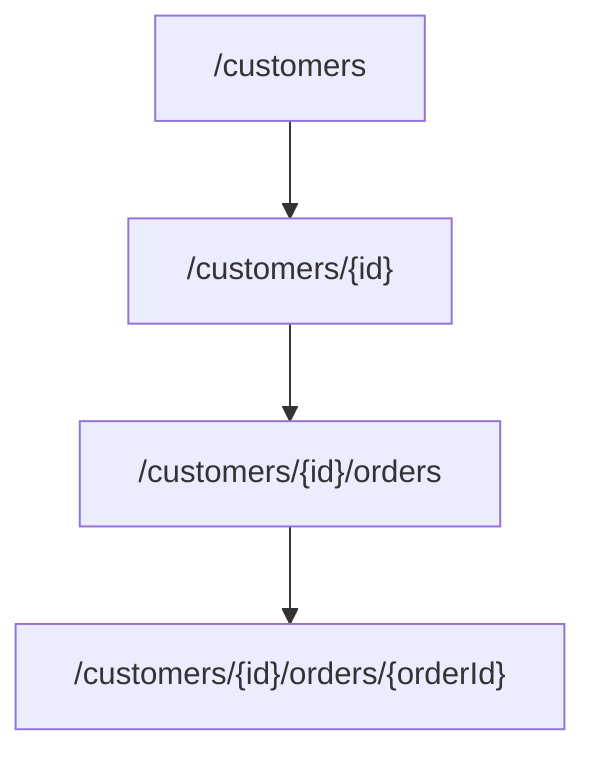

# How to model REST resources and name endpoints

---

## 🟢 Junior Level

### 1. Plain Definition

In REST you do not expose *actions* (verbs); you expose **resources** (nouns) and use the HTTP method as the verb. A resource is any concept a client can name and fetch: a customer, an order, an invoice. Its URL identifies it, and its representation (usually JSON) describes its state.

| Goal | Bad (RPC style) | Good (resource style) |
| :--- | :--- | :--- |
| List books | `GET /getAllBooks` | `GET /books` |
| Create a book | `POST /createBook` | `POST /books` |
| Read one | `GET /getBook?id=5` | `GET /books/5` |
| Replace | `POST /updateBook` | `PUT /books/5` |
| Delete | `GET /deleteBook/5` | `DELETE /books/5` |

### 2. Real-World Analogy

A library catalogue: the shelf `books` contains books; each has a call number (`/books/5`). You don't call the librarian with "getBook"; you point to a thing and say what you want done to it (read, replace, remove).

### 3. Minimal Example

```java
@RestController
@RequestMapping("/books")
class BookController {

    private final Map<Long, Book> store = new ConcurrentHashMap<>();
    private final AtomicLong ids = new AtomicLong();

    @GetMapping
    Collection<Book> list() {
        return store.values();
    }

    @PostMapping
    ResponseEntity<Book> create(@RequestBody Book book) {
        long id = ids.incrementAndGet();
        Book saved = new Book(id, book.title());
        store.put(id, saved);
        return ResponseEntity.created(URI.create("/books/" + id)).body(saved);
    }

    @GetMapping("/{id}")
    ResponseEntity<Book> get(@PathVariable long id) {
        Book b = store.get(id);
        return b == null ? ResponseEntity.notFound().build() : ResponseEntity.ok(b);
    }

    @DeleteMapping("/{id}")
    ResponseEntity<Void> delete(@PathVariable long id) {
        return store.remove(id) == null ? ResponseEntity.notFound().build()
                                        : ResponseEntity.noContent().build();
    }

    record Book(Long id, String title) {}
}
```

### 4. Naming Rules of Thumb

* **Plural nouns**: `/orders`, not `/order`.
* **Lowercase with hyphens**: `/purchase-orders`, not `/purchaseOrders`.
* **No verbs, no file extensions, no trailing slash.**
* **Hierarchy shows ownership**: `/customers/7/orders`.



---

## 🟡 Middle Level

### 1. How to Find the Resources

Start from the **domain language** (DDD ubiquitous language), not from database tables. A resource is not necessarily a table:

* A resource can aggregate several tables (`/orders/42` includes its lines).
* A table can be hidden (join tables are rarely resources).
* A **computed** thing can be a resource (`/customers/7/balance`, `/reports/monthly-sales`).

A good rule: model resources along **aggregate boundaries**. Items inside an aggregate are usually sub-resources or embedded; other aggregates are referenced by link/ID.

### 2. Method Semantics You Must Respect

| Method | Safe | Idempotent | Typical status codes |
| :--- | :--- | :--- | :--- |
| GET | yes | yes | 200, 304, 404 |
| POST | no | no | 201 (+`Location`), 202, 400, 409 |
| PUT | no | yes | 200, 204, 404, 412 |
| PATCH | no | not guaranteed | 200, 204, 409, 422 |
| DELETE | no | yes | 204, 404 |

### 3. Actions That Do Not Fit CRUD

Sometimes the domain has a real operation: *cancel an order*, *publish an article*, *transfer money*. Options:

1. **Model as state** and use PATCH: `PATCH /orders/42 {"status":"CANCELLED"}`. Works when the transition is simple.
2. **Model the action as a sub-resource** (noun): `POST /orders/42/cancellation`, `POST /transfers` creating a `Transfer` resource. Usually best because the new resource has an identity, history and can be queried.
3. **Controller-style endpoint** as a last resort: `POST /orders/42:cancel` (Google AIP style) or `POST /orders/42/cancel`. Accept it for genuinely procedural operations (`/search`, `/convert`).

```java
@PostMapping("/orders/{id}/cancellation")
ResponseEntity<CancellationDto> cancel(@PathVariable long id, @RequestBody CancelRequest req) {
    CancellationDto c = orderService.cancel(id, req.reason());
    return ResponseEntity.created(URI.create("/orders/" + id + "/cancellation")).body(c);
}
```

### 4. Common Mistakes

| Mistake | Why it hurts |
| :--- | :--- |
| `POST /getUsers` for a simple search | Breaks caching and semantics (`POST /users/search` is acceptable for huge filters) |
| Deep nesting `/a/1/b/2/c/3/d/4` | Brittle; limit to 2 levels and use top-level resources with filters (`/items?orderId=2`) |
| Returning 200 with `{"error":...}` | Clients and monitoring cannot rely on status codes |
| Using `PUT` for partial update | PUT replaces the whole representation |
| Sequential database IDs for sensitive data | Enumeration; consider UUIDs or opaque IDs |
| Inconsistent plurals/casing across services | Terrible developer experience |

### 5. Representation Design

```json
{
  "id": "ord_8f3a",
  "status": "PAID",
  "total": { "amount": "49.90", "currency": "EUR" },
  "createdAt": "2024-05-01T10:15:30Z",
  "customer": { "id": "cus_17", "href": "/customers/cus_17" },
  "lines": [ { "sku": "SKU-1", "quantity": 2 } ]
}
```

* Money as **string/decimal + currency**, never a `double`.
* Timestamps in **ISO-8601 UTC** (`Instant`).
* Stable enums as upper-case strings; consumers must tolerate unknown values.

---

## 🔴 Senior Level

### 1. Granularity and Chattiness

Resource design is a trade-off between **fine-grained** (many calls, cache-friendly) and **coarse-grained** (few calls, bigger payloads). Mobile clients on slow networks suffer from chatty APIs. Mitigations without breaking REST:

* **Embedding / expansion**: `GET /orders/42?expand=customer,lines`.
* **Field selection** (see the filtering question).
* **Composite resources** for screens (Backend-for-Frontend pattern).
* **Batch endpoints**: `POST /orders:batchGet`.

### 2. Identifiers

| ID type | Pros | Cons |
| :--- | :--- | :--- |
| Auto-increment `Long` | Compact, index-friendly | Guessable, leaks volume, hard in sharded setups |
| UUID v4 | Unguessable, client-generated | Random index inserts, 36 chars |
| UUID v7 / ULID | Time-ordered, good locality | Needs library support |
| Prefixed IDs (`ord_…`) | Self-describing, type-safe in logs | Custom generation |

Client-generated IDs enable **idempotent creation** with `PUT /orders/{uuid}` (create-or-replace), which removes the need for idempotency keys in some designs.

### 3. Singleton Sub-Resources and Client-Keyed Children

```java
@GetMapping("/customers/{id}/profile")       // singleton sub-resource, one per customer
ProfileDto profile(@PathVariable long id) { return profiles.find(id); }

@PutMapping("/customers/{id}/profile")       // idempotent replace
ResponseEntity<Void> replaceProfile(@PathVariable long id, @RequestBody ProfileDto dto) {
    profiles.replace(id, dto);
    return ResponseEntity.noContent().build();
}

@PutMapping("/orders/{orderId}/lines/{lineNo}")  // client chooses the key inside the aggregate
ResponseEntity<Void> putLine(@PathVariable long orderId, @PathVariable int lineNo,
                             @RequestBody LineDto dto) {
    orders.putLine(orderId, lineNo, dto);
    return ResponseEntity.noContent().build();
}
```

### 4. Location Header Behind Proxies

Always return `201 Created` with `Location`. Build it with `ServletUriComponentsBuilder` so it is correct behind proxies:

```java
URI location = ServletUriComponentsBuilder.fromCurrentRequest()
        .path("/{id}").buildAndExpand(saved.id()).toUri();
return ResponseEntity.created(location).body(saved);
```

Behind a reverse proxy set `server.forward-headers-strategy=framework` so `X-Forwarded-*` headers produce correct absolute URLs.

### 5. Cross-Cutting Design Decisions to Standardise

1. Pagination, filtering, sorting vocabulary (see the dedicated questions).
2. Error format ([Problem Details](07.%20How%20to%20handle%20errors%20with%20Problem%20Details%20RFC%209457.md)).
3. Case convention for JSON (camelCase vs snake_case) – pick one, enforce with Jackson `PropertyNamingStrategies`.
4. Null vs absent fields, empty collections instead of `null`.
5. Soft delete semantics (`DELETE` returns 204 and later `GET` returns 404 or 410).
6. Concurrency control via `ETag` ([ETag and If-Match](09.%20How%20to%20implement%20optimistic%20concurrency%20with%20ETag%20and%20If-Match.md)).
7. Evolution rules ([versioning](04.%20What%20are%20the%20API%20versioning%20strategies.md)).

### 6. Anti-Pattern: Database-Driven API

Auto-exposing repositories (`spring-data-rest`) as the public API couples clients to the schema. Use it for internal admin tools at most; for product APIs hand-design resources so you can refactor storage without a breaking change.

---

## 🎯 Interview Cheat Sheet

### 30-Second Elevator Pitch
"I model resources from the domain, not from tables: plural nouns, hierarchy reflecting aggregate ownership, at most two nesting levels, and HTTP methods for verbs with correct status codes. For non-CRUD operations I create a sub-resource like `/orders/42/cancellation`. I standardise IDs, JSON conventions, errors and pagination across services so the API feels like one product."

### Must-Know Bullets
- Nouns + plural + lowercase-hyphen; verbs belong to HTTP methods.
- `POST` returns `201` + `Location`; `PUT` is idempotent full replace.
- Limit nesting; use filters on top-level collections.
- Resources ≠ tables; align with aggregates.
- Money as decimal string + currency; dates ISO-8601 UTC.

### Common Follow-Up Questions
1. How do you model "cancel order" in REST?
2. PUT vs PATCH vs POST – when each?
3. How do you avoid chatty APIs?
4. UUID vs auto-increment IDs for public resources?

### 🚩 Red Flags
- Verbs in URLs (`/doPayment`), `GET` that modifies state.
- Returning 200 for errors.
- Exposing JPA entity graphs directly.

### Related Topics
- [What is HATEOAS and the Richardson maturity model](10.%20What%20is%20HATEOAS%20and%20the%20Richardson%20maturity%20model.md)
- [How to design filtering sorting and field selection](06.%20How%20to%20design%20filtering%20sorting%20and%20field%20selection.md)
- [DTOs versus entities and mapping with MapStruct](11.%20DTOs%20versus%20entities%20and%20mapping%20with%20MapStruct.md)
