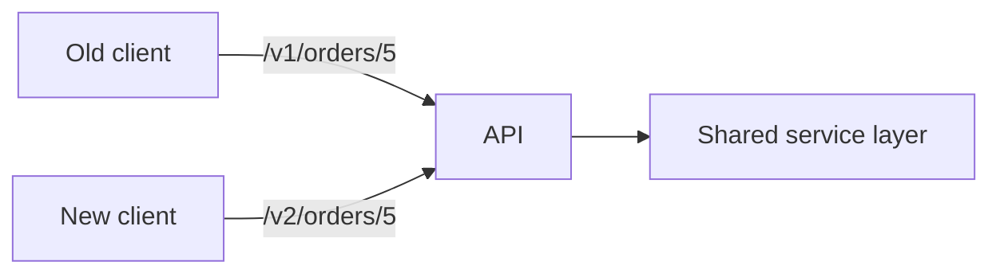

# What are the API versioning strategies

---

## 🟢 Junior Level

### 1. Plain Definition

**API versioning** is the practice of letting an API evolve while old clients keep working. When you must make a change that would break existing consumers (rename a field, remove an endpoint, change semantics), you publish a **new version** and keep the old one running for a while.

### 2. Real-World Analogy

Electrical plug standards. When a country introduces a new socket, it does not force everyone to rewire overnight; both sockets coexist until the old one is retired.

### 3. The Four Common Strategies

| Strategy | Example | Notes |
| :--- | :--- | :--- |
| **URI path** | `GET /v1/orders/5` | Most popular, visible, easy to route and cache |
| **Query parameter** | `GET /orders/5?version=1` | Simple but easy to forget; pollutes cache keys |
| **Custom header** | `X-API-Version: 1` | Clean URLs, harder to test in a browser |
| **Media type (content negotiation)** | `Accept: application/vnd.shop.v1+json` | "Purist" REST, most complex |

### 4. Minimal Example: URI Versioning

```java
@RestController
@RequestMapping("/v1/orders")
class OrderControllerV1 {

    @GetMapping("/{id}")
    OrderV1 get(@PathVariable long id) {
        return new OrderV1(id, "Alice Smith");
    }

    record OrderV1(long id, String customerName) {}
}

@RestController
@RequestMapping("/v2/orders")
class OrderControllerV2 {

    @GetMapping("/{id}")
    OrderV2 get(@PathVariable long id) {
        return new OrderV2(id, new Customer("Alice", "Smith"));
    }

    record OrderV2(long id, Customer customer) {}
    record Customer(String firstName, String lastName) {}
}
```



Version **only for breaking changes**. Adding an optional field is *not* breaking and needs no new version.

---

## 🟡 Middle Level

### 1. Header and Media-Type Versioning in Spring MVC

Spring MVC maps on `headers` or `produces`:

```java
@RestController
@RequestMapping("/orders")
class OrderController {

    @GetMapping(value = "/{id}", produces = "application/vnd.shop.v1+json")
    OrderV1 v1(@PathVariable long id) { return new OrderV1(id, "Alice Smith"); }

    @GetMapping(value = "/{id}", produces = "application/vnd.shop.v2+json")
    OrderV2 v2(@PathVariable long id) {
        return new OrderV2(id, new CustomerV2("Alice", "Smith"));
    }

    @GetMapping(value = "/{id}", headers = "X-API-Version=3")
    OrderV3 v3(@PathVariable long id) { return OrderV3.sample(id); }
}
```

### 2. Spring Framework 7 / Spring Boot 4 Note

Newer Spring versions add first-class API versioning support (`version` attribute on mappings and an `ApiVersionStrategy`). On Spring Boot 3.x you implement it yourself via path prefixes, `produces`, `headers` or a custom `RequestCondition`. In an interview it is worth knowing that the framework is moving in this direction, but the strategies stay the same.

### 3. A Reusable Path-Prefix Setup

```java
@Configuration
class WebConfig implements WebMvcConfigurer {

    @Override
    public void configurePathMatch(PathMatchConfigurer configurer) {
        configurer.addPathPrefix("/v2",
                HandlerTypePredicate.forBasePackage("com.example.shop.web.v2"));
        configurer.addPathPrefix("/v1",
                HandlerTypePredicate.forBasePackage("com.example.shop.web.v1"));
    }
}
```

Controllers in each package are then automatically prefixed.

### 4. Comparison

| Criterion | URI | Header | Media type | Query |
| :--- | :--- | :--- | :--- | :--- |
| Discoverability | ⭐⭐⭐ | ⭐ | ⭐ | ⭐⭐ |
| Cache friendly (CDN) | ⭐⭐⭐ | needs `Vary` | needs `Vary: Accept` | ⭐⭐ |
| Routing at the gateway | trivial | possible | harder | easy |
| Browser / curl testing | trivial | requires header | requires header | trivial |
| Granularity | whole API | whole API | per resource | whole API |
| "RESTfulness" purists | criticised | OK | preferred | criticised |

### 5. Common Mistakes

1. **Versioning too eagerly** (`v1`, `v2` every sprint): maintenance multiplies. Prefer additive evolution.
2. **Copy-pasting whole controllers**: put logic in a shared service and map to version-specific DTOs.
3. **No sunset plan**: old versions live forever. Announce deprecation and dates.
4. **Versioning the whole API for one change** when only one resource changed (media-type versioning handles this better).
5. **Forgetting `Vary`** headers when versioning through headers, so a CDN serves the wrong version.

---

## 🔴 Senior Level

### 1. Architecture That Survives Multiple Versions

Keep **one domain model and one service layer**. Each version is an *adapter*: a controller + DTOs + mapper. A v1→domain mapper and a domain→v2 mapper confine changes to the edge.

```java
interface OrderMapper<T> {
    T toDto(Order domain);
}

@Component
class OrderV1Mapper implements OrderMapper<OrderV1> {
    public OrderV1 toDto(Order o) {
        return new OrderV1(o.id(), o.customer().firstName() + " " + o.customer().lastName());
    }
}

@Component
class OrderV2Mapper implements OrderMapper<OrderV2> {
    public OrderV2 toDto(Order o) {
        return new OrderV2(o.id(), new Customer(o.customer().firstName(), o.customer().lastName()));
    }
}
```

### 2. Deprecation Signalling with Standard Headers

Use the `Deprecation` and `Sunset` headers (RFC 8594 for `Sunset`) and a `Link` to the migration guide:

```java
@Component
class DeprecationFilter extends OncePerRequestFilter {

    @Override
    protected void doFilterInternal(HttpServletRequest req, HttpServletResponse res,
                                    FilterChain chain) throws ServletException, IOException {
        if (req.getRequestURI().startsWith("/v1/")) {
            res.setHeader("Deprecation", "true");
            res.setHeader("Sunset", "Sat, 31 Jan 2026 23:59:59 GMT");
            res.setHeader("Link", "<https://docs.example.com/migrate-v2>; rel=\"deprecation\"");
        }
        chain.doFilter(req, res);
    }
}
```

Combine with **usage metrics per version and per client** (Micrometer tag `api.version`, `client.id`) so you know who still calls v1 before turning it off.

```java
@Component
class VersionMetricsFilter extends OncePerRequestFilter {
    private final MeterRegistry registry;
    VersionMetricsFilter(MeterRegistry registry) { this.registry = registry; }

    @Override
    protected void doFilterInternal(HttpServletRequest req, HttpServletResponse res,
                                    FilterChain chain) throws ServletException, IOException {
        String v = req.getRequestURI().startsWith("/v2/") ? "v2" : "v1";
        registry.counter("api.requests", "version", v,
                "client", Optional.ofNullable(req.getHeader("X-Client-Id")).orElse("unknown")).increment();
        chain.doFilter(req, res);
    }
}
```

### 3. Alternatives to Hard Versioning

* **Additive evolution + tolerant reader**: clients ignore unknown fields; servers add fields only. Jackson `FAIL_ON_UNKNOWN_PROPERTIES=false` on consumers.
* **Date-based versions** (Stripe style): client pins `API-Version: 2024-06-20`; server applies a chain of transformers to translate responses back. Powerful but requires a disciplined change pipeline.
* **Feature flags / capability negotiation**: opt in to new behaviour with a header.
* **GraphQL**: no versions, evolve schema with `@deprecated` (see the GraphQL question).
* **Event / message APIs**: schema registry compatibility rules (BACKWARD/FORWARD/FULL).

### 4. Operational Concerns

* **Gateway routing**: route `/v1/**` and `/v2/**` to different deployments (blue/green by version) to retire v1 code entirely.
* **Documentation**: separate OpenAPI documents per version (`GroupedOpenApi`).
* **Testing**: keep contract tests for every supported version (see the consumer-driven contracts question).
* **Security**: old versions keep old vulnerabilities; do not skip security patches because "v1 is deprecated".
* **Database**: both versions run against the same schema; use expand/contract migrations so neither version breaks during a deploy.

### 5. What Counts as Breaking?

Breaking: removing/renaming fields or endpoints, changing types, making optional input required, tightening validation, changing error codes, changing default sort, adding enum values clients cannot handle. Non-breaking: new endpoints, new optional request fields, new response fields. Treat *behavioural* changes as breaking too, even when the schema stays identical.

---

## 🎯 Interview Cheat Sheet

### 30-Second Elevator Pitch
"I avoid versions as long as I can by evolving additively and relying on tolerant readers. When a breaking change is unavoidable I use URI versioning for public APIs because it is explicit, cache- and gateway-friendly, and keep a single domain layer with per-version DTO mappers. I announce deprecations with `Deprecation`/`Sunset` headers, track usage per version and client, and retire old versions on a published schedule."

### Must-Know Bullets
- Four strategies: URI, query, header, media type.
- Only breaking changes need a new version.
- One service layer, version-specific DTOs/mappers.
- `Sunset` header (RFC 8594) and `Deprecation` header.
- Monitor usage per version before shutdown.

### Common Follow-Up Questions
1. Why is URI versioning criticised by REST purists and still the most common?
2. How do you version a single resource instead of the whole API?
3. How would you retire v1 safely?
4. How does Stripe-style date versioning work?

### 🚩 Red Flags
- Bumping the version for every release.
- Duplicating business logic per version.
- No deprecation timeline or telemetry.

### Related Topics
- [How to manage backward compatibility and breaking changes](21.%20How%20to%20manage%20backward%20compatibility%20and%20breaking%20changes.md)
- [DTOs versus entities and mapping with MapStruct](11.%20DTOs%20versus%20entities%20and%20mapping%20with%20MapStruct.md)
- [What are consumer-driven contract tests](22.%20What%20are%20consumer-driven%20contract%20tests.md)
