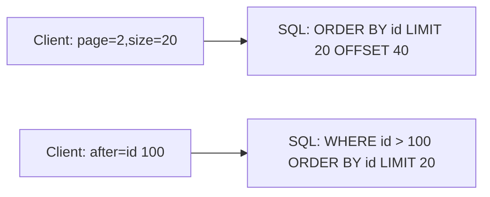

# Offset pagination versus cursor pagination

---

## 🟢 Junior Level

### 1. Plain Definition

**Pagination** splits a large collection into smaller pages so the server does not return a million rows in one response. Two main styles:

* **Offset (page/size) pagination** – "give me page 3, 20 items per page": `GET /orders?page=2&size=20`.
* **Cursor (keyset) pagination** – "give me 20 items after this last one I saw": `GET /orders?limit=20&after=eyJpZCI6MTAwfQ`.

### 2. Real-World Analogy

A book. Offset = "open to page 150". Cursor = "continue from the bookmark". If someone inserts pages at the front while you read, "page 150" now shows different text, but your bookmark still points at the same place.

### 3. Minimal Example with Spring Data

```java
@RestController
@RequestMapping("/orders")
class OrderController {

    private final OrderRepository repo;

    OrderController(OrderRepository repo) { this.repo = repo; }

    // GET /orders?page=0&size=20&sort=createdAt,desc
    @GetMapping
    Page<OrderDto> list(Pageable pageable) {
        return repo.findAll(pageable).map(o -> new OrderDto(o.getId(), o.getTotal()));
    }

    record OrderDto(Long id, BigDecimal total) {}
}

interface OrderRepository extends JpaRepository<OrderEntity, Long> {}
```

Spring Boot resolves `Pageable` from `page`, `size` and `sort` parameters. The `Page` response contains `content`, `totalElements`, `totalPages`.



---

## 🟡 Middle Level

### 1. Why Offset Hurts

```sql
SELECT * FROM orders ORDER BY created_at DESC LIMIT 20 OFFSET 1000000;
```

The database must read and discard 1,000,000 rows before returning 20: cost grows linearly with the page number. Additional problems:

1. **Drift**: inserts/deletes during browsing cause duplicates or skipped items between pages.
2. **`COUNT(*)`**: `Page<T>` triggers an additional count query, expensive on big tables. Use `Slice<T>` (fetches size+1 rows, no count) if you only need "has next".
3. **Deep paging abuse**: a client requesting `page=999999` can degrade the DB; cap `size` and page depth (`spring.data.web.pageable.max-page-size`).

### 2. Keyset (Seek) Pagination

Filter by the **last seen sort key** instead of skipping rows. Requires a deterministic order with a unique tie-breaker and an index on those columns.

```sql
-- index: (created_at DESC, id DESC)
SELECT * FROM orders
WHERE (created_at, id) < (:lastCreatedAt, :lastId)
ORDER BY created_at DESC, id DESC
LIMIT 21;   -- ask for size+1 to know whether a next page exists
```

Cost is constant regardless of depth because the index seeks directly.

### 3. Implementation with Spring Data `Window` / `ScrollPosition` (Boot 3.1+)

Spring Data 3.1 added keyset scrolling:

```java
interface OrderRepository extends JpaRepository<OrderEntity, Long> {
    Window<OrderEntity> findFirst20ByStatusOrderByCreatedAtDescIdDesc(
            String status, ScrollPosition position);
}

@Service
class OrderQueryService {
    private final OrderRepository repo;
    OrderQueryService(OrderRepository repo) { this.repo = repo; }

    Window<OrderEntity> firstPage(String status) {
        return repo.findFirst20ByStatusOrderByCreatedAtDescIdDesc(status, ScrollPosition.keyset());
    }

    Window<OrderEntity> next(String status, KeysetScrollPosition pos) {
        return repo.findFirst20ByStatusOrderByCreatedAtDescIdDesc(status, pos);
    }
}
```

`Window` exposes `hasNext()` and `positionAt(index)` that gives the cursor for the next request.

### 4. Response Envelope Conventions

```json
{
  "data": [ { "id": 101 }, { "id": 100 } ],
  "page": {
    "next": "eyJjIjoiMjAyNC0wNS0wMVQxMDoxNTozMFoiLCJpIjoxMDB9",
    "hasNext": true,
    "size": 2
  }
}
```

Alternatively use the `Link` header (RFC 8288): `Link: <https://api.example.com/orders?after=abc>; rel="next"`.

### 5. Comparison

| Aspect | Offset | Cursor / keyset |
| :--- | :--- | :--- |
| Jump to page N | Yes | No (sequential only) |
| Total count | Easy (expensive) | Usually omitted |
| Performance on deep pages | Degrades linearly | Constant |
| Consistency under writes | Duplicates/skips | Stable |
| Complexity | Trivial | Needs unique sort key, opaque cursor |
| Good for | Admin tables, small sets | Feeds, infinite scroll, exports, big data |

### 6. Common Mistakes

* Sorting by a non-unique column only (`created_at`) – rows with identical timestamps get lost at page borders. Always add `id` as tie-breaker.
* Exposing raw cursor internals (`after_id=100`). Use an **opaque, signed or at least Base64** cursor so you can change the format.
* Allowing arbitrary client sort fields without indexes.
* Returning `totalElements` for infinite lists on every call.

---

## 🔴 Senior Level

### 1. Opaque Cursor Encoding with Tamper Protection

```java
public final class Cursor {

    private static final ObjectMapper MAPPER = new ObjectMapper().findAndRegisterModules();

    public record Position(Instant createdAt, long id) {}

    private final Mac mac;

    public Cursor(byte[] secret) throws GeneralSecurityException {
        mac = Mac.getInstance("HmacSHA256");
        mac.init(new SecretKeySpec(secret, "HmacSHA256"));
    }

    public synchronized String encode(Position p) throws JsonProcessingException {
        byte[] body = MAPPER.writeValueAsBytes(p);
        byte[] sig = mac.doFinal(body);
        Base64.Encoder enc = Base64.getUrlEncoder().withoutPadding();
        return enc.encodeToString(body) + "." + enc.encodeToString(sig);
    }

    public synchronized Position decode(String token) throws IOException {
        String[] parts = token.split("\\.");
        if (parts.length != 2) throw new IllegalArgumentException("Bad cursor");
        byte[] body = Base64.getUrlDecoder().decode(parts[0]);
        byte[] sig = Base64.getUrlDecoder().decode(parts[1]);
        if (!MessageDigest.isEqual(sig, mac.doFinal(body))) {
            throw new IllegalArgumentException("Cursor signature mismatch");
        }
        return MAPPER.readValue(body, Position.class);
    }
}
```

A signed cursor stops clients from forging positions (and, if the query is built from it, from probing for injection).

### 2. jOOQ / Native SQL Keyset with Row Values

Row-value comparison `(a, b) < (?, ?)` is concise but not optimised on every database (older MySQL versions can ignore the index). The portable form is:

```sql
WHERE created_at < :c OR (created_at = :c AND id < :id)
```

Always verify with `EXPLAIN` that the composite index is used for both the filter and order.

```java
List<OrderRow> next = jdbc.query("""
        SELECT id, created_at, total FROM orders
        WHERE created_at < ? OR (created_at = ? AND id < ?)
        ORDER BY created_at DESC, id DESC
        LIMIT ?
        """,
        (rs, i) -> new OrderRow(rs.getLong("id"), rs.getTimestamp("created_at").toInstant(),
                                rs.getBigDecimal("total")),
        Timestamp.from(pos.createdAt()), Timestamp.from(pos.createdAt()), pos.id(), size + 1);
boolean hasNext = next.size() > size;
```

### 3. Production Concerns

* **Hard limits**: `spring.data.web.pageable.max-page-size=100`, default 20; reject larger instead of silently clamping if the contract says so.
* **Snapshot consistency**: for exports spanning many pages, either use a stable cursor over an immutable key (e.g. `id`) or an explicit export job (see the long-running operations question).
* **Sort + filter combinations**: each supported combination needs an index; otherwise limit the allowed sorts. Whitelist sort properties to avoid `PropertyReferenceException` and to avoid sorting by unindexed columns.
* **Count approximations**: for huge tables return an estimate (`pg_class.reltuples`, `EXPLAIN` row estimate) or cap the count (`SELECT COUNT(*) FROM (SELECT 1 ... LIMIT 10001)`).
* **Search engines**: Elasticsearch uses `search_after` (keyset) and PIT (point in time); `from/size` is capped at 10,000 by default.
* **Bidirectional paging**: keep `before`/`after` cursors; for previous page reverse the order then reverse the result.
* **NoSQL**: DynamoDB `LastEvaluatedKey` and Mongo `_id > last` are native cursors.

### 4. Whitelisting Sort Fields

```java
private static final Set<String> SORTABLE = Set.of("createdAt", "total");

Pageable sanitize(Pageable p) {
    p.getSort().forEach(o -> {
        if (!SORTABLE.contains(o.getProperty())) {
            throw new ResponseStatusException(HttpStatus.BAD_REQUEST,
                    "Unsupported sort: " + o.getProperty());
        }
    });
    return PageRequest.of(p.getPageNumber(), Math.min(p.getPageSize(), 100), p.getSort());
}
```

### 5. GraphQL Relay Connections

GraphQL standardises cursor paging as the *Connection* spec (`edges { cursor node } pageInfo { hasNextPage endCursor }`); Spring for GraphQL supports it with `ConnectionFieldTypeVisitor` and `Window`.

---

## 🎯 Interview Cheat Sheet

### 30-Second Elevator Pitch
"Offset pagination is simple and lets users jump to a page, but it gets slower with depth, runs an extra count query and shows duplicates when data changes. Cursor/keyset pagination filters by the last seen sort key with a unique tie-breaker and a matching index, so it is constant-time and stable. I use offset for small admin screens and keyset with opaque, signed cursors for feeds, large tables and exports."

### Must-Know Bullets
- `Pageable` / `Page` / `Slice` (no count) / `Window` (keyset, Spring Data 3.1+).
- Keyset needs deterministic order + unique tie-breaker + composite index.
- Cursor must be opaque; sign it if it feeds a query.
- Cap page size; whitelist sort fields.
- `Link` header or `next` cursor in the body.

### Common Follow-Up Questions
1. Why is `OFFSET 1000000` slow?
2. How do you handle `created_at` duplicates in keyset paging?
3. How would you page through results of a query with many filter combos?
4. How do you give a total count cheaply?

### 🚩 Red Flags
- Returning unbounded lists.
- Exposing `?page=` for a 100M-row table.
- Cursor equal to a raw database ID with no tie-breaker.

### Related Topics
- [How to design filtering sorting and field selection](06.%20How%20to%20design%20filtering%20sorting%20and%20field%20selection.md)
- [GraphQL schema resolvers and the N+1 problem](13.%20GraphQL%20schema%20resolvers%20and%20the%20N+1%20problem.md)
- [How to design long-running operations and async APIs](12.%20How%20to%20design%20long-running%20operations%20and%20async%20APIs.md)
