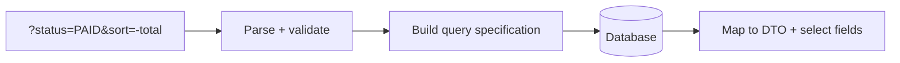

# How to design filtering sorting and field selection

---

## 🟢 Junior Level

### 1. Plain Definition

Collections are rarely consumed whole. Clients need to **filter** (only paid orders), **sort** (newest first) and sometimes **select fields** (only `id` and `name`, to save bandwidth). In REST these are expressed as **query parameters** on the collection URL.

```
GET /orders?status=PAID&customerId=7&sort=-createdAt&fields=id,total
```

### 2. Real-World Analogy

An online shop's left sidebar: tick "Brand = X", "Price < 50", choose "Sort by price", and optionally switch the list to a compact view that shows fewer columns.

### 3. Minimal Example

```java
@RestController
@RequestMapping("/orders")
class OrderController {

    private final OrderRepository repo;

    OrderController(OrderRepository repo) { this.repo = repo; }

    @GetMapping
    List<OrderEntity> search(@RequestParam(required = false) String status,
                             @RequestParam(required = false) Long customerId) {
        if (status != null && customerId != null) {
            return repo.findByStatusAndCustomerId(status, customerId);
        }
        if (status != null) {
            return repo.findByStatus(status);
        }
        return repo.findAll();
    }
}

interface OrderRepository extends JpaRepository<OrderEntity, Long> {
    List<OrderEntity> findByStatus(String status);
    List<OrderEntity> findByStatusAndCustomerId(String status, Long customerId);
}
```

This works but explodes combinatorially as filters grow — the Middle section shows the better way.



---

## 🟡 Middle Level

### 1. Filtering Syntax Choices

| Style | Example | Pros / cons |
| :--- | :--- | :--- |
| Simple equality | `?status=PAID` | Trivial; covers 80% |
| Operator suffix | `?price_gte=10&price_lte=50` | Easy to parse, readable |
| Bracket operators | `?price[gte]=10` | Popular (JSON:API style), needs URL-encoding care |
| RSQL / FIQL | `?filter=price>=10;status==PAID` | Powerful, bigger attack surface |
| Dedicated search body | `POST /orders/search {…}` | Complex filters, no URL length limit, not cacheable |

Guideline: start with equality and ranges; introduce a query language only for real needs and **whitelist** the allowed fields and operators.

### 2. Dynamic Filters with Spring Data `Specification`

```java
interface OrderRepository extends JpaRepository<OrderEntity, Long>,
                                   JpaSpecificationExecutor<OrderEntity> {}

record OrderFilter(String status, Long customerId, BigDecimal minTotal) {}

final class OrderSpecs {
    static Specification<OrderEntity> from(OrderFilter f) {
        return (root, query, cb) -> {
            List<Predicate> p = new ArrayList<>();
            if (f.status() != null)     p.add(cb.equal(root.get("status"), f.status()));
            if (f.customerId() != null) p.add(cb.equal(root.get("customerId"), f.customerId()));
            if (f.minTotal() != null)   p.add(cb.greaterThanOrEqualTo(root.get("total"), f.minTotal()));
            return cb.and(p.toArray(Predicate[]::new));
        };
    }
}

@GetMapping
Page<OrderDto> search(OrderFilter filter, Pageable pageable) { // @ModelAttribute binding from query params
    return repo.findAll(OrderSpecs.from(filter), pageable).map(mapper::toDto);
}
```

Binding a record to query parameters works because Spring's data binder supports constructor binding.

### 3. Sorting

Convention options: `?sort=createdAt,desc` (Spring Data default), `?sort=-createdAt,name` (JSON:API), `?orderBy=createdAt&direction=desc`. Pick one and document it. Always add a deterministic tie-breaker (`id`) and **whitelist** sortable fields.

### 4. Field Selection (Sparse Fieldsets)

Reduces payload and sometimes DB load. With Jackson, use a `FilterProvider`:

```java
@JsonFilter("dynamicFilter")
record ProductDto(Long id, String name, BigDecimal price, String description) {}

@RestControllerAdvice
class FieldsAdvice extends AbstractMappingJacksonResponseBodyAdvice {

    @Override
    protected void beforeBodyWriteInternal(MappingJacksonValue value, MediaType type,
            MethodParameter returnType, ServerHttpRequest request, ServerHttpResponse response) {
        String fields = ((ServletServerHttpRequest) request).getServletRequest().getParameter("fields");
        SimpleBeanPropertyFilter filter = fields == null
                ? SimpleBeanPropertyFilter.serializeAll()
                : SimpleBeanPropertyFilter.filterOutAllExcept(fields.split(","));
        value.setFilters(new SimpleFilterProvider().addFilter("dynamicFilter", filter));
    }
}
```

Note: `AbstractMappingJacksonResponseBodyAdvice` still exists in Spring 6. Field filtering by Jackson only trims the *JSON*; the DB still loads all columns unless you use projections.

### 5. Common Mistakes

1. Passing user-provided field names straight into JPQL/SQL (injection, or exposure of columns like `passwordHash`).
2. Case/format ambiguity: dates in filters should be ISO-8601 (`createdAfter=2024-05-01T00:00:00Z`).
3. Unindexed filter columns causing full scans.
4. Silent ignoring of unknown filter names: respond `400` so typos are discovered (`?stauts=PAID` should not return everything).
5. Using `LIKE '%term%'` for text search; use full-text search or a search engine.

---

## 🔴 Senior Level

### 1. Safe, Whitelisted Query Mapping

A registry of allowed fields → JPA attributes → permitted operators keeps flexibility and security:

```java
final class FilterRegistry {

    enum Op { EQ, GTE, LTE, IN }

    private final Map<String, Set<Op>> allowed = Map.of(
            "status", EnumSet.of(Op.EQ, Op.IN),
            "total", EnumSet.of(Op.GTE, Op.LTE),
            "createdAt", EnumSet.of(Op.GTE, Op.LTE));

    <T> Specification<T> parse(MultiValueMap<String, String> params) {
        List<Specification<T>> parts = new ArrayList<>();
        params.forEach((key, values) -> {
            if (Set.of("page", "size", "sort", "fields").contains(key)) return;
            String field = key.replaceAll("_(gte|lte|in)$", "");
            Op op = key.endsWith("_gte") ? Op.GTE : key.endsWith("_lte") ? Op.LTE
                  : key.endsWith("_in") ? Op.IN : Op.EQ;
            if (!allowed.getOrDefault(field, Set.of()).contains(op)) {
                throw new ResponseStatusException(HttpStatus.BAD_REQUEST, "Unsupported filter: " + key);
            }
            parts.add((root, q, cb) -> switch (op) {
                case EQ -> cb.equal(root.get(field), values.get(0));
                case GTE -> cb.greaterThanOrEqualTo(root.<String>get(field), values.get(0));
                case LTE -> cb.lessThanOrEqualTo(root.<String>get(field), values.get(0));
                case IN -> root.get(field).in(values);
            });
        });
        return Specification.allOf(parts);
    }
}
```

In production convert strings to the attribute's Java type (`Instant`, `BigDecimal`) with Spring's `ConversionService` rather than comparing strings.

### 2. Performance Considerations

* **Index design**: equality columns first, then range, then sort columns. Combine with keyset pagination for stable speed.
* **Projections**: Spring Data interface/DTO projections avoid loading entities and honour `fields` at the SQL level (`select id, total`).
* **Avoid N+1**: when `expand` loads associations, use `@EntityGraph` or fetch joins; but **never** combine collection fetch joins with pagination (Hibernate paginates in memory, warning HHH90003004).
* **Limit expansion depth** and allowed `expand` values.
* **Caching**: GET with query strings is cacheable; normalise parameter order at the gateway for better hit rates.
* **Large `IN` lists**: cap them (e.g. 100 values) or switch to `POST /search`.

### 3. When Filtering Becomes a Query Language

If clients keep requesting new combinations, consider:

1. **GraphQL** (clients choose fields and nested data; see the GraphQL question).
2. A **search-engine-backed** endpoint (Elasticsearch/OpenSearch) with faceting.
3. **OData** (`$filter`, `$orderby`, `$select`, `$expand`) – standardised but heavy; rarely chosen in modern Spring shops.
4. **Query by Example / Spring Data REST** for internal tools only.

### 4. Security and Multi-Tenancy

Filters must be combined with **mandatory** server-side constraints (tenant ID, ownership) that the client cannot override:

```java
Specification<OrderEntity> spec = FilterRegistry.parse(params)
        .and((root, q, cb) -> cb.equal(root.get("tenantId"), currentTenant.id()));
```

Also guard against filter-based **data inference** (attacker filters on fields they cannot read, learning values from result counts). Only allow filtering on fields the caller may view.

### 5. Testing

Property-based and table-driven tests for each filter operator, plus an integration test with Testcontainers that asserts `EXPLAIN` uses the expected index for the top three query shapes.

---

## 🎯 Interview Cheat Sheet

### 30-Second Elevator Pitch
"Filtering, sorting and field selection are query parameters on collections. I start with simple equality/range filters, build them dynamically with Spring Data Specifications, whitelist every filterable and sortable field with its allowed operators, reject unknown parameters with 400, always tie-break sorts by ID, and combine with keyset pagination. For sparse fields I use projections so the database does less work, not just Jackson filters. Tenant and ownership constraints are always enforced server-side."

### Must-Know Bullets
- Query params for filtering; `sort=field,dir`; `fields=a,b`.
- `JpaSpecificationExecutor` for dynamic criteria.
- Whitelist fields/operators; never pass raw names into queries.
- Index for each supported filter/sort shape.
- Never fetch-join collections with pagination.

### Common Follow-Up Questions
1. How do you avoid SQL/JPQL injection in dynamic filters?
2. Where does `POST /search` make sense?
3. How do you implement `fields=` efficiently?
4. When do you move to GraphQL or Elasticsearch?

### 🚩 Red Flags
- Ignoring unknown parameters silently.
- Sorting by any column the client names.
- Combinatorial repository methods (`findByAAndBAndC…`).

### Related Topics
- [Offset pagination versus cursor pagination](05.%20Offset%20pagination%20versus%20cursor%20pagination.md)
- [GraphQL schema resolvers and the N+1 problem](17.%20GraphQL%20schema%20resolvers%20and%20the%20N+1%20problem.md)
- [DTOs versus entities and mapping with MapStruct](11.%20DTOs%20versus%20entities%20and%20mapping%20with%20MapStruct.md)
