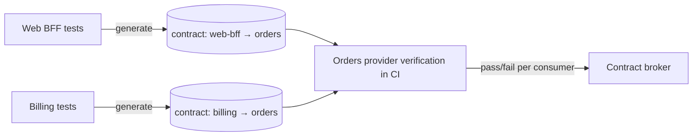

# What are consumer-driven contract tests

---

## 🟢 Junior Level

**Consumer-driven contract (CDC) testing** flips the usual direction of API testing: instead of the provider guessing what clients need, each **consumer** writes down the exact interactions it relies on (requests it sends, response fields it reads). These expectations — the **contract** — are then verified automatically against the **provider's** real implementation in the provider's build.

### What it gives you
* The provider learns **which fields and behaviors are actually used** — it can freely change everything else.
* Breaking changes are caught **before deployment**, in the provider's pipeline, without spinning up all services for end-to-end tests.
* Each consumer's tests run against a **mock provider** generated from its own expectations — fast and reliable.

Tools: **Pact** (polyglot, consumer-driven by design, with Pact Broker/PactFlow) and **Spring Cloud Contract** (JVM-focused, often provider-authored contracts plus generated stubs).

---

## 🟡 Middle Level

### What a good contract contains
* Only the interactions and fields the consumer **really** uses (if billing reads `id` and `total`, the contract must not mention `shippingAddress`).
* **Matchers** for shape, not exact values: "`total` is a decimal", "`status` matches `PAID|SHIPPED`", "`createdAt` is an ISO-8601 timestamp".
* **Provider states** describing preconditions ("order 42 exists and is paid") that the provider sets up during verification.
* Important **error responses** the consumer handles (404 for unknown order, 409 for conflicts).

### The workflow
1. Consumer team writes or changes a contract test → contract published to the broker with the consumer's version and branch.
2. Broker webhook triggers provider verification against the new contract (or the provider verifies all relevant contracts in its own CI).
3. Results are recorded per (consumer version, provider version).
4. Before deploying either side: `can-i-deploy --to-environment production` checks the compatibility matrix against what's currently deployed.

### CDC vs other approaches

| Approach | Catches | Misses |
| --- | --- | --- |
| Provider-only OpenAPI tests | Provider matches its own spec | Whether the spec matches consumers' needs |
| End-to-end tests | Real integration | Slow, flaky, late; combinatorial versions |
| Consumer-driven contracts | Exactly what each consumer relies on | Behavior beyond the contract; unknown consumers |
| Schema diff (oasdiff) | Structural breaking changes | Semantic changes, unused-field freedom |

---

## 🔴 Senior Level

### Making CDC work at organizational scale
* **Contracts are communication, not a substitute for it** — a failing verification starts a conversation between teams; "pending pacts" let a consumer publish a new expectation without breaking the provider's build until the provider implements it.
* **Versioning by branch and environment** — record deployments (`record-deployment`) so `can-i-deploy` compares against what's actually running, not "latest".
* **Ownership**: consumers own their contracts; providers own provider states and verification setup. Keep provider states minimal and fast (mock repositories or in-memory data rather than full datasets).
* **Messaging contracts**: the same idea for events — consumers declare the message shapes they process (Pact message pacts, Spring Cloud Contract messaging); verification checks the producer's actual serialized messages.

### Pitfalls
* **Over-specification** — exact values, full payload snapshots, or response headers the consumer ignores → providers can't evolve; contracts break on harmless changes.
* **Testing provider business logic through contracts** — contracts check the interface; correctness belongs in provider tests.
* **Stale contracts** from consumers that no longer exist — prune with broker metadata (no deployments in N months).
* **Public APIs with unknown consumers** — CDC doesn't apply; use schema diffing, versioning policy and deprecation instead.
* **Treating mocks as truth** — consumer tests pass against the generated mock even if verification was never run; enforce `can-i-deploy` in pipelines.

### Example outcome to cite
"Before CDC, every release of the orders service required a two-day staging E2E cycle with five teams. After introducing Pact with `can-i-deploy` gates, each service deploys independently several times per day; contract failures are caught in the PR of the team that would have broken the integration, and the E2E suite shrank to ten smoke tests."

---

## 🎯 Interview Cheat Sheet

**30-second pitch:** Consumer-driven contract testing lets each consumer declare the requests and response fields it depends on; those contracts are verified against the real provider in its CI, and a broker answers whether a version can be deployed. It catches breaking changes early, lets providers change anything consumers don't use, and replaces most slow end-to-end integration tests — as long as contracts stay minimal, use matchers, and teams keep talking.

**Must know:**
* Consumer → contract → provider verification → broker → `can-i-deploy`.
* Matchers and provider states; include handled error responses.
* Pending pacts, record-deployment, webhooks.
* Message contracts for events.
* Over-specification and unknown-consumer limitations.

**Common follow-ups:**
* How is this different from validating against OpenAPI?
* Who writes the contract — consumer or provider?
* How do you add a new field the consumer needs?

**Red flags:** contracts as full-response snapshots; no verification in the provider pipeline; using CDC for public APIs.

**Related:**
* [Contract testing with Pact and Spring Cloud Contract](../22.%20Testing/21.%20Contract%20testing%20with%20Pact%20and%20Spring%20Cloud%20Contract.md)
* [How to manage backward compatibility and breaking changes](14.%20How%20to%20manage%20backward%20compatibility%20and%20breaking%20changes.md)
* [What is API-first design and contract-first versus code-first](01.%20What%20is%20API-first%20design%20and%20contract-first%20versus%20code-first.md)
* [Schema evolution and message contracts](../28.%20Messaging%20Beyond%20Kafka/15.%20Schema%20evolution%20and%20message%20contracts.md)
