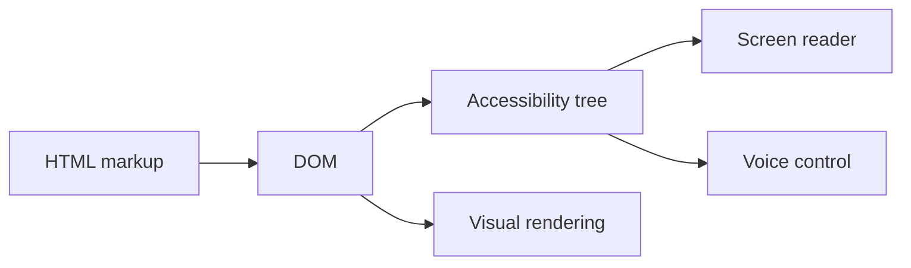

# What are HTML5 semantic elements and accessibility basics

---

## 🟢 Junior Level

**Semantic HTML** means choosing elements by their *meaning* (`<nav>`, `<main>`, `<article>`, `<button>`) instead of by their look (`<div>` and `<span>` everywhere). Browsers, search engines and assistive technologies (screen readers, voice control) read that meaning to build the **accessibility tree** — the structure that blind or keyboard-only users actually navigate.

### Simple Real-World Analogy
Think of a book with a table of contents, chapter titles and page numbers versus a book where every page is just plain text with big fonts. Both *look* similar, but only the first can be navigated by someone who cannot see the page. Semantic tags are the chapter titles; `<div>` is plain text.

### Main semantic elements

| Element | Purpose |
|---|---|
| `<header>` | Introductory content of a page or section (logo, title) |
| `<nav>` | Major navigation links |
| `<main>` | The unique main content (only one visible per page) |
| `<section>` | Thematic group with a heading |
| `<article>` | Self-contained piece (blog post, card, comment) |
| `<aside>` | Tangential content (sidebar) |
| `<footer>` | Footer of page or section |
| `<figure>` / `<figcaption>` | Media with a caption |
| `<button>` / `<a>` | Actions vs. navigation |

### Minimal example

```html
<!DOCTYPE html>
<html lang="en">
<head>
  <meta charset="utf-8">
  <meta name="viewport" content="width=device-width, initial-scale=1">
  <title>Orders dashboard</title>
</head>
<body>
  <header>
    <h1>Orders</h1>
    <nav aria-label="Primary">
      <a href="/orders">Orders</a>
      <a href="/customers">Customers</a>
    </nav>
  </header>

  <main>
    <article>
      <h2>Order #1042</h2>
      <p>Status: <strong>Shipped</strong></p>
      <button type="button">Cancel order</button>
    </article>
  </main>

  <footer><small>&copy; 2026 Shop Inc.</small></footer>
</body>
</html>
```

### Accessibility basics every developer must know
1. **Use real buttons and links.** `<button>` gives focus, Enter/Space activation and the correct role for free.
2. **Every image needs `alt`** (empty `alt=""` for decorative images).
3. **Every form control needs a label** (`<label for="id">`).
4. **Headings form an outline**: one `<h1>`, then `h2`, `h3` without skipping levels.
5. **Set `lang` on `<html>`** so screen readers pick the right pronunciation.
6. **Color contrast** at least 4.5:1 for normal text (WCAG AA).



---

## 🟡 Middle Level

### How the accessibility tree is built
The browser derives for each DOM node a **role** (button, link, heading), a **name** (label text), a **state** (expanded, checked, disabled) and a **value**. Native elements provide all four. A `<div onclick>` provides none of them — it is not focusable, has no role, and does not react to the keyboard.

```html
<!-- Anti-pattern: looks like a button, is not one -->
<div class="btn" onclick="save()">Save</div>

<!-- Correct -->
<button type="button" class="btn" onclick="save()">Save</button>
```

### ARIA: the "first rule of ARIA"
> If you can use a native HTML element with the semantics you need, do that instead of adding ARIA.

ARIA (`role`, `aria-*`) only changes what assistive tech *hears*; it adds **no behavior**. When you must build a custom widget (tabs, combobox, modal), you own keyboard handling and focus management.

```html
<button aria-expanded="false" aria-controls="menu1" id="menuBtn">Menu</button>
<ul id="menu1" hidden>
  <li><a href="/profile">Profile</a></li>
</ul>

<script>
  const btn = document.getElementById('menuBtn');
  const menu = document.getElementById('menu1');
  btn.addEventListener('click', () => {
    const open = btn.getAttribute('aria-expanded') === 'true';
    btn.setAttribute('aria-expanded', String(!open));
    menu.hidden = open;
  });
</script>
```

### Forms done right

```html
<form novalidate>
  <label for="email">Email</label>
  <input id="email" name="email" type="email" autocomplete="email"
         required aria-describedby="email-err">
  <p id="email-err" role="alert" hidden>Please enter a valid email.</p>

  <fieldset>
    <legend>Notification channel</legend>
    <label><input type="radio" name="ch" value="mail"> Email</label>
    <label><input type="radio" name="ch" value="sms"> SMS</label>
  </fieldset>
  <button type="submit">Subscribe</button>
</form>
```

Choosing the right `type` (`email`, `tel`, `number`, `date`) also summons the correct mobile keyboard and gives free built-in validation.

### Common mistakes
| Mistake | Consequence | Fix |
|---|---|---|
| `outline: none` without replacement | Keyboard users lose focus indicator | Style `:focus-visible` instead |
| Placeholder as label | Disappears while typing, low contrast | Real `<label>` |
| Click handlers on `div`/`span` | No keyboard/screen reader support | `<button>` |
| `<br>` for spacing | Meaningless line breaks read aloud | CSS margins |
| Positive `tabindex` values | Breaks natural tab order | Use `0` or `-1` only |
| Icon-only button with no name | Announced as just "button" | `aria-label="Close"` |

### Landmarks and skip links
Screen reader users jump between landmarks (`header`, `nav`, `main`, `footer`). A "skip to content" link saves keyboard users from tabbing through the whole menu:

```html
<a class="skip-link" href="#main">Skip to main content</a>
<main id="main" tabindex="-1">...</main>
```

```css
.skip-link { position: absolute; left: -9999px; }
.skip-link:focus { left: 1rem; top: 1rem; background: #fff; padding: .5rem; }
```

---

## 🔴 Senior Level

### Accessibility as an engineering concern, not a polish step
Legal pressure is real: the European Accessibility Act (applicable since June 2025), ADA litigation in the US and public-sector regulations make WCAG 2.2 AA a common contractual requirement. A senior engineer builds it into the design system and CI rather than auditing at the end.

### Focus management in SPAs
In a server-rendered site a page navigation resets focus and the screen reader announces the new title. In a SPA the URL changes but nothing is announced. You must manage it:

```ts
// Called after each client-side route change
export function announceRouteChange(title: string) {
  document.title = title;
  const h1 = document.querySelector<HTMLElement>('h1');
  if (h1) {
    h1.setAttribute('tabindex', '-1');
    h1.focus({ preventScroll: false });
  }
  const live = document.getElementById('route-announcer');
  if (live) live.textContent = `Navigated to ${title}`;
}
```
```html
<div id="route-announcer" aria-live="polite" class="visually-hidden"></div>
```

### Accessible modal dialog
Use the native `<dialog>` element: it traps focus (when opened with `showModal()`), supports `Esc`, makes the rest of the page inert and returns focus on close.

```html
<dialog id="confirm">
  <form method="dialog">
    <h2>Delete order?</h2>
    <button value="cancel">Cancel</button>
    <button value="ok">Delete</button>
  </form>
</dialog>
<script>
  document.getElementById('confirm').showModal();
</script>
```

### Automated + manual testing pipeline
- **Lint**: `eslint-plugin-jsx-a11y` (React) or `@angular-eslint/template` accessibility rules.
- **Unit/component**: query by role in Testing Library (`getByRole('button', {name: /save/i})`) — if it fails, a screen reader probably fails too.
- **E2E**: `@axe-core/playwright` scans pages for WCAG violations.
- **Manual**: keyboard-only pass, NVDA/VoiceOver pass, 200% zoom and `prefers-reduced-motion` check. Automation catches roughly 30–40% of issues only.

```ts
import { test, expect } from '@playwright/test';
import AxeBuilder from '@axe-core/playwright';

test('orders page has no detectable a11y violations', async ({ page }) => {
  await page.goto('/orders');
  const results = await new AxeBuilder({ page }).withTags(['wcag2a', 'wcag2aa', 'wcag22aa']).analyze();
  expect(results.violations).toEqual([]);
});
```

### Edge cases and nuances
- `display:none` and `hidden` remove content from the accessibility tree; `visibility:hidden` too; a "visually hidden" utility class (clip rect) keeps it for screen readers only.
- `aria-live` regions must exist in the DOM *before* content changes to be announced reliably.
- `prefers-reduced-motion`, `prefers-color-scheme` and `forced-colors` media queries are part of inclusive design.
- Semantic HTML also helps SEO and Reader Mode, and server-rendered semantic markup (Thymeleaf templates) is accessible without any JavaScript.
- Tables: use `<th scope>` and `<caption>`; never use tables for layout.

---

## 🎯 Interview Cheat Sheet

**30-second pitch:** Semantic HTML conveys meaning, so browsers and assistive tech build a correct accessibility tree. Prefer native elements (`button`, `nav`, `label`), use ARIA only to fill gaps, keep keyboard operability and focus visible, and test with axe plus a manual keyboard/screen-reader pass.

**Must-know bullets**
- `<div>` and `<span>` have no semantics; `<button>` gives role, focus and keyboard for free.
- One `<main>`, logical heading order, `lang` on `<html>`.
- Every image `alt`, every input `label`.
- ARIA adds semantics, never behavior.
- WCAG 2.2 AA: contrast 4.5:1, focus visible, target size, keyboard access.
- SPAs must manage focus and announce route changes.

**Common follow-up questions**
1. What is the difference between `<section>` and `<article>`?
2. When is `role="button"` on a div acceptable? (Almost never.)
3. How do you test accessibility in CI?
4. What does `aria-live` do and when do you use `assertive`?

**Red flags**
- "Accessibility is for later / only for blind users."
- Removing the focus outline globally.
- Using ARIA to patch a bad div soup instead of fixing the markup.

**Related topics**
- [How do the CSS box model and specificity work](02.%20How%20do%20the%20CSS%20box%20model%20and%20specificity%20work.md)
- [What is the DOM and event delegation](10.%20What%20is%20the%20DOM%20and%20event%20delegation.md)
- [How to test the frontend](18.%20How%20to%20test%20the%20frontend.md)
- [What are Java UI alternatives Thymeleaf Vaadin and HTMX](19.%20What%20are%20Java%20UI%20alternatives%20Thymeleaf%20Vaadin%20and%20HTMX.md)
