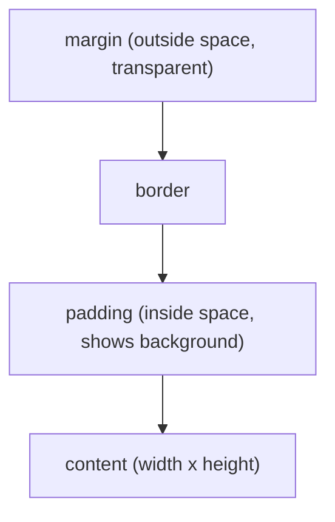

# How do the CSS box model and specificity work

---

## 🟢 Junior Level

**CSS** (Cascading Style Sheets) describes how HTML elements look. Two ideas explain most "why is my style not working" problems:

1. **The box model** — every element is a rectangle made of *content*, *padding*, *border* and *margin*.
2. **Specificity and the cascade** — when several rules target the same element, the browser picks a winner by a defined algorithm.

### Simple Real-World Analogy
A framed picture on a wall: the **picture** is the content, the **mat** around it is padding, the **frame** is the border and the **gap to the next picture** is the margin. For specificity, imagine rule books: a company-wide policy (element selector) is overridden by a department rule (class), which is overridden by a note signed by your manager (ID), which is overridden by an emergency order (`!important`).



### Minimal example

```html
<div class="card">Hello</div>
```
```css
.card {
  width: 200px;
  padding: 20px;
  border: 5px solid #333;
  margin: 10px;
}
```

With the default `box-sizing: content-box` the rendered width is `200 + 2*20 + 2*5 = 250px`. With `box-sizing: border-box` the declared `width` includes padding and border, so the box stays 200px. Almost every modern project starts with:

```css
*, *::before, *::after { box-sizing: border-box; }
```

### Selector basics
| Selector | Example | Targets |
|---|---|---|
| Type | `p` | all paragraphs |
| Class | `.btn` | elements with `class="btn"` |
| ID | `#header` | the element with that id |
| Descendant | `nav a` | links inside nav |
| Child | `ul > li` | direct children only |
| Pseudo-class | `a:hover` | state-based |

---

## 🟡 Middle Level

### The cascade: three questions in order
The browser resolves conflicts by (simplified) ordering:
1. **Origin and importance** — user-agent < author < `!important` author < user `!important`; also `@layer` order.
2. **Specificity** — a tuple `(ID, CLASS, TYPE)`.
3. **Source order** — the later declaration wins.

### Calculating specificity

| Selector | (ID, Class/attr/pseudo-class, Type/pseudo-element) |
|---|---|
| `p` | 0,0,1 |
| `.btn` | 0,1,0 |
| `nav a.active` | 0,1,2 |
| `#hdr .btn:hover` | 1,2,0 |
| inline `style=""` | beats all selectors |
| `:where(.a .b)` | 0,0,0 (always zero) |
| `:is(.a, #b)` | takes the most specific argument |

The tuple is compared left to right; **10 classes never beat 1 ID**.

```css
a            { color: black; }   /* 0,0,1 */
.nav a       { color: blue;  }   /* 0,1,1 */
a.active     { color: red;   }   /* 0,1,1 -> wins by being later */
```

### Margin collapsing and other box-model traps
- Vertical margins of adjacent block siblings **collapse** into the larger one (not the sum). Flex and grid items do not collapse.
- Percent `padding`/`margin` are relative to the containing block's **width**, even vertically.
- `display: inline` ignores `width`/`height` and vertical margins; use `inline-block` or flex.
- `overflow: hidden` creates a new block formatting context (BFC), which stops margin collapse and contains floats.

### Cascade layers and modern organization
`@layer` lets you control order independent of specificity — great for taming third-party CSS:

```css
@layer reset, vendor, components, utilities;

@layer vendor     { .btn { background: gray; } }
@layer components { .btn { background: royalblue; } }  /* wins: later layer */
```

Unlayered styles beat any layered styles (for normal declarations).

### CSS custom properties and nesting (baseline since 2023)

```css
:root { --brand: #0b5fff; --radius: 8px; }

.card {
  border-radius: var(--radius);
  border: 1px solid color-mix(in srgb, var(--brand) 40%, white);

  &:hover { box-shadow: 0 2px 8px rgb(0 0 0 / .2); }
  & h2 { margin-block: 0 .5rem; }
}
```

### Common mistakes
| Mistake | Fix |
|---|---|
| Reaching for `!important` | Reduce selector weight, use layers or reorder |
| Over-qualified selectors `div.main ul li a` | Use a single class (BEM or utility style) |
| Styling by ID | IDs are for anchors/ARIA; use classes |
| Fixed pixel heights for text containers | `min-height`, `padding`, or let content size it |
| Forgetting `box-sizing` reset | Global border-box reset |

---

## 🔴 Senior Level

### Rendering pipeline and why it matters
Style recalculation → layout (reflow) → paint → composite. Changing `width`, `margin` or `top` triggers **layout**; `background-color` only **paint**; `transform` and `opacity` can be handled on the compositor (GPU) only. Animate transform/opacity, not layout properties.

```css
.drawer { transform: translateX(-100%); transition: transform .25s ease; will-change: transform; }
.drawer.open { transform: translateX(0); }
```

Use `will-change` sparingly: each promoted layer consumes GPU memory.

### Scaling CSS in large codebases
| Approach | Pros | Cons |
|---|---|---|
| BEM + plain CSS | Predictable, no tooling | Verbose, discipline needed |
| CSS Modules | Local scope, zero runtime | Composition across files awkward |
| Utility-first (Tailwind) | Tiny CSS, consistent tokens | Verbose markup, learning curve |
| CSS-in-JS runtime (styled-components) | Dynamic props | Runtime cost, SSR complexity; fading in React 18+ server components |
| Design tokens + custom properties | Theming, dark mode | Needs governance |

### Containment, performance and `content-visibility`

```css
.feed-item {
  contain: layout paint style;
  content-visibility: auto;            /* skip rendering off-screen items */
  contain-intrinsic-size: auto 300px;  /* avoid scrollbar jumps */
}
```

Large DOMs (>1500 nodes), deep selectors and layout thrashing (reading `offsetHeight` right after a write in JS) are the usual culprits of janky pages.

```js
// Layout thrash: forces a synchronous reflow on each iteration
items.forEach(el => { el.style.width = el.parentNode.offsetWidth + 'px'; });

// Batch: read first, then write
const w = items[0].parentNode.offsetWidth;
items.forEach(el => { el.style.width = w + 'px'; });
```

### Debugging specificity in production
Open DevTools → Elements → Computed/Styles: crossed-out declarations show the loser; "Layers" and "Cascade" panes show the origin. For legacy sites, use `:where()` to write low-weight defaults in your own library so consumers can override without `!important`.

### Edge cases
- `:has()` (the "parent selector") is supported by all evergreen browsers, but expensive broad selectors like `body:has(.x)` can hurt style recalculation.
- Container queries (`@container`) make components responsive to their parent rather than the viewport — see [How do Flexbox Grid and responsive design work](03.%20How%20do%20Flexbox%20Grid%20and%20responsive%20design%20work.md).
- Shadow DOM isolates styles; only inherited properties and custom properties cross the boundary, which is how Web Components are themed.
- Inheritance: `color`, `font-*`, `line-height` inherit; `margin`, `border`, `background` do not.

---

## 🎯 Interview Cheat Sheet

**30-second pitch:** Every element is a box (content, padding, border, margin); use `border-box` so sizes are predictable. Conflicts are resolved by origin/importance, then specificity (ID, class, type), then source order. Prefer low-specificity single-class selectors, `@layer` for third-party control, and animate only `transform`/`opacity`.

**Must-know bullets**
- `content-box` vs `border-box` width math.
- Specificity tuple; inline beats selectors; `!important` is a last resort.
- Margin collapsing happens only for vertical block margins.
- `@layer`, `:where()`, custom properties, nesting are modern tools.
- Layout > paint > composite cost ordering.

**Common follow-up questions**
1. What's the specificity of `#a .b p:hover`? (1,2,1)
2. Why does my `margin-top` on a child push the parent down?
3. How do you override a third-party library's CSS cleanly?
4. `rem` vs `em` vs `px`?

**Red flags**
- Sprinkling `!important` everywhere.
- Not knowing what `box-sizing` does.
- Animating `top/left/width` for performance-critical UI.

**Related topics**
- [What are HTML5 semantic elements and accessibility basics](01.%20What%20are%20HTML5%20semantic%20elements%20and%20accessibility%20basics.md)
- [How do Flexbox Grid and responsive design work](03.%20How%20do%20Flexbox%20Grid%20and%20responsive%20design%20work.md)
- [How to optimize web performance](16.%20How%20to%20optimize%20web%20performance.md)
